# PHASE 01 — SaaS Foundation (Architecture, CP Database Schema, Identity, Routing, Roles)

| Item | Value |
|---|---|
| Master architecture | [SAAS_ARCHITECTURE_MASTER.md](SAAS_ARCHITECTURE_MASTER.md) |
| Phase type | **Design and approval gate.** It produces no code. It must be completed, reviewed and **explicitly approved by the project owner** before any later phase starts. |
| Depends on | — |
| Enables | Every later phase (PHASE_02 … PHASE_14) |
| Status | **APPROVED** (S0-1 DONE, 2026-10-03): the design is documented (this document, version 1.6, 2026-10-03: v1.0 foundation; v1.1 commercial, billing, payment, discount and email design; v1.2 current vs future scope; **v1.3 decision register §0: strict per-module DB and bucket isolation, shared environment DB credentials, a Keycloak realm per company, full payment only, user mailbox authorization**; **v1.4 final review: CD-11 company roles in the company realm (Q-50 closed); **v1.5 final decision review: CD-12..CD-22**; **v1.6: CD-23 email channels, CD-24 delegated decisions; v1.7: CD-25 configurable tax and invoicing; only tax/legal questions Q-42, Q-29, Q-04 (tax) remain open**). **Owner approval DONE** (S0-1, gate G0, 2026-10-03). Still open: S0-2, S0-10, S0-12 (PROPOSAL only) open; S0-4, S0-5 pending; PHASE_02 LOCKED until S0-4 and S0-5 are DONE. |
| Evidence basis | Local code inspection on 2026-10-02 (`CODE-INSPECTED`). The current CP schema was extracted from `CONTROL-PANEL-SERVICE/src/main/resources/db/changelog/platform/*.xml`. Tests were **not** executed for this design. Statements taken only from the old documents are marked `DOC-REPORTED`. |

---

## 0. Decision register (clarified business requirements, 2026-10-03)

This register is **authoritative**. Where any other section of this folder still disagrees with it, this register wins and that section must be corrected.

Marks:
- **CONFIRMED DECISION**: a business requirement stated by the owner.
- **OPEN QUESTION**: needs an owner decision.
- **FUTURE CAPABILITY**: designed now, not implemented in R1.
- **IMPLEMENTATION IMPACT**: what the decision means for the code.

### 0.1 Confirmed decisions

| ID | CONFIRMED DECISION | Existing code support (`CODE-INSPECTED`) | IMPLEMENTATION IMPACT |
|---|---|---|---|
| CD-01 | **Strict company isolation.** Every company gets **its own database per purchased module** and **its own storage bucket per purchased module** (e.g. Company A: CRM DB + CRM bucket, HRMS DB + HRMS bucket; Company B: its own CRM DB + CRM bucket, …). No database or bucket is ever shared between companies. | **Partly supported.** Provisioning already creates `org_<id>_<module>_db` (**LEGACY** prefix; target `cmp_<n>_<module>_db`, CD-26) per organization, but for **all 16 modules**, regardless of purchase (`TenantProvisioningService`, `tenant.provisioning.modules`). Bucket naming `org-<id>-<module>-bucket` already exists (`TenantResourceNaming.bucketName`, `PropertyBasedBucketResolver`; **LEGACY** prefix, target `cmp-<n>-<module>-bucket`, CD-26), but buckets are created **lazily** on first upload, are **not registered**, and are checked by **prefix** only. | Provision only the **purchased** modules (PHASE_08). Create each module bucket **at provisioning** and register it per (company, module) (PHASE_08/09). Exact-match bucket check (PHASE_09). **Reverses** the v2–v4 "one bucket per company" design (AD-04). |
| CD-02 | **One login = one company.** A user account belongs to exactly one company. There is no company switching or linking. The company context comes from the authenticated identity (token) and is enforced by the backend. | Memberships are already unique per identity (`tbl_customer_user` / `tbl_organization_user`, UQ `identity_id`). At decision time the gateway still supported multi-group selection through `Active-Org` (`OrganizationSelection`); removed in P02-T11 stage D (2026-10-05), the company comes from the verified `tenant_id` claim only. | Remove `Active-Org` multi-company selection (PHASE_03). With a realm per company (CD-06), each account exists in exactly one company realm, so the company is derived from the token issuer **and** the `tenant_id` claim (§6.6). |
| CD-03 | **Database credentials are environment-level infrastructure configuration.** DB host or IP, port, username and password come from the environment. The **same** configured credentials connect to every company database. **No MySQL user is created per company.** The company database is selected dynamically through the Control Panel registry: company → module → database name and connection metadata → bucket metadata. | **Supported.** `EnvironmentTenantCredentialProvider` (shared `DB_USER`/`DB_PASSWORD`/`DB_HOST`/`DB_PORT`), the `tbl_organization_database` registry (db name, host, port) and `DynamicRoutingDataSource` already work this way. | **Reverses** the v2–v4 design: per-company DB users (`t_<n>_app` / `t_<n>_ddl`), `tbl_company_db_credential`, the credential API, the `CREATE_DB_ACCOUNTS` / `GRANT_PRIVILEGES` / `ROTATE_CREDENTIALS` steps and `ControlPlaneTenantCredentialProvider` are **removed** (AD-05 withdrawn). Isolation relies on the compensating controls in §6.1.4. |
| CD-04 | **The Platform Super Admin is created manually by the platform operator.** Company administrators (Company Super Admin, Company Admin) can **never** create, invite or elevate a Platform Super Admin. No company-facing API can assign a platform role. | Platform roles are realm roles assigned by an operator. No code grants `PLATFORM_*` roles. Company APIs do not touch platform roles (`CODE-INSPECTED`). | Kept as an explicit security rule. Bootstrap by an operator procedure (§6.5.5). Platform Admins (not Super Admins) are created by a Platform Super Admin only. |
| CD-05 | **New production database architecture.** Production uses the **new** Control Plane database and company-specific, module-specific databases, provisioned by the new platform. The existing production database is **not** the target architecture. Existing production and reference data is **not deleted or modified** during the architecture and documentation phases. Importing existing data is a **future, controlled** activity. | The new CP schema does not exist yet (PHASE_02). The legacy production DBs live on protected hosts and are never touched by this project. | New CP baseline (PHASE_02). Company DBs are created by provisioning (PHASE_08). Shivam's data import follows the controlled plan of §6.8, executed in PHASE_12, with **owner-run** exports only. |
| CD-06 | **A Keycloak realm per company.** Every company gets its **own realm** (users, roles, clients, configuration). Platform staff use a separate **platform realm**. One shared realm for all companies is **not** used. | **Partly supported.** The gateway already resolves tokens from more than one issuer (`RealmIssuers`, a staff and a customer realm, static). The identity-sync outbox creates users and groups through the admin API in **one** realm. Everything assumes the single realm `ERPSystem`. | **Reverses** AD-06/AD-16 (single realm). Realm provisioning automation, a realm registry, dynamic issuer validation (gateway and services), realm-aware identity sync, a login realm-discovery step, per-realm lifecycle, backup, monitoring and upgrades (§6.5). |
| CD-07 | **Full payment only.** A subscription is activated **only after 100 % of the order amount is confirmed paid.** There is **no partial-payment activation.** Payment may be manual: cash, cheque, UPI, bank transfer, other approved methods. The Platform Super Admin records and confirms it. Non-immediate methods (e.g. cheque) wait in a verification state and count only once verified. **Renewal** after expiry is processed manually by the Platform Super Admin. Online and automatic payment are future. | No billing code exists (unused stubs). | **Reverses** the v4 partial-payment design: the activation rules MINIMUM_PAYMENT / ADMIN_APPROVAL, PARTIALLY_PAID, partial allocations and credit-term activation are **removed** (AD-25 withdrawn). See §6.9. **Exception (CD-36 item 3, PO-1 (a)):** audited manual grants / allowance overrides for the owner's internal Product Owner / testing Company only — never for customer companies. |
| CD-08 | **The target email architecture is user mailbox authorization.** An ERP user may connect **their own** mailbox through the provider's OAuth (Google / Google Workspace, Microsoft 365 / Outlook, Zoho; others later). The ERP **never asks for the user's mailbox password** in the OAuth flow. It stores the authorization securely (secret references), refreshes and revokes tokens, supports reconnect, and sends **from the user's own mailbox** when that user triggers an email. One global SMTP account for all mail is **not** the target. | Today all services send through one global, env-configured Gmail SMTP sender (`CODE-INSPECTED`). No OAuth exists. | Future PHASE_13. Refined by **CD-23**: business email only from the user's own verified OAuth mailbox (no shared mailbox, no fallback, no generic SMTP); platform email from one static platform mailbox (R1). The interim global sender stays for the first company only (§6.10.5). |
| CD-09 | Shivam is the first company and uses the **standard** company flow. There is no Shivam-specific architecture. | — | Unchanged — **order superseded by CD-34 (2026-10-10):** the Product Owner Company is first, Shivam is deferred; the standard-flow rule stays |
| CD-10 | R1 = the admin panel only. The website, digital payments, catalog discounts and email OAuth are **future**, with the schema prepared. | — | Unchanged (§1.1) |
| CD-11 | **Company user roles live in the company's Keycloak realm** (closes Q-50, owner decision of 2026-10-03). The company realm is authoritative for company user identity **and** actual role assignment. Platform roles live only in the platform realm. The Control Plane holds platform configuration, the company registry, subscriptions, entitlements and the role → permission **policy** (Q-54), never who holds which role. The microservices enforce authorization at runtime. **Role ≠ entitlement:** an operation needs a role with the permission **and** an entitled module. | Legacy services already read business roles from Keycloak tokens (client roles in `resource_access`: CRM `CrmDataAccessAuthority`, ACCOUNT-BOOK `KeycloakAccountBookRolesConverter`, CP `JwtRoleExtractor`), in one realm. The CP business-RBAC tables (`tbl_business_role*`, `tbl_organization_user_business_role`) exist but are not enforced. | Reverses the Q-50 recommendation (CP RBAC authoritative). Removes `tbl_company_user_role`, `tbl_platform_admin_role` and `tbl_company_user_module_access`. Predefined company roles come from the realm template. Role assignment through the realm admin API. Runtime permission = token roles + CP policy + entitlement (§6.7). |
| CD-12 | **Role → permission policy in the Control Plane** (closes Q-54). **Keycloak Role Assignment** ("John has `CRM_MANAGER`") lives in the company realm. **CP Permission Policy** ("`CRM_MANAGER` may VIEW, CREATE and UPDATE CRM customers") lives in the CP. **Runtime Authorization** is enforced by the gateway and the microservices. The CP stores role-definition metadata, permission definitions, role → module and role → permission mappings, the policy version and audit metadata. It **never** stores user → role. | CP business-RBAC tables exist (definitions, seeder); no enforcement (`CODE-INSPECTED`) | `tbl_role` (definitions) + `tbl_permission` + `tbl_role_permission` + `tbl_role.policy_version`; `TENANT_ROLE_PERMS` cache; `PermissionEvaluator` (§6.7) |
| CD-13 | **Company administrators manage users and roles only through the ERP Company Admin UI** (closes Q-55). The ERP backend is the controlled bridge to Keycloak: authorization → company policy check (seats, escalation, entitlement) → Keycloak Admin API (backend service account) → company realm. Company administrators **never** get Keycloak Admin Console access. | Identity-sync outbox and admin client exist for one realm | Company admin APIs (PHASE_10); realm-aware admin client; seat and escalation guards in the backend (§6.7.5) |
| CD-14 | **Company business roles are Keycloak realm roles** (closes Q-56). Each business role is defined **once** per company realm (`COMPANY_SUPER_ADMIN`, `COMPANY_ADMIN`, `CRM_MANAGER`, `CRM_USER`, `CUSTOM_…`). They reach the token through the built-in `roles` client scope (`realm_access.roles`). **No duplicate client roles** per client; client roles only for a concrete, application-specific technical need. The legacy `resource_access` usage does not shape the target. | Legacy services read client roles (`resource_access`); HRMS/PAYROLL already read `realm_access.roles` (`CODE-INSPECTED`) | Realm template roles and conventions (§6.5.9); COMMON role extraction from `realm_access.roles` of the verified token; legacy role migration (PHASE_10/11) |
| CD-15 | **Company Login Code for login discovery** (closes Q-46). The user enters the company's login code (e.g. `ABCMFG01`); the ERP discovery API resolves it through the CP registry to the ACTIVE company realm and redirects to that realm's authorization endpoint. Subdomains and a broker realm are **future** enhancements, not R1. | None | `tbl_company.login_code`; public discovery API (§6.5.11) |
| CD-16 | **Shivam uses the standard provisioning flow with a new standard company realm** (closes Q-47). There is no Shivam-specific provisioning code. Three activities stay **separate**: (A) standard company provisioning, (B) legacy identity migration from `ERPSystem` into Shivam's new realm, (C) legacy business-data export/import. `ERPSystem` is not part of the target architecture. | Shivam users live in `ERPSystem` today | §6.8.0; identity migration tool and runbook (PHASE_11/12) |
| CD-17 | **Dedicated realm-provisioning service account** (closes Q-48). The Control Plane's Realm Provisioning Service uses a dedicated, minimum-privilege Keycloak service account through the Admin API. Platform Admins never receive master or platform realm admin credentials; no admin credential is in any frontend. The **platform realm is named `erp-platform`**. | Admin client exists (one configured realm) | §6.5.10; provisioning operations `CREATE_REALM`, `ENABLE_REALM`, `DISABLE_REALM`, `APPLY_REALM_TEMPLATE`, `CREATE_STANDARD_ROLES`, `CONFIGURE_CLIENTS`, `REGISTER_REALM`, `RECONCILE_REALM` |
| CD-18 | **Initial capacity planning target: 50 companies** (closes Q-49 for R1). It is a planning target, not a hard limit; growth beyond it requires capacity validation. | — | Sizing of Keycloak (51 realms), DB pools, buckets, provisioning, backup, monitoring, jobs, load tests (§6.5.13) |
| CD-19 | **Keycloak identity emails use a central platform transactional SMTP** (closes Q-53 for R1). Every realm template applies the platform-owned sender and domain; companies configure nothing. Keycloak identity email ≠ ERP business email (CD-08). Company-specific SMTP for Keycloak is future. | Each realm has its own SMTP setting | Realm template email settings, SMTP secret through the Keycloak vault (§6.5.12) |
| CD-20 | **Several verified instruments may make up 100 %** (closes Q-45). Activation only when the sum of **verified** payments equals the order total (`confirmed_amount >= grand_total`, with recording capped at the outstanding amount). Unverified cheque, DD or transfer amounts do not count. This is **not** partial-payment activation. | No billing code | `tbl_payment` rows per instrument; order `confirmed_amount` / `outstanding_amount` (§6.9.2) |
| CD-21 | **No mandatory two-person payment rule in R1** (closes Q-31). Authorized platform users record and verify payments according to their platform permissions; every step is audited. A maker-checker policy may be added later. | — | No `TWO_PERSON_RULE` check; `approved_by_identity_id` optional |
| CD-22 | **Expiry grace period = 0 days in R1** (closes Q-07 for R1). ACTIVE → EXPIRED at `end_date`; warnings 7 days and 1 day before; renewal stays manual. A configurable grace period is future. | — | Scheduler warnings and expiry; no PAST_DUE in R1 (PHASE_06) |
| CD-23 | **Email channels** (owner decision; closes Q-51, Q-52, Q-44). **Platform email** (subscription, billing, invoices, renewal and expiry notices, onboarding, invitations, Keycloak identity emails) is sent from **one single static platform mailbox** over SMTP with an app password held in the secret store; it is **R1**. **Business email** of company users is sent **only from the user's own mailbox, connected by OAuth and verified** (address = the user's own ERP account email). **If the user's mailbox is not connected and verified, the business email is not sent**: there is no company shared mailbox, no platform fallback and no generic SMTP. | One global Gmail SMTP sender in six services (`CODE-INSPECTED`); no platform mail component in the CP | R1: platform mail sender in the CP + `tbl_platform_email_message*`; PHASE_13: user OAuth connections only (§6.10.3). Group J reduced to USER and PLATFORM owners. |
| CD-24 | **Decisions taken by the agent under the owner's delegation** (2026-10-03: "for other decision you decide the best"). Listed with their decision in §0.2; the owner may override any of them. | — | Closes Q-06, Q-08, Q-09, Q-10, Q-11, Q-12, Q-14, Q-15, Q-17, Q-18, Q-19, Q-20, Q-21, Q-23, Q-26 (Keycloak version — superseded by CD-30, 2026-10-05), Q-27, Q-28, Q-32, Q-33, Q-34, Q-35, Q-38, Q-39, Q-40, Q-41, and the non-tax parts of Q-04 |
| CD-25 | **Configurable tax and invoicing** (owner instruction: keep Q-42, Q-29 and Q-04 tax PENDING, make them dynamic, do not hold the work). The invoice trigger, seller data, GST rules, rounding and numbering are **effective-dated, versioned configuration** approved by the Platform Super Admin with the CA's reference; no code change when the CA answers. Production quoting is gated until the configuration is APPROVED; all development continues. | `tbl_tax_rule`, `tbl_seller_entity`, `tbl_document_series` designed; PHASE_05 had a "tax not configured" override | New `tbl_billing_policy`; versioning and approval columns; both invoice-timing paths; `EInvoiceProvider` SPI; go-live gate (§6.9.8) |
| CD-26 | **`CMP_<n>` is the single company identifier** (owner decision, 2026-10-03; terminology/naming consistency only, no business-logic change). It is the business id, the runtime tenant-context value, the `tenant_id` claim value, the Redis key suffix and the basis of resource names: `cmp_<n>_<module>_db`, `cmp-<n>-<module>-bucket`, `cmp-<n>-control-panel-bucket`; Redis `COMPANY_MODULES:<CMP_n>`. `ORG_<n>`, `ORG_MODULES` and the `org_` / `org-` prefixes are **LEGACY** (current code only) and are never used in the target. Legacy class and header **names** (`TenantContext.organizationId`, `X-Organization-Id`) may stay but carry the `CMP_<n>` value. *(Superseded 2026-10-04 by the owner directive P02-T11: the names were renamed as well — `TenantContext.companyCode`, header `X-Company-Code`; done in P02-T11 stages B and D, 2026-10-05.)* Supersedes AD-02 and the "not renamed" part of Q-21. | At decision time (2026-10-03) the CP allocated `"ORG_" + n`, `TenantResourceNaming` used `org_` / `org-` and the Redis key was `ORG_MODULES` (`CODE-INSPECTED`); all replaced by P02-T11 stages A–D (2026-10-04/05) | `tbl_company.tenant_key` removed (only `company_code`); prefix change in `TenantResourceNaming`; key constant rename in the gateway, COMMON and CP; gateway claim check `^CMP_[0-9]{1,8}$`; identity-sync id pattern; development `org_*` / `org-*` resources are LEGACY and not reused |
| CD-27 | **Control Plane schema management: Hibernate during development, one clean Liquibase baseline at the end** (owner decision, 2026-10-03). While the Company-based CP model is being built (PHASE_02..PHASE_11), `control_panel_db` is managed by Hibernate/JPA `ddl-auto: update` in local and development environments. **No CP Liquibase changelog is written during that time**: no early baseline, no per-phase CP changelogs, no temporary or `legacy` changelog layer, and no table or FK created only to satisfy Liquibase. When the CP model is complete and stable, a dedicated **final CP Liquibase phase** ([PHASE_11A](PHASE_11A_FINAL_CP_LIQUIBASE_BASELINE.md)) audits the final entities and the Hibernate-generated schema and writes **one clean, reviewable Liquibase baseline** of the final CP schema; Liquibase then becomes the only CP schema mechanism and Hibernate switches to `ddl-auto: validate`. Scope: the **Control Plane DB only**. Company (tenant) databases keep the Liquibase design of AD-09 (master §16.5, PHASE_02 tenant migrator); the attachment DB keeps its existing Liquibase changelog. | CP: `ddl-auto: update`, `spring.liquibase.enabled: false`, 26 generated changelogs of the old model (not run) (`CODE-INSPECTED`) | PHASE_02..PHASE_11 add and change CP **entities only**; their "changelog" tasks become entity/schema tasks. The column-level design of §6.2 stays the target and is implemented through the entity mappings (types, lengths, nullability, unique keys, indexes, FKs). DB CHECK constraints, seeds and named constraints are delivered in PHASE_11A. The old generated changelogs are retired in PHASE_11A. Production `control_panel_db` is created from the final baseline only. `ddl-auto: update` is never used against staging or production (gate G6, CD-28 item 10). |
| CD-28 | **Owner decisions on the implementation-plan questions** (owner, 2026-10-03; tracker S0-2 items 1 and 4, S0-10, S0-12..S0-17). (1) **Resource registry uniqueness:** unique (company, module, resource type) in `tbl_company_resource`; PLATFORM_CORE resources (attachment DB, notification DB, control-panel bucket) are registered consistently against their PLATFORM_CORE rows in `tbl_module`; `module_id` NULL only for IDP_REALM (gap fix S0-2 item 1 approved). (2) **Explicit audit columns** for important audit records: actor/user, action, entity/resource type, entity id, timestamp, and before/after values or metadata where applicable (gap fix S0-2 item 4 approved). (3) **`tbl_module`** is a functional PHASE_04 table (not a Liquibase-only table); P04-T6 runs as soon as the PHASE_02 foundation it needs (P02-T2) is ready (S0-10). (4) **`PlatformAdmin`** must exist before any platform-role or bootstrap operation that depends on it; PHASE_04 owns the entity and its integration with the bootstrap (S0-13). (5) **Platform roles** are seeded as inactive/default templates; activation and assignment are explicit and audited (S0-14). (6) **Seller entity and billing policy** belong to PHASE_05 (S0-15). (7) **Invoice PDFs and payment evidence** are stored in a dedicated, operator-controlled billing bucket, isolated from company business buckets (S0-16). (8) **Company Super Admin invitation** is generated only by the controlled provisioning workflow and is audited; no SMTP credential or secret is exposed (S0-17). (9) **Platform Super Admin bootstrap** refines CD-04: no permanent seeded username/password (never `admin/admin`); the initial credentials are supplied only through environment / secret configuration; the bootstrap creates the first Platform Super Admin in the platform realm `erp-platform` with a **forced password change at first login**, records the event in the audit log, and needs no company code (platform-level). (10) **PHASE_11A** (final CP Liquibase baseline) is a **mandatory readiness gate before staging/production readiness** (gate G6); it runs only after the schema-freeze approval (S0-11) and its other prerequisites (S0-12). CD-27 is unchanged. | — | PHASE_02 registry keys (T2); PHASE_04 audit columns (T9), early slices E-A / E-B, role seed (T2); PHASE_03 / PHASE_04 bootstrap (T2 / E-B); PHASE_05 owns `tbl_seller_entity` + `tbl_billing_policy`; PHASE_07 billing bucket; PHASE_08 invitation step; PHASE_11A / PHASE_12 gate G6 mandatory |
| CD-29 | **Owner decisions on P02-T6 / T7 / T8** (owner, 2026-10-04). (1) **Tenant no-drop allow-list:** MINING changeset `masters/changelog-type_of_material_master.xml#20260925-0001` (drops `type_of_material_master.account_book_sku`) is an approved historical exception in MINING's explicit `TenantChangelogNoDropTest` allow-list; every other drop outside a rollback stays forbidden. (2) **Liquibase guard:** a tenant database with existing tables but no valid Liquibase history is rejected with 409 `TENANT_DB_NOT_EMPTY`, even when it holds no rows; it is never auto-converted (the operator re-creates an empty one). (3) **Schema parity:** a column default that only the changelog sets is valid when the schema intentionally requires it. (4) **Local test MySQL:** integration tests use the existing MySQL on the owner's development machine `192.168.5.141` (no Docker MySQL image for this purpose); credentials only from environment/secret configuration, never in source code. (5) **Local test Redis** (owner, 2026-10-04): the loopback Docker `redis:7-alpine` on `127.0.0.1:16379` for the domain integration tests; no separate host Redis is installed. | `TenantDatabaseGuard`, `TenantChangelogNoDropAssert`, `SchemaParityAssert` (P02-T6..T8) | PHASE_02 §6.4, §11.4–5; MINING allow-list entry; IT runs with `-Dit.mysql.host=192.168.5.141 -Dit.mysql.allowed-host=192.168.5.141` and credentials from the environment |
| CD-30 | **Keycloak version = 25.0.6, fixed project standard** (owner decision, 2026-10-05; overrides the Q-26 entry decided under the delegation CD-24). The local development / test Keycloak and the live / production Keycloak both run **Keycloak 25.0.6**; no 26.x upgrade is planned or validated. Closes PHASE_03 D3-5 (Keycloak test image). | **Supported.** The company realm template (P03-T1), realm registry (P03-T3), invalidation (P03-T10), gateway issuers (P03-T5) and service token verification (P03-T6) were validated on the local Keycloak 25.0.6 on 2026-10-05 (gated local-Keycloak ITs, all PASS). The template needs the `basic` client scope, available since 25. | Every Keycloak-dependent design, test and runbook targets 25.0.6 (no version-specific 26.x feature). Live environment: pin the Keycloak hostname (exact `iss`). Not yet exercised on 25.0.6: vault-referenced SMTP password, signed-JWT client authentication (D3-10 open). |
| CD-31 | **Company-only tenancy** (owner decision, 2026-10-07, P02/P03 closure decision P02-4d; formalizes the owner directive behind P02-T11 "Remove the Organization / Customer tenancy architecture"). The company (`CMP_<n>`, `tbl_company`) is the only tenant: no Organization or Customer tenancy tier, no `ORG_<n>` / `org_` / `org-` identifiers, no `X-Organization-Id` / `Active-Org` headers, no `allow-legacy-organization-ids` flag. Remaining Organization wording is history or a recorded exception: log wording deferred to PHASE_11 (P02-4a), legacy `DataScope.ORGANIZATION` deferred to PHASE_10 (P02-4b), the test name `AttachmentPerOrgRoutingMySqlIT` / `it_routing_org101/102` kept unchanged as a documented exception (P02-4c). | **Supported.** Delivered by P02-T11 stages A–G (CMP-only naming, company context and headers, 36 CP organization / customer classes removed, gateway company context, cross-module architecture contract `CompanyTenancyArchitectureTest` in 22 modules, Keycloak through P03-T1/T3/T5/T6/T10). | New code and tests use company identifiers only; the architecture contract fails a reintroduced Organization tenancy element. Complements CD-26 (single company identifier). |
| CD-32 | **Owner decisions on the PHASE_05 implementation plan** (owner, 2026-10-07, after the read-only PHASE_05 readiness review; F5-1..F5-6). (1) **F5-1:** the PHASE_05 implementation plan is **approved** as the PHASE_05 implementation baseline (after the documentation-drift correction). (2) **F5-2 — S0-2 item 5 approved:** the versioned tax-configuration tables (`tbl_tax_rule`, `tbl_seller_entity`, `tbl_billing_policy`) get a nullable `approval_evidence_object_key`; the evidence file is stored in the operator-created platform billing bucket, following the S0-16 storage approach; no secrets or credentials in schema, documents or tests. (3) **F5-3:** P05-T7 (removal of `tbl_plan_entitlement` and the orphaned plan DTOs) is moved to PHASE_06 / P06-T8; PHASE_05 does not depend on PHASE_06. (4) **F5-4:** the initial bundle seed is the 4 bundles of master §11.3 plus the portal add-on, insert-if-missing; no other bundle. (5) **F5-5:** P05-T5 property-style tests use JUnit and the existing project tooling, and the engine purity rule uses the existing COMMON ASM scanner — no jqwik, no ArchUnit, no new test dependency without a later owner decision. (6) **F5-6:** new PHASE_05 platform-admin endpoints declare `@RequiresPlatformPermission` (v2 authorization model); runtime behaviour stays consistent with the approved v1 precedent (`PLATFORM_ACCESS_MODEL` v1, D-D (a)); acceptance verifies the v2 permission model. PHASE_05 stays LOCKED until an explicit unlock decision (F5-7 not yet). | **Supported by PHASE_04 (DONE):** catalog and `ModuleDependencyService` (P04-T6), seeded platform permissions `platform.plan.manage`, `platform.tax.manage`, `platform.catalog.read` / `.manage`, `platform.billing.read` (P04-T2), `@RequiresPlatformPermission` / `PlatformAccessResolverV2` (P04-T3); the COMMON scanner of the architecture rules (P03-T9 / P02-T11 stage E). | PHASE_05 plan preconditions 1–3 met (PHASE_04 DONE, S0-15, S0-2 item 5); tax values stay outside (CD-25, gate G2a). Closes S0-2 item 5 (items 2, 3, 6 stay open). |
| CD-33 | **PHASE_05 closure, PHASE_06 plan approval and unlock** (owner decision "OWNER DECISIONS — PHASE_05 CLOSURE / PHASE_06 UNLOCK", 2026-10-08, after the governance decision package A–I). (1) P05-T7 PENDING → **DEFERRED**, target PHASE_06 / P06-T8 (reason F5-3, CD-32). (2) The DEFERRED P05-T7 counts as closed (PHASE_02 precedent P02-6): **PHASE_05 DONE**, 6 / 7 (+ 1 DEFERRED). (3) The PHASE_06 implementation plan is **approved**, with docs-only drift corrections (stale `Organization*` names → `Company*`, the obsolete D6-3 dual-write risk closed); no code change. (4) **D6-1 (a):** P06-T3 uses the `PlatformNotificationRequested` / `PlatformNotifier` abstraction and does not implement the PHASE_07 email sender; P07-T11 later provides the email delivery. (5) **D6-2:** a NEW subscription may be created PENDING at order confirmation and becomes ACTIVE only after the required billing / payment fulfilment verification (a clarification, not a new rule). (6) **D6-3 closed / overtaken:** the `ORG_MODULES` → `COMPANY_MODULES` migration was done in P02-T11; no dual write. (7) **S0-2 item 3:** series code `SUBSCRIPTION`, format `SUB/{FY}/{SEQ:5}`, example `SUB/2026-27/00001`, FY reset yes, width 5; the P06-T2 `SubscriptionNumberAllocator` must use this series, no second format; the boundary between the PHASE_06 allocator and the later PHASE_07 `DocumentSeriesService` is documented in the P06-T1 / T2 readiness. (8) **PHASE_06 UNLOCKED** after recording; P06-T1 readiness review first, no implementation without explicit approval. | **Supported by PHASE_02–PHASE_05 (DONE):** company model, the P02-T11 key rename (`COMPANY_MODULES`, `CompanyContextFilter`), the module catalog (P04-T6), plans / prices / pricing engine (P05-T3 / T5); the legacy single-subscription code (`Subscription`, `PlatformSubscriptionService`, `ModuleEntitlementService`, `SubscriptionResolver`) is replaced by PHASE_06. No `tbl_document_series` entity exists yet. | PHASE_06 preconditions 1–3 met. The P06-T1 readiness review (2026-10-08) is NOT READY: entity-level decisions E6-1..E6-9 open (PHASE_06 plan §3a). Closes S0-2 item 3 (items 2 and 6 stay open). |
| CD-34 | **First-company order, legacy Ticket Service retirement and a future Support module** (owner instruction "Claude Master Task: Product Owner Testing Company, Legacy Ticket Service Removal, and SaaS Critical-Path Execution", 2026-10-10). (1) The owner's own permanent **Product Owner Company** (internal product development, integration testing, validation of all modules) is the **first company**, created through the standard company flow (`CMP_<n>`, own realm, own module databases and buckets, Super Admin by invitation); **all approved catalog modules are available to it for testing** — this applies only to that company, never automatically to customer companies; no special company identity, no separate provisioning flow, no bypass of authentication, isolation, authorization or the payment controls of other companies. How its modules are entitled without a paid order is **open** (PHASE_12 plan §8.10, PO-1) — no silent activation. (2) **Shivam's onboarding and legacy import are deferred**; CD-09 / CD-16 stay valid for Shivam (standard flow, `IMPORT_EXISTING_DATA`, separate identity migration and data import) except the order: Shivam is no longer the first company. (3) The **legacy `TICKETS-SERVICE` is retired from the active SaaS scope**: its source and exclusively owned files are to be archived under `_cleanup_review/` and its active references removed, **only after a separate execution authorization** (method and catalog handling open, PHASE_12 plan §8.10, TK-1..TK-6); no data migration of the retired service. (4) A **SaaS-native Support / Ticket module** is a separate future feature (scope in PHASE_12 plan §8.11; phase placement open, SP-1); not built now. | Standard company flow (PHASE_02–PHASE_04), manual grants and allowance overrides (P06-T4 / P06-T5) exist; realm provisioning, Super Admin invitation and login are not wired yet (PHASE_08 / PHASE_10). | Roadmap order: Product Owner Company first, Shivam later; the V1 register (PHASE_12 plan §8) is revised in §8.10; no task status changed by this decision. |
| CD-35 | **Backend first; every UI deliverable deferred to a final UI phase** (owner decision "Claude Master Prompt: Backend-First SaaS ERP Implementation — Defer All UI Work Until the Final Phase", 2026-10-10). (1) The SaaS backend architecture and its integrations (orders → manual payment verification → activation, lifecycle, entitlements, provisioning, company realm, Super Admin identity lifecycle, storage, security, module integration) are completed and validated first. (2) **Deferred to the final UI phase:** the Company Admin UI, the company login frontend (Company Login Code discovery, realm lookup, redirect, callback, session), ERP-wide frontend integration, Keycloak login-page theme / branding / redirects, UI styling and navigation; no temporary, incomplete or duplicate frontend. (3) The absence of a custom UI is **not a backend blocker**; interactive authentication tests use the **default Keycloak 25.0.6 login page** where the realm / client configuration supports it, otherwise automated API-level tests; the default page does not replace backend company discovery, realm selection, role assignment or company administration, which are implemented and tested on their own. (4) The final UI phase starts only after the backend readiness gates pass and gets its own plan (PHASE_12 plan §8.12). (5) The Product Owner Company stays first (CD-34), Shivam deferred; no Keycloak upgrade, no change to shared Keycloak environments. | Realm template v1 clients `erp-web` / `erp-portal` (public, standard flow + PKCE S256, no direct grants, redirect URIs `${ERP_REDIRECT_URIS}` / `${PORTAL_REDIRECT_URIS}`); local test realms with test-only clients (COMMON `LocalKeycloak`); ACCOUNT-BOOK `erp-ui` (legacy, `ERPSystem`) is not the target UI. | BD-9 resolved (UI deferred, not a backend blocker); the V1 / backend register is reordered (PHASE_12 plan §8.12); no task status changed by this decision. |
| CD-36 | **P06-T5 acceptance, P06-T6 runtime-publication decisions, Product Owner Company entitlement exception, governance preparation** (owner decisions "Proceed with the following owner decisions …", given 2026-10-10 — partly recorded that evening in the PHASE_06 phase document only — and recorded completely 2026-10-12). (1) **P06-T5 DONE**: the independent review (PASS WITH NON-BLOCKING FINDINGS) is accepted; the follow-up findings **M-1** (possible InnoDB gap-lock deadlock when two companies without allowance / usage rows insert them concurrently — before concurrent onboarding: pre-create the rows at company creation or retry on deadlock) and **T-1** (timing-dependent, vacuous post-expiry step of the override IT) are **retained as documented follow-ups**, not hidden or discarded (with N-1..N-4 and F5-1..F5-9). (2) **P06-T6 decisions T6-1..T6-10** (as recommended by the readiness review of 2026-10-10): the **master §7.1 company status codes** — DRAFT / PROVISIONING / PROVISIONING_FAILED / AWAITING_DATA_IMPORT → 503 `COMPANY_NOT_READY`, SUSPENDED → 403 `COMPANY_SUSPENDED`, DISABLED → 403 `COMPANY_DISABLED`, ARCHIVED and PURGE_APPROVED → 403 `COMPANY_ARCHIVED` (T6-1); the status is **validated on every company-scoped API route** before the entitlement check (business modules, CONTROL-PANEL company routes — a SUSPENDED company keeps read-only GET there, master §7.1 —, NOTIFICATION, WebSocket ticket issuance; platform routes and `/public/**` exempt) (T6-2); a missing `TENANT_STATUS` (or `COMPANY_MODULES`), an unknown value or Redis unavailable → **fail closed, 503 `ENTITLEMENT_UNAVAILABLE`**; the status is published at company creation (T6-3); blocking is **API-level only** — no Keycloak realm change; expired subscriptions stay 403 `MODULE_NOT_ENTITLED` (T6-4); the **resync covers every company and is on by default** (status of every company, modules of ACTIVE companies, other module keys evicted; off only in the test profile) (T6-5); **atomic, ordered publication by one Redis Lua script under the company row lock** (T6-6); the findings **T6-7** (`refresh` honours the `acknowledge` result: no RECOVERED audit while still listed, evict again) and **T6-8** (any successful recompute + publish acknowledges a listed company; resync failures enter the backlog with one audit and the backoff; R1 accepted with resync on) are to be **fixed** in P06-T6; **T6-9** (the internal modules API ignores the recovery backlog, F5) is a **documented limitation**; **T6-10** the T3-6 notification-request key is **recorded now** (PHASE_06 plan §3d) and implemented in P06-T3. (3) **PO-1 = option (a): a documented internal exception to CD-07** for the owner's permanent **Product Owner / testing Company** (CD-34) only — all **approved (ACTIVE) ERP catalog modules** incl. PLATFORM_CORE through audited Super Admin manual grants (reason "Product Owner internal testing company", inclusive `valid_to`, renewed by a new grant) and allowance overrides with an expiry; **internal testing only**; no subscription, invoice or payment record; **never extended to customer companies**; no bypass of authentication, isolation, authorization or audit; to be replaced by PO-1 (b) (a PHASE_07 order with a 100 % MANUAL adjustment) once PHASE_07 exists. (4) **BD-4: a narrowly scoped governance exception is prepared** (PHASE_12 plan §8.13) for the required PHASE_07 / 08 / 09 / 10 task subsets; it takes effect only when the owner approves it; every task keeps its dependency checks, readiness review and explicit implementation authorization; **no phase is unlocked by this decision**. (5) **BD-6: comparison** of JWKS-based signed-JWT client authentication with the per-realm client-secret alternative on the actual architecture, with a recommendation and the rotation / operational implications (PHASE_12 plan §8.14); **D3-10 stays OPEN and nothing is implemented** until the owner records the BD-6 decision. (6) **CD-35 preserved:** backend first; custom login UI, Company Admin UI, ERP UI integration and Keycloak theme work stay deferred to the final UI phase; the default Keycloak login page is used for local testing where the realm / client configuration supports it. (7) **CD-34 preserved:** Shivam's onboarding / import and the future SaaS Support / Ticket module stay deferred. | P06-T5 delivered (`AllowanceRecomputer`, `AllowanceService`, `CompanyUsageService`, override endpoint); P06-T6 not built: the publisher writes `COMPANY_MODULES` non-atomically (`delete` / `add` / `expire`), no `TENANT_STATUS`, resync off by default and ACTIVE-only, gateway checks modules only; manual grants (P06-T4) and allowance overrides (P06-T5) exist and are audited; company provisioning does not check a subscription today (master §7.1 "valid subscription required" is not enforced in code); company-realm `erp-identity-admin` operations fail closed (D3-10). | Tracker: P06-T5 DONE (42 DONE / 0 REVIEW / 0 IN_PROGRESS / 3 DEFERRED / 1 BLOCKED / 96 PENDING = 142); P06-T6 readiness re-run (PHASE_06 plan T6 row); PO-1 consequence for PHASE_08: the provisioning precondition "valid subscription required" must admit the Product Owner Company under this exception (decide in the P08 readiness); PO-2 (how the internal purpose is recorded) stays open (recommendation (a), audit reasons + name); no phase unlocked, no implementation authorized. |
| CD-37 | **P06-T6 readiness decisions, BD-4 narrow exception, BD-6 preferred design** (owner decisions "Owner Decisions and Next Authorized Work — P06-T6", 2026-10-12). (1) **B-1 — `#NONE` marker approved:** the `COMPANY_MODULES:<CMP_n>` set of an ACTIVE company whose entitlement set is empty contains only the reserved internal member `#NONE`; a **missing key → 503 `ENTITLEMENT_UNAVAILABLE`**; a **present key without the requested module — including a `#NONE`-only set — → 403 `MODULE_NOT_ENTITLED`**; a real entitled module proceeds to the remaining authorization checks; `#NONE` is never a module, gateway token or grant (the catalog code / gateway-token format cannot produce it, the gateway and COMMON never treat it as a module, the reader / APIs never return it, tests prove it). (2) **TA6-2..TA6-10** (PHASE_06 plan T6 row "Owner decisions (CD-37)"): TA6-2 separate after-commit publish transaction (company lock → read → one Lua script → commit) **approved**; TA6-3 Redis command timeout ~2 s **a proposal only — accepted when the implementation evidences the failure handling** (Redis unreachable / slow: the publish fails within the timeout, the company-lock transaction ends well below the 50 s InnoDB lock wait, the company is listed, the gateway answers 503, no key without TTL, recovery after Redis returns); TA6-4 standalone / Sentinel Redis (no Cluster) **accepted as an R1 assumption** (re-check if Cluster is chosen, BD-12); TA6-5 **resolved: status-only publication** after commit at company creation and at every status change — a full entitlement event at creation does **not** safely resolve M-1 (see (6)); TA6-6 shared status check for WebSocket ticket issuance **approved**; TA6-7 **replaced: a SUSPENDED company gets no unrestricted GET** — per master §7.1 only the company **subscription and billing view** routes stay readable (GET / HEAD on an explicit allow-list: the PHASE_06 §9 company subscription / entitlement / limit views (P06-T7) and the PHASE_07 company billing read APIs (P07-T10) — neither exists yet, so until then a SUSPENDED company has no API access); every other route → 403 `COMPANY_SUSPENDED`; TA6-8 resync / backlog rules **approved** with the quantified bound: FAILED audits per Redis outage ≤ companies × CP instances that ran a resync or failed publish during the outage (target 50 companies, CD-18: ≤ 50 per instance, ≤ 100 with two instances; plus at most as many RECOVERED records), independent of the outage duration (one record per company per outage per instance; retries are not audited); TA6-9 resync on by default, disabled for CP tests, new all-company query, method names kept **approved**; TA6-10 IT Redis defaults 127.0.0.1:16379 **approved**. (3) **BD-4:** the prepared narrow exception (PHASE_12 plan §8.13) for the documented P0 subsets of PHASE_07 / 08 / 09 / 10 is **approved as a scoped exception, not a blanket authorization**: a listed task may proceed only through its plan approval, dependency check, readiness review and an explicit per-task implementation authorization; every unlisted task stays LOCKED; the phases stay LOCKED; the exact lists are in §8.13. (4) **BD-6:** **signed-JWT client authentication with an internal-only JWKS endpoint is selected as the preferred R1 design** for `erp-identity-admin`, subject to validation of the private-key secret mounting, the rotation runbook, the gateway / network restriction of the JWKS endpoint and the compatibility with the local Keycloak 25.0.6; **D3-10 stays OPEN** until its acceptance criteria (PHASE_12 plan §8.14) are evidenced and the owner records the closure; no access to shared Keycloak. (5) **PO-2:** recommendation recorded (PHASE_12 plan §8.10) — classification of the Product Owner Company through the existing architecture only (decision-register entry naming its company code once created, audit reasons of creation / grants / overrides, a name marker); no schema change, no provisioning bypass. (6) **M-1:** kept visible as a follow-up; the analysis (PHASE_06 plan T5 row "M-1 analysis") shows that a full creation event does not remove the risk; proposal: plain-insert row initialization at company creation + backfill + bounded deadlock retry, with concurrency tests — not implemented without a task authorization. (7) CD-35 and CD-34 preserved (UI, Shivam, Support deferred). | Publisher writes no key for an empty set (`ModuleEntitlementCachePublisher.write`); gateway `CompanyContextFilter` checks `SISMEMBER` only (absent ↔ false → 403); `AllowanceRecomputer` inserts missing allowance rows after a locking read (`findByCompanyIdForUpdate`), `CompanyUsageService` creates the usage row lazily after a locking read (`findByIdForUpdate`); CP company routes today: `/api/users`, `/api/user-roles`, `/api/keycloak`, `/api/attachment` (no subscription / billing views yet). | P06-T6 readiness re-run 2026-10-12 (third check, PHASE_06 plan T6 row); no phase unlocked; no implementation authorized by this decision. |
| CD-38 | **P06-T6 implementation authorization context, PO-2, M-1 follow-up** (owner instruction "Explicit Implementation Authorization — P06-T6", 2026-10-12). (1) **P06-T6 is authorized for implementation** (only that task), on the basis of CD-36, CD-37 and the third readiness READY (PASS) with IC-1..IC-12; it ends as REVIEW, only the owner sets DONE. (2) **PO-2 decided** with the existing architecture only: the Product Owner / testing Company is identified by (a) a **decision-register entry naming its company code** (`CMP_<n>`) once it is created — this binds the CD-36 item 3 exception to that one company; (b) the **audit reasons** of its creation, manual grants and allowance overrides ("Product Owner internal testing company (CD-36 PO-1)"); (c) the **naming marker** "(Internal testing)" in its legal / display name. No schema field, no new enum value, no provisioning bypass without a separate decision. (3) **M-1 follow-up task proposed** (not in the tracker until the owner approves it; not part of P06-T6): "P06-T5 follow-up M-1 — allowance / usage row initialization at company creation with plain inserts, idempotent backfill for existing companies, bounded deadlock retry (≤ 3 attempts, only MySQL 1213 / 1205, idempotent operations) and ≥ 10-way concurrency tests" (PHASE_06 plan T5 row "M-1 analysis"). (4) D3-10 stays OPEN until the A1–A6 evidence is complete; PHASE_07..PHASE_10 stay LOCKED (BD-4 = scoped exception, per-task readiness + authorization); CD-35 (UI deferred) and CD-34 (Shivam onboarding / import, Support module deferred) unchanged. | — | Tracker: P06-T6 IN_PROGRESS (claimed 2026-10-12); no other task, phase or status changed. |
| CD-39 | **P06-T6-F1 follow-up authorization — N2b company primary-key lock order + retry eligibility 1205 / 1213** (owner instructions "I approve N2b as a separate, scoped follow-up implementation …" and "I approve the following scoped follow-up decisions. Authorization: P06-T6-F1", 2026-10-12). (1) New task **P06-T6-F1** in PHASE_06 (tracker 142 → 143 rows; phase document §12 row 6a; plan section T6-F1); design: [plans/P06-T6_N2B_LOCK_ORDER_AND_RETRY_PROPOSAL.md](plans/P06-T6_N2B_LOCK_ORDER_AND_RETRY_PROPOSAL.md). (2) **Dependency exception:** P06-T6-F1 may proceed while P06-T6 stays REVIEW (it changes P06-T6 code); this does not mark P06-T6 DONE and unlocks no phase. (3) **Scope:** all six company lock sites L1–L6 lock the company row by primary key; the company code is resolved to the id **before** the locking transaction starts by a `NOT_SUPPORTED` `CompanyIdResolver`; the code is revalidated after the lock (mismatch fails closed); IC-2 preserved (no plain read before the lock in the locking transaction). The affected code paths of P06-T2, P06-T4 and P06-T5 are included **without reopening or rewriting their DONE records**. (4) **New-company fallback:** a code-based locking read only when the caller is demonstrably inside the same company-creation transaction that owns the new row; ordinary missing companies and uncertain transaction contexts fail closed; if this cannot be proven safe within the existing transaction design, stop and present the evidence. (5) **Retry eligibility:** retry only a `PessimisticLockingFailureException` (or subclass) whose cause chain contains a JDBC `SQLException` with vendor code **1205** or **1213**; maximum 3 attempts unchanged; no retry without an SQL cause, for another vendor code, or with SQL state 40001 as the only evidence. (6) Tests per the proposal; ends as REVIEW, only the owner sets DONE. |
| CD-40 | **P06-T3 readiness decisions D-1..D-8** (owner instruction "I approve the following P06-T3 readiness decisions: D-1 through D-8, plus the documentation-only corrections", 2026-10-12; after the read-only P06-T3 readiness re-run NOT READY). **D-1:** subscription expiry removes the module entitlements — business-module requests answer 403 `MODULE_NOT_ENTITLED`; the Company is **not** suspended automatically and its Keycloak realm is **not** disabled; login, Control Panel and Notification access stay available for the renewal (clarifies T3-7: there is no company-level expiry state, the P06-T6 `TENANT_STATUS` path reflects the company status only). **D-2:** under the required locks, all due expiry and cancel-at-period-end boundaries are processed before an upgrade, downgrade or renewal is applied (extends the T3-4 catch-up). **D-3:** the renewal transaction clears `cancel_at_period_end` and cancels the PENDING notification requests of the old end date (approved P06-T2 change scope). **D-4:** when several warnings are overdue only the nearest due warning is created, and only while `end_date >= today`; no late 7-day / 1-day warning after the end date. **D-5:** 7-day / 1-day warnings are sent also when `cancel_at_period_end` is set; no EXPIRED-type notice on cancellation; a SUSPENDED subscription that passes its end date becomes EXPIRED and gets an EXPIRED notice but no warnings. **D-6:** defaults — cron 00:10 Asia/Kolkata, one startup catch-up, `enabled=true`, `dry-run=false`, scheduler disabled in test profiles; these defaults authorize no production deployment and do not bypass PHASE_11A / G6. **D-7:** `SubscriptionLifecycleScheduler#run` is added to the COMMON `ScheduledJobPolicy.APPROVED` list (precedent `EntitlementRecomputeRecovery#retryPending`). **D-8:** the notification uniqueness key (`subscription_id`, `notification_type`, `target_end_date`) is confirmed (T6-10 / T3-6), enforced by a database unique constraint with insert-if-absent behaviour. Documentation corrected for D-1 (PHASE_06 plan T3 Files row and precondition 3, PHASE_06 §6.2, PHASE_03 §§ realm-template / dependency rows, master §13.7). P06-T3 stays PENDING; no task claimed, no implementation authorized, no phase unlocked; P06-T7 / P06-T8 not authorized. |
| CD-41 | **P06-T7 owner decisions D-T7-1..D-T7-9** (owner authorization "P06-T7 Implementation — Company Read APIs", 2026-10-12; after the read-only P06-T7 readiness review BLOCKED ON OWNER DECISIONS). **D-T7-1:** the legacy `correctDates` data fix (endpoint and method) is retired — subscription dates are controlled only by activation, renewal and the lifecycle; no replacement endpoint, paid periods never changed (S6-22). **D-T7-2:** the legacy `{id}` GET / cancel controller methods and the internal alias `/api/v1/internal/platform/subscriptions` are removed (mappings only; no file deleted; request DTO clean-up = P06-T8). **D-T7-3:** platform action URLs use the numeric subscription id (the number `SUB/{FY}/{SEQ:5}` contains slashes); responses carry the number; no encoded slashes. **D-T7-4:** the platform subscription list and all platform subscription actions are Super Admin only under access model v1. **D-T7-5:** until the PHASE_10 permissions, the three company read APIs need the company realm role `COMPANY_SUPER_ADMIN` (not `COMPANY_ADMIN`, module roles or no role). **D-T7-6:** company subscriptions — all statuses, items, unit-price snapshots, periods, the number; entitlements — source type, charged flag, manual-grant reason and expiry, ENDED rows, read from `tbl_company_entitlement`; limits — effective, included, purchased, override details, usage and measurement time. **D-T7-7:** canonical company path `/subscriptions` (plural). **D-T7-8:** the gateway SUSPENDED read allow-list holds the three company GET routes (GET / HEAD only). **D-T7-9:** the platform company subscription list is a summary, all statuses, newest first, no pagination; the company is found by code with a read-only lookup. Recorded in the PHASE_06 plan T7 rows. |
| CD-42 | **P06-T8 owner decisions D-T8-1..D-T8-5** (owner instruction "P06-T8 — Final Deletion Inventory and SVN-State Verification", 2026-10-12; after the read-only P06-T8 readiness review BLOCKED ON OWNER DECISIONS; approved for planning — **implementation not authorized**): D-T8-1 (a) remove `Subscription.planVersionId` and the JSON field `SubscriptionResponse.planVersionId` (approved API contract change: the key disappears from the platform company-subscription list, the four platform action responses and the nested `subscription` of `GET /api/v1/company/subscriptions`); D-T8-2 (a) remove `SubscriptionLifecycleRequest`, `CreateSubscriptionRequest`, `ReassignPlanRequest` and the unused audit constants `SUBSCRIPTION_DATES_CORRECTED`, `SUBSCRIPTION_LIFECYCLE_FAILED` (existing audit rows unchanged); D-T8-3 (b) keep `changelog-tbl_plan_entitlement.xml` and its master include until PHASE_11A; D-T8-4 (a) no database action — no DROP, no destructive SQL (existing databases keep `tbl_plan_entitlement` and `tbl_subscription.plan_version_id`); D-T8-5 (a) after a separate implementation authorization the agent deletes only explicitly approved unversioned files locally, the owner runs `svn rm` for versioned files. Recorded in the PHASE_06 plan T8 rows. **Status note (appended 2026-10-12; decision text unchanged):** implementation authorized separately (owner "P06-T8 — Owner Authorization for Implementation", A-1..A-5: exactly nine unversioned files deleted after a verified backup, `PlanEntitlement.java` / `PlanEntitlementRepository.java` kept, `AGENTS.md` unchanged); REVIEW 2026-10-12; **DONE 2026-10-12** (owner approval). |
| CD-43 | **PHASE_06 closure / PHASE_07 preparation decisions** (owner instruction "Owner Decision — PHASE_06 Closure / PHASE_07 Preparation", 2026-10-12, after the read-only PHASE_06 closure and PHASE_07 readiness review; the review recommendations were proposals until this instruction). (1) PHASE_06 §13 acceptance 3 and 4: the service-level evidence is accepted as an explicit exception to PHASE_06 plan §9 ("all criteria proven"); the end-to-end renewal-order pricing (acceptance 3) and the full-payment activation / reinstatement incl. "a subscription order that is not fully paid never activates" (acceptance 4) are mandatory acceptance tests of P07-T7 / P07-T8; the gateway "blocks within 120 s" timing test (none exists today) is a PHASE_12 backlog item. (2) `PlanEntitlement.java`, `PlanEntitlementRepository.java` (incl. its `M +` local change), `tbl_plan_entitlement` and `changelog-tbl_plan_entitlement.xml` + its master include stay untouched now; the two Java files are removed by the owner (`svn rm`) only after a separate owner decision, before PHASE_11A starts (PHASE_11A §6.1 criterion 2); table and changelog follow the PHASE_11A plan (baseline, P11A-T8). (2b) P05-T7 counts complete when those two Java files are removed; the table and the changelog are PHASE_11A work (interpretation of PHASE_11A §6.1 criterion 1). (3) `SubscriptionAddon` is removed in P07-T10 after its replacement is verified (owner-controlled SVN deletion); E6-9 ("removal in P06-T8") is superseded. (4) `CONTROL-PANEL-SERVICE/AGENTS.md` stays unchanged (A-5); any change needs a new explicit authorization. (5) Retained findings: P06-T5 M-1 (= P06-T3 R2) → P07-T7 readiness; P06-T5 T-1 and P06-T7 F4 / F5 → PHASE_12 test backlog; P06-T6 N2b closed (implemented as P06-T6-F1, CD-39); P06-T3 R1 / R3 accepted limitations; P06-T3 R4 (activation lock order: order → subscription → company), P06-T2 R-3 (idempotency of the fulfilment reads) and the P07-T11 delivery of `tbl_platform_notification_request` → PHASE_07 plan rules; T5-1: later NEW orders of a company are priced against its existing allowance (details in the P07-T4 / P07-T12 readiness). (6) Docs Batch 1 approved (docs-only, incl. the PHASE_06 progress count 8 / 9 → 9 / 9; no phase-status change in Batch 1). (7) PHASE_06 may be declared DONE only after (1), (2), (2b), (3) and (5) are recorded and Batch 1 is complete (confirmation B). (7b) Tracker rule 8: a phase becomes DONE and the next phase UNLOCKED only after an explicit owner decision. (8) S0-2 item 2 approved: append-only `tbl_invoice_status_history` and `tbl_billing_order_status_history` (PHASE_01 §6.2 I pattern), created by P07-T1 — no schema change now. (9) The platform mailbox address and secret are provided before P07-T5 / P07-T11; the configuration key names are fixed before the PHASE_07 unlock; values never appear in documents. (10) The `PlanVersionService.create` Plan ↔ Company lock inversion is fixed by a separate, narrowly scoped PHASE_06 follow-up (working name P06-T3-F1) before the PHASE_07 unlock; only a read-only readiness review is authorized (confirmation C), implementation needs a separate explicit authorization; its tracker row is added when the implementation is authorized (precedent CD-39) and its placement is decided then — the PHASE_06 closure does not wait for it (B), the PHASE_07 unlock does (D-3). (11) UPGRADE / DOWNGRADE orders: a new task P07-T12, added by Docs Batch 2 with its dependencies. (12) PHASE_07 plan drift is corrected docs-only (Docs Batch 2, confirmation D-1); then the plan is prepared for approval (D-2 — not a final approval). (13) PHASE_07 stays LOCKED; it is unlocked only by a separate written owner decision after PHASE_06 DONE, S0-2 item 2 decided, the lock-inversion follow-up DONE, the PHASE_07 plan approved and the mailbox key names fixed (D-3). Not changed by these decisions: code, schema, Liquibase changelogs, `AGENTS.md`, `PlanEntitlement*`, `SubscriptionAddon`. **Applied 2026-10-12:** Docs Batch 1 completed; PHASE_06 declared DONE under item 7 / confirmation B; PHASE_07 not unlocked. **Docs Batch 2 applied 2026-10-12:** P07-T12 added (tracker 144 rows), PHASE_07 plan drift corrected and the plan prepared for approval (not approved); lock-inversion readiness (read-only) reported to the owner. |
| CD-44 | **P06-T3-F1 authorization — `PlanVersionService.create` Plan ↔ Company lock inversion** (owner instruction "I approve the following lock-inversion decisions … I separately authorize implementation of this lock-inversion fix within the reviewed scope", 2026-10-12, after the read-only readiness of CD-43 confirmation C). **Q-1 (a)** the company row is locked with the existing exclusive lock `CompanyRepository.findByIdForUpdate()` (taken through `CompanyIdResolver`, the P06-T6-F1 pattern: id resolved outside the caller's transaction, lock by primary key, revalidated) **before** the plan target-group rows — one lock order company → plan everywhere (the subscription path already holds the company row when its items reference a plan). **Q-2 (a)** P06-T3-F1 is a post-closure follow-up under PHASE_06; PHASE_06 stays DONE. **Q-3** unit tests and a deterministic MySQL IT incl. a negative run against the previous code, on permitted local ephemeral test databases with the standard safeguards. **Q-4 (a)** no bounded retry. Implementation authorized within the reviewed scope (`PlanVersionService.create` and its tests); the task ends in REVIEW, only the owner sets DONE. Not authorized: the PHASE_07 unlock or plan approval, unrelated code, schema or Liquibase changes, SVN operations. **Status (2026-10-13):** implemented → REVIEW (tracker P06-T3-F1); **DONE 2026-10-13** (owner approval; evidence `C:\SVN-Evidence\P06-T3-F1\`). |
| CD-45 | **PHASE_07 plan approval, platform mailbox configuration names and PHASE_07 unlock** (owner instruction "Owner decision — PHASE_07", 2026-10-13). (1) **Plan approval:** `plans/PHASE_07_IMPLEMENTATION_PLAN.md` (T1–T12 as prepared on 2026-10-12 / 13) is APPROVED — the plan only; no implementation is authorized by it. (2) **Mailbox configuration names:** `erp.platform.mail.from` → `ERP_PLATFORM_MAIL_FROM`, `erp.platform.mail.host` → `ERP_PLATFORM_MAIL_HOST`, `erp.platform.mail.port` → `ERP_PLATFORM_MAIL_PORT`, `erp.platform.mail.username` → `ERP_PLATFORM_MAIL_USERNAME`, `erp.platform.mail.password` → `ERP_PLATFORM_MAIL_PASSWORD` (secret — its value only in `.env` / the secret store, never in documentation, logs or source control). (3) **Unlock:** after (1) and (2) are recorded and verified, PHASE_07 is UNLOCKED; every task: read-only readiness review → separate explicit implementation authorization → REVIEW → owner-approved DONE. No production change, no protected-host access. **Applied 2026-10-13:** (1) and (2) recorded and verified, then PHASE_07 UNLOCKED in the tracker; no task claimed. |
| CD-46 | **P07-T1 readiness decisions — T1 scope** (owner instruction "Owner decisions — P07-T1 readiness, 2026-10-13", after the read-only P07-T1 readiness NOT READY). (1) **E6-5 FKs (a):** P07-T1 adds the physical FKs `tbl_subscription_item.source_order_line_id` → `tbl_billing_order_line`, `tbl_subscription_period.billing_order_id` → `tbl_billing_order`, `tbl_subscription_period.invoice_id` → `tbl_invoice`, `tbl_subscription_event.billing_order_id` → `tbl_billing_order`, and moves the existing PHASE_06 tests that write placeholder order ids to real billing-order records through a shared test fixture — business behaviour and test coverage preserved. (2) **Platform email tables (b):** `tbl_platform_email_message` / `_recipient` / `_attempt` and their entities move to P07-T11 (the PHASE_01 §6.2 J reference to §6.10.4 is wrong — the company-DB email tables are §6.10.5, FUTURE, user-mailbox model; the platform columns are decided at the P07-T11 readiness). (3) **Credit-note tables (b):** `tbl_credit_note` / `tbl_credit_note_line` and their entities move to P07-T9 (columns decided at its readiness). (4) **Immutability rule (a):** the repository's ASM constant-pool test style; no ArchUnit, no new dependency. (5) **Payment model (a):** a new `Payment` entity with its own status enum; the legacy `PaymentTransaction` stub stays until P07-T10 removes it; `BillingAccount` and `Invoice` are modified in place; `InvoiceStatus` = ISSUED_UNPAID, ISSUED_PAID, CREDITED, VOID. (6) **Existing development databases (a):** a fresh database is the supported baseline of P07-T1; the limitations for existing development databases are documented; no migration script under this authorization. (7) **Assumptions approved:** the status-history tables follow the `tbl_payment_status_history` pattern; `signup_request_id` is not added (FUTURE); `@Check` for MANUAL ⇒ `reason` (applies to new databases only); invoice lines / invoice tax lines are snapshots of the order lines / taxes. (8) **T1 scope (b):** T1 = the core billing account / order / invoice / payment entities, the history tables and the E6-5 FKs; platform email → T11, credit notes → T9. PHASE_07 stays UNLOCKED; P07-T1 not claimed; implementation needs a separate owner authorization. |
| CD-47 | **P07-T1 implementation authorization** (owner instruction "I separately authorize implementation of P07-T1 based on CD-46 and the completed readiness review", 2026-10-13). Scope: CD-46 (core billing account / order / invoice / payment entities, payment / invoice / billing-order status history, the E6-5 FKs with the PHASE_06 ITs moved to a shared billing-order fixture; credit notes → P07-T9, platform email → P07-T11). Assumptions approved: **A1** `source_order_line_id` stays nullable (final rule PHASE_11A); **A2** the shared fixture creates a minimal seller entity, billing order and order lines; **A3** existing audit base, `@Version` and `@Immutable` patterns; **A4** static immutability checks (no public setter for the listed financial / snapshot fields, no `delete*` on their repositories, history entities `@Immutable`); **A5** a separate payment status enum — the legacy stub and its enum are removed only in P07-T10; **A6** local test safeguards (local MySQL 192.168.5.141 via `ItMySqlCredentials`, secret scanner before / after, only run-created databases dropped, ACCOUNT-BOOK 94 baseline compared). Ends in REVIEW; only the owner sets DONE. Not authorized: P07-T2 or any other task, later-phase scope, unrelated code, `_cleanup_review/`, `.env`, SVN, protected hosts / shared Keycloak. **Status (2026-10-13):** implemented → REVIEW (tracker P07-T1); owner review pending. |
| CD-48 | **P07-T1 correction authorization, temporary files and P07-T2 owner decisions** (owner instruction "I approve the following decisions for PHASE_07", 2026-10-13, after the P07-T1 independent review NEEDS CORRECTION and the P07-T2 readiness NOT READY). (1) **P07-T1 correction C1–C6 authorized:** C1 `ManualPayment` protected against silent updates on repeated saves, set-once columns not updatable; C2 `Invoice` / `Payment` set-once columns not updatable, snapshot getters unmodifiable; C3 the immutability architecture guard catches aliased updates, deletes without FROM, `remove*` methods and the applicable mutation patterns; C4 regression tests (duplicate `ManualPayment` save, guard patterns); C5 documentation (eight affected / new MySQL ITs; old development-database limitations); C6 the race-test orders are prepared before the race starts. Reruns: focused tests, unit reactor, ACCOUNT-BOOK baseline comparison, CP integration tests. P07-T1 stays **REVIEW** — DONE only after the owner reviews the results and explicitly approves completion. (2) **Temporary files:** `C:\Users\Dell\AppData\Local\Temp\x` and `C:\Users\Dell\AppData\Temp_review_dummy` are NOT deleted — left untouched pending a separate authorization. (3) **P07-T2 decisions (recorded for its later readiness; no implementation authorized):** **T2-Q1** short-FY formats for tax documents (e.g. `INV/26-27/00001`, `CN/26-27/00001`); invoice and credit-note numbers ≤ 16 characters with only permitted characters (enforced); the format stays configurable for future CA-approved changes. **T2-Q2** a separate invoice and credit-note series per seller entity — `series_code` values incorporating `INVOICE:<invoice_series_code>` and the corresponding credit-note prefix; no schema change. **T2-Q3** April–March for every document series in R1. **T2-Q4** series rows created lazily on first use with code defaults. **T2-Q5** SUBSCRIPTION numbering stays with the existing P06-T2 allocator. **T2-Q6** invoice issuance is refused when e-invoicing is applicable but no provider is available; the planned SPI is named `EInvoiceProviderSpi` (avoids confusion with the existing enum `EinvoiceProvider`). **T2-Q7** explicit failure on series-counter overflow — never a silent wider padding or counter reset. **T2-Q8** confirmed: the series row is locked last, allocation runs in the document's own transaction, invoice / credit-note numbering is gapless under the approved transaction model; rollback, void / cancellation and concurrency behaviour are documented and tested. **T2-Q9** P07-T2 does not create or modify the PHASE_05 seller entity or billing policy and adds no API. (4) **Next steps:** first the authorized P07-T1 corrections and verification; P07-T1 never set DONE automatically. P07-T2 stays unclaimed and unimplemented until P07-T1 is approved DONE; then its readiness is rechecked against these decisions and any remaining blocker is reported before implementation. Not authorized: protected hosts, secrets, SVN commit / update / server operations, `_cleanup_review/`, unrelated changes. **Status (2026-10-13):** (1) implemented → P07-T1 stays REVIEW (WORK_LOG "P07-T1 correction C1–C6"); (2) both files untouched; (3) recorded in the PHASE_07 plan T2 rows. |
| CD-49 | **P07-T2 readiness blockers resolved — seller-specific tax-document numbering, credit-note series, seller-code rule, non-tax formats; assumptions confirmed** (owner instruction "PHASE_07 — Resolve P07-T2 Readiness Blockers", 2026-10-13, after the second P07-T2 readiness NOT READY; explicit owner-approved clarifications of CD-48 — CD-48 stays in force where it is not refined here). (1) **T2-B1:** invoice numbers carry a seller-specific prefix and a document-type marker so that numbers of different sellers cannot collide in the globally unique `tbl_invoice.invoice_number` — example `AB-I/26-27/00001` (refines the CD-48 T2-Q1 example `INV/26-27/00001`; the invoice series stays `INVOICE:<invoice_series_code>`, CD-48 T2-Q2). (2) **T2-B2:** credit-note series code `CREDIT_NOTE:<invoice_series_code>`; example `AB-C/26-27/00001`. (3) **T2-B3 (stricter seller-code rule):** for the compact tax-document format `invoice_series_code` must be exactly two uppercase alphanumeric characters; invoice / credit-note issuance is rejected when the code is missing or invalid — no silent truncation, no fallback; no change to the PHASE_05 seller-entity schema or unrelated seller fields; the compatibility implications for existing seller codes are documented and existing data needing owner attention is reported. (4) **T2-B4:** ORDER `ORD/{FY}/{SEQ:5}`, PAYMENT `PAY/{FY}/{SEQ:5}`, RECEIPT `RCT/{FY}/{SEQ:5}` — "one series per document type per Company database, not per seller", with the long FY placeholder (scope wording: see the P07-T2 readiness (third), item T2-R1). (5) **Assumptions A-T2-1..A-T2-6 confirmed:** valid document-number characters are letters, digits, hyphen and slash; when e-invoicing applies and no provider is available, invoice issuance is refused with 409 `EINVOICE_PROVIDER_UNAVAILABLE` and the T5 / T7 issue flows use this check; the SPI is named `EInvoiceProviderSpi`; April–March for every R1 document series — the billing-policy `fy_start_month` is not used; the document-series lock is taken last, after the approved existing lock order, and numbers are allocated in the document's own transaction; a transaction rollback may release an uncommitted number for reuse, while an issued document that is later voided / cancelled keeps its number, which is never reused; five-digit sequence, explicit failure after 99999, no automatic padding increase; placeholders `{FY}` (long) and `{FYS}` (short), `{FYS}` for the invoice and credit-note formats. (6) **Constraints:** P07-T2 not implemented, PENDING and unclaimed; the readiness notes and plan documentation (Files / Tests rows, FY source, SPI name, task title, PHASE_07 wording) are reconciled first and the readiness is then rerun; existing seller codes are checked only through local read-only repository evidence (no protected host, no production data); if existing codes may violate the two-character rule, the impact is reported and owner direction awaited — no seller data or schema change. **Status (2026-10-13):** recorded; documents reconciled; readiness (third) in the PHASE_07 plan T2 row "Readiness 2026-10-13 (third)". |
| CD-50 | **P07-T2 readiness questions answered — global non-tax series, fail-closed seller codes, conflict codes, duplicate seller codes** (owner instruction "PHASE_07 — Resolve P07-T2 Readiness Questions", 2026-10-13, after the third P07-T2 readiness NOT READY; owner-approved clarifications of CD-48 / CD-49, which stay in force). (1) **T2-R1:** ORDER `ORD/{FY}/{SEQ:5}`, PAYMENT `PAY/{FY}/{SEQ:5}` and RECEIPT `RCT/{FY}/{SEQ:5}` each use one global series across the platform, stored in the control-plane database — no per-company counters, because the document-number uniqueness constraints are global; this settles the CD-49 item 4 wording "per Company database". (2) **T2-R2:** development databases are not inspected for this task; invoice / credit-note issuance fails closed when `invoice_series_code` is missing or invalid — no truncation, no generated fallback, no claim that existing development seller data is valid; the PHASE_05 seller approval logic and schema are not changed in P07-T2; documented: existing development seller data has not been inspected, and an approved seller version with a valid code may be required before issuance. (3) **T2-R3:** conflict responses 409 `INVOICE_SERIES_CODE_INVALID` (missing / invalid seller code) and 409 `DOCUMENT_SERIES_EXHAUSTED` (sequence exhausted after 99999); two distinct approved seller entities using the same `invoice_series_code` must not silently share a series — issuance is rejected when a duplicate is detected; PHASE_05 and its schema are not modified; the readiness review determines whether duplicates can be detected reliably at issuance within the approved T2 scope, and otherwise reports the exact blocker and the smallest owner decision — no workaround, no schema change without authorization. (4) Documentation and readiness only; P07-T2 PENDING and unclaimed; implementation needs a separate owner authorization. **Status (2026-10-13):** recorded; documents reconciled; readiness (fourth) in the PHASE_07 plan T2 row "Readiness 2026-10-13 (fourth)". |
| CD-51 | **P07-T2 duplicate seller-code error and detection rules (T2-R4)** (owner instruction "PHASE_07 — Resolve T2-R4 and Recheck Readiness", 2026-10-13, after the fourth P07-T2 readiness NOT READY; owner-approved clarification of CD-50 item 3 — CD-48, CD-49 and CD-50 stay in force). (1) **Option (b):** 409 `INVOICE_SERIES_CODE_DUPLICATE` when another seller has an APPROVED version with the same `invoice_series_code`; 409 `INVOICE_SERIES_CODE_INVALID` stays for missing or malformed seller codes. (2) **Duplicate detection rules:** include all APPROVED versions belonging to other sellers, superseded versions included; exclude other versions of the same seller; exclude DRAFT and RETIRED versions; do not filter the other seller's APPROVED versions by effective date. (3) **Constraints:** no PHASE_05 code or schema change; no development-database inspection; P07-T2 not implemented, PENDING and unclaimed until a separate implementation authorization. **Status (2026-10-13):** recorded; plan updated; final readiness in the PHASE_07 plan T2 row "Readiness 2026-10-13 (fifth, final)". |
| CD-52 | **P07-T2 implementation authorization** (owner instruction "PHASE_07 — Explicit Authorization to Implement P07-T2", 2026-10-13, after the final P07-T2 readiness READY). Scope: only the approved P07-T2 Files and Tests rows of `plans/PHASE_07_IMPLEMENTATION_PLAN.md`, following CD-48, CD-49, CD-50 and CD-51 — document-series allocation and formatting for ORDER, INVOICE, CREDIT_NOTE, PAYMENT and RECEIPT; seller-specific invoice / credit-note series with the seller-code validation and duplicate detection rules; global ORDER / PAYMENT / RECEIPT series in the control-plane database; April–March and `{FY}` / `{FYS}`; five-digit sequence with explicit overflow errors; transaction and locking behaviour of the approved lock order; rollback / reuse and void-number retention; `EInvoiceProviderSpi` and the provider-unavailable check; the P06-T2 SUBSCRIPTION numbering preserved; all tests of the plan. Mandatory rules: 409 `INVOICE_SERIES_CODE_INVALID`, 409 `INVOICE_SERIES_CODE_DUPLICATE` (other sellers' APPROVED versions incl. superseded, regardless of effective dates; DRAFT / RETIRED and same-seller versions ignored), 409 `DOCUMENT_SERIES_EXHAUSTED`, 409 `EINVOICE_PROVIDER_UNAVAILABLE`; never truncate or substitute seller codes; no PHASE_05 seller schema / approval-logic change; no API; no development-database inspection (seller-code compatibility stays a documented limitation). Tests with the established safe local runner and credentials mechanism; no secret output, no destructive or production operation, no protected host (192.168.5.52 / .53, shared Keycloak 192.168.5.15), no SVN commit / update / server operation, no `_cleanup_review/` change, both temporary files kept. Ends in REVIEW; only the owner sets DONE. |
| CD-53 | **P07-T2 correction authorization (C1–C5) and issuing-seller rules** (owner instruction "I explicitly authorize P07-T2 corrections C1–C5 with the following owner decisions", 2026-10-13, after the independent P07-T2 review NEEDS CORRECTION; CD-48, CD-49, CD-50, CD-51 and CD-52 stay in force). (1) 409 `SELLER_ENTITY_NOT_APPROVED` when the issuing seller version of an invoice / credit note is not APPROVED; (2) 409 `SELLER_ENTITY_NOT_EFFECTIVE` when it is not effective on `issueDate`; (3) both the `invoice_series_code` duplicate comparison and the seller `code` comparison are case-sensitive, independent of the database collation; (4) PHASE_05's inclusive effective-date rule: `effectiveFrom <= issueDate` and (`effectiveTo IS NULL` or `effectiveTo >= issueDate`). Scope: C1 consistent status / documents, C2 case-sensitive comparisons, C3 issuing-seller validation, C4 regression tests, C5 verification (focused tests, unit reactor, full CP IT) and a fresh-context independent review. Constraints: no PHASE_05 logic / schema change, no API, no unrelated file; backups before editing; safe local runner and secret scanner; P07-T2 stays REVIEW (never DONE by the agent); P07-T3 not started. **Status (2026-10-13):** implemented; independent review of the correction PASS WITH NON-BLOCKING FINDINGS; **P07-T2 DONE (owner approval, 2026-10-13)** — before the approval P07-T2 was REVIEW (WORK_LOG "P07-T2 correction round (CD-53)"). |
| CD-54 | **P07-T3 billing-account decisions T3-D1..T3-D12** (owner approval in chat, 2026-10-13, after the P07-T3 readiness NOT READY; D8 corrected by the owner the same day — `companyCode`, not a numeric `companyId` (CD-26); CD-25, CD-26, CD-43 item 5 (R4), CD-48 and CD-53 stay in force). **D1** one billing account per company (UQ `company_id`); a second create → 409 `BILLING_ACCOUNT_EXISTS`; create / edit allowed when the company status is DRAFT, PROVISIONING, PROVISIONING_FAILED, AWAITING_DATA_IMPORT, ACTIVE or SUSPENDED; refused for DISABLED, ARCHIVED, PURGE_APPROVED (409 `COMPANY_NOT_ELIGIBLE`). **D2** the tax-identity fields (`billing_name`, `gst_treatment`, `gstin`, `pan`, `address_line1` / `address_line2`, `city`, `state_code`, `postal_code`, `country_code`, `currency`) lock once the account has its first invoice (any status, VOID included) or the company has an order in QUOTED, AWAITING_PAYMENT, PAID or FULFILLED (DRAFT, CANCELLED and EXPIRED orders are ignored) → 409 `BILLING_ACCOUNT_LOCKED`; `billing_email` stays editable. **D3** REGISTERED_BUSINESS_REGULAR, REGISTERED_BUSINESS_COMPOSITION and SEZ: GSTIN required, its first two characters = `state_code`, PAN = GSTIN characters 3–12; UNREGISTERED_BUSINESS and CONSUMER: no GSTIN, PAN optional; OVERSEAS: no GSTIN, `state_code` 96, `country_code` not IN. **D4** GST state codes in a CP-local list (no ACCOUNT-BOOK / COMMON dependency): 01–38 and 97; 96 only for OVERSEAS; the final list is to be confirmed with the CA. **D5** leading / trailing whitespace trimmed; no case folding for GSTIN and PAN — lowercase is refused (CD-50 precedent). **D6** GSTIN structure + the GSTN mod-36 check digit; PAN `[A-Z]{5}[0-9]{4}[A-Z]`. **D7** an account is created ACTIVE; no SUSPENDED / CLOSED endpoint in T3 (a later task); T4 refuses orders for a non-ACTIVE account. **D8** `POST /api/v1/platform/admin/billing-accounts` (body with `companyCode` `CMP_<n>`; `platform.billing.manage`), `GET /billing-accounts/{id}` and `GET /billing-accounts?companyCode=CMP_<n>` (`platform.billing.read`), `PUT /billing-accounts/{id}` with the optimistic `version` (`platform.billing.manage`); `@PlatformSuperAdminOnly` like the other platform admin controllers; no paging in T3. **D9** audit `BILLING_ACCOUNT_CREATED` and `BILLING_ACCOUNT_UPDATED`; the detail holds only the changed field names, GSTIN / PAN masked, no email. **D10** 400 `BILLING_ACCOUNT_INVALID` (the field named in the message); 409 `BILLING_ACCOUNT_EXISTS`, `BILLING_ACCOUNT_LOCKED`, `COMPANY_NOT_ELIGIBLE`, `BILLING_ACCOUNT_VERSION_CONFLICT` (stale version). **D11** R1 currency INR only; `country_code` IN, except OVERSEAS: an ISO 3166-1 alpha-2 code other than IN. **D12** lock order (R4 kept): order → subscription → company → billing account → allowance / usage / plan → document series (last); T3 locks the company row (by primary key, `CompanyIdResolver`) and then the account row before it checks invoices / orders; T4 (quote / confirm), T5 and T7 take their R4 locks up to the company before they read billing-account data or build snapshots — T7 issues the invoice only after the activation's subscription → company locks (step order inside T7; R4 itself unchanged). **Status (2026-10-13):** recorded; C-1 decided by CD-55 (PAN required); P07-T3 readiness (second, read-only, after CD-54): NOT READY — one owner clarification C-1 (PAN rule of D3); everything else ready (PHASE_07 plan T3 rows; WORK_LOG "CD-54 P07-T3 decisions + P07-T3 readiness (second, read-only)"); P07-T3 not claimed, implementation not authorized. |
| CD-55 | **P07-T3 clarification C-1 (PAN) and implementation assumptions A-T3-1..A-T3-7** (owner approval in chat, 2026-10-13, after the second P07-T3 readiness NOT READY; owner-approved clarification of CD-54 D3 — CD-54 stays in force). **C-1:** for REGISTERED_BUSINESS_REGULAR, REGISTERED_BUSINESS_COMPOSITION and SEZ the PAN is **required** and must equal GSTIN characters 3–12 (a missing or different PAN is a validation refusal, CD-54 D10). **A-T3-1** every billing-account endpoint carries `@RequiresPlatformPermission(..., allScope = true)` (the company is in the body / query and the account id has no interceptor resolver) — no shared security change; with the default access model v1 only the Platform Super Admin passes (`@PlatformSuperAdminOnly`). **A-T3-2** all validation in the service: every refusal 400 `BILLING_ACCOUNT_INVALID` (no bean-validation code). **A-T3-3** the ISO 3166-1 alpha-2 country list from the JDK (`Locale.getISOCountries()`), no new dependency. **A-T3-4** GSTIN / PAN masked to their last 4 characters in the audit detail. **A-T3-5** the FAILED audit (own transaction) carries no company id, so it never waits on the held company row. **A-T3-6** no plain (non-locking) read before the company / billing-account locks (the REPEATABLE READ snapshot starts after them). **A-T3-7** a fresh database is the supported baseline; existing development databases are a documented limitation (CD-46 item 6). **Status (2026-10-13):** recorded; P07-T3 final readiness (third, read-only, after CD-55): READY — no blocker; implementation needs a separate owner authorization (PHASE_07 plan T3 rows; WORK_LOG "CD-55 P07-T3 clarification + final readiness (read-only)"); P07-T3 not claimed. |
| CD-56 | **P07-T3 implementation authorization** (owner instruction "I explicitly authorize P07-T3 implementation based on the approved CD-54 and CD-55 decisions and the latest readiness report marked READY", 2026-10-13, after the final P07-T3 readiness READY). Scope: only P07-T3 — billing-account create / update / get endpoints (`companyCode` for the company, account `{id}` for the resource); company eligibility, GST-treatment rules, GSTIN structure + mod-36 check digit, PAN validation and GSTIN / PAN match, state / country rules, INR only, the approved normalization; the first-invoice / order lock, 409 `BILLING_ACCOUNT_VERSION_CONFLICT`, audit events and masking; the R4 lock order and transaction rules; v1 / v2 security with the existing conventions and `allScope`; unit, service, security and MySQL integration tests. Verification with the safe runner and secret scanner (focused, unit reactor with the ACCOUNT-BOOK 94 baseline, full CP IT, cleanup / Redis / protected-host checks, negative test) and a fresh-context independent review. Limits: backups before editing; no PHASE_05 logic / schema change; no external GST verification; no SVN; no `.env` or development database; no protected host; no `_cleanup_review/`; no real GSTIN / PAN data; P07-T4 not started; ends in REVIEW — only the owner sets DONE. **Status (2026-10-13):** implemented → REVIEW; independent review PASS WITH NON-BLOCKING FINDINGS; correction round CD-57; **P07-T3 DONE 2026-10-13 (owner approval)** (WORK_LOG "P07-T3 implemented → REVIEW (owner authorization CD-56)"). |
| CD-57 | **P07-T3 correction authorization (C1, C7) and accepted interpretations (C4)** (owner instruction "P07-T3 remains REVIEW. I authorize only the following targeted corrections", 2026-10-13, after the P07-T3 independent review PASS WITH NON-BLOCKING FINDINGS C1–C10; CD-54, CD-55 and CD-56 stay in force). **C1:** only the one-account-per-company unique key `uk_billing_account_company_id` maps to 409 `BILLING_ACCOUNT_EXISTS`; any other constraint violation is not converted (regression tests incl. the fresh-database behaviour). **C7:** deterministic integration coverage — a QUOTED order committed while a billing-account update waits for the company lock; a lookup without `companyCode` refused (400); snapshot isolation across two transaction snapshots with the invoice snapshot unchanged. **C4 (accepted interpretations, documented):** an OVERSEAS PAN is optional (format-checked when given); the 14th GSTIN character may be any uppercase alphanumeric (the check character is still enforced); an update without changes answers 200 without saving or auditing. **E-mail check:** report the existing conventions; no new rule invented. Limits: backups; safe runner and secret scanner; focused, unit reactor, full CP IT, ACCOUNT-BOOK 94 baseline; fresh-context independent review; no PHASE_05 change, no API, no P07-T4, not DONE; no SVN, `.env`, development database, protected host or `_cleanup_review/`. **Status (2026-10-13):** done; independent review of the correction PASS WITH NON-BLOCKING FINDINGS; **P07-T3 DONE (owner approval, 2026-10-13)** — before the approval P07-T3 stayed REVIEW (WORK_LOG "P07-T3 correction round (CD-57) — P07-T3 stays REVIEW"). |
| CD-58 | **P07-T4 order-service decisions T4-D1..T4-D17** (owner approval in chat, 2026-10-13, after the first P07-T4 readiness NOT READY; documentation / readiness only — not an implementation authorization; CD-25, CD-43 item 5, CD-48, CD-54 and CD-57 stay in force). **D1** T4 implements the CONFIRM transition of the order state machine and the `ORDER_EXPIRED` validation; the confirm endpoint and its transaction (AWAITING_PAYMENT, PENDING subscription, invoice per policy) belong to T5. **D2** the T4 expiry applies only to QUOTED orders; AWAITING_PAYMENT expiry is decided at the T5 / T6 readiness. **D3** default quote validity 7 calendar days, configurable by `erp.platform.order.quote-validity-days`; Asia/Kolkata calendar days: an order quoted on Asia/Kolkata date D is valid through the whole of D + N; `valid_until` holds the exclusive boundary D + N + 1 at 00:00 Asia/Kolkata local time; an order is expired when the current Asia/Kolkata time is at or after `valid_until`. **D4** `ORD/{FY}/{SEQ:5}` is allocated at order creation; gaps from abandoned drafts are accepted; committed numbers are never reused (CD-48). **D5** pricing runs at create; the production tax-policy gate (`TaxGoLiveGate`) also applies to DRAFT creation and fails closed; document-series availability is not a tax-gate condition. **D6** only DRAFT orders are edited / adjusted; no backward state transitions; re-pricing at quote time (quote date). **D7** adjustments replace the whole set (replace-all), DRAFT only; a grand total ≤ 0 is refused; audit events for create / adjust / quote / cancel / expire; cancellation requires a reason. **D8** cancel in T4 for DRAFT / QUOTED only, reason required. **D9** a global idempotency key (schema UQ); the same key with the same canonical payload replays the existing order; a different payload → 409 `ORDER_IDEMPOTENCY_CONFLICT`; concurrent requests handled safely, never returning or revealing another company's order. **D10 (T5-1)** the included allowance comes from the selected approved PlanVersion(s); requested user / storage quantities are total quantities; the company's current active entitlements are not deducted in this R1 order quote; no new pricing formula; no PHASE_05 code change — if existing approved pricing behaviour cannot satisfy this, report a blocker and request a separate authorization. **D11** an INCLUDED dependency without an available priced plan → 409 `PRICE_NOT_AVAILABLE`. **D12** GST inputs (treatment, place of supply) from the billing account; OVERSEAS place of supply 96; the tax-policy version and the sample flag are snapshotted with the order. **D13** company eligibility (CD-54 D1 statuses) and an ACTIVE billing account are validated on create and on quote. **D14** the `ScheduledJobPolicy.APPROVED` entry (COMMON test code) for the QUOTED-expiry job is approved, following the existing scheduler pattern (`@Scheduled` Asia/Kolkata + `@SchedulerLock`, enable flag, `runOnce`); quote and confirm also check expiry lazily. **D15** API routes, permissions and version checks as in the readiness table (`/api/v1/platform/admin/orders`; `platform.billing.read` / `platform.billing.manage`, `platform.order.discount` for adjustments; `allScope = true`; optimistic `version` on state-changing requests). **D16** the error-code list of the readiness table. **D17** T4 supports only NEW orders of channel ADMIN; the proforma PDF stays in T9. **Lock order (CD-54 D12, unchanged):** order → subscription → company → billing account → allowance / usage / plan → document series. **Status (2026-10-13):** recorded; P07-T4 readiness (second, read-only, after CD-58): NOT READY — one technical blocker B-1 (manual adjustments cannot be re-priced through the public PHASE_05 API) and three clarifications O-1..O-3 (PHASE_07 plan T4 rows; WORK_LOG "CD-58 P07-T4 decisions + P07-T4 readiness (second, read-only)"); P07-T4 PENDING, not claimed. *Later (2026-10-13):* applied by the P07-T4 implementation under CD-62 — P07-T4 REVIEW, then **DONE 2026-10-13 (owner approval)** (status of this row above kept as written). |
| CD-59 | **P07-T4 blocker B-1 and clarifications O-1..O-3** (owner instruction "Record the owner's new P07-T4 decisions as CD-59, then continue with the authorized PHASE_05 pricing-overload scope", 2026-10-13, after the second P07-T4 readiness NOT READY; CD-58 stays in force — its D10 "no PHASE_05 code change" is superseded only for this overload; still no P07-T4 implementation authorization). **B-1 (option A):** a narrowly scoped public `PricingQuoteService.calculate(...)` overload accepting manual adjustments; the pricing formula, allowance calculation, catalog / policy / tax resolution and existing callers are preserved; no duplicate pricing or tax resolution in T4; the minimum PHASE_05 change and its tests are authorized (no other PHASE_05 behaviour, schema, Liquibase or public contract). **O-1 error codes:** 409 `BILLING_ACCOUNT_REQUIRED`, 409 `BILLING_ACCOUNT_NOT_ACTIVE`, 409 `COMPANY_NOT_ELIGIBLE` (existing code reused), 409 `ORDER_STATE_INVALID`, 409 `ORDER_VERSION_CONFLICT`, 400 `ORDER_KIND_NOT_SUPPORTED`, 409 `ORDER_TOTAL_NOT_POSITIVE`; the CD-58 codes stay (409 `ORDER_IDEMPOTENCY_CONFLICT`, 409 `PRICE_NOT_AVAILABLE`, `ORDER_EXPIRED`). **O-2:** `PUT /orders/{id}` updates the inputs of a DRAFT order (requires `version`; DRAFT only; no QUOTED → DRAFT); `PUT /orders/{id}/adjustments` stays the separate replace-all endpoint. **O-3:** reuse `POST /pricing/calculate`; no `POST /orders/calculate`. **Status (2026-10-13):** recorded; overload implemented — `PricingQuoteService.calculate(PricingCalculateRequest, List<ManualAdjustment>)` — the existing `calculate(request)` delegates with `List.of()`; the same validation, go-live gate, policy, SAC, catalog, tax resolution and engine; the adjustments go to the engine's existing MANUAL discount source (D4-4..D4-6, 400 `INVALID_DISCOUNT_ADJUSTMENT`); `null` = none; a total ≤ 0 is reported, not refused (the order service refuses, CD-59 O-1 `ORDER_TOTAL_NOT_POSITIVE`); only main caller `PricingController` unchanged; tests `PricingQuoteServiceTest` 7 → 10 (backward-compatible equality with `List.of()` / `null`, ORDER 10 % → taxable 90 / tax 16.20, LINE FIXED 25 → 75 / 13.50 with the same tax resolution, five invalid adjustments → 400, an over-base FIXED refused, 100 % → zero totals); pricing unit 47 / 0, `Pricing*IT` 7 / 0, CP unit 951 / 0 (948 + 3); fresh-context review PASS WITH NON-BLOCKING FINDINGS (P1-N1 the over-base test checks only the status; P1-N2 a redundant null guard); P07-T4 readiness (third, read-only, after CD-59): NOT READY — no technical blocker (B-1 resolved by the PHASE_05 overload); four small owner decisions A-1..A-4 (PHASE_07 plan T4 rows; WORK_LOG "CD-59 + PHASE_05 pricing overload + P07-T4 readiness (third)"); P07-T4 PENDING, not claimed. *Later (2026-10-13):* applied by the P07-T4 implementation under CD-62 — P07-T4 REVIEW, then **DONE 2026-10-13 (owner approval)** (status of this row above kept as written). |
| CD-60 | **P07-T4 decisions A-1..A-4 (owner approval in chat, 2026-10-13, after the third P07-T4 readiness NOT READY; CD-58 / CD-59 stay in force; A-1..A-3 are P07-T4 implementation rules — not an implementation authorization; A-4 authorizes one separate, narrowly scoped PHASE_05 fix).** **A-1 (option a) — LINE adjustment matching:** after re-pricing, LINE adjustments are matched by line type plus plan / module code, never by `lineNo`; a missing target line or an ambiguous match is refused with 400 `INVALID_DISCOUNT_ADJUSTMENT`; an adjustment is never silently redirected or ignored; regression tests required. **A-2 — idempotent replay:** the canonical request is compared with the original create payload persisted in `input_json` (not with later edited order inputs); same global key and same canonical payload → the original order; a different payload → 409 `ORDER_IDEMPOTENCY_CONFLICT`; company isolation preserved, no cross-company data leakage. **A-3 — locking and quote validation:** during create the required locks are taken before the idempotency lookup and the pricing, in the approved order order → subscription → company → billing account → allowance / usage / plan → document series; at quote, stored adjustments that no longer match the current pricing lines are refused with 400 `INVALID_DISCOUNT_ADJUSTMENT`; database uniqueness and safe concurrent idempotency replay preserved. **A-4 — PHASE_05 tax-resolution transaction issue (R-1):** a separate, narrowly scoped PHASE_05 fix is authorized; before implementation the exact exception type and the `GstComponentResolver` transaction behaviour are inspected; no broad `noRollbackFor` rule; an exception-specific change only if proven safe — no partial writes, no unsafe commit after the caught failure — otherwise stop and report the evidence and the remaining decision; regression tests show that a tax-resolution failure is handled as intended, causes no unexpected rollback / 500 and does not compromise transaction integrity; pricing formulas, policy / catalog / tax resolution behaviour and backward compatibility preserved. **Work order:** record CD-60; implement and test only A-4; A-1..A-3 only within the later P07-T4 implementation; fresh read-only P07-T4 readiness against the source, tests, schema and CD-58..CD-60; P07-T4 stays PENDING and unclaimed until a separate explicit owner authorization; no SVN, no protected host, no `.env` / development database, no `_cleanup_review/`, `AGENTS.md` or protected temporary files, no unrelated PHASE_05 / schema / Liquibase change. **Status (2026-10-13):** recorded; **A-4 implemented and tested** — `GstComponentResolver.resolve` is `@Transactional(readOnly = true, noRollbackFor = TaxConfigException.class)`; the exact failure was proven first by a negative run (`UnexpectedRollbackException: Transaction silently rolled back because it has been marked as rollback-only` at the commit of `PricingQuoteService.calculate`); safe because `resolve` only reads and writes nothing, `TaxConfigException` has no subclass, every other exception keeps the default rule, `TaxGoLiveGate.requireReady` is unchanged and runs first, and a failed key that a line uses still fails the calculation and rolls the caller back; tests `PricingQuoteMySqlIT` +3, `GstComponentResolverTest` +1; focused 69 / 0, CP unit 952 / 0, full CP IT 329 tests (1 pre-existing flaky fixture error in `BillingAccountMySqlIT`, rerun 10 / 0); P07-T4 readiness (fourth, read-only): READY — no technical blocker, implementation defaults N1..N14 to be confirmed in the authorization (PHASE_07 plan T4 rows); P07-T4 PENDING, not claimed. *Later (2026-10-13):* applied by the P07-T4 implementation under CD-62 — P07-T4 REVIEW, then **DONE 2026-10-13 (owner approval)** (status of this row above kept as written). |
| CD-61 | **P07-T4 implementation defaults N1..N14** (owner approval in chat, 2026-10-13, after the fourth P07-T4 readiness READY with defaults to confirm; CD-58, CD-59 and CD-60 stay in force; documentation and readiness reconciliation only — not an implementation authorization). **Approved as proposed** (the reviewer proposals of the PHASE_07 plan T4 row "Readiness 2026-10-13 (fourth, after CD-60)"): **N1** `input_json` layout `{createRequest (immutable), currentInputs, adjustments, policyVersion, sample}`; **N3** no adjustments at create; replay before the eligibility checks; the idempotency key is required, ≤ 80 characters; **N5** the replay reads the existing order without a lock; **N6** match keys — PLAN / ADDITIONAL_* lines by plan code, DEPENDENCY lines by module code (PLAN lines never by module code); a PUT that removes an adjusted line → 400; **N7** D7 (grand total ≤ 0 refused) applied at create, PUT, adjust and quote; **N8** lazy expiry only refuses (409 `ORDER_EXPIRED`), the job persists EXPIRED; **N12** no duplicate check against the company's active entitlements (T5 / T7); **N13** the expiry job runs one transaction per order under the order lock with re-check; **N14** docs — the T4 Rules row (T5-1 vs D10) and the Files row ("calculate", "confirm") are reconciled. **N2 — `calculationDate`:** the client must not supply `calculationDate` in the create request; the server determines it using the Asia/Kolkata date and stores it in the immutable create / pricing snapshot; it is excluded from the client idempotency-payload comparison. **N4 — repository finders:** T4 may add new T4-owned repositories or adapters / finders; P07-T3 DONE source files, including `BillingAccountRepository`, are not modified merely to add a finder; the approved lock order is preserved and the existing repository contracts are used wherever possible. **N9 — malformed request error:** the existing `VALIDATION_ERROR` code; no new error code for this purpose. **N10 — version and audit:** every successful mutation of order inputs, adjustments or state increments the order version; `ORDER_UPDATED` for DRAFT input updates, `ORDER_ADJUSTED` for adjustment changes and `ORDER_CANCELLED` for cancellation (owner wording: "the already approved `ORDER_CANCELLED`"); a no-op update persists no change and emits no audit event. **N11 — `BillingAccountService.ELIGIBLE` visibility:** option (a) — a T4-local copy of the approved eligible company statuses, pinned by tests to detect drift; `ELIGIBLE` is not made public and no P07-T3 DONE source file is modified for this purpose. **Status (2026-10-13):** recorded; T4 Rules / Files / Tests rows reconciled with CD-58..CD-61; `ORDER_CANCELLED` was not recorded in the register before CD-61 — the approved developer guide lists "ORDER_CREATED / QUOTED / CONFIRMED / CANCELLED" (line 597), the source of the owner's wording; P07-T4 readiness (fifth, read-only, after CD-61): READY — no blocker; three one-line clarifications for the implementation authorization (N-1 audit names for create / quote / expire, N-2 a client-supplied `calculationDate`, N-3 the scope of N9) — PHASE_07 plan T4 row "Readiness 2026-10-13 (fifth, after CD-61)"; P07-T4 PENDING, not claimed. *Later (2026-10-13):* applied by the P07-T4 implementation under CD-62 — P07-T4 REVIEW, then **DONE 2026-10-13 (owner approval)** (status of this row above kept as written). |
| CD-62 | **P07-T4 clarifications N-1..N-3 and implementation authorization** (owner instruction "Owner authorization — The owner explicitly authorizes P07-T4 implementation under the approved PHASE_07 plan and CD-58 through CD-62 decisions", 2026-10-13, after the fifth P07-T4 readiness READY; CD-58..CD-61 stay in force). **N-1 audit names:** `ORDER_CREATED` for create; `ORDER_QUOTED` for quote; `ORDER_EXPIRED` for expiry (with CD-61 N10: `ORDER_UPDATED`, `ORDER_ADJUSTED`, `ORDER_CANCELLED`). **N-2:** a client-supplied `calculationDate` is rejected with HTTP 400 `VALIDATION_ERROR` — never silently ignored. **N-3:** T4's own validation uses `VALIDATION_ERROR`; framework parsing errors (`MALFORMED_REQUEST`, `INVALID_FORMAT`, `TYPE_MISMATCH`) keep their existing behaviour. **Authorization:** implement the approved order-service scope — create / read orders; DRAFT input update and replace-all adjustments; quote and cancel; idempotent replay against the immutable original create payload; LINE-adjustment re-matching after re-pricing; the approved lock order, concurrency safety, cross-company isolation, version conflicts and audit events; pricing through the approved PHASE_05 adjustments-aware overload; billing-account / company validation, the production tax gate, quote validity, lazy and scheduled expiry; the approved permissions, response / error contracts, schema constraints and regression tests — exactly per CD-58..CD-62 (server-derived Asia/Kolkata `calculationDate`; no adjustments at create; the six audit names; the immutable create payload in `input_json`; unmatched adjustments never silently moved or discarded; the approved lock order and the read-only replay exception; no `/orders/calculate`; no confirm endpoint / transaction — T5). **Restrictions:** no change to P07-T1 / P07-T2 / P07-T3 DONE source files; no further PHASE_05 change; the `BillingAccountMySqlIT` flaky fixture not fixed here; no SVN; no protected host (192.168.5.52 / .53 / .15); no `.env` / development database; no `_cleanup_review/`, `AGENTS.md` or protected temporary files; backups before every edit; the safe test runner and secret scanner; no scope broadening or silent contract change. Ends in REVIEW; only the owner sets DONE. **Status (2026-10-13):** recorded; P07-T4 implemented → REVIEW → **DONE 2026-10-13 (owner approval; I-1..I-5 confirmed; RV-1..RV-5 retained as follow-up notes)** — PHASE_07 plan T4 rows "Implementation 2026-10-13" / "Status", WORK_LOG "P07-T4 implementation (REVIEW)". |
| CD-63 | **P07-T11 platform mail sender — owner gates G1..G4 and design items a..m** (owner instruction "Approve all recommendations a–m exactly as proposed, with the following explicit decision for item (a)", 2026-10-13, after the P07-T11 readiness NOT READY (gates G1..G5) and the agent's decision table; decisions and readiness only — **not** an implementation authorization (G5 open); CD-23, CD-24 (Q-38), CD-43 item 9, CD-45 and CD-46 item 2 stay in force, CD-43 item 9 / plan precondition 5 refined by G2 and (a)). **G1:** an exception to the PHASE_12 plan "HOLD (V2)" for P07-T11 only — the historical V1-register record and the BD-4 wording stay as written; the exception supersedes the HOLD (V2) for P07-T11 alone (no other HOLD item, no PHASE_12 gate changes). **G2:** the real mailbox address and secret are not required for implementation or local tests; they are provided only through secure configuration for the live smoke test (never in chat, logs, source control or documentation). **(a) Live SMTP smoke test:** a successful live SMTP smoke test is mandatory before P07-T11 can be marked DONE; the live smoke test may not be deferred until after P07-T11 is marked DONE. **G3:** no GreenMail; a loopback SMTP stub in test code; the Spring Mail and Thymeleaf dependencies are approved. **G4:** at-most-once handling of an unknown SMTP outcome; bounded retry; no mail health indicator. **(b) Tables:** message — `idempotency_key` UQ, purpose, `source_type` / `source_id`, `company_id`, `template_code`, `locale`, from / subject, `body_html` (purgeable), status, attempts, `next_attempt_at`, `claimed_at`, `sent_at`, `last_error_code` / `last_error`, `[ver]`; recipient — TO / CC / BCC, address; attempt — `attempt_no` UQ, started / finished, result, `error_code`, SMTP code. **(c) Attachments:** none in T11 (T9). **(d) Status:** message PENDING / SENDING / SENT / FAILED / CANCELLED; attempt result SUCCESS / TRANSIENT_FAILURE / PERMANENT_FAILURE. **(e) Retry:** first backoff 1 minute, doubling, capped at 1 hour; max 8 attempts; SMTP 5xx = permanent; then FAILED + audit `PLATFORM_EMAIL_FAILED`. **(f) Configuration keys (beyond the five of CD-45):** `erp.platform.mail.enabled`, `erp.platform.mail.starttls` (default: required), `erp.platform.mail.from-name`, `erp.platform.mail.connect-timeout-ms` / `read-timeout-ms` / `write-timeout-ms`, `erp.platform.email.worker.*` (interval, batch, max-attempts), `erp.platform.email.purge.*`. **(g) Q-38 retention:** after 180 days only the body is NULLed; no metadata deletion in R1. **(h) Templates:** engine, outbox, TEST and the PHASE_06 EXPIRY_7D / EXPIRY_1D / EXPIRED notices; language English; the billing templates in T5 / T6 / T7. **(i) Recipients:** `billing_email` + `primary_contact_email`, de-duplicated; no recipient → FAILED `NO_RECIPIENT` + audit; send-time re-check — the subscription no longer ACTIVE, or its end date changed or passed → the request CANCELLED. **(j) Controller:** `GET /config` (only "configured" true / false for secrets), `GET /messages`, `GET /messages/{id}`, `POST /test-send` (only to the caller's own address), `POST /messages/{id}/resend` (FAILED only); `platform.email.manage`, `allScope`, Super Admin only, every call audited. **(k) Scheduler:** two COMMON `ScheduledJobPolicy` entries — the worker and the body purge. **(l) Missing configuration:** the app starts with the sender disabled; messages stay PENDING, a WARN log, the config view "not configured" (not fail closed). **(m) Locks:** PHASE_06 order subscription → request; the SMTP call outside the DB transaction. **Status (2026-10-13):** recorded; P07-T11 PENDING, not claimed; fresh read-only readiness in the PHASE_07 plan T11 row "Readiness 2026-10-13 (second, after CD-63)". *Later (2026-10-13):* the CD-63 (a) live SMTP smoke test PASSED (`PlatformMailLiveSmokeIT` 1 / 0 / 0 / 0, outcome SUCCESS, SMTP 250 = acceptance; mailbox delivery not yet confirmed); P07-T11 stays REVIEW until the owner's explicit DONE approval (status of this row above kept as written). *Later still (2026-10-13):* mailbox delivery of that test e-mail was confirmed by the owner (screenshot); P07-T11 still REVIEW. |
| CD-64 | **P07-T11 readiness clarifications C1..C4** (owner instruction "Record the owner decisions for P07-T11 readiness", 2026-10-13, after the second P07-T11 readiness NOT READY on C1; decisions and readiness only — **not** an implementation authorization (G5 open); C1 refines CD-63 (i), C2 confirms CD-63 (j), C3 refines the CD-63 (j) test-send target, C4 refines CD-63 (h) / (i); all other CD-63 items unchanged; a successful live SMTP smoke test stays mandatory before P07-T11 DONE (CD-63 (a))). **C1 — APPROVED:** apply the ACTIVE / end-date rule only to `EXPIRY_7D` and `EXPIRY_1D`. Send an `EXPIRED` notice only when the subscription status is still `EXPIRED` and `end_date == target_end_date`; otherwise mark the notice `CANCELLED`. **C2 — APPROVED:** retain the existing v2 `allScope` + `platform.email.manage` access model; do not introduce `superAdminOnly = true`. **C3 — APPROVED:** derive the test-send recipient from the JWT `email` claim only when `email_verified = true`; otherwise return HTTP 422. **C4 — APPROVED:** if `EXPIRY_7D` was not sent and the `EXPIRY_1D` send time arrives, send both notices. **Status (2026-10-13):** recorded; P07-T11 PENDING, not claimed; fresh read-only readiness in the PHASE_07 plan T11 row "Readiness 2026-10-13 (third, after CD-64)" — READY, waits for G5. |
| CD-65 | **P07-T11 implementation authorization (G5) and clarifications** (owner instruction "G5 granted: P07-T11 implementation is authorized under CD-63 / CD-64", 2026-10-13, after the third P07-T11 readiness READY). **G5 — granted:** "P07-T11 implementation is authorized under CD-63 / CD-64." **(1) Local Keycloak:** access to the local Keycloak at `127.0.0.1:8081` is authorized only for the required local integration / regression tests; never the shared Keycloak `192.168.5.15` or the protected hosts `192.168.5.52` / `192.168.5.53`. **(2) HTTP 422 error code:** `TEST_RECIPIENT_UNVERIFIED` approved for a missing or unverified JWT e-mail claim. **(3) Live SMTP smoke test:** use the approved configuration names `ERP_PLATFORM_MAIL_FROM`, `ERP_PLATFORM_MAIL_HOST`, `ERP_PLATFORM_MAIL_PORT`, `ERP_PLATFORM_MAIL_USERNAME`, `ERP_PLATFORM_MAIL_PASSWORD` (CD-45 item 2); the owner supplies the real mailbox configuration securely through the execution environment when needed; never request, print, log or store secret values in source code or documentation. Scope: P07-T11 only, following the approved plan and CD-63 / CD-64; the task stays in REVIEW until the independent review and the explicit owner approval; a successful live SMTP smoke test is mandatory before DONE; all existing restrictions remain (no SVN command, no development database access, no `.env` inspection or modification, no `_cleanup_review/` modification, no production change). **Status (2026-10-13):** recorded; P07-T11 claimed (IN_PROGRESS) by the agent; implemented → **REVIEW** 2026-10-13 (live SMTP smoke test and owner review pending; not DONE). *Later (2026-10-13):* the CD-63 (a) live SMTP smoke test PASSED (`PlatformMailLiveSmokeIT` 1 / 0 / 0 / 0, outcome SUCCESS, SMTP 250 = acceptance; mailbox delivery not yet confirmed); P07-T11 stays REVIEW until the owner's explicit DONE approval (status of this row above kept as written). *Later still (2026-10-13):* mailbox delivery of that test e-mail was confirmed by the owner (screenshot); P07-T11 still REVIEW. **Then (2026-10-13): P07-T11 DONE by explicit owner approval** (the approval condition of this decision met). |
| CD-66 | **P07-T5 owner decisions T5-Q1..T5-Q16** *(finalized 2026-10-14 after the owner approved Q2-R; was: DRAFT)* (owner instruction "I approve the proposed P07-T5 decisions Q1–Q16, subject to these explicit clarifications", 2026-10-13, after the P07-T5 readiness (first and second, read-only) NOT READY and the agent's decision-register draft; questions and recommendations verbatim in the PHASE_07 plan T5 row "Readiness 2026-10-13 (first, read-only)"; decisions only — **not** an implementation authorization; CD-43 item 9, CD-45, CD-54 D12, CD-58 (incl. D2, D17), CD-61 N12, CD-63 (c) / (h) stay in force except as refined here). **Q1:** temporary development mailbox values are approved for implementation and local tests only; production values are supplied securely at deployment (refines plan §2 precondition 5 / CD-43 item 9 for P07-T5). **Q2:** P07-T11 is DONE, but the SVN commit / merge gate (plan §4 "T11 merged before T5") stays BLOCKED until the owner explicitly confirms completion. **Q3:** the proforma PDF belongs to T9 (CD-58 D17); the P07-T5 Work row and the tracker title are reconciled to state that PDF generation is deferred to T9 (owner-authorized). **Q4:** the existing order number identifies the proforma — no new document series; the final PDF details are decided at the T9 readiness. **Q5–Q7:** `POST /api/v1/platform/admin/orders/{id}/confirm`, permission `platform.billing.manage`, `allScope`, request body `{version}`, audit `ORDER_CONFIRMED`; a narrowly scoped confirm path in the DONE T4 `OrderService` reusing `lock()`; a duplicate confirmation → 409 `ORDER_STATE_INVALID` (no replay). **Q8:** the billing-policy and seller versions snapshotted at quote are kept — never silently re-resolved; seller effectiveness keeps the existing 409 `SELLER_ENTITY_NOT_EFFECTIVE`; **owner proposal (update 2026-10-13): 409 `BILLING_POLICY_NOT_EFFECTIVE` for a quote-time billing policy that is no longer APPROVED** — repository check: a quote always uses an APPROVED policy effective on the quote date, and an effective APPROVED policy cannot be retired (TX-3), only superseded (`effective_to` = D − 1, TX-1), so the reachable case is "no longer effective"; open owner decision RQ-A (one code for not-APPROVED and not-effective, or two codes as for the seller). *Was:* a dedicated policy-effectiveness code proposed as 409 `BILLING_POLICY_NOT_EFFECTIVE`, pending confirmation. **Q9:** invoice snapshot — buyer = billing-account tax fields, seller = the seller-entity row, lines = order-line snapshots; `content_sha256` stays T9 scope. **Q10:** 409 when a PENDING or ACTIVE subscription already exists (resolves CD-61 N12 for NEW orders); **owner proposal (update 2026-10-13): `SUBSCRIPTION_ALREADY_EXISTS`** — repository check: the 409 "already there" codes follow `<ENTITY>_EXISTS` (`BILLING_ACCOUNT_EXISTS`, `ACTIVE_PLAN_EXISTS`, `DEPENDENCY_EXISTS`, `MANUAL_GRANT_EXISTS`) and no error code uses "ALREADY" — the proposal deviates from the convention; open owner decision: confirm `SUBSCRIPTION_ALREADY_EXISTS` (deviation accepted) or use `SUBSCRIPTION_EXISTS`. *Was:* proposed `SUBSCRIPTION_EXISTS`, the owner's candidate noted. **Q11:** AWAITING_PAYMENT cancel / expiry and an ISSUED_UNPAID invoice are not in T5 — recorded for T6 / T9 (resolves the CD-58 D2 deferral for T5). **Q12:** purpose `ORDER_PROFORMA`, source `BILLING_ORDER`, a template and an outbox enqueue inside the confirm transaction; no attachment until T9 (CD-63 (c)). **Q13:** `proformaEnabled=false` under ON_FULL_PAYMENT → no proforma e-mail. **Q14:** the SUBSCRIPTION series is locked before the INVOICE series (refines the CD-54 D12 / CD-58 lock order "… → document series"). **Q15:** the production `TaxGoLiveGate` is re-checked at confirm (fail closed; the existing PHASE_05 gate is only called, not changed). **Q16:** no PDF dependency in T5. **Changes to DONE code (Q5 / Q6: T4 `OrderService`, `OrderController`, `OrderAudit`, `OrderEndpointTest`; Q12: T11 `PlatformEmailPurpose`, `PlatformEmailSourceType`, `PlatformEmailOutbox`, templates) are authorized only after all readiness gates pass and the owner gives a separate implementation authorization.** **Readiness questions (update 2026-10-13; analysis with repository evidence in the PHASE_07 plan T5 row "CD-66 readiness questions RQ-A..RQ-C (2026-10-13, read-only)"):** RQ-A a quote-time policy no longer APPROVED / no longer effective at confirm; RQ-B seller validation on the ON_FULL_PAYMENT path (no invoice number allocated at confirm); RQ-C the development SAMPLE policy (no policy row). **Owner decisions on the open items (2026-10-13, owner instruction "I approve the following CD-66 decisions and documentation scope"):** **Q8 / RQ-A** one error code, 409 `BILLING_POLICY_NOT_EFFECTIVE`, for a quote-time policy that is not effective (APPROVED and inside its effective window, inclusive) at confirmation; no separate not-APPROVED code unless new repository evidence shows a distinct required behaviour. **Q10** 409 `SUBSCRIPTION_EXISTS` when a PENDING or ACTIVE subscription already exists (repository convention `<ENTITY>_EXISTS`; the proposal `SUBSCRIPTION_ALREADY_EXISTS` withdrawn). **RQ-B** option (a): no seller issuance check at ON_FULL_PAYMENT confirmation (no invoice number allocated); the seller is checked at invoice issuance per CD-53; the DONE P07-T2 file is not modified and its validation is not duplicated in T5 (`SELLER_ENTITY_NOT_EFFECTIVE` / `SELLER_ENTITY_NOT_APPROVED` apply where an invoice is issued, e.g. ON_ORDER_CONFIRMATION). **RQ-C** the development-only SAMPLE flow is approved — ON_FULL_PAYMENT confirmation without a policy-row lookup; the production `TaxGoLiveGate` stays fail-closed (Q15); **no proforma e-mail for SAMPLE orders**. **Q3 documentation** — the PHASE_07 phase document task-5 row and its flow lines ("QUOTED (… proforma PDF)") reconciled to "proforma PDF generation deferred to T9" (owner-authorized). **Q2-R — conflict with the final-commit policy CD-67 (2026-10-13; owner decision required):** CD-67 forbids intermediate commits until all phases are complete, so the Q2 condition "P07-T11 SVN commit / merge confirmed" (from plan §4 "T11 … should be merged before T5") cannot be met before P07-T5. Verified: P07-T11 is DONE (implemented, tested, independently reviewed, live SMTP smoke test PASS, owner-approved) and its code is already integrated in the single shared working copy that the T5 build and tests use (the last full CP IT ran the T11 tests with all other modules); T5 depends on T11 code, not on its commit. **Proposed replacement (smallest safe change):** G-B = "P07-T11 is owner-approved DONE and integrated in the shared working copy before P07-T5 starts, and the P07-T5 regression runs the P07-T11 test suite (`PlatformEmailMySqlIT`, `PlatformMailRulesTest`, `PlatformMailSenderTest`) with the T5 tests" — the T11-before-T5 dependency and the regression requirement are preserved; no SVN commit is a prerequisite (CD-67); the approved plan §4 sentence is interpreted accordingly (text kept, annotated). Until the owner approves Q2-R, G-B stays BLOCKED (not PASS). **Q2-R APPROVED (owner, 2026-10-14, "I approve the CD-66 Q2-R proposal: redefine G-B so P07-T11 must be owner-approved DONE and present in the shared working copy before P07-T5 starts. The P07-T5 regression run must include the T11 test suite: PlatformEmailMySqlIT, PlatformMailRulesTest, and PlatformMailSenderTest."):** **G-B (redefined)** = P07-T11 owner-approved DONE and present in the shared working copy before P07-T5 starts, and the P07-T5 regression run includes `PlatformEmailMySqlIT`, `PlatformMailRulesTest` and `PlatformMailSenderTest`; no SVN commit / merge is a prerequisite (CD-67); the approved plan §4 sentence "T11 … should be merged before T5" is read with this meaning (text kept, annotated); Q2 is superseded by Q2-R. **Status (2026-10-14):** **recorded (final)** — every decision field decided, Q2-R approved; a fresh read-only P07-T5 readiness follows; implementation only after a separate explicit implementation authorization (CD-45 (3)); DONE-code changes Q5 / Q6 / Q12 only within that authorization; P07-T5 PENDING, not claimed. *Was (2026-10-13):* DRAFT — every T5 decision field is decided; open: the owner decision Q2-R (replaces the earlier open item "owner confirmation of the P07-T11 SVN commit / merge", which CD-67 makes unreachable before the final stage); then (after Q2-R) a fresh read-only P07-T5 readiness; implementation only after a separate explicit authorization; P07-T5 PENDING, not claimed. *Was (earlier the same day):* DRAFT — every decision field is decided; the only open item is the owner's explicit confirmation that the P07-T11 SVN commit / merge is complete (Q2, gate G-B BLOCKED); per the owner's instruction CD-66 stays DRAFT until that confirmation. *Was:* DRAFT; stays DRAFT until the owner decides Q8 (incl. RQ-A), Q10, RQ-B and RQ-C and confirms the P07-T11 SVN commit / merge (Q2). *Was:* DRAFT recorded; open — owner confirmation of the two error codes (Q8, Q10) and of the P07-T11 SVN commit / merge (Q2). |
| CD-67 | **Repository-wide final-commit policy — no commits until all phases are complete** (owner instruction "Important Owner Instruction — No Commits Until All Phases Are Complete", 2026-10-13). (1) No code or file is committed at any intermediate stage — no SVN commit during PHASE_07 or any other phase; the owner commits **service-wise only after all planned phases are fully implemented and completed**. (2) No `svn commit`, `svn add` or any other SVN command that changes repository or working-copy state (CLAUDE.md §1 SVN and §2 stay in force: server SVN commands remain forbidden; local read-only commands only when explicitly needed and allowed). (3) The agent does not ask the owner to commit or merge a task before continuing with the next task; the absence of an intermediate commit is **not** a reason to stop development. (4) **Two separate statuses:** the *task implementation status* (tracker `PENDING` / `IN_PROGRESS` / `REVIEW` / `DONE` — implemented, tested, independently reviewed, owner-approved) and the *version-control status* — every task's code and documents stay **uncommitted in the shared working copy until the final service-wise commit stage**; `DONE` never implies "committed". (5) Earlier records that name an owner "SVN add / commit (/ merge)" action after a task (e.g. P07-T1..T4, P07-T11) are kept as written and are deferred to that final stage. (6) P07-T11 stays owner-approved DONE; its implementation and documentation stay intact. (7) Where an approved plan or decision makes an intermediate commit / merge a prerequisite (PHASE_07 plan §4 "T11 … should be merged before T5"; CD-66 Q2), the conflict is resolved only by an explicit owner decision — the agent proposes, never marks such a gate PASS by itself (see CD-66 Q2-R). Production configuration and deployment rules are unchanged. **Status (2026-10-13):** recorded and in force; the conflicting P07-T5 gate G-B awaits the owner decision CD-66 Q2-R. *Later (2026-10-14):* the owner approved CD-66 Q2-R — G-B redefined (P07-T11 owner-approved DONE + present in the shared working copy + the T11 suite in the T5 regression); CD-66 finalized. |
| CD-68 | **P07-T5 implementation authorization (G-D) and scope clarifications** (owner instruction "Explicit Implementation Authorization — P07-T5 Confirmation", 2026-10-14, after the third P07-T5 readiness READY FOR SEPARATE IMPLEMENTATION AUTHORIZATION; CD-66 and CD-67 in force). **Authorized:** P07-T5 only — the confirmation workflow per the approved PHASE_07 plan, CD-66 and the readiness of 2026-10-14: `POST /api/v1/platform/admin/orders/{id}/confirm` (`platform.billing.manage`, `allScope`, body `{version}`, audit `ORDER_CONFIRMED`); state validation; PHASE_06 `createPendingFromConfirmedOrder`; 409 for a duplicate confirmation and for an existing PENDING / ACTIVE subscription (`SUBSCRIPTION_EXISTS`); quote-time policy / seller versions, 409 `BILLING_POLICY_NOT_EFFECTIVE`; invoice snapshot mapping and issue-time validation; SUBSCRIPTION series before INVOICE; the production `TaxGoLiveGate` fail-closed; the T11 outbox integration and the approved SAMPLE behaviour. **Clarifications:** (1) Q12 "templates" includes `PlatformMailTemplates.java` and the new HTML template; (2) `OrderException`, `OrderStateMachine` and `OrderServiceMySqlIT` stay unchanged — the new error codes and the confirmation helper go into new T5 files; the existing `OrderService` constructors are preserved; (3) interpretations recorded for the review: proforma e-mail only when `proformaEnabled` = true and the order is not SAMPLE; recipients = billing e-mail + primary contact, `NO_RECIPIENT` does not fail the confirmation; buyer snapshot from the billing account's tax fields; `subscriptionId` set on the order at confirmation; a SAMPLE order in production → 409 `TAX_CONFIGURATION_NOT_APPROVED`; an invoice status-history row at issue. A contradiction with an approved decision or an unexpected change to another DONE task → stop and report. **Rules:** no other task (no P07-T6); no SVN command of any kind (incl. status), no commit / staging (CD-67); no `.env` change, no secret output; no `_cleanup_review/` change; only local resources; P07-T5 ends in REVIEW — DONE only on the owner's explicit approval. **Status (2026-10-14):** recorded; P07-T5 claimed IN_PROGRESS, then implemented → **REVIEW** (independent review PASS WITH NON-BLOCKING FINDINGS; owner review pending; not DONE) — PHASE_07 plan T5 rows "Implementation (REVIEW, 2026-10-14, CD-68)" / "Status"; WORK_LOG "P07-T5 implemented → REVIEW (CD-68)". **Status (2026-10-14, final):** P07-T5 **DONE** by explicit owner approval ("I explicitly approve P07-T5 — Order Confirmation as DONE") after the final verification READY FOR OWNER DECISION; RV5-1 accepted as a non-blocking T11 / T6 / T9 follow-up; uncommitted (CD-67). |
| CD-69 | **P07-T5 review decisions and authorized narrow corrections** (owner instructions "P07-T5 Review — Resolve I5-1 Before DONE Approval" and "P07-T5 — Authorized Narrow Corrections", 2026-10-14; CD-54, CD-58, CD-66, CD-67, CD-68 in force). **Review decisions:** **I5-2 approved** — a duplicate confirmation with the current version → 409 `ORDER_STATE_INVALID`, with a stale version → 409 `ORDER_VERSION_CONFLICT`; neither is replayed. **I5-3 approved in principle**, subject to verification against the approved seller / buyer / order-line / tax requirements (correction B, C). **I5-4 approved in principle** — the proforma wording was verified against the activation workflow (activation only after the full payment is confirmed; no change). **I5-5 approved** — `OrderResponse` unchanged; the subscription and invoice numbers stay in the audit detail. **I5-1 not approved as implemented →** **(A) confirmation-time eligibility:** the CD-58 D13 create / quote rule is extended to confirmation — `OrderService.confirm` re-checks, after the version / state validation and before any subscription, invoice, document-series, e-mail-outbox or other business write, `requireEligible(company)` and `requireActive(account, company)` under the already-held CD-58 row locks (order → company → billing account; company status and billing-account changes take the same rows, so the check is race-free); existing codes only: 409 `COMPANY_NOT_ELIGIBLE`, `BILLING_ACCOUNT_NOT_ACTIVE`, `BILLING_ACCOUNT_REQUIRED` (`OrderException` unchanged); the CD-54 D1 eligible set is unchanged — **SUSPENDED stays eligible**; a refusal rolls back and writes only the FAILED audit. **(B) buyer invoice snapshot = the CD-54 D2 tax identity:** `name`, `gstTreatment`, `gstin`, `pan`, `addressLine1`, `addressLine2`, `city`, `stateCode`, `postalCode`, `countryCode`, **`currency` added**; **`email` removed** (D2 keeps `billing_email` editable and outside the tax identity; the billing e-mail used for delivery is unchanged); `buyer_snapshot_json` is a free JSON map with no schema / API contract on its keys and no API exposes it — no schema or API change. **(C)** tests assert the copied invoice-line / invoice-tax-line values and the invoice totals against the source order (no calculation or tax-rule change). **Rules:** P07-T5 only; no P07-T6; no SVN command, no commit / staging (CD-67); no `.env`, database-configuration, PHASE_05 / PHASE_06 / P07-T2 or `_cleanup_review/` change; no live SMTP rerun; P07-T5 stays REVIEW — DONE only on the owner's explicit approval. **Status (2026-10-14):** recorded; corrections implemented and tested — P07-T5 **REVIEW** (PHASE_07 plan T5 row "Implementation (REVIEW, 2026-10-14, CD-68)" update "CD-69 corrections"; WORK_LOG "P07-T5 CD-69 narrow corrections"). **Status (2026-10-14, final):** P07-T5 **DONE** by explicit owner approval ("I explicitly approve P07-T5 — Order Confirmation as DONE") after the final verification READY FOR OWNER DECISION; RV5-1 accepted as a non-blocking T11 / T6 / T9 follow-up; uncommitted (CD-67). |
| CD-70 | **P07-T6 owner decisions — manual payments (Q1–Q10, RV5-1, Q4 settings, O-1, O-2)** (owner decision draft "P07-T6 owner decision draft" and owner decision "CD-70 O-1 and O-2", 2026-10-14, after the P07-T6 readiness (read-only) REQUIRES OWNER DECISION and the decision proposal; CD-07, CD-20, CD-21, CD-28, CD-54, CD-58, CD-63, CD-66, CD-67, CD-69 stay in force; decisions only — **not** an implementation authorization). **Q1 boundary (a):** P07-T6 handles the payment states and the order `payment_status` only — PAID when Σ CONFIRMED ≥ `grand_total`, otherwise PENDING_VERIFICATION when a RECORDED or PENDING_VERIFICATION payment exists, otherwise UNPAID; the order `status` PAID / FULFILLED, invoice issue / ISSUED_PAID, `amount_paid` / `balance_due`, `payment.invoice_id`, subscription activation and entitlements stay P07-T7 (T7 adds its call into the T6 confirm / verify transaction under its own authorization). **Q2 totals (a):** `confirmed_amount` and `outstanding_amount` are computed from `tbl_payment` under the order row lock and returned by the API; no new `tbl_billing_order` columns, no T1 change; the plan T6 wording "stored, recomputed in the same transaction" is superseded; PHASE_01 §6.2 D unchanged. **Q3 reversal (a):** `reverse` moves a CONFIRMED payment to REVERSED only while the order is AWAITING_PAYMENT, with a mandatory reason, status history and audit; no invoice, credit-note or subscription change in T6; reversal after activation (credit note, invoice amounts, PHASE_06 suspension) is decided at the P07-T7 / P07-T9 readiness. **Q4 evidence (a):** a new `BillingDocumentStore` interface with a MinIO implementation following `RealmExportStore` / `MinioRealmExportStore` (the existing MinIO client configuration, no new secret); bucket from the operator configuration key `erp.platform.billing.document-store.bucket` (no bucket name in code; CD-28 (7)); private objects; evidence upload is optional and separate from recording (recording never depends on the store); allowed types PDF, JPEG, PNG; maximum 10 MB; **O-1:** a disallowed file type or a file over 10 MB → 400 `VALIDATION_ERROR`; the billing document store not configured or unavailable → 409 `BILLING_DOCUMENT_STORE_NOT_CONFIGURED` (new code, the `PLATFORM_MAIL_NOT_CONFIGURED` pattern); **O-2:** evidence upload requires `platform.payment.record`; no download endpoint and no download permission in P07-T6 (evidence download deferred). **Q5 receipt (b):** a payment-receipt e-mail is queued in the T11 outbox inside the transaction only when a payment becomes CONFIRMED (cash confirm, verify); no recipient → the message FAILED `NO_RECIPIENT` and the payment operation still succeeds (CD-68 precedent); a receipt has its own source (the proforma's `BILLING_ORDER` source de-duplicates per order); authorized in principle for the T6 implementation: `PlatformEmailPurpose` (+`PAYMENT_RECEIPT`), `PlatformEmailSourceType` (+`BILLING_PAYMENT`), `PlatformEmailOutbox` (+ a receipt enqueue), `PlatformMailTemplates` (+ the receipt), plus a new T6 template. **Q6 transition matrix:** record → CASH RECORDED; CHEQUE, DEMAND_DRAFT, UPI, BANK_TRANSFER and OTHER `verification_required` = true → PENDING_VERIFICATION (UPI / BANK_TRANSFER always, OTHER fail-safe); confirm RECORDED → CONFIRMED (CASH is two steps, record then confirm; the same authorized user may do both, CD-21); confirm on PENDING_VERIFICATION → 409 `PAYMENT_NOT_VERIFIED`; verify PENDING_VERIFICATION → CONFIRMED (`verified_at` / `verified_by`); reject (= bounce before confirmation) RECORDED / PENDING_VERIFICATION → REJECTED with a mandatory reason — never a CONFIRMED payment; reverse per Q3 (= bounce after confirmation); REJECTED and REVERSED are terminal; record needs `platform.payment.record`, confirm / verify / reject / reverse need `platform.payment.confirm`; every state-changing call names the payment `version`; repeated or invalid transitions are not replayed — 409 `PAYMENT_STATE_INVALID`; a stale version → 409 `PAYMENT_VERSION_CONFLICT` (new codes, `ORDER_*` naming). **Q7 formulas:** `confirmed_amount` = Σ CONFIRMED; `outstanding_amount` = `grand_total` − `confirmed_amount`; record cap: amount ≤ `grand_total` − Σ (RECORDED + PENDING_VERIFICATION + CONFIRMED), else 422 `PAYMENT_EXCEEDS_OUTSTANDING`; REJECTED and REVERSED do not count ("non-rejected" = neither REJECTED nor REVERSED); computed under the order row lock, so concurrent recordings cannot exceed the total. **Q8 idempotency (CD-58 D9 pattern):** same key + same canonical payload → the existing payment in its current status, no new number, e-mail or audit; a different payload, or reuse for another order / company → 409 `PAYMENT_IDEMPOTENCY_CONFLICT` (new code), revealing no data; a rolled-back attempt left nothing, so a retry is processed normally; concurrent same-key requests: the order lock serializes one order, across orders the unique key → 409. **Q9 (a):** no AWAITING_PAYMENT cancellation / expiry in T6; the gap (a PENDING subscription of an unpaid order blocks the company's next confirmation with `SUBSCRIPTION_EXISTS`, CD-66 Q10) is raised explicitly at the P07-T9 readiness; an earlier fix needs a separate owner decision and a T4 file-change authorization. **Q10 eligibility and lock order (b):** record, confirm and verify re-check, under the locks, the CD-54 D1 company statuses (SUSPENDED stays eligible) and an ACTIVE billing account — existing 409 `COMPANY_NOT_ELIGIBLE` / `BILLING_ACCOUNT_NOT_ACTIVE` / `BILLING_ACCOUNT_REQUIRED` (CD-69 pattern); reject and reverse stay available as corrective actions without these checks; lock order order → payment row(s) → the order's subscription (if set) → company → billing account → document series (last) — extends CD-54 D12 with the payment rows, R4 unchanged; a caller without a platform identity (`recorded_by_identity_id` / `verified_by_identity_id` NOT NULL where required) → the existing 403 `FORBIDDEN` (COMMON `ForbiddenException`, the `PlatformAccessResolver` precedent). **RV5-1:** not part of P07-T6 — a separate narrow T11 follow-up (re-resolve the recipients when a billing message that failed with `NO_RECIPIENT` is resent; `PlatformEmailOutbox.resend` + its tests), its own tracker row and authorization (no row added under CD-70). **Status (2026-10-14):** proposed for owner approval; not yet recorded. *Update 2026-10-14:* the owner approved the final content (incl. O-1 / O-2) and authorized recording ("I approve the final CD-70 decision content …") — **recorded**; P07-T6 PENDING, not claimed; next a fresh read-only P07-T6 readiness, then a separate explicit implementation authorization (DONE-file changes — the four T11 files of Q5 — only within it); no RV5-1 tracker row added. |
| CD-71 | **P07-T6 implementation authorization and implementation clarifications** (owner instruction "Explicit Implementation Authorization — P07-T6 Manual Payments", 2026-10-14, after CD-70 and the fresh P07-T6 readiness (read-only); CD-67 and CD-70 in force). **Authorized:** P07-T6 only, per CD-70 — manual payment recording, confirmation, verification, rejection, reversal, payment status history, audit, idempotency, computed amounts, payment / receipt numbering and the required tests; `BillingDocumentStore` + its MinIO implementation on the existing MinIO client configuration (no new secret, no live MinIO server in tests). **DONE-file changes authorized:** the four T11 files strictly for the CD-70 receipt — `PlatformEmailPurpose`, `PlatformEmailSourceType`, `PlatformEmailOutbox`, `PlatformMailTemplates`. **R-1 (configuration):** the Control Panel `application.yml` — `spring.servlet.multipart.max-file-size: 10MB`, a slightly larger `spring.servlet.multipart.max-request-size`, `erp.platform.billing.document-store.bucket` with an environment placeholder and no default bucket name; upload-size exceptions mapped to 400 `VALIDATION_ERROR`; no `.env` change, no configuration value exposed. **R-2 (a):** new T6 repositories extend `NoDeleteRepository` and T6-owned tests verify the immutability rule; no T1 DONE file changes. **Clarifications:** `approved_by_identity_id` stays NULL — verification sets only `verified_at` and `verified_by_identity_id`; evidence upload `POST /api/v1/platform/admin/payments/manual/{id}/evidence` with `platform.payment.record`, no download endpoint; CD-70 codes, transitions, eligibility, lock order, computed totals and idempotency exactly as approved. **Out of scope:** P07-T7 activation / invoice, P07-T9 credit notes, AWAITING_PAYMENT cancellation / expiry, RV5-1 (no tracker row, no `PlatformEmailOutbox.resend` change). **Rules:** safe test runner, focused + regression suites (T4, T5, T11, schema / model, document series, all CP unit and all CP integration tests with Redis and the local Keycloak), secret scan before / after and cleanup, no live SMTP; no access to 192.168.5.52 / .53 / .15; no `.env` read; no `_cleanup_review/`, PHASE_05 or PHASE_06 implementation change; no SVN command, no staging / commit (CD-67); a newly discovered scope conflict → stop and report; P07-T6 ends in REVIEW — DONE only on the owner's explicit approval. **Status (2026-10-14):** recorded; P07-T6 claimed IN_PROGRESS, then implemented → REVIEW (independent review NEEDS CORRECTION → RV6-1 / RV6-2 corrected and re-tested); final independent review PASS WITH NON-BLOCKING FINDINGS; **DONE 2026-10-14** by explicit owner approval ("I approve P07-T6 as DONE based on the final independent review, which found no blocking issues.") with the owner decisions **RV6-4** (the version conflict is checked before the payment-state validation — accepted, no correction) and **RV6-9** (evidence upload needs no payment version and stays available in any payment state — accepted); non-blocking follow-ups in the PHASE_07 plan T6 row "Final independent review"; uncommitted (CD-67) — PHASE_07 plan T6 rows "Implementation (REVIEW, 2026-10-14, CD-71)" / "Status"; WORK_LOG "P07-T6 implemented → REVIEW (CD-71)". |
| CD-72 | **P07-T7 owner decisions D1–D10 (activation readiness)** (owner instruction "Owner Confirmation — Proposed CD-72 Decisions for P07-T7", 2026-10-14, after the P07-T7 readiness (first, read-only) PASS WITH OWNER DECISIONS and the decision proposal; CD-07, CD-20, CD-24 Q-40, CD-36 / CD-38 (M-1), CD-43 item 5, CD-54 D12, CD-66 Q9, CD-67, CD-70, CD-71 stay in force; **decisions only — no implementation and no code change authorized**). **D1 activation atomicity — APPROVED:** the final payment confirmation / verification and the activation stay in one transaction (CD-70 Q1, the approved T7 plan); an activation failure rolls back the payment confirmation; explicit tests for activation refusal and rollback. *Operational consequence:* a configuration or activation failure (e.g. seller not effective, e-invoice applicable, `MODULE_CHARGED_TWICE`, a deadlock, the SAMPLE case of D10) can prevent the confirmation of the final payment until the underlying issue is resolved. **D2 T6 verify snapshot fix — DECISION APPROVED, CODE CHANGE NOT AUTHORIZED:** in the T6 `ManualPaymentService.verify` flow `requireIdentity()` moves after `lockEligible()` (reviewed path: today `lock(id)` → `requireIdentity()` (a plain read of `tbl_identity`) → … → `lockEligible()`, so the REPEATABLE READ snapshot starts before the subscription / company locks), subject to the existing authorization contract; consequence: for a caller without a platform identity the eligibility / version / state refusals may come before the 403, and no write occurs before the identity check succeeds; editing the DONE T6 code needs a **separate explicit implementation authorization**. **D3 M-1 deadlock mitigation — APPROVED AS A SEPARATE PREREQUISITE:** a separate PHASE_06 follow-up task before P07-T7 implementation — pre-create the allowance / usage rows in the company-creation flow, a defined and approved backfill, bounded retry of MySQL 1213 / 1205 (≤ 3 attempts, only where a transaction retry is safe), 10-way concurrency tests (the CD-38 item 3 proposal); P07-T7 stays unimplemented until that task is implemented, tested, independently reviewed and owner-approved DONE; the task is created and its readiness reviewed first, then a separate implementation authorization; any PHASE_06 DONE-code change needs explicit authorization (no tracker row added under CD-72). **D4 `content_sha256` — APPROVED:** stays T9 scope (CD-66 Q9); not in T7 — the T7 plan wording "`content_sha256`" is superseded. **D5 e-mail — APPROVED:** T7 sends no duplicate payment receipt (T6 queues it at CONFIRMED, CD-70 Q5); the invoice e-mail is deferred to T9 (PDF); the activation e-mail is a separate follow-up (changes to the DONE T11 enums, source types, outbox and templates need separate explicit authorization); **T7 itself sends no customer e-mail** — this narrows the T7 plan "emails (receipt, invoice, activation)" and PHASE_07 §6.6 item 6 (texts kept, annotated). **D6 provisioning readiness — APPROVED WITH A PENDING CLARIFICATION:** no company column or status for a "ready for provisioning" flag; readiness is derived from the PHASE_08 prerequisites (company DRAFT or PROVISIONING_FAILED, an eligible order, an ACTIVE subscription, at least one business entitlement, the Super Admin e-mail configured) and the explicit platform action of Q-40; **pending (PHASE_08 readiness dependency):** PHASE_08 §6 states the order prerequisite as PAID while T7 leaves the order FULFILLED — whether PAID means only the pre-fulfilment state or FULFILLED must also be accepted stays open; neither document is rewritten. **D7 invoice issuer — APPROVED OPTION (ii), SUBJECT TO SEPARATE AUTHORIZATION:** clean reuse with a narrowly scoped T5 change parameterizing the invoice status, the amount paid and the history reason (no duplicated issuance, no wrong history semantics); design direction only — modifying the DONE T5 `OrderConfirmation` needs separate explicit authorization and regression tests for the existing order confirmation and the invoice history. **D8 post-activation correction — APPROVED AS AN EXPLICIT R1 LIMITATION:** until the T9 corrective flow exists, a wrongly confirmed final payment has no corrective reversal path after activation (T6 `reverse` stays limited to AWAITING_PAYMENT orders); *risk:* the activation (subscription ACTIVE, entitlements, invoice ISSUED_PAID) cannot be undone until T9 (credit note, PHASE_06 suspension); no post-activation reversal, credit-note or suspension behaviour under this decision. **D9 `payment.invoice_id` — APPROVED:** when the invoice is issued for a fully paid order, every CONFIRMED payment of that same order is linked to it; REJECTED and REVERSED payments stay unlinked; under the order lock with the order / company ownership verified (`tbl_payment.invoice_id` "Set when the invoice is issued on full confirmation", PHASE_01 §6.2 I.1; one invoice per order, `uk_invoice_billing_order_id`); no schema change. **D10 SAMPLE orders — PENDING OWNER DECISION (not approved):** verified constraint — a SAMPLE order has no billing-policy row (RQ-C, S5-7) while `tbl_invoice.billing_policy_id` is NOT NULL, and the SAMPLE seller has no `invoice_series_code`, so the normal invoice path cannot complete and under D1 the final payment confirmation of a fully paid SAMPLE order would always roll back; alternatives: (a) development-only SAMPLE activation without an invoice, with a robust environment guard and proof that production cannot use the path; (b) refuse SAMPLE activation with a documented 409; (c) another explicitly defined policy — no SAMPLE bypass, fallback invoice policy or production change until decided. **Status (2026-10-14):** recorded; P07-T7 PENDING, not claimed; open: D10, the D6 PHASE_08 clarification; prerequisites before P07-T7 implementation: the D3 task DONE, separate authorizations for D2 (T6), D7 (T5) and — for the activation e-mail — D5 (T11); then a fresh read-only readiness and a separate explicit implementation authorization. *Update 2026-10-14 (governance-only, owner instruction):* the D3 task was created as **P06-T5-F1** (tracker row, PENDING, unclaimed; tracker 145 → 146 rows); P07-T7 stays unimplemented until P06-T5-F1 is DONE. *Update 2026-10-14 (owner decision "Owner decision for CD-72 D10"):* **D10 DECIDED — option (b):** when the confirmation or verification of a payment would trigger the activation of a SAMPLE order, the request is refused with 409 `SAMPLE_ORDER_NOT_ACTIVATABLE` (new code, approved) and the transaction rolls back (D1); partial payments that do not trigger activation may still be recorded and confirmed; no invoice, no fallback billing policy, no subscription activation and no invoiceless FULFILLED state for SAMPLE orders; the existing production refusal of SAMPLE orders (409 `TAX_CONFIGURATION_NOT_APPROVED`, CD-66 RQ-C / CD-68) is unchanged. *Known limitation:* the SAMPLE subscription stays PENDING and can block the company's next order confirmation (`SUBSCRIPTION_EXISTS`, CD-66 Q10); AWAITING_PAYMENT cancellation stays deferred to T9 (CD-70 Q9). Decision recording only — implemented within P07-T7 under its own authorization; no change to completed tasks under this decision. |
| CD-73 | **P06-T5-F1 owner decisions O1–O5 (M-1 mitigation design)** (owner instruction "P06-T5-F1 — Owner Confirmation for CD-73", 2026-10-14, after the P06-T5-F1 readiness (read-only) PASS WITH OWNER DECISIONS; CD-36, CD-38 item 3, CD-39, CD-67, CD-72 D3 stay in force; **decisions only — no implementation, code, test or configuration change authorized**). Readiness basis (code-verified): a locking read of a missing key (`AllowanceRecomputer.upsert`, `CompanyUsageService.lockUsage`, the `AllowanceService.setOverride` path) takes a gap lock, so the first INSERTs of two new companies (same index gap) can deadlock (1213); the first allowance insert already happens at the T5 confirm (BEFORE_COMMIT recompute); `CompanyService.create` creates no allowance / usage rows; no schema change is needed. **O1 pre-creation — APPROVED:** a new PHASE_06 `CompanyAllowanceInitializer`, called from `CompanyService.create` in the same transaction, creates two zero-valued allowance rows (USERS, STORAGE_BYTES) and one zero-valued usage row; the existing lazy creation paths stay as fallback; modifying the DONE `CompanyService` (code or constructor) needs separate authorization. **O2 backfill — APPROVED:** a startup runner, disabled by default, with explicit dry-run and apply modes; single-threaded and idempotent; inserts only missing rows, never overwrites existing values or overrides; the appropriate company locking strategy; a concise audit summary and dry-run counts; development and the .141 test environment first — production use needs a separate explicit authorization; no `.env` value read or exposed; the implementation and any new configuration keys need separate authorization. **O3 retry — APPROVED:** the complete outermost transaction is retried, at most three attempts, for MySQL vendor codes 1213 and 1205 using the existing CD-39 vendor-code classification (SQL state 40001 alone is not sufficient); only where the complete transaction can safely restart; an already-active outer transaction → rethrow, no retry; never a partial retry; bounded jittered delay; the long wait of 1205 (up to the lock-wait timeout per attempt) accounted for; no duplicate committed outbox, series or other side effect; the retry implementation and any change to the DONE classification code need separate authorization. **O4 limits API semantics — APPROVED WITH EXPLICIT REGRESSION COVERAGE:** the limits view shows 0 when the effective allowance is zero, including pre-created rows — an API semantics change from the earlier missing-row `null`; affected consumers to be verified and regression tests updated; modifying the DONE `CompanyReadService` and existing tests needs separate implementation authorization. **O5 authorization boundary — APPROVED:** before implementation one explicit authorization lists the new initializer and the `CompanyService` integration; the `AllowanceRecomputer`, `CompanyUsageService` and `AllowanceService` fallback behaviour; the backfill runner and its configuration; the retry wrapper and its entry points; the `CompanyReadService` / API semantics and the affected tests; the required concurrency and regression suites — design approval is never permission to change DONE code. **Status (2026-10-14):** recorded; P06-T5-F1 PENDING, not claimed; next: a separate explicit implementation authorization; P07-T7 PENDING and blocked until P06-T5-F1 is implemented, tested, independently reviewed and owner-approved DONE. |
| CD-74 | **P06-T5-F1 implementation authorization** (owner instruction "P06-T5-F1 — Explicit Implementation Authorization", 2026-10-14; CD-67, CD-72 D3 and CD-73 in force). **Authorized:** P06-T5-F1 only, limited to CD-73 O1–O5 — the PHASE_06 `CompanyAllowanceInitializer` called from `CompanyService.create` in the same transaction (two zero allowance rows USERS / STORAGE_BYTES, one zero usage row; lazy paths kept; creation rollback removes the rows); the disabled-by-default backfill runner with dry-run / apply (development and .141 only; **apply on an existing database only after a separate owner confirmation of the presented dry-run, environment, operation and rollback considerations; production not authorized**); the outermost-transaction retry (≤ 3 attempts, vendor codes 1213 / 1205 via the CD-39 classification, never on SQL state 40001 alone, rethrow inside an active transaction, no partial retry, bounded jitter, no duplicate committed side effects, unrelated retry behaviour unchanged); the limits view `0` instead of `null` with consumer review and regression tests; the tests listed by the owner; the necessary DONE-code changes identified in CD-73. **Not authorized:** P07-T7; D10; the D6 clarification; D2 / D5 / D7; production backfill or deployment; unrelated schema / Liquibase / configuration / `.env` changes; SVN commands, staging or commits. P06-T5-F1 ends in REVIEW — DONE only on the owner's explicit approval. **Status (2026-10-14):** recorded; P06-T5-F1 claimed IN_PROGRESS, then implemented → REVIEW; independent review PASS WITH NON-BLOCKING FINDINGS; **DONE 2026-10-14** by explicit owner approval ("I approve P06-T5-F1 as DONE based on the independent review verdict of PASS WITH NON-BLOCKING FINDINGS.") with N3 (audit noise) and N4 (connection-pool capacity — operational risk before production / burst onboarding) accepted; follow-ups recorded (not implemented, no task id): N1 test the retry through the real T5 confirmation path; N5 test concurrent backfill runs, interrupted-run recovery and a lazy creator racing the backfill; backfill apply on an existing database still gated — WORK_LOG "P06-T5-F1 implemented → REVIEW (CD-74)". |
| CD-75 | **PHASE_07 master execution authorization; P07-T7 with D2 / D7 / D10** (owner instruction "MASTER EXECUTION PROMPT — Complete PHASE_07 (P07-T1 to P07-T12)", 2026-10-14; CD-67, CD-70..CD-74 in force). **Authorized:** the remaining PHASE_07 tasks in dependency order, each with a focused readiness, claim, implementation, tests, REVIEW — DONE only by explicit owner approval; a dependent task waits while its prerequisite awaits approval. **Narrow DONE-code changes authorized:** D2 — in T6 `ManualPaymentService.verify` the caller identity is read after `lockEligible()` (no other T6 refactor); D7 — the T5 `OrderConfirmation.issueInvoice` issuer parameterized by invoice status, amount paid and history reason (no other T5 refactor); both implemented and reviewed within the P07-T7 work package. **D10 (decided):** 409 `SAMPLE_ORDER_NOT_ACTIVATABLE` inside T7. Confirmed decisions not to be asked again: D1, D3 (P06-T5-F1 DONE), D4, D5, D6 (T7 proceeds under the current semantics), D8, D9, N3, N4. **Not authorized:** backfill apply, production changes, SVN, `.env`, protected hosts, `_cleanup_review/`, moving work between tasks, new task ids. **Status (2026-10-14):** recorded; fresh P07-T7 readiness (read-only, focused) READY — dependencies DONE, D2 / D7 inside the T7 work package, D10 in scope, no schema change (`uk_invoice_billing_order_id`, `Invoice.settle`, `Payment.invoiceId` exist); P07-T7 claimed IN_PROGRESS, then implemented → **REVIEW** (independent review PASS WITH NON-BLOCKING FINDINGS) — WORK_LOG "P07-T7 implemented → REVIEW (CD-75)"; then **DONE** by explicit owner approval (N4 / SAMPLE limitation accepted; N1 / N5, D6 open) — WORK_LOG "P07-T7 → DONE". |
| CD-76 | **P07-T8 decisions R8-1..R8-3 and P07-T12 decisions T12-1..T12-3; implementation authorization** (owner instruction "OWNER DECISIONS + IMPLEMENTATION AUTHORIZATION — P07-T8 and T12", 2026-10-14; CD-67, CD-72, CD-75 in force; not to be asked again). **R8-1 (renewal identity / inputs):** `POST /api/v1/platform/admin/orders/{id}/renewal` — `{id}` is an existing FULFILLED order of the subscription being renewed; the subscription is resolved from that order through trusted database relations (never a client-supplied subscription id); a new RENEWAL DRAFT copies the source order's plan / module and quantity inputs; the existing authorized DRAFT update / adjustment mechanism may change them before quote / confirmation; billing period and currency fixed to the subscription (TA2-7); contract-version pricing precedence unchanged (S5-11); after a scheduled downgrade the administrator reviews / adjusts the draft; company ownership / authorization validated, no cross-company access. **R8-2 (eligibility / duplicates):** renewal allowed for ACTIVE, SUSPENDED, EXPIRED subscriptions; PENDING and CANCELLED → 409 with a stable documented code; no renewal time window; at most one open RENEWAL order (DRAFT, QUOTED, AWAITING_PAYMENT) per subscription, enforced under concurrency by locks / constraints of the existing schema (not only a non-locking existence check); terminal prior renewal orders follow the existing lifecycle (not open); company isolation and subscription lifecycle unchanged. **R8-3 (narrow DONE-code changes, authorized for T8 only):** (1) T4 — the renewal entry point in a dedicated `billing/renewal` package; generic `POST /orders` stays NEW-only; (2) T5 — a RENEWAL confirmation creates no subscription, locks the linked subscription and refuses CANCELLED; lock order order → subscription → company → account (a documented correction only if the established locking contract requires it); (3) T7 `ActivationService` — branch on order kind: NEW → `activateOnFullPayment`, RENEWAL → `applyRenewal` with the priced renewal lines; (4) D10 unchanged (SAMPLE → 409 `SAMPLE_ORDER_NOT_ACTIVATABLE`); (5) D1 atomicity, D5 email / receipt restrictions, D6 current semantics, D8 reversal limitation, D9 invoice-payment linking preserved; minimal changes, no broad refactor; regression tests for eligibility, company isolation, concurrent duplicate renewals, open-order states, subscription locking, CANCELLED, pricing / contract precedence, rollback. **T12-1 (proration rounding):** `BigDecimal` only; the currency's minor-unit scale; `RoundingMode.HALF_UP` per independently prorated monetary line, then the rounded lines summed into the order total; unrounded intermediates at adequate precision until each line's boundary; invoice / payment amounts reconcile exactly to the sum of the rounded lines; the general pricing-engine rounding outside proration unchanged; tests for half-way, multiple lines, zero values, other minor-unit scales where supported, total reconciliation. **T12-2 (DOWNGRADE without a positive amount):** a zero-payable DOWNGRADE is allowed (the generic positive-total rule must not reject it); no fabricated or CONFIRMED payment without money; a dedicated explicit no-payment transition applies the approved downgrade and records an audit event atomically, outside the payment-confirmation path and without an invoice / payment created only for activation; a positive-payable DOWNGRADE uses the normal payment confirmation and atomicity rules; a negative total is rejected safely unless an approved proration / refund policy supports it (conflicts reported, no refund workflow invented); tests for zero, positive, negative totals and transactional consistency of entitlements and audit; if the lifecycle or schema cannot support it without a material architecture change, that subtask stops and the exact blocker is reported. **T12-3 (cancel a scheduled downgrade):** an authorized administrator may cancel a scheduled downgrade before it is effective; company-scoped, audited, idempotent; current plan and entitlements unchanged; later renewal inputs no longer reflect it; refused with a documented conflict once effective or otherwise terminal; serialized against downgrade application; tests for success, repeat, unauthorized / cross-company access, after effectiveness, races. **Process:** decisions recorded first; T8 focused readiness, implementation → REVIEW; remaining eligible PHASE_07 tasks in dependency order under CD-75 + CD-76 (T9 after T8, T10 after T9, T12 after T7); DONE only by explicit owner approval. **Not authorized:** SVN, commits, protected hosts, `_cleanup_review/`, `.env`, production changes (incl. connection-pool settings, N4), backfill apply, new task ids. **Status (2026-10-14):** recorded; P07-T8 readiness READY → implemented → **REVIEW** (owner DONE decision pending) — WORK_LOG "P07-T8 implemented → REVIEW (CD-76)"; P07-T12 readiness BLOCKED ON OWNER DECISIONS G1 (UPGRADE / DOWNGRADE order entry point, given R8-3 (1)) and G2 (T12-3 actor: company-side vs platform admin) — not claimed; P07-T8 **DONE** by explicit owner approval and G1 / G2 decided — CD-77. |
| CD-77 | **P07-T8 DONE approval; P07-T12 decisions G1 / G2; continuation** (owner instruction "OWNER APPROVAL + CONTINUE — P07-T8, T9, T10, T12", 2026-10-14; CD-67, CD-75, CD-76 in force; not to be asked again). **(1) P07-T8 DONE:** "I approve P07-T8 as DONE based on the reported independent review verdict PASS WITH NON-BLOCKING FINDINGS and the reported final test evidence." Findings and risks retained. Follow-ups / constraints: company ownership only from trusted server-side context and relations (never client-controlled company or subscription ids); an AWAITING_PAYMENT renewal can block later renewals until the authorized T9 cancellation work; the cancellation / confirmation race (cancel-at-period-end between confirm and payment) is addressed in the relevant task scope without weakening transaction or payment safety; N4 production-readiness risk; D6 pending for PHASE_08; P06-T5-F1 N1 / N5 unimplemented. **(2) G1 (T12 entry point):** `POST /api/v1/platform/admin/orders/{id}/upgrade` and `POST /api/v1/platform/admin/orders/{id}/downgrade` — `{id}` is an existing FULFILLED order of the subscription being changed; subscription and company resolved from trusted database relations and the authorization context (no client-supplied subscription id); generic `POST /orders` stays NEW-only; dedicated, clearly scoped billing endpoints / services; company isolation, subscription locking, order lifecycle, contract-version pricing precedence and auditability preserved; source ownership and eligibility validated; concurrency and cross-company regression tests; no separate source-order policy, no bypass of pricing rules. **(3) G2 (T12-3 actor):** a Platform Admin endpoint cancels a scheduled downgrade; it explicitly identifies and authorizes the target company and subscription; platform permissions and company scoping enforced server-side (another company's downgrade cannot be cancelled by changing an identifier); audited, idempotent; serialized against the downgrade application; already effective or terminal → documented conflict; afterwards the current plan and entitlements stay and the cancelled downgrade is removed from future renewal inputs; existing gateway / authorization conventions, only narrowly scoped gateway / API changes; tests for authorization, cross-company, repeated cancellation, post-effectiveness, races. **(4)** T12-1 / T12-2 / T12-3 of CD-76 unchanged; an unsafe decision under the current schema / lifecycle is reported as an exact blocker, never implemented by weakening financial, transaction or authorization invariants. **(5) Process:** T8 → DONE (minimal docs); focused T9 readiness, implementation only when permitted → REVIEW; T10 after T9 approval; T12 under G1 / G2 + CD-76 when its dependencies (T4–T7, T11) permit; DONE only by explicit owner approval. **Not authorized:** SVN, commits, protected hosts, `_cleanup_review/`, `.env`, production changes (incl. pool settings), backfill apply. |
| CD-78 | **P07-T9 decisions Q9-1..Q9-8 and P07-T12 decisions Q12-A / Q12-B; implementation authorization** (owner instruction "CD-78 — Owner Decisions and Implementation Authorization for T9 and T12", 2026-10-14; CD-67, CD-75..CD-77 in force; not to be asked again). **Q9-1 (credit-note model) — approved, subject to CA validation:** line-level credit notes linked to the original invoice and its lines; partial credits; GST at the tax rates of the original invoice lines; original references and auditability preserved, the issued invoice never silently altered; **CA confirmation of the GST treatment, rounding and required credit-note fields is an external production-compliance prerequisite (not obtained)**; a tax treatment the implementation cannot represent safely is stopped and reported. **Q9-2:** R1 credit notes only up to the invoice's remaining unpaid amount; no refunds, no negative balance (refunds FUTURE). **Q9-3:** a cancellation credit note never changes the subscription or entitlements in R1; D8 limitation kept; a corrective lifecycle workflow needs separate design authorization. **Q9-4 (VOID) — approved, subject to CA validation:** only an ISSUED_UNPAID invoice without a CONFIRMED payment; an issued number is never reused; immutable audit records and seller-specific series kept; invalid transitions → documented conflict; **CA confirmation of the VOID / numbering treatment before production use (not obtained)**. **Q9-5 (cancel AWAITING_PAYMENT):** only without a CONFIRMED payment; refused while a payment is RECORDED or PENDING_VERIFICATION (resolve it through the payment workflow first); NEW → its PENDING subscription CANCELLED; RENEWAL → subscription unchanged; an ISSUED_UNPAID invoice → VOID (Q9-4); nothing deleted; serialized against payment confirmation / activation (only one wins; a racing confirmation never activates a cancelled order); documented conflicts; closes the CD-77 renewal blocker / race. **Q9-6 (PDFs):** invoice and credit-note PDFs generated and stored in MinIO at issue; `content_sha256` = SHA-256 of the exact stored bytes; proforma and receipt PDFs on demand; a bundled font with the rupee sign and stable rendering; the SAMPLE watermark where applicable; issued documents immutable (no silent regeneration of different bytes); tests for stored bytes / hash, access isolation, content, watermark; no secrets or storage credentials in logs or reports. **Q9-7:** invoice e-mail attachments deferred — a separately authorized T11 follow-up; T11 unchanged. **Q9-8:** credit notes pass the same fail-closed e-invoicing gate as invoices (no bypass for SAMPLE / development); tax-specific production enablement subject to CA validation. **Q12-A (UPGRADE proration, delayed payment):** priced with the quote-time date and that period's remaining duration; confirmation and activation verify the quoted subscription period is still current, otherwise 409 and rollback (no activation at a stale price); upgraded items from the payment / activation date (PHASE_06 unchanged); R1 trade-off accepted (the quote-to-payment interval is paid without the upgraded items); tests for payment within the period, after a boundary, period change and the 409 rollback. **Q12-B (renewal inputs after UPGRADE / DOWNGRADE):** a renewal source must be FULFILLED and NEW or RENEWAL; an UPGRADE / DOWNGRADE source → 409 with a documented code; the administrator adjusts the renewal draft after an upgrade / downgrade; no configuration inferred from a delta order; a cancelled scheduled downgrade never becomes renewal input; the minimal T8 change (renewal source validation + tests) is authorized. **Process:** T9 first (T10 depends on it), then T12 under G1 / G2, T12-1..3, Q12-A / Q12-B; REVIEW until explicit owner approval; seller-specific INVOICE / CREDIT_NOTE series, global ORDER / PAYMENT / RECEIPT series and the numbering policy preserved, VOID / cancelled numbers never reused. **Not authorized:** SVN, commits, protected hosts, `_cleanup_review/`, `.env`, production changes (incl. pool settings), backfill apply, T11 changes. **Status (2026-10-14):** recorded; P07-T12 implemented → **REVIEW**; P07-T9 IN_PROGRESS (Q9-5 / Q9-4 done; Q9-6 and Q9-1 / Q9-2 / Q9-8 blocked — WORK_LOG "P07-T9 partial + P07-T12 → REVIEW"); CA validation not obtained. |
| CD-79 | **P07-T12 conditional (not DONE); Q9-6 font download; credit notes option (a); T9 continuation** (owner instruction "Owner Decisions and Continuation — T12 Review + T9 Completion", 2026-10-14; CD-67, CD-75..CD-78 in force; not to be asked again). **(1) T12 — not DONE:** resolve the unreachable positive-payable DOWNGRADE branch so code and approved behaviour agree (zero-payable → dedicated atomic no-payment transition; positive payable → normal payment confirmation; negative never silently zero) without new pricing policy; if the approved pricing rules do not define a positive DOWNGRADE amount, stop only that subtask and report the exact business question; tests for zero / positive / negative, rollback and audit; focused regression + focused independent review; REVIEW until explicit approval. **(2) Q9-6 font — approved:** download Noto Sans Regular and Bold with the SIL Open Font License from the official Google `notofonts` GitHub release / source only (no mirror); verify source and license; only the required files; provenance recorded in the repository documentation; PDF tests for U+20B9 and stable output; PDF work not claimed complete before storage, SHA-256, isolation, SAMPLE watermark and lifecycle are tested; no other network access. **(3) Credit notes — option (a):** a credit note reduces the amount still payable on the invoice / order; narrowly scoped T6 / T7 changes authorized. Invariants: partial line-level credit notes linked to the invoice and its lines; original invoice line tax rates (CA validation before production); credits never above the eligible outstanding amount; one consistent definition of the remaining payable amount for outstanding balance, confirmed payments, credit notes, invoice settlement and activation; T6 final-payment / verification rules and the T7 activation threshold use it (confirmed payments plus valid credits satisfy the payable amount, a credit never treated as money received); no fabricated or CONFIRMED payment; D1 atomicity; invoice / order / company linkage, concurrency safety, immutable audit, idempotency; R1 limits kept (no refunds, no negative balance, no subscription / entitlement change from a cancellation credit note); Q9-8 fail-closed e-invoicing; tests for partial credit, full credit of the remaining balance, credit + partial payment, final payment after credit, over-credit, concurrent credit / payment, rollback, activation thresholds; **CA validation remains an external production prerequisite (not obtained)**. **(4) T9:** complete credit notes and Q9-6 (MinIO storage, `content_sha256` of the exact stored bytes, on-demand proforma / receipt, bundled font, SAMPLE watermark); Q9-4 / Q9-5 preserved; Q9-7 deferred (T11 unchanged); Q9-8 verified; independent review → REVIEW; T10 after T9 approval. **Not authorized:** SVN, commits, protected hosts, `_cleanup_review/`, `.env`, production changes (incl. pool settings), backfill apply, other network access. **Status (2026-10-14):** recorded; Noto Sans downloaded from the official notofonts GitHub (provenance in `CONTROL-PANEL-SERVICE/src/main/resources/fonts/noto/PROVENANCE.md`); P07-T9 implemented → **REVIEW**; P07-T12 stays REVIEW — positive-payable DOWNGRADE undefined by the approved pricing (owner question); WORK_LOG "P07-T9 implemented → REVIEW". |
| CD-80 | **P07-T9 DONE; N2 guards approved; T12 DOWNGRADE option (a)** (owner instruction "Owner Decisions — Approve T9 and Resolve T12 DOWNGRADE Policy", 2026-10-14; CD-67, CD-75..CD-79 in force; not to be asked again). **(1) P07-T9 DONE:** "I approve P07-T9 as DONE based on the reported independent review verdict PASS WITH NON-BLOCKING FINDINGS and the reported test evidence." Findings, prerequisites and risks retained. **N2 guards approved:** (i) without a confirmed payment no full-value credit note substitutes for cancelling an unpaid order — the order-cancellation workflow is used instead (`CREDIT_WOULD_SETTLE_UNPAID`); (ii) a CANCELLATION credit note never activates an order or subscription and never changes subscription / entitlement state (Q9-3, `CREDIT_CANCELLATION_WOULD_ACTIVATE`); regression tests kept; the cancellation-credit workflow not broadened. **Pending CA validation (not obtained):** N1 credit rounding residuals and invoice round-off credit treatment; N8 invoice VOID when the invoice has credit notes; Q9-1 GST treatment; Q9-4 VOID compliance — no CA approval, production tax compliance or production readiness claimed. **Risks kept:** N3 MinIO PUT while the invoice-series row is locked; N5 MinIO availability a deployment prerequisite for invoice issuance; N4 production pool sizing; D6 PAID vs FULFILLED (PHASE_08); P06-T5-F1 N1 / N5 outstanding; no infrastructure or pool change. **(2) T12 DOWNGRADE pricing — option (a):** R1 DOWNGRADE is always zero-payable (PHASE_05 / PHASE_06 rules kept: no immediate charge, zero-amount schedule, no new price, no refund); a positive payable total → 409 with a stable documented code, no payable invoice, never routed through payment confirmation; a negative total refused (never zero, no refund); a zero-payable DOWNGRADE uses the dedicated atomic no-payment transition with audit; the unreachable positive-payment DOWNGRADE activation branch removed / disabled only as far as needed; NEW / RENEWAL / UPGRADE payment behaviour unchanged; tests for zero / positive / negative, rollback, audit, no fabricated payment / invoice; no downgrade fee, no new priced line; T12 stays REVIEW until corrected, tested, independently reviewed and separately approved. **(3) Order:** T9 DONE (minimal docs); focused T10 readiness; the T12 correction with a focused independent review; REVIEW until explicit approval. **Not authorized:** SVN, commits, protected hosts, `_cleanup_review/`, `.env`, production changes (incl. pool settings), backfill apply. |
| CD-81 | **P07-T12 DONE; P07-T10 decisions D10-A / D10-B** (owner instruction "OWNER APPROVAL — T12 DONE + D10-A/D10-B + CONTINUE T10", 2026-10-14; CD-67, CD-75..CD-80 in force; not to be asked again). **(1) P07-T12 DONE:** "I approve P07-T12 as DONE based on the reported focused independent review (PASS WITH NON-BLOCKING FINDINGS), the CD-80 DOWNGRADE correction, and the reported passing regression tests." Findings and risks retained; no production readiness claimed (N4 pool sizing, D6 PHASE_08 outstanding); no pool change. **(2) D10-A — approved:** the gateway SUSPENDED read allow-list gains exactly `GET /control-panel/api/v1/company/billing/orders`, `.../invoices`, `.../payments` (a suspended company reads its own billing to see what it owes and pay); company only from the token `tenant_id`, `COMPANY_SUPER_ADMIN` kept, isolation kept; focused gateway / security tests; no write route, no unrelated endpoint. **(3) D10-B — approved:** remove `model/PaymentTransaction`, `repository/PaymentTransactionRepository`, the legacy `PaymentStatus` enum, `model/SubscriptionAddon`, `repository/SubscriptionAddonRepository`, `changelog-tbl_payment_transaction.xml`, `changelog-tbl_subscription_addon.xml`, their two master-changelog includes and the obsolete javadoc link in `BillingPaymentStatus` — exact paths and references inspected first, only these artifacts; compilation, tests, changelog integrity and no remaining active reference verified; no table dropped / truncated / modified; `changelog-tbl_invoice.xml` unchanged (parity question out of scope); **no SVN command of any kind** (no `svn rm`) — local file changes only, uncommitted (CD-67), the owner handles the final service-wise SVN commits. **(4)** T10 completed under these decisions, focused tests then justified regressions, independent review, REVIEW until explicit owner approval. **Not authorized:** SVN, commits, protected hosts, `_cleanup_review/`, `.env`, production changes (incl. pool settings), backfill apply. |
| CD-82 | **PHASE_08 readiness decisions — C1–C6, BD-12 / BD-13 (development / IT scope), S0-2 item 6, D-9 deferral record** (owner messages "Owner Approval — PHASE_08 Readiness Decisions" and "MASTER EXECUTION PROMPT — PHASE_08 Complete Readiness", 2026-10-16, after the read-only readiness analysis of the same day; CD-07, CD-17, CD-30, CD-36, CD-37, CD-38, CD-67, CD-72 in force; **PHASE_08 stays LOCKED; no task, phase or count changed; the PHASE_08 plan stays DRAFT FOR OWNER REVIEW**). **(1) C1 / D6 — FULFILLED:** the order condition of `CREATE_COMPANY` is an order in status **FULFILLED** (paid and activated); the PHASE_07 activation moves PAID → subscription ACTIVE → order FULFILLED in one transaction (PHASE_07 plan T7), so "PAID and subscription ACTIVE" never holds together; this resolves the CD-72 D6 clarification. **(2) C2 / D8-1 — approved:** acceptance 1 also expects `cmp-<n>-control-panel-bucket`. **(3) C3 / D8-3 — approved with the explicit rule "existing data must never be overwritten":** REPAIR verifies every planned resource and recreates only **missing** resources, created empty, with the same executors; an existing database, schema, bucket, object, realm, user or registry row is never dropped, truncated, re-seeded, re-imported or replaced; an existing resource that fails verification becomes a reconciliation item. **(4) C4 / BD-7:** V1 uses the existing in-process executor with manual recovery **for the first Company only**; the durable worker (P08-T1 / T3) is required **before a second Company is onboarded**; P08-T1 / T3 stay outside the CD-37 exception (HOLD). **(5) C5 / PO-1:** for the internal Product Owner Company **only** (CD-36 PO-1 (a), CD-38 PO-2) the order / subscription conditions of `CREATE_COMPANY` are replaced by its audited Super Admin manual grants; every other condition applies unchanged; no other company and no automated path is covered; the no-order path is verified in the P08-T2 / T4 readiness. **(6) BD-12 / BD-13, PHASE_08 development / IT scope:** development and ITs use the local MySQL 192.168.5.141 (safe runner, least-privilege test accounts, exact-name cleanup) and the local Keycloak 25.0.6 at 127.0.0.1:8081 (CD-30; never 192.168.5.15); the operator environment provisioning account and the `erp-realm-provisioner` client are required before the P08-T4 / P08-T5 readiness, not before the phase unlock; the MinIO IT environment is decided in the P08-T6 readiness; staging / production hosts (rest of BD-12 / BD-13) stay open. **(7) C6 — reading A′:** P08-T5 may start only after its readiness prerequisites (S0-2 item 6 decided, plan approval, phase unlock or a CD-37 per-task authorization); **P08-T5 is not set DONE, and no `CONFIGURE_CLIENTS` runs outside tests, before D3-10 is closed**; D3-10 closure is **not waived** (A1–A6 evidence + explicit owner approval, PHASE_12 plan §8.14); D3-10 is not a PHASE_08 unlock gate; P10-T3 / P10-T10 keep the closure requirement of PHASE_12 plan §8.13 (iii) unchanged. Reason: readings A (phase gate) and B (closure before the T5 start) are circular, because A1–A6 are implemented inside P08-T5 (PHASE_12 plan §8.14). **(8) S0-2 item 6 — DECIDED** (owner choice R-b + owner-delegated completion of storage / JWKS, 2026-10-16) for the `erp-identity-admin` signed-JWT key pair: (a) **storage** — PKCS#8 PEM private-key files (one per `kid`) only in an owner-managed read-only **secret mount** whose directory CP reads from a non-secret setting; never in the database, the repository, `.env` values, logs, test reports or fixtures; tests use in-memory keys only; outside the `test` profile CP fails closed at start-up when the mount, the active key or its file permissions are missing (the existing test-only client-secret fallback stays test-guarded); (b) **`kid`** — `cp-ia-<yyyyMMdd>-<n>` (generation date + sequence), unique, never reused; the active `kid` is a non-secret setting; (c) **planned rotation every 12 months**; the new key is published in the JWKS at least the overlap before signing switches to it and the old key stays published at least the overlap afterwards; **overlap ≥ the measured Keycloak key-cache behaviour — minimum 1 hour**; local measurement 2026-10-16 on Keycloak 25.0.6 (temporary realm, deleted): an unknown `kid` triggers a JWKS refetch at most about every 10 s; a key removed from the JWKS stays accepted from the cache until a refetch, the `keys` cache idle expiry (configured max-idle 3 600 000 ms; not observed by waiting) or an admin clear-keys-cache; the rollover test of A2 repeats the measurement with the CP implementation; (d) **emergency rotation** on suspected compromise: new key, switch, remove the old key from the JWKS **and** clear the keys cache in every realm, then a negative check per realm (removing the key from the JWKS alone does not revoke it — measured); (e) **rotation after any restore** (PHASE_12 plan §8.14; `keycloak/platform-realm/RUNBOOK.md` restore step 3); (f) **manual in R1**, by runbook with a verification step and a documented rollback (re-activate the previous key while it is still published) because one key serves every realm and a failed rotation affects every company; (g) **JWKS URL** — a CP endpoint under `/api/v1/internal/` (proposed `/api/v1/internal/identity-admin/jwks`, GET without a token for that path only), reachable by Keycloak over the internal network only, denied at the gateway by the existing internal-segment deny rule and covered by a gateway test (A3); local: `http://127.0.0.1:8084/api/v1/internal/identity-admin/jwks`; production: `<CP_INTERNAL_BASE_URL>/api/v1/internal/identity-admin/jwks` — **deployment prerequisite** (BD-12; no host recorded). Implemented today: nothing (PHASE_12 plan §8.14); (a)–(g) are design decisions for the separately authorized P08-T5 work; **D3-10 stays OPEN**. **(9) D-9 — option (ii), explicit deferral:** acceptance 1 and 5 stay V1 requirements; acceptance 2, 3 (backoff / automatic retry part), 4, 6 and the task rows T1 / T3 / T7 / T8 / T9 are recorded as D9-1 … D9-8 (PHASE_08 plan §9.1) with the destination **UNASSIGNED — OWNER DECISION REQUIRED**; PHASE_08 cannot be closed while a destination is unassigned; no criterion is waived. **(10) Not decided here:** PHASE_08 plan approval, the unlock, every task status, the plan's package-path corrections, the handoff documents; DTO validation stays REVIEW (outcome after the G-C evidence). |

### 0.2 Open questions (owner decisions)

After the final decision review and the owner's delegation of 2026-10-03, **only tax and legal questions remain open**. They need the accountant or CA. **Their status is PENDING (values only):** the design is decided as configurable (CD-25, §6.9.8), the implementation goes ahead, and only the production billing go-live waits for the approved values.

| ID | Question | Why needed | Options | Architectural impact | Blocks R1? | Decide later? |
|---|---|---|---|---|---|---|
| Q-42 | Tax invoice timing. The documented working flow is: proforma (the order PDF) → full verified payment → tax invoice. It is **not** legally confirmed. | GST compliance | (a) the working flow; (b) tax invoice at order confirmation | Invoice issue trigger (configurable) | Billing and tax go-live only | Before PHASE_07 go-live |
| Q-29 | The platform's invoicing entity: legal name, GSTIN, state, SAC code; whether e-invoicing (IRN) applies; invoice series format and FY reset | Every tax invoice prints the seller data | Owner + CA provide the data | `tbl_seller_entity` (configurable; the code is built without the values) | Billing and tax go-live only | Before PHASE_07 go-live |
| Q-04 (tax part) | GST rules: rates, IGST vs CGST+SGST by place of supply, rounding rule for tax | Tax calculation | CA confirms | `tbl_tax_rule` (configurable) | Billing and tax go-live only | Before PHASE_05 tax go-live |

**Owner action items** (facts or tasks, not design decisions):

| ID | Action | Needed before |
|---|---|---|
| Q-25 | Name the owner and repository of the production ERP UI. That team implements the Company Login Code login (PHASE_03 contract). | PHASE_03 UI integration |
| Q-02 | Provide Shivam's commercial data: modules, user count, storage, legal name and GSTIN, price agreement, Company Login Code. The defaults are in the table below. | Shivam onboarding (PHASE_12) |
| Q-22 | Rotate every credential that appeared in tracked files (`.env`, Postman collections, realm exports) | Gate G6 |
| Q-30 / Q-37 | Open the payment-gateway merchant account; register the OAuth apps (Google, Microsoft, Zoho) | PHASE_14 / PHASE_13 (future) |

**Decided under the owner's delegation (CD-24; the owner may override):**

| ID | Decision |
|---|---|
| Q-04 (non-tax) | Currency INR; billing periods monthly and yearly; amounts stored with 2 decimals; one round-off line to the nearest ₹1 on the final total; document series per financial year (format confirmed with Q-29) |
| Q-06 | Billable users = INVITED + ACTIVE users (the Company Super Admin counts); DISABLED and REMOVED users do not count |
| Q-08 | Downgrades take effect at the period end; no refunds (see Q-33) |
| Q-09 | The module dependency list and bundles of master §11.2 are accepted as the initial catalog; they can be changed later in the DB-driven catalog |
| Q-10 | Overlapping bundles: full prices with a warning; the Super Admin may apply a manual discount |
| Q-11 | A Company Super Admin **cannot** appoint another Company Super Admin; only the platform (or provisioning) assigns `COMPANY_SUPER_ADMIN`. The Company Super Admin has implicit access to all **entitled** modules (AD-11). |
| Q-12 | No company self-service purchases in R1; changes are made by the platform through orders |
| Q-14 | Customer portal users live in the **company's own realm** with a separate `erp-portal` client, limited to `/portal/**`; no separate portal realm |
| Q-15 | The platform console is a new small separate app (`platform-console` in `erp-platform`); the Company Admin screens are an admin section of the ERP UI (`erp-web`) |
| Q-17 | No platform support access to company data in R1 |
| Q-18 | No trials in R1 (TRIAL is reserved for the future) |
| Q-19 | Data retention 365 days after a subscription ends; data export on request; purge only through the manual dual-approved process |
| Q-20 | The legacy production `control_panel_db` stays untouched (CD-05) |
| Q-21 | **Superseded by CD-26:** the company identifier is `CMP_<n>` everywhere in the target (values, claims, Redis keys, DB and bucket names). Only legacy class, field and header **names** (`TenantContext.organizationId`, `X-Organization-Id`) are kept as names; they carry the `CMP_<n>` value. *(The name-keeping part is superseded by the owner directive P02-T11, 2026-10-04: `TenantContext.companyCode` and `X-Company-Code` since stages B / D, 2026-10-05.)* |
| Q-23 | Daily backups, 30-day retention; RPO ≤ 24 hours, RTO ≤ 8 hours for R1; a restore drill before go-live |
| Q-26 | **Superseded by CD-30 (owner, 2026-10-05):** local and live/production Keycloak run **25.0.6** (fixed project standard; no 26.x upgrade). Capabilities (realm creation, vault, signed-JWT clients) are verified on the local Keycloak 25.0.6 (realm creation and token flow validated in PHASE_03 on 2026-10-05; vault and signed-JWT still to verify) |
| Q-27 | MFA (OTP) mandatory for platform users, the Company Super Admin and Company Admins; optional for other company users |
| Q-28 | Soak 2 weeks after cutover; rollback uses a documented manual re-entry procedure (no reverse data sync) |
| Q-32 | Future: each renewal is paid separately (payment link); no auto-debit initially |
| Q-33 | No refunds, except owner-approved exceptions with a credit note |
| Q-34 | Future: one coupon per order; automatic discounts do not stack (the best one wins); first period only |
| Q-35 | Future website: the company is created only after payment; no free trial initially |
| Q-38 | Email logs: message bodies kept 180 days, metadata 2 years |
| Q-39 | Personal-data deletion requests: anonymize non-financial personal data; never delete financial records |
| Q-40 | R1: provisioning starts by an explicit platform action ("Start provisioning") after the full verified payment; automatic start is future |
| Q-41 | Until PHASE_13: Shivam keeps the existing static sender (interim, §6.10.5). Any further company is onboarded with **business email disabled** (in-app notifications only), because CD-23 forbids sending business mail from any mailbox other than the user's own. Platform email works for all companies from R1. |

**Closed in the final decision review (2026-10-03):**

| ID | Decision | Register |
|---|---|---|
| Q-46 | Company Login Code; subdomain and broker realm are future | CD-15 |
| Q-47 | A new standard company realm through the standard flow; legacy identity migration and data import are separate activities | CD-16 |
| Q-48 | A dedicated realm-provisioning service account; platform realm `erp-platform` | CD-17 |
| Q-49 | 50 companies as the initial planning target (not a hard limit) | CD-18 |
| Q-50 | Company roles stored and assigned in the company realm | CD-11 |
| Q-53 | Central platform transactional SMTP for Keycloak identity emails | CD-19 |
| Q-54 | CP Permission Policy (role → module → permission → operation) | CD-12 |
| Q-55 | Company admins manage users and roles only through the ERP UI and backend | CD-13 |
| Q-56 | Company business roles = realm roles; client roles only for a concrete technical need | CD-14 |
| Q-45 | Several verified instruments may total 100 %; no partial activation | CD-20 |
| Q-31 | No mandatory two-person rule in R1; audit kept | CD-21 |
| Q-07 | Grace period 0 days in R1 | CD-22 |
| Q-51, Q-52, Q-44 | Platform email from one static platform mailbox; business email only from the user's own verified OAuth mailbox; no shared mailbox, no fallback, no generic SMTP | CD-23 |

**Closed or superseded earlier:**
- Q-03 (by CD-02).
- Q-13 (by CD-03: no per-company credentials; secrets that still need storing, such as future OAuth tokens and gateway keys, keep the secret-reference design of §6.11.3).
- Q-16, Super Admin part (by CD-04).
- Q-24 (by CD-06).
- Q-43 (by CD-07).
- Q-36 (merged into Q-51).

### 0.3 Future capabilities (not in R1)

- Website signup and purchase.
- Digital gateway payments, automatic renewals and payments.
- Catalog discounts and coupons.
- Trials.
- Refunds through a gateway.
- User-mailbox OAuth for business email (CD-23). Company shared mailboxes, platform fallback and generic SMTP for business email are **not** planned.
- The financial hash-chain ledger.
- Company subdomains and a broker realm for login discovery (CD-15).
- A configurable expiry grace period (CD-22) and a maker-checker payment policy (CD-21).
- Company-specific SMTP for Keycloak identity emails (CD-19).
- **Centralized role and permission management** in the Control Plane: platform-defined available roles, role permissions, module and application access, operation permissions, permission groups, role templates and company-specific customization rules (CD-11, §6.7.4).

All have reserved schema hooks, and adding them changes no R1 table (§1.1).

### 0.4 Previous assumptions corrected

| Earlier design (version) | Corrected to |
|---|---|
| One bucket per company `org-<n>-files` (AD-04, v2–v4) | One bucket **per company per purchased module** `cmp-<n>-<module>-bucket` (CD-01, CD-26); the existing naming pattern with the `cmp-` prefix |
| Per-company MySQL users `t_<n>_app` / `t_<n>_ddl`, encrypted DB credentials, credential API (AD-05, v2–v4) | Shared environment DB credentials; registry-driven database selection (CD-03) |
| Single Keycloak realm `ERPSystem` for everyone; `tenant_id` attribute; `ORG_` groups in transition (AD-06, AD-16, v2–v4) | A realm per company + a platform realm; company from the issuer + realm claim (CD-06) |
| Partial manual payments, MINIMUM_PAYMENT / ADMIN_APPROVAL activation, credit terms (AD-25, v4) | Full payment confirmed before activation; verification state for non-immediate methods; manual renewal (CD-07) |
| Email "sending policies" defaulting to company or platform senders as equal options (v3/v4) | **User mailbox authorization** for business email (CD-08); platform email from one static platform mailbox; **no** company shared mailbox and **no** fallback (CD-23) |
| `Active-Org` multi-company selection kept for the transition | Removed; one login = one company (CD-02) |
| Two company identifiers: `company_code` `CMP_<n>` + technical tenant key `ORG_<n>` (AD-02) | **One** identifier `CMP_<n>` for everything; `ORG_` / `org_` / `org-` are LEGACY only (CD-26) |
| A fresh CP Liquibase baseline in PHASE_02, then per-phase CP changelogs, `ddl-auto: validate` from PHASE_02 on | Hibernate `ddl-auto: update` for the CP during development; **one** clean CP Liquibase baseline of the final schema in PHASE_11A, then `validate` (CD-27) |
| Control Plane RBAC authoritative for company roles and user-role assignment; minimal realm roles; per-user module access in the CP (v2–v5 drafts, Q-50 recommendation) | Company roles and their assignment live in the **company realm** (CD-11); the CP holds only the role → permission policy (Q-54); module access through module roles, bounded by entitlements |

---

## 1. Objective

Define, in one reviewable place, the foundation that every later phase builds on:

1. The **complete Company-based Control Plane (CP) database schema**: tables, columns, types, keys, relationships, constraints, indexes and status fields. It includes the review of every existing CP table (rename, merge, modify, remove or keep) and the migration strategy.
2. **Company naming and tenant isolation**: terminology, identifiers, database, bucket and DB-user naming, and strict isolation rules.
3. **Platform Super Admin and Keycloak**: the secure creation of the first Platform Super Admin, the separation of platform identity from company identity, and the realm, client, role, claim and mapper design.
4. **Company database routing**: company resolution and validation, the end-to-end request flow, and safe tenant-context propagation.
5. **Role and permission isolation**: platform roles versus company roles, predefined and custom roles, assignment rules and backend enforcement.
6. **Shivam as the first Company** through the *standard* company creation and provisioning flow, followed by a controlled import of its existing data: backup, validation, reconciliation, rollback and cutover.
7. **Commercial, billing and payments** (added and clarified 2026-10-03):
   - **CURRENT (R1):** admin-panel company creation, plan and module selection, subscription, and **full** manual payment confirmation before activation (CD-07); manual renewal.
   - **FUTURE, schema-ready:** catalog discounts and coupons, public website signup, digital gateway payments, webhooks, refunds, reconciliation (§1.1, §6.2 D, I, K; §6.9).
8. **Company and user email** (FUTURE, schema-ready; added and clarified 2026-10-03):
   - company-level and **user-level** mailbox connections (OAuth: Google, Microsoft 365, Zoho; SMTP; later others);
   - secret references instead of plaintext;
   - token refresh, revocation and expiry handling;
   - sender identities and sending policies;
   - a central email layer with per-company logs (§6.2 J; §6.10).

**Approval gate:** PHASE_02 and every later phase may start only after the owner has approved this document, and the decisions in §12 that are marked "required before PHASE_02" are recorded.

### 1.1 Current scope vs future capability (clarified 2026-10-03)

**Current release (R1): Admin Panel onboarding only.** This is what will be implemented after this phase is approved:

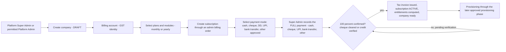

- The first company, **Shivam, uses exactly this flow**. There is no Shivam-specific table or architecture.
- **Not in R1:** public website signup, digital payment gateway, webhooks, online refunds, reconciliation with a provider, coupons and catalog discounts, trials, email OAuth and per-company or per-user email sending.

**Future capability (designed now, implemented later).** All of these use the **same** company, plan, subscription, order, invoice, payment and entitlement tables. There are no separate admin or website tables, and later features need no restructuring of current tables:
- the public website flow: registration → plan selection → monthly/yearly price → coupon → order/invoice → gateway payment → verification → subscription → company creation → provisioning (PHASE_14);
- catalog discounts and coupons, trials, gateway payments, attempts, webhooks, refunds, reconciliation (PHASE_14);
- company-level and user-level email connections (OAuth), central email dispatch (PHASE_13).

**Schema scope marks** (used in §6.2 together with the classification marks of §6.11.1):

| Mark | Meaning |
|---|---|
| `[CURRENT]` | Created and used in R1 (the admin panel release) |
| `[FUTURE]` | Fully designed now. Added in its future phase (as a JPA entity while the CP is under development; as an additive Liquibase changeset once the final CP baseline exists, CD-27). **No CURRENT table has to be altered** when it is added: CURRENT tables already carry the neutral columns and FK targets the future tables attach to. |

Rule against unnecessary complexity:
- R1 creates only `[CURRENT]` tables.
- `[CURRENT]` tables contain no gateway- or OAuth-specific columns. Those live in separate `[FUTURE]` child tables, for example `tbl_gateway_payment` 1:1 with `tbl_payment`.
- A manual payment is therefore never modelled as a gateway payment.

---

## 2. Existing implementation relevant to this phase

> **CURRENT/LEGACY:** this section describes the code as inspected on 2026-10-03, before P02-T11. Values such as `ORG_<n>`, `ORG_MODULES`, `org_<id>_<module>_db` and `org-<id>-<module>-bucket` appear here only as LEGACY; the target uses `CMP_<n>`, `COMPANY_MODULES`, `cmp_` and `cmp-` (CD-26). P02-T11 stages A–F (2026-10-04/05) replaced them in the code: company-only runtime, `TenantContext.companyCode`, `X-Company-Code`, `/api/v1/internal/platform/companies/...`, the CP organization / customer tier deleted, gateway `CompanyContextFilter` / `CompanySelection` (company from the verified `tenant_id` claim).

### 2.1 Current CP database schema (`CODE-INSPECTED`)

The schema comes from the 26 changelog files under `CONTROL-PANEL-SERVICE/src/main/resources/db/changelog/platform/`. The files were generated from the Hibernate entities on 2026-10-02.

How the schema is managed at runtime today:
- `ddl-auto: update` in `CONTROL-PANEL-SERVICE/src/main/resources/application.yml`.
- `spring.liquibase.enabled: false`.
- The changelogs are not run at boot and not exercised by the tests.

Most tables share these base columns:
- `id BIGINT AUTO_INCREMENT`;
- `created_at DATETIME(6)`, `created_by`, `updated_at`, `updated_by` (VARCHAR(255));
- in most tables also `is_deleted BIT(1)`, `deleted_at`, `deleted_by`;
- in some tables `version INT`.

Enums are **native MySQL `ENUM`** columns in the CP changelogs.

| Table | Business columns (beyond base) | Keys and constraints | Used by code? |
|---|---|---|---|
| `tbl_customer` | `external_id` VARCHAR(255) NN (`CUST_<n>`), `legal_name` NN, `slug` NN, `billing_email`, `tax_id`, `status` ENUM(PENDING, ACTIVE, DISABLED, SUSPENDED, ARCHIVED), `status_reason`, `disabled_at/by`, `deletion_requested_at`, `deletion_scheduled_at`, `deletion_reason`, `deletion_status`, `deleted_reason`, `retention_days` | UQ `external_id`, UQ `slug` | Yes (onboarding, quota, membership) |
| `tbl_organization` | `customer_id` NN, `external_id` NN (`ORG_<n>`), `name` NN, `slug` NN, `timezone`, `status` ENUM(PENDING, PROVISIONING, RECOVERING, ACTIVE, DISABLED, SUSPENDED, DEACTIVATED), `status_reason`, `keycloak_group_id` VARCHAR(64), disabled/deletion fields, `retention_days` | UQ `external_id`, UQ `slug`, FK `customer_id` → customer | Yes (tenant key, provisioning, routing) |
| `tbl_organization_database` | `organization_id` NN, `service_name` NN, `db_name` NN, `db_host` NN, `db_port` INT NN | UQ (`organization_id`, `service_name`); **no FK** | Yes (routing metadata) |
| `tbl_customer_usage` | PK/FK `customer_id`, `current_organization_count` INT, `current_user_count` INT | FK customer | **No** |
| `tbl_customer_user` | `customer_id`, `identity_id`, `role` ENUM(all 7 `PlatformRole` values), `status` ENUM(ACTIVE, INACTIVE, SUSPENDED) | UQ `identity_id`; FKs customer, identity | Yes (company tier) |
| `tbl_organization_user` | `organization_id`, `identity_id`, `role` ENUM(7 values), `status` | UQ `identity_id`; FKs organization, identity | Yes (organization tier) |
| `tbl_identity` | `keycloak_user_id` VARCHAR(36) NN, `account_scope` ENUM(PLATFORM, COMPANY, ORGANIZATION), `status` ENUM(PENDING_VERIFICATION, ACTIVE, SUSPENDED, DISABLED, REMOVED) | UQ `keycloak_user_id` | Yes |
| `tbl_identity_sync_task` | `task_type` ENUM(ENSURE_ORGANIZATION_GROUP, SYNC_IDENTITY, INVITE_ORGANIZATION_MEMBER, INVITE_COMPANY_MEMBER, RECONCILE_ORGANIZATION_GROUP), `status` ENUM(PENDING, DONE, FAILED), `dedup_key`, `organization_external_id`, `customer_external_id`, `identity_id`, `email` VARCHAR(320), `role`, `requested_by`, `attempts`, `next_attempt_at`, `last_error` VARCHAR(500), `completed_at`, `version` BIGINT | IDX due (`status`, `next_attempt_at`), IDX dedup | Yes (outbox; off by default) |
| `tbl_application` | `code` NN, `name` NN, `status` ENUM(ACTIVE, INACTIVE) | UQ `code` | Seeded mirror of the hard-coded `ModuleCatalog` |
| `tbl_organization_application` | `organization_id`, `application_id`, `status` | UQ pair; no FK | **No** |
| `tbl_plan` | `code` NN, `name` NN, `description` | UQ `code` | No service or API |
| `tbl_plan_version` | `plan_id`, `version_number` INT, `is_custom` BIT, `status` ENUM(DRAFT, ACTIVE, RETIRED), `effective_from/to` | UQ (`plan_id`, `version_number`); no FK | Read only by entitlement resolution |
| `tbl_plan_entitlement` | `plan_version_id`, `entitlement_key`, `entitlement_value` (strings) | **no unique, no FK** | Read by the entitlement and quota code |
| `tbl_subscription` | `customer_id`, `plan_version_id`, `subscription_type` ENUM(TRIAL, PAID), `status` ENUM(PENDING, ACTIVE, PAST_DUE, CANCELLED, EXPIRED), trial/start/end/renewal dates, `external_subscription_id`, `expiration_reason` | **no FK** | Yes |
| `tbl_subscription_addon` | `subscription_id`, `plan_version_id`, `status` | no FK | **No** |
| `tbl_billing_account` | `customer_id`, `currency`, `status` | no FK | **No** |
| `tbl_invoice` | `customer_id`, `billing_account_id`, `invoice_number` NN, `amount` DECIMAL(38,2), `currency`, `due_date`, `status` ENUM(UNPAID, PAID, CANCELLED) | no unique on number | **No** |
| `tbl_payment_transaction` | `invoice_id`, `external_payment_id`, `webhook_event_id`, `amount`, `currency`, `status` | UQ the two external ids | **No** |
| `tbl_business_role` | `role_type` ENUM(SYSTEM, CUSTOM), `organization_id`, `application_id`, `role_level` ENUM(USER, TEAMLEAD, MANAGER, ADMIN, SUPERADMIN), `code` VARCHAR(60), `name` VARCHAR(120), `status` ENUM(ACTIVE, DISABLED), `scope_key` BIGINT, `version` | UQ (`scope_key`, `code`); FKs application, organization; IDX (`organization_id`, `status`). The CHECK exists only as a Hibernate `@Check`. | Seeder only |
| `tbl_permission` | `application_id` NN, `code` VARCHAR(120), `name` VARCHAR(150), `status` ENUM(ACTIVE, DEPRECATED) | UQ `code`; FK application | No rows seeded |
| `tbl_business_role_permission` | `role_id`, `permission_id`, `data_scope` ENUM(OWN, TEAM, ORGANIZATION) | UQ pair; FKs | Test only |
| `tbl_organization_user_business_role` | `organization_user_id`, `role_id`, `assigned_by_identity_id` | UQ pair; 3 FKs | Test only |
| `tbl_provisioning_job` | `organization_id`, `status` ENUM(PENDING, IN_PROGRESS, COMPLETED, FAILED), `error_message` VARCHAR(255) | no FK, no type | Yes |
| `tbl_provisioning_step` | `job_id`, `sequence_no`, `step_name`, `status`, `error_message`, `completed_at` | no FK | Yes |
| `tbl_platform_audit_log` | `actor_id`, `action`, `target_type`, `target_id`, `ip_address` | none | Yes |
| `tbl_platform_setting` | `setting_key` NN, `setting_value` VARCHAR(255) | UQ `setting_key` | **No** |
| `tbl_audit_log` (COMMON-LIBRARY changelog, also in every tenant DB) | UUID id, `tenant_id`, `performed_by`, action, endpoint, entity, result, `correlation_id`, `source_ip`, `service_name`, `before_state`/`after_state` LONGTEXT | IDX tenant, entity | Yes (`AuditAspect`) |

### 2.2 Tenancy, identity and routing (`CODE-INSPECTED`)

| Topic | Today |
|---|---|
| Tenant key | `tbl_organization.external_id` (`ORG_<n>`, generated as max+1 starting at 101). It is used as `TenantContext.organizationId`, as the `X-Organization-Id` header, in `ORG_MODULES:<id>`, as the Keycloak group name `/ORG_<n>`, and in `TenantResourceNaming`. |
| Company resolution | The gateway `OrganizationSelection` takes JWT `groups` entries matching `^/?ORG_[A-Za-z0-9_]{1,60}$` (one group, or `Active-Org` among them). |
| Gateway enforcement | JWT signature, issuer, audience (`nyaalkaran-erp`) and expiry; strips client identity headers; `ORG_MODULES` check (fail-closed); denies `/internal/` at any depth. |
| Service side | `TenantContextFilter` trusts `X-Organization-Id`. **No token verification** in domain services. Ports of 6 services are published to the host. |
| Routing | `DynamicRoutingDataSource` (fail-closed), per-tenant Hikari pools, metadata from the CP `GET /api/v1/internal/platform/organizations/{id}/metadata?serviceName=` (DB name, host and port from `tbl_organization_database`). |
| Credentials | **One shared MySQL login** (`DB_USER`/`DB_PASSWORD`) for all tenants, with DDL rights. |
| Keycloak | Realm `ERPSystem`. Audience `nyaalkaran-erp`. Realm roles `PLATFORM_SUPERADMIN`, `PLATFORM_ADMIN` (the COMPANY_*/ORG_* realm roles were reported removed from the production realm, `DOC-REPORTED`). Legacy client roles on the `api-gateway` client (`CRM_SUPERADMIN`, `IT_MANAGER`, `RND_MANAGER`, `COMPLIANCE_*`, …) are read by several services without signature verification. `account-book-ui` is a public client (Angular `erp-ui`). |
| Platform admins | Keycloak realm role only. No CP table, no permissions, no company scope. `PlatformAccessResolver` gives them a global bypass. The control plane validates the JWT via JWK only (no issuer or audience check) and ends with `anyRequest().permitAll()`. |
| Business RBAC | Tables only. No API, no permission catalog, no enforcement. **Zero** `@PreAuthorize` in the services. |

### 2.3 Shivam today (`CODE-INSPECTED` + `DOC-REPORTED`)

- **No Shivam company or organization record**, no default tenant, no import tooling in the application.
- **Legacy production data** (protected hosts, `DOC-REPORTED`): per-module databases (`crm_service_db`, `hrms_db`, `store_db`, `mining_db`, `production_db`, `qc_db`, `logistics_db`, `asset_db`, `tickets_db`, `chat_db`, `research_and_development_db`, `compliance_db_recurrence`), ACCOUNT-BOOK `nyaalkaran_erp_accounting`, the shared `attachment_db` (with 50 rows of unknown ownership), the legacy `control_panel_db`, the attendance database `Shivam_HRMS_Attendance` (on `.53`), and per-module MinIO buckets (`crm-bucket`, …).
- **Hard-coded Shivam branding** in CRM (`EmailProperties`), QC (`PdfReportService`, `SalesOrderMailService`), R&D (`SalesOrderMailService`), HRMS letter templates, the ATTENDANCE report, the COMPLIANCE email template, static logos, and the `.env` mail settings.
- Integration behaviour is controlled by **global** `.env` flags: store, production and mining sync to account-book are ON; the CRM flag is bound to nothing.

---

## 3. Existing completed work

These items are implemented, compatible with the Company-based design, and backed by code and existing tests (`CODE-INSPECTED`, `TEST-EXISTS`, not re-run).

| Item | Evidence | Classification |
|---|---|---|
| Fail-closed per-tenant DB routing and tenant context | COMMON `DynamicRoutingDataSource`, `TenantContextFilter`, `TenantContextHolder`, `MultiTenantSafetyEnforcer` | COMPLETED (reused) |
| Gateway JWT validation, identity-header stripping, internal-path deny, legacy admin path deny | API-GATEWAY `SecurityConfig`, `CompanyContextFilter` (was `OrganizationContextFilter`, renamed in P02-T11 stage D), `LegacyAdminPathMatcher` | COMPLETED (reused) |
| Gateway entitlement check via Redis (fail-closed) | `CompanyContextFilter` + Redis key `COMPANY_MODULES` (was `OrganizationContextFilter` / `ORG_MODULES`; renamed in P02-T11 stages B and D) | COMPLETED; the target key is `COMPANY_MODULES:<CMP_n>` (CD-26: key constant renamed in gateway, COMMON and CP) and its data source changes |
| `@Async`, STOMP and Quartz tenant propagation; WebSocket tickets | `MdcTaskDecorator`, `TenantStompSupport`, `TenantQuartzSupport`, `WebSocketTicket*` | COMPLETED |
| Per-tenant scheduled jobs with locks | `PerTenantJobAspect`, `TenantJobLock` | COMPLETED (module filter added later) |
| Resource naming utility | `TenantResourceNaming` | COMPLETED (extended) |
| Attachment DB per tenant via Liquibase | `LiquibaseAttachmentDbSchemaManager` | COMPLETED |
| Per-service Liquibase changelogs aligned to entities | `*/src/main/resources/db/changelog/**`, `LIQUIBASE_CONVENTIONS.md` | COMPLETED as files (not yet run on tenant DBs) |

Everything else in the old architecture is at best **PARTIALLY_COMPLETED** against the new design (§4). "Completed" phases in the old documents (e.g. 5E-*, 5L) are **not** counted as completed here unless they meet the Company-based design.

---

## 4. Reusable components

### 4.1 Reusable without changes
`TenantContext`, `TenantContextHolder`, `TenantContextFilter` (a verification filter is added next to it), `TenantMySqlDialect`, `MdcTaskDecorator`, `TenantStompSupport`, `TenantQuartzSupport`, `TenantJobLock`, the gateway `SecurityConfig` / `RealmIssuers` / `LegacyAdminPathMatcher` / WebSocket tickets, `PlatformJwtGrantedAuthoritiesConverter`, `InternalServiceTokenAuthenticator`, `LiquibaseAttachmentDbSchemaManager`, `DefaultObjectKeyGenerator`, `tbl_identity` (its scope enum is reduced), `tbl_platform_setting`.

### 4.2 Reusable with modifications

| Component | Modification |
|---|---|
| `DynamicRoutingDataSource`, `AttachmentRoutingDataSource` | Environment credentials through the existing provider (CD-03); database name from the registry; pool eviction on invalidation |
| `TenantMetadataResolver`, `ControlPlaneClient`, internal metadata API | Read from `tbl_company_resource`; same payload |
| `EnvironmentTenantCredentialProvider` | Development-only fallback |
| `TenantResourceNaming` | Per-module bucket rule (existing `bucketName(org, module)`), realm name `co-<n>`, exact validators |
| `PerTenantJobAspect` | Run only for companies entitled to the job's module |
| `ModuleEntitlementEnforcementFilter` | Enabled everywhere; soft handling of non-mandatory Feign targets |
| `CompanyContextFilter`, `CompanySelection` (renamed from `OrganizationContextFilter` / `OrganizationSelection` in P02-T11 stage D; `tenant_id` claim done there) | Tenant from the `tenant_id` claim; status and user-access checks |
| CP provisioning step services | Durable worker, entitlement-driven, credentials, bucket |
| `PlatformSubscriptionService` | Company target, items, new states |
| `ModuleEntitlementCachePublisher` and sync listener/scheduler | Materialized entitlements, new keys, resync on |
| `PlatformSecurityInterceptor`, `PlatformAccessResolver`, `PlatformActorResolver` | Platform permissions and company scope, no global bypass, trusted IP |
| `PlatformMembershipService` | Company-user model, seats, permission-based guards |
| Identity sync outbox, worker, processor, reconciler | Realm-aware; new tasks (create realm admin user, invite in the company realm, platform role in the platform realm, disable or enable account and realm) |
| `BusinessRoleCatalogSeeder` | Seeds from `tbl_module` |
| `OrganizationQuotaService` locking pattern | Reused for the seat (user) limit |
| COMMON-ATTACHMENT services | Module bucket per company from the registry, exact check, usage metering, authorization |
| `AuditAspect`, `AuditLogController` | MDC key fix, trusted IP, permission check |
| Per-service Liquibase changelogs | Become the tenant schema source |
| CP tables: `tbl_identity_sync_task`, `tbl_provisioning_job/step`, `tbl_platform_audit_log`, `tbl_subscription`, `tbl_permission`, `tbl_business_role*` | See the table review in §5.1 |

### 4.3 Requires redesign or replacement

`TenantBootstrapService` / `HibernateTenantSchemaInitializer` (Hibernate update → Liquibase), the in-process provisioning executor, `FeignSecurityInterceptor` (hard-coded defaults, internal token on every call), the hard-coded `ModuleCatalog` and the YAML module list, `PropertyBasedBucketResolver` plus lazy bucket creation, `JwtAccessTokenUtil` role decoding, `CrmDataAccessAuthority` token decoding, the CP legacy `KeycloakController` / `KeycloakUserController` / `RoleController` / `JwtRoleExtractor`, the services' `UserLookupService` user lookups, the hard-coded branding, the global integration flags.

### 4.4 Pending (does not exist yet)

- **Company model:** the Company model and code allocator, the resource registry, the realm registry (environment DB credentials kept, CD-03).
- **Commercial layer:** catalog management, dependencies and bundles, price books and the pricing engine, quotes, subscription items, materialized entitlements, allowances and usage.
- **Platform administration:** the platform admin model (permissions + scope).
- **Company administration and authorization:** company admin APIs that manage users and role assignments in the company realm, the permission catalog and the CP Permission Policy (CD-12), and backend enforcement.
- **Security and storage:** service-side token verification, the company module buckets and storage limits.
- **Shivam:** the company data import tooling.
- **Commercial and billing (2026-10-03 review):** plan prices, discounts and coupons, billing orders, tax calculation, invoices, credit notes, full manual payments (several verified instruments may total 100 %, CD-20; no mandatory two-person rule, CD-21), payment gateway integration (future), webhooks, refunds, reconciliation, document numbering, public signup. **None exists in code**: the CP billing tables are unused stubs, and there is no gateway SDK or configuration (`CODE-INSPECTED`).
- **Company and user email:** company- and user-owned mailbox connections, OAuth, secret references, sending policies, central dispatch. **None exists**: six services send through one global Gmail SMTP configuration (`CODE-INSPECTED`).

---

## 5. Work requiring modification or redesign: CP schema review

### 5.1 Table-by-table decision

| Existing table | Decision | Target | Reason |
|---|---|---|---|
| `tbl_customer` | **Merge** | `tbl_company` + `tbl_company_profile` | Company = customer **and** tenant |
| `tbl_organization` | **Merge** | `tbl_company` (company code, lifecycle, `keycloak_group_id` during the transition) | One company = one tenant |
| `tbl_organization_database` | **Replace (rename + extend)** | `tbl_company_resource` (`resource_type=DATABASE`) | Registry for every resource with reservation; FK; status |
| `tbl_customer_usage` | **Remove** | `tbl_company_usage` | Unused; organization counter obsolete |
| `tbl_customer_user`, `tbl_organization_user` | **Merge** | `tbl_company_user` | One membership level |
| `tbl_identity` | **Keep, modify** | `tbl_identity` | `account_scope` reduced to PLATFORM/COMPANY; soft-delete columns replaced by status |
| `tbl_identity_sync_task` | **Keep, modify** | same | New task types; `customer_external_id`/`organization_external_id` → `company_code` (CMP_<n>, CD-26); `role` → `payload_json` |
| `tbl_application` | **Rename + extend** | `tbl_module` | Database-driven catalog with tokens and provisioning flags |
| `tbl_organization_application` | **Remove** | `tbl_company_entitlement` | Unused; replaced |
| `tbl_plan`, `tbl_plan_version` | **Keep, modify** (v3) | `tbl_plan` (sellable offer: module, bundle, user seats, storage) + `tbl_plan_version` (immutable price version) + new `tbl_plan_price` | The existing versioning (DRAFT/ACTIVE/RETIRED, `is_custom`, UQ plan+version) is exactly what historical price retention needs. Prices are added (none today). |
| `tbl_plan_entitlement` | **Remove** | Entitlements derived from the plan's module or bundle | Key/value entitlements cannot express bundles, dependencies or prices |
| `tbl_subscription` | **Keep, modify** | same | `customer_id` → `company_id`; `plan_version_id` moves to the items (a price snapshot per item); one billing period per subscription; several subscriptions per company allowed (v3); new states and columns; FKs |
| `tbl_subscription_addon` | **Remove** | `tbl_subscription_item` | Unused |
| `tbl_billing_account`, `tbl_invoice`, `tbl_payment_transaction` | **Keep, modify** (v3) | `tbl_billing_account` (GST identity), `tbl_invoice` (+ lines, tax lines), `tbl_payment` (neutral) + `tbl_manual_payment` + `tbl_payment_status_history` (CURRENT); allocations, gateway details, attempts and refunds in FUTURE child tables | Unused stubs today (`CODE-INSPECTED`): no FKs, a non-unique `invoice_number`, a global `external_payment_id`, no provider column. Redesigned as provider-independent billing (§6.2 I). |
| `tbl_business_role` | **Rename + modify** | `tbl_role` | Becomes a **role definition and template** catalog (not assignments, CD-11): `organization_id` → `company_id` (custom roles only, CD-12); add `role_domain`, `module_id`, `template_version`; CHECK in Liquibase |
| `tbl_permission` | **Modify** | same | Add `permission_domain`, `grantable`; `application_id` → `module_id` (nullable for non-business permissions) |
| `tbl_business_role_permission` | **Rename + modify** | `tbl_role_permission` | `data_scope` ORGANIZATION → COMPANY |
| `tbl_organization_user_business_role` | **Remove** (CD-11) | — | User-role assignments live in the company realm; the CP stores no assignment. Existing rows (if any) are a reference for the Shivam role mapping only (PHASE_11 C-3). |
| `tbl_provisioning_job`, `tbl_provisioning_step` | **Keep, modify** | same | Job type, mode, lease, guard, FKs, step resource columns |
| `tbl_platform_audit_log` | **Keep, modify** | same | `company_id`, `outcome`, `permission_code`, `detail_json`, `correlation_id` |
| `tbl_platform_setting` | **Keep** | same | `setting_value` widened to TEXT |
| `tbl_audit_log` (COMMON) | **Keep** | same (per company DB) | Fixes in the code only |
| — | **New** | `tbl_company_setting`, `tbl_company_status_history`, ~~`tbl_company_db_credential`~~ (removed 2026-10-03, CD-03), `tbl_id_sequence`, `tbl_module_dependency`, `tbl_bundle`, `tbl_bundle_module`, `tbl_price_book`, `tbl_price_book_item`, `tbl_user_pricing_rule`, `tbl_storage_pricing_rule`, `tbl_discount`, `tbl_tax_rule`, `tbl_quote`, `tbl_quote_line`, `tbl_quote_warning` (the v2 price-book and quote tables were **replaced in v3** by the rows below), `tbl_subscription_item`, `tbl_subscription_event`, `tbl_company_entitlement`, `tbl_company_allowance`, `tbl_company_usage`, `tbl_company_usage_snapshot`, `tbl_platform_admin`, `tbl_platform_admin_company_scope`, `tbl_platform_admin_role`, `tbl_company_user_module_access`, `tbl_data_import_run`, `tbl_data_import_check` | Company-based model |
| — | **New (v3/v4, 2026-10-03)**, CURRENT | `tbl_plan_price`, `tbl_tax_rule`, `tbl_seller_entity`, `tbl_document_series`, `tbl_billing_order`, `tbl_billing_order_line`, `tbl_billing_order_discount`, `tbl_billing_order_tax`, `tbl_billing_order_warning`, `tbl_subscription_period`, `tbl_invoice_line`, `tbl_invoice_tax_line`, `tbl_credit_note`, `tbl_credit_note_line`, `tbl_manual_payment`, `tbl_payment_status_history`, `tbl_identity_realm`, `tbl_platform_email_message` (+ recipient, attempt; R1 platform email, CD-23, §6.2 J) | Admin-panel commercial flow with full manual payment (§6.2 D, I.1); realm registry (§6.5.2) |
| — | **New (v3/v4)**, FUTURE (schema-ready, created later) | `tbl_discount`, `tbl_discount_target`, `tbl_coupon`, `tbl_discount_redemption`, `tbl_payment_allocation`, `tbl_payment_provider`, `tbl_payment_provider_account`, `tbl_gateway_customer`, `tbl_gateway_payment`, `tbl_payment_attempt`, `tbl_refund`, `tbl_payment_webhook_event`, `tbl_payment_reconciliation_run`, `tbl_payment_reconciliation_item`, `tbl_financial_audit_ledger`, `tbl_email_provider`, `tbl_email_provider_app`, `tbl_email_connection`, `tbl_email_connection_setting`, `tbl_email_credential`, `tbl_email_oauth_state`, `tbl_email_sender_identity`, `tbl_email_sender_verification`, `tbl_email_sending_policy`, `tbl_signup_request`, `tbl_signup_verification` | Website, digital payments, company and user email (§6.2 D, I.2, J, K) |

### 5.2 Column-level renames carried into the new model

| Old | New |
|---|---|
| `tbl_customer.external_id` (`CUST_<n>`) | `tbl_company.company_code` (`CMP_<n>`) |
| `tbl_organization.external_id` (`ORG_<n>`, **LEGACY**) | `tbl_company.company_code` (`CMP_<n>`, CD-26): the only company identifier; the `ORG_` format is not used in the target |
| `tbl_customer.legal_name` | `tbl_company.legal_name` |
| `tbl_organization.name` | `tbl_company.display_name` |
| `tbl_customer.billing_email`, `tax_id` | `tbl_company_profile.billing_email`, `tax_id` |
| `tbl_organization.timezone`, `keycloak_group_id`, `retention_days`, `status_reason` | `tbl_company.*` |
| `tbl_organization_database.service_name` | `tbl_company_resource.module_id` (FK to `tbl_module`, which carries `service_name`) |
| `*.organization_id` / `*.customer_id` | `*.company_id` |
| `data_scope` `ORGANIZATION` | `COMPANY` |
| `is_deleted` / `deleted_*` soft-delete triplets | Explicit `status` + timestamps (no hidden soft-delete filter) |

---

## 6. New development required (the foundation design)

### 6.1 Terminology and naming conventions

#### 6.1.1 Terminology

| Customer-facing term | Technical term kept in code | Rule |
|---|---|---|
| **Company** | `tenant`, `companyCode` (COMMON runtime, `X-Company-Code`, `COMPANY_MODULES`) | New CP code, APIs and UI use *company*. Since P02-T11 stage B (2026-10-05) the COMMON runtime uses company names too (`TenantContext.companyCode`, header `X-Company-Code`); the value is the `company_code` `CMP_<n>` (CD-26). The former names `TenantContext.organizationId` / `X-Organization-Id` are retired. |
| Company code | `company_code` | Shown to users, quotes, support |
| (not shown to users) | `company_code` | Routing, naming, claims, Redis |
| Company User | `company_user` | — |
| Platform Super Admin / Platform Admin | `platform_admin` (`admin_type`) | — |
| Company Super Admin / Company Admin | `company_user.is_company_super_admin`, company-admin roles | — |

#### 6.1.2 Identifiers

| Identifier | Format | Example | Source | Mutability |
|---|---|---|---|---|
| `tbl_company.id` | BIGINT AUTO_INCREMENT | 1 | MySQL | Immutable; internal only |
| `company_code` | `CMP_` + n (n ≥ 101, from `tbl_id_sequence 'COMPANY'`) | `CMP_101` | CP allocator | **Immutable forever.** The single company identifier (CD-26): business id, runtime tenant context value, `tenant_id` claim, Redis keys, resource names |
| Company DB token | `lower(company_code)` | `cmp_101` | Derived | — |
| Company DNS token | `lower(company_code)` with `_`→`-` | `cmp-101` | Derived | — |
| `slug` | `^[a-z0-9](?:[a-z0-9-]{1,38}[a-z0-9])$`, reserved words rejected, unique | `shivam-induscorp` | Suggested from the name, editable until ACTIVE | Display / login hint only |
| Legal / display name | 1–150 characters | "Shivam IndusCorp Pvt Ltd" | Platform admin | Mutable; **never** used in any resource identifier |

Rules:
1. **A company name is never a technical identifier.** Names are not unique and can change. Every resource name derives only from `company_code`.
2. `n` comes from a locked sequence row (`SELECT … FOR UPDATE` in its own transaction). There are no max+1 scans. Gaps are allowed; duplicates are impossible (unique constraints are the backstop).
3. The sequence starts at 101 (the existing convention), so **the first company created on the new platform receives `CMP_101`**. Shivam is planned to be that first company (§6.8). If another company were created first, Shivam would receive the next number. Nothing depends on Shivam being 101 (Q-02).

#### 6.1.3 Resource names

| Resource | Rule | Example (`CMP_101`) | Validation |
|---|---|---|---|
| Module database (per company, per **purchased** module) | `<company db token>_<module.db_token>_db` | `cmp_101_crm_db`, `cmp_101_hrms_db`, `cmp_101_account_book_db` | `^[a-z0-9_]{1,64}$` |
| Attachment database (per company, platform core) | `<company db token>_attachment_db` | `cmp_101_attachment_db` | same |
| Notification database (per company, platform core) | `<company db token>_notification_db` | `cmp_101_notification_db` | same |
| Module bucket (per company, per **purchased** module; CD-01) | `<company dns token>-<module dns token>-bucket`, the **existing** `TenantResourceNaming.bucketName(org, module)` | `cmp-101-crm-bucket`, `cmp-101-hrms-bucket` | 3–63 characters, `^[a-z0-9][a-z0-9-]*[a-z0-9]$` |
| Platform-core bucket (per company; branding and company-level files) | the same rule with the existing `CONTROL_PANEL` attachment module | `cmp-101-control-panel-bucket` | same |
| Company Keycloak realm (CD-06) | `co-<n>`, for every company including Shivam (CD-16) | `co-101` | `^co-[0-9]{1,8}$` |
| Platform Keycloak realm (CD-17) | `erp-platform` | — | fixed |
| Company Login Code (CD-15) | Chosen or generated by the platform | `ABCMFG01` | `^[A-Z0-9]{6,12}$`, unique |
| Redis keys | `COMPANY_MODULES:<company_code>`, `TENANT_STATUS:<company_code>`, `TENANT_ROLE_PERMS:<company_code>:<role>` (role → permission policy, CD-11), `TENANT_SETTINGS:<company_code>`, `TENANT_META:<company_code>:<service>` (existing) | — | — |

Removed (corrected 2026-10-03):
- per-company DB users `t_<n>_app` / `t_<n>_ddl` (CD-03);
- the single company bucket `org-<n>-files` (CD-01);
- the transitional Keycloak group `/ORG_<n>` (CD-06; the company comes from the realm).

Every name is **reserved** in `tbl_company_resource` (unique `resource_type` + `resource_name`) **before** it is created.

**Credentials vs identity vs mapping vs routing** (CD-03):

| Concept | Where it lives | Example |
|---|---|---|
| Infrastructure DB credentials | Environment configuration (`DB_HOST`, `DB_PORT`, `DB_USER`, `DB_PASSWORD`, read by `EnvironmentTenantCredentialProvider`). The same for all companies. Never in the CP database. | One login for the MySQL server |
| Company database identity | The database **name** derived from `company_code` + module `db_token` | `cmp_101_crm_db` |
| Company-to-database mapping | `tbl_company_resource` rows (DATABASE: company, module, db name, db host, db port; BUCKET: company, module, bucket name) | (CMP_101, CRM) → `cmp_101_crm_db` @ host:port, `cmp-101-crm-bucket` |
| Runtime routing | `TenantMetadataResolver` (cached) → `DynamicRoutingDataSource` builds or reuses the company's pool using the **mapped database name** + the **environment credentials**. The bucket resolver uses the mapped bucket. | A request of CMP_101 to CRM → pool `HikariPool-Tenant-CMP_101` on `cmp_101_crm_db` |

#### 6.1.4 Isolation rules

1. **Databases** (CD-01): each company has its own MySQL database per purchased module, plus its attachment and notification databases. No business table or database is shared between companies. The platform DB contains no business data.
2. **Buckets** (CD-01): each company has its own bucket per purchased module. Every object operation checks for an **exact** match between the bucket and the registry row for (company, module). Buckets are never created at runtime.
3. **Credentials** (CD-03): the database credentials are shared infrastructure configuration, so **isolation is enforced by the application**, not by MySQL grants. The compensating controls are mandatory:
   - the tenant comes only from the verified token (issuer + claim);
   - database and bucket names come only from VERIFIED registry rows;
   - routing fails closed;
   - services verify tokens themselves (PHASE_03);
   - no service ports are published;
   - the internal APIs are allow-listed;
   - every cross-tenant attempt is audited.

   **Residual risk accepted with CD-03:** a fully compromised service process could reach other companies' databases with the shared login. This is mitigated by the network restrictions, least-privilege infrastructure credentials (only the `cmp\_%` schemas and the CP DB, no MySQL admin rights for the runtime account), and monitoring.
4. **Routing input:** no request field can influence the database or bucket selection.
5. **No deletion:** removing a module, ending a subscription, suspending a company or a failed provisioning never drops or truncates a company resource or realm. Deletion is the manual, dual-approved purge process only (master §19.6).

### 6.2 Complete proposed CP database schema

**Database:** `control_panel_db` (platform metadata only). **Schema management (CD-27):** during development the schema is generated by Hibernate `ddl-auto: update` from the JPA entities, which implement the definitions below; after the CP model is stable, PHASE_11A writes one clean **Liquibase** baseline of the final schema (conventions in `LIQUIBASE_CONVENTIONS.md`) and Hibernate switches to `ddl-auto: validate`. Constraint names, CHECK constraints and seed data listed below are part of that final baseline.

**Column conventions** (apply to every table unless stated):

| Convention | Definition |
|---|---|
| `id` | `BIGINT NOT NULL AUTO_INCREMENT PRIMARY KEY` |
| Audit | `created_at DATETIME(6) NOT NULL`, `created_by VARCHAR(100) NULL`, `updated_at DATETIME(6) NULL`, `updated_by VARCHAR(100) NULL` (shown as **[audit]**) |
| Optimistic lock | `version INT NOT NULL DEFAULT 0` where concurrent updates are possible (shown as **[ver]**) |
| Enums | `VARCHAR(30) NOT NULL`, values listed (no native MySQL ENUM: it cannot be widened safely; project dialect convention) |
| Money | `DECIMAL(19,4)`; currency `CHAR(3)` (ISO 4217) |
| Foreign keys | `ON DELETE RESTRICT ON UPDATE RESTRICT`; named `fk_<table>_<column>` |
| Unique / index / check names | `uk_<table>_<cols>`, `idx_<table>_<cols>`, `ck_<table>_<rule>` |
| Text | UTF8MB4; e-mail `VARCHAR(320)`; codes `VARCHAR(60)`; names `VARCHAR(150)` |
| Soft delete | Not used. Lifecycle is explicit through `status` and timestamps. |

Tables are grouped A–K. Each table carries a scope mark (`[CURRENT]` / `[FUTURE]`, §1.1) and a classification mark (legend in §6.11.1): `[REUSE existing]`, `[MODIFY existing]`, `[NEW in v2, kept]`, `[MODIFY v2 design]`, `[NEW]`, `[REMOVE]` or `[PENDING-VERIFICATION Qxx]`. Tables without a mark in groups A–C and F–H are v2 designs, kept unchanged in v3/v4, and are all `[CURRENT]`.

#### A. Company and tenancy

**`tbl_company`**: a company, which is both the customer and the tenant.

| Column | Type | Null | Key / default | Notes |
|---|---|---|---|---|
| id | BIGINT | NO | PK | |
| company_code | VARCHAR(20) | NO | UQ `uk_company_code` | `CMP_<n>`; immutable (`updatable=false`); the single company identifier (CD-26). The former separate `tenant_key` column (`ORG_<n>`) is **removed**. |
| legal_name | VARCHAR(150) | NO | | |
| display_name | VARCHAR(150) | NO | | |
| slug | VARCHAR(40) | NO | UQ `uk_company_slug` | |
| login_code | VARCHAR(12) | NO | UQ `uk_company_login_code` | **Company Login Code** (CD-15): `^[A-Z0-9]{6,12}$`; non-sensitive; not the company code, company code, DB or realm name; changed only by an audited platform operation |
| status | VARCHAR(30) | NO | IDX `idx_company_status` | DRAFT, PROVISIONING, PROVISIONING_FAILED, AWAITING_DATA_IMPORT, ACTIVE, SUSPENDED, DISABLED, ARCHIVED, PURGE_APPROVED |
| status_reason | VARCHAR(500) | YES | | |
| onboarding_type | VARCHAR(30) | NO | default `NEW` | NEW, IMPORT_EXISTING_DATA (§6.8) |
| timezone | VARCHAR(50) | NO | default `Asia/Kolkata` | IANA zone |
| retention_days | INT | NO | default from platform setting | Retention after the end of a subscription |
| keycloak_group_id | VARCHAR(64) | YES | | Not used with a realm per company (CD-06); kept nullable only to carry legacy values during the migration of the old CP code |
| activated_at | DATETIME(6) | YES | | |
| suspended_at | DATETIME(6) | YES | | |
| archived_at | DATETIME(6) | YES | | |
| [audit], [ver] | | | | |

**`tbl_company_profile`**: contact and branding (1:1). v3: `billing_email` and `tax_id` moved to `tbl_billing_account` (§I). The `mail_*` fields stay as **display defaults** (branding). The actual sending identities are the future `tbl_email_connection` / `tbl_email_sender_identity` rows (§J).

| Column | Type | Null | Key | Notes |
|---|---|---|---|---|
| id | BIGINT | NO | PK | |
| company_id | BIGINT | NO | UQ, FK → `tbl_company` | |
| address_line1, address_line2 | VARCHAR(200) | YES | | |
| city, state | VARCHAR(100) | YES | | |
| postal_code | VARCHAR(20) | YES | | |
| country_code | CHAR(2) | YES | | |
| primary_contact_name | VARCHAR(150) | YES | | |
| primary_contact_email | VARCHAR(320) | YES | | |
| primary_contact_phone | VARCHAR(30) | YES | | |
| logo_object_key | VARCHAR(500) | YES | | Key in the company's `cmp-<n>-control-panel-bucket` (the existing `CONTROL_PANEL` attachment module; created for every company as platform core) |
| mail_sender_name | VARCHAR(150) | YES | | Replaces the hard-coded branding |
| mail_from_address | VARCHAR(320) | YES | | |
| mail_reply_to | VARCHAR(320) | YES | | |
| [audit], [ver] | | | | |

**`tbl_company_setting`**: key/value settings, e.g. integration switches.

| Column | Type | Null | Key | Notes |
|---|---|---|---|---|
| id | BIGINT | NO | PK | |
| company_id | BIGINT | NO | FK; UQ (`company_id`, `setting_key`) | |
| setting_key | VARCHAR(100) | NO | | e.g. `integration.store-to-account-book.enabled`, `pricing.price_book_code`, `attendance.face-recognition.url` |
| setting_value | VARCHAR(1000) | YES | | Never a secret |
| [audit] | | | | |

**`tbl_company_status_history`** (append-only)

| Column | Type | Null | Key |
|---|---|---|---|
| id | BIGINT | NO | PK |
| company_id | BIGINT | NO | FK; IDX (`company_id`, `changed_at`) |
| from_status | VARCHAR(30) | YES | |
| to_status | VARCHAR(30) | NO | |
| reason | VARCHAR(500) | YES | |
| actor | VARCHAR(100) | NO | |
| changed_at | DATETIME(6) | NO | |

**`tbl_company_resource`**: the registry of every company resource. It replaces `tbl_organization_database`.

| Column | Type | Null | Key | Notes |
|---|---|---|---|---|
| id | BIGINT | NO | PK | |
| company_id | BIGINT | NO | FK; IDX (`company_id`, `resource_type`) | |
| resource_type | VARCHAR(30) | NO | | DATABASE (per company and module), BUCKET (per company and module, CD-01), IDP_REALM (the company realm, CD-06) |
| module_id | BIGINT | YES | FK → `tbl_module` | Set for module databases **and module buckets**; NULL for company-level resources (attachment and notification DB, realm) |
| resource_name | VARCHAR(100) | NO | UQ (`resource_type`, `resource_name`) | |
| db_host | VARCHAR(255) | YES | | DATABASE only |
| db_port | INT | YES | | DATABASE only |
| schema_version | VARCHAR(100) | YES | | The last Liquibase changeset id applied |
| status | VARCHAR(30) | NO | | RESERVED, CREATED, VERIFIED, DEGRADED, ORPHANED, RETIRED |
| verified_at | DATETIME(6) | YES | | |
| [audit], [ver] | | | | |

Additional constraints:
- UQ (`company_id`, `resource_type`, `module_key`), where the generated column `module_key = COALESCE(module_id, 0)` makes the uniqueness work with NULL.
- CHECK: `resource_type <> 'DATABASE' OR (db_host IS NOT NULL AND db_port IS NOT NULL)`.

**`tbl_company_db_credential`** `[REMOVED 2026-10-03, CD-03]`: per-company MySQL credentials are not used. The DB credentials are environment-level infrastructure configuration.

**`tbl_id_sequence`**

| Column | Type | Null | Key |
|---|---|---|---|
| sequence_name | VARCHAR(30) | NO | PK (`COMPANY`, `QUOTE`, `IMPORT_RUN`) |
| next_value | BIGINT | NO | |
| version | INT | NO | |

#### B. Provisioning

**`tbl_provisioning_job`** (evolved)

| Column | Type | Null | Key | Notes |
|---|---|---|---|---|
| id | BIGINT | NO | PK | |
| company_id | BIGINT | NO | FK; IDX | |
| job_type | VARCHAR(30) | NO | | CREATE_COMPANY, ADD_MODULE, REPAIR, SCHEMA_UPGRADE, REALM_TEMPLATE_UPGRADE |
| mode | VARCHAR(30) | NO | | SEEDED (standard), EMPTY_FOR_IMPORT (standard option for `onboarding_type=IMPORT_EXISTING_DATA`), UPGRADE |
| status | VARCHAR(30) | NO | IDX (`status`, `next_attempt_at`) | QUEUED, RUNNING, RETRYING, FAILED, COMPLETED, CANCELLED |
| attempt | INT | NO | default 0 | |
| next_attempt_at | DATETIME(6) | YES | | |
| locked_by | VARCHAR(100) | YES | | Worker instance id |
| locked_until | DATETIME(6) | YES | | Lease |
| active_guard | TINYINT | YES | UQ (`company_id`, `active_guard`) | 1 while not terminal, so one active job per company |
| requested_by | VARCHAR(100) | NO | | |
| last_error | VARCHAR(1000) | YES | | Scrubbed of secrets |
| completed_at | DATETIME(6) | YES | | |
| [audit], [ver] | | | | |

**`tbl_provisioning_step`** (evolved)

| Column | Type | Null | Key | Notes |
|---|---|---|---|---|
| id | BIGINT | NO | PK | |
| job_id | BIGINT | NO | FK; UQ (`job_id`, `sequence_no`) | |
| sequence_no | INT | NO | | |
| step_code | VARCHAR(60) | NO | | e.g. RESERVE_NAMES, CREATE_REALM, CREATE_DATABASE (per purchased module), MIGRATE_SCHEMA, CREATE_BUCKET (per purchased module), APPLY_REALM_TEMPLATE, CREATE_STANDARD_ROLES, CONFIGURE_CLIENTS, REGISTER_REALM (company realm, CD-14/CD-17), REGISTER_RESOURCES, INVITE_COMPANY_SUPER_ADMIN, PUBLISH_CACHES, ACTIVATE |
| resource_type | VARCHAR(30) | YES | | |
| module_id | BIGINT | YES | FK → `tbl_module` | |
| resource_name | VARCHAR(100) | YES | | |
| status | VARCHAR(30) | NO | | PENDING, RUNNING, COMPLETED, FAILED, SKIPPED |
| attempts | INT | NO | default 0 | |
| last_error | VARCHAR(1000) | YES | | |
| started_at, completed_at | DATETIME(6) | YES | | |
| [audit] | | | | |

#### C. Module catalog

**`tbl_module`** (evolved from `tbl_application`)

| Column | Type | Null | Key | Notes |
|---|---|---|---|---|
| id | BIGINT | NO | PK | |
| code | VARCHAR(60) | NO | UQ | e.g. `crm`, `research-and-development`, `account-book` |
| gateway_token | VARCHAR(60) | NO | UQ | e.g. `CRM`, `RESEARCH-AND-DEVELOPMENT` |
| db_token | VARCHAR(40) | YES | UQ (when not NULL) | e.g. `crm`, `rnd`, `account_book`. Immutable after ACTIVE. |
| service_name | VARCHAR(100) | YES | | Eureka name |
| module_type | VARCHAR(30) | NO | | BUSINESS, PLATFORM_CORE, ADDON |
| requires_database | BIT(1) | NO | | |
| requires_bootstrap | BIT(1) | NO | | |
| standalone_allowed | BIT(1) | NO | | |
| name | VARCHAR(150) | NO | | |
| description | VARCHAR(1000) | YES | | |
| category | VARCHAR(60) | YES | | |
| sort_order | INT | NO | default 0 | |
| status | VARCHAR(30) | NO | | DRAFT, ACTIVE, RETIRED |
| [audit], [ver] | | | | |

**`tbl_module_dependency`**

| Column | Type | Null | Key | Notes |
|---|---|---|---|---|
| id | BIGINT | NO | PK | |
| module_id | BIGINT | NO | FK; UQ (`module_id`, `depends_on_module_id`) | |
| depends_on_module_id | BIGINT | NO | FK | CHECK `module_id <> depends_on_module_id`; acyclic (service-validated) |
| dependency_type | VARCHAR(30) | NO | | MANDATORY, RECOMMENDED, CONDITIONAL |
| charge_mode | VARCHAR(30) | NO | | CHARGED, INCLUDED |
| condition_setting_key | VARCHAR(100) | YES | | For CONDITIONAL (e.g. the integration switch) |
| reason | VARCHAR(500) | NO | | Code evidence |
| status | VARCHAR(30) | NO | | ACTIVE, RETIRED |
| [audit] | | | | |

**`tbl_bundle`**

| Column | Type | Null | Key |
|---|---|---|---|
| id | BIGINT | NO | PK |
| code | VARCHAR(60) | NO | UQ |
| name | VARCHAR(150) | NO | |
| description | VARCHAR(1000) | YES | |
| status | VARCHAR(30) | NO | DRAFT, ACTIVE, RETIRED |
| sort_order | INT | NO | |
| [audit], [ver] | | | |

**`tbl_bundle_module`**

| Column | Type | Null | Key |
|---|---|---|---|
| id | BIGINT | NO | PK |
| bundle_id | BIGINT | NO | FK; UQ (`bundle_id`, `module_id`) |
| module_id | BIGINT | NO | FK; IDX |
| [audit] | | | |

#### D. Plans, pricing, discounts, orders and subscriptions

> **History.**
> - v3 (2026-10-03) replaced the v2 price-book and quote tables with **plans and immutable plan versions**. This reuses the existing `tbl_plan` / `tbl_plan_version` (DRAFT/ACTIVE/RETIRED, `is_custom`, UQ plan+version, `CODE-INSPECTED`) and **billing orders**, where a quote is an order in DRAFT/QUOTED.
> - v4 added the current/future scope marks and moved catalog discounts and coupons to `[FUTURE]`.
> - **v5 (decision register §0):** the v4 partial-payment and activation-rule columns are **removed**. Activation requires full payment (CD-07).
> - The current admin flow keeps a simple, audited **manual adjustment** on the order.

**`tbl_plan`** `[CURRENT]` `[MODIFY existing]` A sellable offer.

| Column | Type | Null | Key | Notes |
|---|---|---|---|---|
| id | BIGINT | NO | PK | |
| code | VARCHAR(60) | NO | UQ | Existing column (was VARCHAR(255)) |
| name | VARCHAR(150) | NO | | Existing |
| description | VARCHAR(1000) | YES | | Existing |
| plan_type | VARCHAR(30) | NO | IDX | **New.** MODULE, BUNDLE, USER_SEAT, STORAGE |
| module_id | BIGINT | YES | FK → `tbl_module` | **New.** Required for MODULE |
| bundle_id | BIGINT | YES | FK → `tbl_bundle` | **New.** Required for BUNDLE |
| is_public | BIT(1) | NO | default 0 | **New.** For the future website catalog; unused in R1 |
| status | VARCHAR(30) | NO | | **New.** DRAFT, ACTIVE, RETIRED (replaces the soft-delete triplet) |
| sort_order | INT | NO | default 0 | |
| [audit], [ver] | | | | |

Check `ck_plan_target`: MODULE ⇒ `module_id` set and `bundle_id` NULL; BUNDLE ⇒ the reverse; USER_SEAT/STORAGE ⇒ both NULL. There is at most one ACTIVE plan per module, per bundle, and for each of USER_SEAT and STORAGE (service-validated).

**`tbl_plan_version`** `[CURRENT]` `[MODIFY existing]` Immutable once ACTIVE.

| Column | Type | Null | Key | Notes |
|---|---|---|---|---|
| id | BIGINT | NO | PK | |
| plan_id | BIGINT | NO | FK; UQ (`plan_id`, `version_number`) | Existing; the FK is **new** |
| version_number | INT | NO | | Existing |
| status | VARCHAR(30) | NO | | Existing DRAFT, ACTIVE, RETIRED |
| is_custom | BIT(1) | NO | | Existing. Contract or company-specific version |
| custom_company_id | BIGINT | YES | FK → `tbl_company` | **New.** Required when `is_custom` = 1 |
| effective_from, effective_to | DATETIME(6) | YES | | Existing |
| published_at | DATETIME(6) | YES | | **New** |
| published_by | VARCHAR(100) | YES | | **New** |
| [audit] | | | | |

**`tbl_plan_price`** `[CURRENT]` `[NEW]` The monthly and yearly prices of a version.

| Column | Type | Null | Key | Notes |
|---|---|---|---|---|
| id | BIGINT | NO | PK | |
| plan_version_id | BIGINT | NO | FK; UQ (`plan_version_id`, `billing_period`, `currency`) | |
| billing_period | VARCHAR(20) | NO | | MONTHLY, YEARLY (extensible) |
| currency | CHAR(3) | NO | | INR initially |
| unit_price | DECIMAL(19,4) | NO | | ≥ 0 |
| unit_quantity | INT | NO | default 1 | USER_SEAT: 1 user. STORAGE: the block size in GiB (1 GiB = 2^30 bytes; P06-T5 T5-4, 2026-10-10). |
| included_users | INT | NO | default 0 | |
| included_storage_gb | INT | NO | default 0 | STORAGE: the base included storage in GiB (the column name keeps `_gb`; P06-T5 T5-4) |
| min_quantity | INT | NO | default 1 | |
| max_quantity | INT | YES | | |
| sac_code | VARCHAR(10) | YES | | Pending Q-29 |
| [audit] | | | | |

The old **`tbl_plan_entitlement`** is `[REMOVE]`: entitlements derive from the plan's module or bundle (§E).

**`tbl_tax_rule`** `[CURRENT]` `[NEW]` (values PENDING Q-04; design CD-25): id, `code`, `version`, `tax_type` (GST), `sac_code` NULL, `plan_type` NULL, `supply_type` (INTRA_STATE, INTER_STATE, EXPORT, SEZ), `components_json` (e.g. `[{"c":"CGST","rate":x},{"c":"SGST","rate":x}]` or `[{"c":"IGST","rate":y}]`), `cess_rate` NULL, `effective_from`, `effective_to` NULL, `config_status` (DRAFT, APPROVED, RETIRED), `approved_by_identity_id`, `approved_at`, `approval_reference`, [audit]. UQ (`code`, `version`). Exactly one APPROVED rule per (applicability, supply type, date). The rule is selected from the seller state and the buyer place of supply.

**`tbl_seller_entity`** `[CURRENT]` `[NEW]` (values PENDING Q-29; design CD-25): id, `code`, `version`, `legal_name`, `gstin`, `pan`, `state_code` CHAR(2), `address_json`, `default_sac_code`, `einvoice_applicable` BIT, `einvoice_provider` (NONE; future GSP), `bank_details_json`, `invoice_series_code`, `is_default`, `effective_from`, `effective_to`, `config_status`, `approved_by_identity_id`, `approved_at`, `approval_reference`, [audit], [ver]. UQ (`code`, `version`). Invoices reference the exact version and keep a snapshot.

**`tbl_billing_policy`** `[CURRENT]` `[NEW]` (values PENDING Q-42 / Q-04 rounding; design CD-25): id, `version`, `invoice_issue_trigger` (ON_FULL_PAYMENT, ON_ORDER_CONFIRMATION), `proforma_enabled` BIT, `fy_start_month` (default 4), `amount_scale` (default 2), `rounding_mode` (default HALF_UP), `tax_rounding_level` (LINE, INVOICE), `round_off_unit` DECIMAL (e.g. 1.00; NULL = none), `effective_from`, `effective_to`, `config_status`, `approved_by_identity_id`, `approved_at`, `approval_reference`, [audit]. Exactly one APPROVED policy per date.

**`tbl_document_series`** `[CURRENT]` `[NEW]`: id, `series_code` (ORDER, INVOICE, CREDIT_NOTE, PAYMENT, RECEIPT, SUBSCRIPTION (CD-33: `SUB/{FY}/{SEQ:5}`, FY reset, width 5); future REFUND), `period_key` (financial year or `ALL`), `prefix`, `format_pattern` (e.g. `INV/{FY}/{SEQ:5}`, CD-25; R1 formats CD-48 / CD-49: INVOICE `<code>-I/{FYS}/{SEQ:5}` and CREDIT_NOTE `<code>-C/{FYS}/{SEQ:5}` per seller entity, ORDER `ORD/{FY}/{SEQ:5}`, PAYMENT `PAY/{FY}/{SEQ:5}`, RECEIPT `RCT/{FY}/{SEQ:5}`), `fy_reset` BIT, `next_value`, `padding`, [ver]. UQ (`series_code`, `period_key`). Allocation is atomic, in the document's own transaction (the ACCOUNT-BOOK `LedgerCodeSequenceService` pattern). **Ownership boundary (owner decisions CD-33 / E6-8, 2026-10-08):** the entity and table are created by P06-T1; the `SUBSCRIPTION` series (`SUB/{FY}/{SEQ:5}`, Indian financial year, reset to 00001 per FY, width 5, overflow beyond 99 999 fails) is allocated by the P06-T2 `SubscriptionNumberAllocator`; PHASE_07 (P07-T1 / T2) reuses the same table, adds the other series and the generic `DocumentSeriesService`, and must preserve the SUBSCRIPTION format, counter and numbering semantics (no second table, format or counter).

**`tbl_discount`**, **`tbl_discount_target`**, **`tbl_coupon`**, **`tbl_discount_redemption`** `[FUTURE]` `[NEW]` (PHASE_14 / website). Catalog discounts and coupons, unchanged from v3:
- PERCENT or FIXED, cap;
- LINE or ORDER level;
- channel, billing period, new-company, first-period and `requires_coupon` eligibility;
- stackable flag and priority;
- validity dates;
- total and per-company usage limits;
- coupon codes (optionally private to a company);
- redemptions RESERVED → APPLIED → RELEASED, with UQ (`billing_order_id`, `discount_id`).

They attach to the CURRENT `tbl_billing_order_discount.discount_id` column, which is nullable, so adding them later changes no current table.

**`tbl_billing_order`** `[CURRENT]` `[NEW]` One priced commercial commitment for **both** channels.

| Column | Type | Null | Key | Notes |
|---|---|---|---|---|
| id | BIGINT | NO | PK | |
| order_number | VARCHAR(40) | NO | UQ | Series ORDER |
| company_id | BIGINT | YES | FK; IDX (`company_id`, `status`) | Always set in R1 (the company is created first). NULL only for the future website before payment. |
| signup_request_id | BIGINT | YES | | `[FUTURE]` FK → `tbl_signup_request`, added with PHASE_14; unused in R1 |
| subscription_id | BIGINT | YES | FK | For upgrades and renewals |
| order_kind | VARCHAR(20) | NO | | NEW, UPGRADE, DOWNGRADE, RENEWAL |
| channel | VARCHAR(20) | NO | | ADMIN (R1), SYSTEM (renewals), WEBSITE (future) |
| billing_period | VARCHAR(20) | NO | | MONTHLY, YEARLY |
| currency | CHAR(3) | NO | | |
| seller_entity_id | BIGINT | NO | FK | |
| place_of_supply_state | CHAR(2) | YES | | |
| subtotal | DECIMAL(19,4) | NO | | **Base amount**: Σ gross |
| discount_total | DECIMAL(19,4) | NO | | **Discount** |
| taxable_total | DECIMAL(19,4) | NO | | |
| tax_total | DECIMAL(19,4) | NO | | **Tax** |
| other_charges_total | DECIMAL(19,4) | NO | default 0 | **Other applicable charges** |
| round_off | DECIMAL(19,4) | NO | default 0 | **Round-off** |
| grand_total | DECIMAL(19,4) | NO | | **Final payable amount**; frozen from QUOTED on |
| payment_status | VARCHAR(20) | NO | | UNPAID, PENDING_VERIFICATION, PAID (**no partial state**, CD-07) |
| status | VARCHAR(20) | NO | | DRAFT, QUOTED, AWAITING_PAYMENT, PAID, FULFILLED, CANCELLED, EXPIRED |
| calculation_version | VARCHAR(20) | NO | | |
| input_json | JSON | NO | | Calculation inputs (reproducibility) |
| valid_until | DATETIME(6) | YES | | Quote validity |
| idempotency_key | VARCHAR(80) | NO | UQ | |
| created_by_actor | VARCHAR(100) | NO | | |
| [audit], [ver] | | | | |

**`tbl_billing_order_line`** `[CURRENT]` `[NEW]`: id, `billing_order_id` FK, `line_no`, `line_type` (PLAN, DEPENDENCY, ADDITIONAL_USERS, ADDITIONAL_STORAGE), `plan_version_id` FK, `plan_price_id` FK, `module_id` NULL FK, `bundle_id` NULL FK, `description`, `quantity` DECIMAL(19,4), `unit_price`, `period_start`, `period_end`, `proration_factor` DECIMAL(9,6), `gross_amount`, `line_discount_amount`, `order_discount_allocated`, `taxable_amount`, `tax_amount`, `line_total`, `sac_code` NULL, [audit]. UQ (`billing_order_id`, `line_no`).

**`tbl_billing_order_discount`** `[CURRENT]` `[NEW]` The applied discounts, both kinds in one table.

| Column | Type | Null | Key | Notes |
|---|---|---|---|---|
| id | BIGINT | NO | PK | |
| billing_order_id | BIGINT | NO | FK | |
| billing_order_line_id | BIGINT | YES | FK | NULL = order level |
| discount_source | VARCHAR(20) | NO | | MANUAL (R1: an admin adjustment) or CATALOG (future) |
| discount_id | BIGINT | YES | | `[FUTURE]` FK → `tbl_discount` (CATALOG only) |
| coupon_id | BIGINT | YES | | `[FUTURE]` FK → `tbl_coupon` |
| discount_type | VARCHAR(20) | NO | | PERCENT, FIXED |
| discount_value | DECIMAL(19,4) | NO | | |
| base_amount | DECIMAL(19,4) | NO | | |
| discount_amount | DECIMAL(19,4) | NO | | The computed, stored value |
| reason | VARCHAR(500) | YES | | Required for MANUAL |
| approved_by_identity_id | BIGINT | YES | FK → `tbl_identity` | For MANUAL adjustments; optional (no mandatory two-person rule, CD-21) |
| sequence_no | INT | NO | | Application order |
| [audit] | | | | |

CHECK: MANUAL ⇒ `reason` NOT NULL and `discount_id` NULL; CATALOG ⇒ `discount_id` NOT NULL.

**`tbl_billing_order_tax`** `[CURRENT]` `[NEW]`: id, `billing_order_id` FK, `billing_order_line_id` FK, `tax_rule_id` FK, `component` (IGST, CGST, SGST, CESS), `rate_percent`, `taxable_amount`, `tax_amount`, [audit]. UQ (`billing_order_line_id`, `component`).

**`tbl_billing_order_warning`** `[CURRENT]` `[NEW]`: id, `billing_order_id` FK, `code`, `detail`, [audit].

**`tbl_subscription`** `[CURRENT]` `[MODIFY existing]`

| Column | Type | Null | Key | Notes |
|---|---|---|---|---|
| id | BIGINT | NO | PK | |
| subscription_number | VARCHAR(40) | NO | UQ | **New.** Format (CD-33, S0-2 item 3): series code `SUBSCRIPTION`, format `SUB/{FY}/{SEQ:5}`, example `SUB/2026-27/00001`, FY reset yes, width 5; allocated by the P06-T2 `SubscriptionNumberAllocator` from the `SUBSCRIPTION` series of `tbl_document_series` |
| company_id | BIGINT | NO | FK; IDX (`company_id`, `status`) | Was `customer_id`; the FK is **new** |
| billing_period | VARCHAR(20) | NO | | **New.** One period per subscription |
| currency | CHAR(3) | NO | | **New** |
| status | VARCHAR(30) | NO | | Existing PENDING, ACTIVE, PAST_DUE, CANCELLED, EXPIRED; **new** SUSPENDED; TRIAL (`[FUTURE]` use, value reserved now) |
| subscription_type | VARCHAR(20) | NO | | Existing TRIAL, PAID |
| start_date, end_date, renewal_date | DATE | YES | | Existing |
| trial_start_date, trial_end_date | DATE | YES | | Existing (future use) |
| auto_renew | BIT(1) | NO | default 0 | **New.** Reserved for FUTURE automatic renewal; always 0 in R1 (manual renewal, CD-07) |
| cancel_at_period_end | BIT(1) | NO | default 0 | **New** |
| grace_until | DATE | YES | | **New** |
| external_subscription_id | VARCHAR(100) | YES | | Existing. Reserved for future gateway-managed recurring billing (Q-32) |
| end_reason | VARCHAR(500) | YES | | Was `expiration_reason` |
| [audit], [ver] | | | | |

A company may hold **one or several** subscriptions (AD-08 revised). Duplicates are prevented by the engine and by the charged-entitlement guard (§E).

**`tbl_subscription_item`** `[CURRENT]` `[MODIFY v2 design]`: id, `subscription_id` FK, `item_type` (PLAN, DEPENDENCY, ADDITIONAL_USERS, ADDITIONAL_STORAGE — authoritative, owner decision E6-4 2026-10-08; a PLAN item carries `module_id` or `bundle_id`), `plan_id` FK, `plan_version_id` FK (**price snapshot reference**), `plan_price_id` FK, `module_id` NULL FK, `bundle_id` NULL FK, `quantity`, `unit_price_snapshot` DECIMAL(19,4), `source_order_line_id` NULL (plain BIGINT reference, no physical FK until PHASE_07 creates `tbl_billing_order_line`, E6-5), `status` (SCHEDULED, ACTIVE, ENDED), `effective_from`, `effective_to` NULL, [audit], [ver]. IDX (`subscription_id`, `status`).

**`tbl_subscription_period`** `[CURRENT]` `[NEW]` Renewal history.

| Column | Type | Null | Key | Notes |
|---|---|---|---|---|
| id | BIGINT | NO | PK | |
| subscription_id | BIGINT | NO | FK; UQ (`subscription_id`, `period_no`) | |
| period_no | INT | NO | | 1 = initial term |
| period_start, period_end | DATE | NO | | |
| billing_order_id | BIGINT | YES | reference; no physical FK until PHASE_07 (E6-5) | |
| invoice_id | BIGINT | YES | reference; no physical FK until PHASE_07 (E6-5) | |
| status | VARCHAR(20) | NO | | UPCOMING, AWAITING_PAYMENT, PAID, EXPIRED_UNPAID, VOID |
| [audit] | | | | |

**`tbl_subscription_event`** `[CURRENT]` `[NEW in v2, kept]` (append-only): id, `subscription_id` FK, `event_type` (CREATED, ACTIVATED, TRIAL_STARTED, RENEWED, UPGRADED, DOWNGRADE_SCHEDULED, DOWNGRADED, PAST_DUE, SUSPENDED, REINSTATED, CANCEL_SCHEDULED, CANCELLED, EXPIRED), `from_status`, `to_status`, `billing_order_id` NULL (no physical FK until PHASE_07, E6-5), `actor`, `reason`, `occurred_at`. IDX (`subscription_id`, `occurred_at`).

#### E. Entitlements, allowances, usage

**`tbl_company_entitlement`** `[CURRENT]` `[NEW in v2, modified in v3]`: id, `company_id` FK, `module_id` FK, `source_type` (PLAN_MODULE, PLAN_BUNDLE, DEPENDENCY, PLATFORM_CORE, MANUAL_GRANT), `source_item_id` NULL, `source_key` VARCHAR(100) NOT NULL (deterministic source identity, e.g. `ITEM:<id>`, `CORE`, `GRANT:<id>`; the exact values are fixed deterministically and documented with P06-T4; owner decision E6-1, 2026-10-08), `is_charged` BIT, `charged_guard` TINYINT NULL (= 1 when `is_charged` = 1 and `status` ≠ ENDED, otherwise NULL; owner decision E6-2), `status` (PENDING, ACTIVE, DEGRADED, SUSPENDED, ENDED), `valid_from`, `valid_to` NULL, `grant_reason` NULL, [audit], [ver].
- UQ (`company_id`, `module_id`, `source_type`, `source_key`).
- **UQ (`company_id`, `module_id`, `charged_guard`)**: no module is charged twice across a company's subscriptions.

**`tbl_company_allowance`** `[CURRENT]`, **`tbl_company_usage`** `[CURRENT]`, **`tbl_company_usage_snapshot`** `[CURRENT]`: as defined in the master §13.5 / §15 (owner decision E6-3, 2026-10-08; was "unchanged from v3"). The allowances are summed over all active subscriptions.
- `tbl_company_allowance`: `company_id`, `allowance_type` (USERS, STORAGE_BYTES), `included_quantity`, `purchased_quantity`, `effective_limit`, nullable override fields `override_limit`, `override_reason`, `override_expires_at` (the Super Admin override with reason and expiry of the master §13.5; its audit entry is the platform audit log), `updated_at`. UQ (`company_id`, `allowance_type`). `source_subscription_id` is **not** part of the target design.
- `tbl_company_usage`: `company_id` (PK), `billable_users` (was `current_user_count`), `storage_bytes`, `storage_measured_at`, `version`.
- `tbl_company_usage_snapshot`: `company_id`, `metric`, `value`, `measured_at`. IDX (`company_id`, `metric`, `measured_at`).

#### F. Identity and membership

**`tbl_identity`** (kept)

| Column | Type | Null | Key | Notes |
|---|---|---|---|---|
| id | BIGINT | NO | PK | |
| identity_realm_id | BIGINT | NO | FK → `tbl_identity_realm`; UQ (`identity_realm_id`, `keycloak_user_id`) | **New (CD-06).** The realm the account lives in |
| keycloak_user_id | VARCHAR(36) | NO | | Keycloak `sub` (unique per realm) |
| account_scope | VARCHAR(20) | NO | | PLATFORM, COMPANY; immutable |
| status | VARCHAR(30) | NO | | PENDING_VERIFICATION, ACTIVE, SUSPENDED, DISABLED, REMOVED |
| [audit], [ver] | | | | No profile data; Keycloak is the profile store |

**`tbl_company_user`** (merges the two membership tables)

| Column | Type | Null | Key | Notes |
|---|---|---|---|---|
| id | BIGINT | NO | PK | |
| company_id | BIGINT | NO | FK; IDX (`company_id`, `status`) | |
| identity_id | BIGINT | NO | FK; UQ `uk_company_user_identity` | One account = one company (Q-03) |
| status | VARCHAR(30) | NO | | INVITED, ACTIVE, INACTIVE, REMOVED |
| is_company_super_admin | BIT(1) | NO | default 0 | |
| invited_at | DATETIME(6) | YES | | |
| activated_at | DATETIME(6) | YES | | |
| deactivated_at | DATETIME(6) | YES | | |
| invited_by_identity_id | BIGINT | YES | FK → `tbl_identity` | |
| [audit], [ver] | | | | |

**`tbl_platform_admin`**: id, `identity_id` FK UQ, `admin_type` (SUPER_ADMIN, ADMIN), `status` (ACTIVE, SUSPENDED, DISABLED), `scope_mode` (ALL, LISTED), `mfa_required` BIT default 1, `created_via` (BOOTSTRAP, INVITATION), [audit], [ver].

**`tbl_platform_admin_company_scope`**: id, `platform_admin_id` FK, `company_id` FK, [audit]. UQ (`platform_admin_id`, `company_id`).

#### G. Permissions and role-permission policy (CD-11)

> **CD-11:** the actual role **assignment** of a company user lives in the **company realm**, and of a platform user in the **platform realm**. The CP tables below hold **policy and configuration only**: the permission catalog and the role-permission templates. **No CP table stores which user holds which role.** These tables are the **CP Permission Policy** of R1 (CD-12): predefined and custom role policies, with `policy_version`. Central editing by the platform is a FUTURE CAPABILITY.

**`tbl_permission`** (evolved)

| Column | Type | Null | Key | Notes |
|---|---|---|---|---|
| id | BIGINT | NO | PK | |
| code | VARCHAR(120) | NO | UQ | `platform.*`, `company.*`, `<module>.<resource>.<action>` |
| permission_domain | VARCHAR(20) | NO | IDX (`permission_domain`, `module_id`) | PLATFORM, COMPANY_ADMIN, BUSINESS |
| module_id | BIGINT | YES | FK → `tbl_module` | NOT NULL if and only if BUSINESS (CHECK) |
| name | VARCHAR(150) | NO | | |
| description | VARCHAR(500) | YES | | |
| default_data_scope | VARCHAR(20) | YES | | BUSINESS: OWN, TEAM, COMPANY |
| grantable | BIT(1) | NO | default 1 | Non-grantable permissions are reserved for the Super Admin (`platform.admin.manage`, `company.admin.manage`) |
| status | VARCHAR(20) | NO | | ACTIVE, DEPRECATED |
| declared_by_service | VARCHAR(100) | YES | | From permission registration |
| [audit] | | | | |

**`tbl_role`** (evolved from `tbl_business_role`): a **role definition and template**, not an assignment. Each row names a role that exists in Keycloak (the platform realm for PLATFORM; every company realm for the predefined company roles, created by the realm template; one company realm for CUSTOM).

| Column | Type | Null | Key | Notes |
|---|---|---|---|---|
| id | BIGINT | NO | PK | |
| role_domain | VARCHAR(20) | NO | | PLATFORM, COMPANY_ADMIN, BUSINESS |
| role_type | VARCHAR(20) | NO | | SYSTEM (predefined), CUSTOM |
| company_id | BIGINT | YES | FK | NOT NULL if and only if CUSTOM (the custom role's policy, CD-12) |
| module_id | BIGINT | YES | FK | BUSINESS roles only |
| role_level | VARCHAR(20) | YES | | SYSTEM BUSINESS only: USER, TEAM_LEAD, MANAGER, ADMIN, SUPER_ADMIN (CD-14 naming; the legacy seeder values TEAMLEAD / SUPERADMIN are migrated) |
| code | VARCHAR(60) | NO | | The Keycloak **realm role** name (CD-14, naming in §6.5.9), e.g. `CRM_MANAGER`, `COMPANY_ADMIN`, `PLATFORM_ADMIN`; immutable |
| policy_version | INT | NO | default 1 | Incremented on every permission-policy change of the role; published with `TENANT_ROLE_PERMS` (CD-12) |
| name | VARCHAR(120) | NO | | |
| description | VARCHAR(500) | YES | | |
| template_version | VARCHAR(20) | YES | | The realm-template version that creates this predefined role |
| status | VARCHAR(20) | NO | IDX (`company_id`, `status`) | ACTIVE, DISABLED |
| scope_key | BIGINT | NO | UQ (`scope_key`, `code`) | `company_id` or 0 for SYSTEM |
| [audit], [ver] | | | | |

Checks (as Hibernate `@Check` during development; as database CHECK constraints in the final CP Liquibase baseline, PHASE_11A, CD-27):
- `ck_role_custom_company`: (`role_type`='CUSTOM') = (`company_id` IS NOT NULL);
- `ck_role_platform_system`: `role_domain`='PLATFORM' ⇒ `role_type`='SYSTEM' and company NULL;
- `ck_role_business_module`: `role_domain`='BUSINESS' ⇔ `module_id` IS NOT NULL.

**`tbl_role_permission`**: id, `role_id` FK, `permission_id` FK, `data_scope` VARCHAR(20) NULL (OWN, TEAM, COMPANY; BUSINESS only), [audit]. UQ (`role_id`, `permission_id`); IDX `permission_id`. The service validates that the permission domain equals the role domain (and the module, for BUSINESS). This is the **role → permission policy** that the services enforce at runtime.

**Removed by CD-11** (not created; they would make the CP the source of truth for role assignment):
- `tbl_company_user_role` (company user → role): the assignment lives in the company realm.
- `tbl_platform_admin_role` (platform admin → platform role): the assignment lives in the platform realm.
- `tbl_company_user_module_access` (per-user module access): module access is expressed by **module roles** in the company realm (a user without any CRM role has no CRM access), always bounded by the company's entitlements.

`tbl_company_user` and `tbl_platform_admin` stay. They hold **membership, seats, status mirror, scope and audit**, not roles.

#### H. Integration, audit and operations

**`tbl_identity_sync_task`** (evolved)

| Column | Type | Null | Notes |
|---|---|---|---|
| id | BIGINT | NO | PK |
| task_type | VARCHAR(40) | NO | CREATE_REALM_ADMIN_USER, SYNC_IDENTITY, INVITE_COMPANY_USER, LINK_EXISTING_ACCOUNT, DISABLE_REALM, ENABLE_REALM, ASSIGN_PLATFORM_ROLE, REVOKE_PLATFORM_ROLE, ASSIGN_COMPANY_ROLE, REVOKE_COMPANY_ROLE, CREATE_COMPANY_ROLE (company realm only, CD-11), DISABLE_ACCOUNT, ENABLE_ACCOUNT, RECONCILE_COMPANY |
| status | VARCHAR(20) | NO | PENDING, DONE, FAILED |
| dedup_key | VARCHAR(200) | YES | IDX (`dedup_key`, `status`) |
| company_code | VARCHAR(20) | YES | `CMP_<n>` (CD-26). Was `organization_external_id` / `customer_external_id` (LEGACY) |
| identity_id | BIGINT | YES | FK → `tbl_identity` |
| email | VARCHAR(320) | YES | |
| payload_json | JSON | YES | No secrets |
| requested_by | VARCHAR(100) | YES | |
| attempts | INT | NO | |
| next_attempt_at | DATETIME(6) | NO | IDX (`status`, `next_attempt_at`) |
| last_error | VARCHAR(1000) | YES | |
| completed_at | DATETIME(6) | YES | |
| created_at, updated_at | DATETIME(6) | NO | |
| version | BIGINT | NO | |

**`tbl_platform_audit_log`** (evolved): id, `occurred_at` DATETIME(6), `actor_identity_id` NULL FK, `actor_name` VARCHAR(100), `actor_scope` (PLATFORM, COMPANY, SYSTEM), `action` VARCHAR(80), `outcome` (SUCCESS, DENIED, FAILED), `permission_code` NULL, `company_id` NULL FK, `target_type` VARCHAR(60), `target_id` VARCHAR(100), `detail_json` JSON NULL (no secrets), `ip_address` VARCHAR(45), `correlation_id` VARCHAR(64). IDX (`company_id`, `occurred_at`), (`actor_identity_id`, `occurred_at`), (`action`, `occurred_at`). Append-only: no update or delete grants for the runtime account.

**`tbl_platform_setting`** (kept): id, `setting_key` VARCHAR(100) UQ, `setting_value` TEXT, [audit].

**`tbl_data_import_run`** (generic company data import, §6.8)

| Column | Type | Null | Notes |
|---|---|---|---|
| id | BIGINT | NO | PK |
| run_code | VARCHAR(30) | NO | UQ (`IMPORT_RUN` sequence) |
| company_id | BIGINT | NO | FK |
| run_type | VARCHAR(20) | NO | REHEARSAL, FINAL |
| module_id | BIGINT | YES | FK (NULL = whole company) |
| source_label | VARCHAR(200) | NO | A description of the owner-supplied export (never a host address) |
| phase | VARCHAR(30) | NO | INVENTORY, SCHEMA_DIFF, LOAD, RECONCILE, IDENTITY_LINK, OBJECT_MIRROR, VERIFIED |
| status | VARCHAR(20) | NO | RUNNING, FAILED, COMPLETED, ROLLED_BACK |
| operator | VARCHAR(100) | NO | |
| started_at, completed_at | DATETIME(6) | NO / YES | |
| summary_json | JSON | YES | Counts only, no data values |
| [audit] | | | |

**`tbl_data_import_check`**: id, `run_id` FK, `check_type` (ROW_COUNT, CHECKSUM, FK_INTEGRITY, OBJECT_COUNT, OBJECT_BYTES, IDENTITY_LINK), `object_name` VARCHAR(200), `expected_value` VARCHAR(100), `actual_value` VARCHAR(100), `result` (PASS, FAIL, WAIVED), `waived_by` NULL, `waiver_reason` NULL, [audit]. IDX (`run_id`, `result`).

#### I. Billing accounts, invoices and payments

**Financial immutability rule:**
- `tbl_invoice*`, `tbl_credit_note*`, `tbl_payment`, `tbl_manual_payment`, `tbl_payment_status_history` and the future gateway, webhook and refund rows are **never deleted**.
- Amounts are never updated after the record is issued or confirmed. Corrections are new records: a credit note, a reversal or a re-allocation.
- The control-plane runtime account gets **no DELETE** privilege on these tables.

##### I.1 Current (R1, admin panel, manual full payment; CD-07)

**`tbl_billing_account`** `[CURRENT]` `[MODIFY existing stub]` (1:1 with company). Columns:
- `company_id` UQ FK;
- `billing_name`, `billing_email`;
- `gst_treatment`, `gstin`, `pan`;
- address lines, `city`, `state_code` (place of supply), `postal_code`, `country_code` default `IN`;
- `currency` default INR;
- `status` (ACTIVE, SUSPENDED, CLOSED);
- [audit], [ver].

**`tbl_invoice`** `[CURRENT]` `[MODIFY existing stub]`

| Column | Type | Null | Key | Notes |
|---|---|---|---|---|
| id | BIGINT | NO | PK | |
| invoice_number | VARCHAR(40) | NO | **UQ** | Series INVOICE per FY |
| seller_entity_id | BIGINT | NO | FK | |
| company_id | BIGINT | NO | FK; IDX (`company_id`, `status`) | |
| billing_account_id | BIGINT | NO | FK | |
| billing_order_id | BIGINT | NO | FK; UQ | One invoice per order |
| invoice_type | VARCHAR(20) | NO | | TAX_INVOICE (others configurable later, Q-29) |
| seller_entity_version | INT | NO | | The seller-entity version used (CD-25) |
| billing_policy_id | BIGINT | NO | FK | The billing policy version used (CD-25) |
| issue_date | DATE | NO | | Per `tbl_billing_policy.invoice_issue_trigger` (Q-42, CD-25): full-payment date or order-confirmation date |
| place_of_supply_state | CHAR(2) | YES | | |
| seller_snapshot_json, buyer_snapshot_json | JSON | NO | | |
| currency | CHAR(3) | NO | | |
| subtotal, discount_total, taxable_total, tax_total, other_charges_total, round_off, grand_total | DECIMAL(19,4) | NO | | Copied from the order (base → discount → tax → charges → round-off → final) |
| amount_paid | DECIMAL(19,4) | NO | | **Paid amount** (verified payments) |
| amount_credited | DECIMAL(19,4) | NO | default 0 | Σ credit notes |
| balance_due | DECIMAL(19,4) | NO | | **Outstanding** (0 when paid; = `grand_total` − verified payments − credits for an ISSUED_UNPAID invoice) |
| status | VARCHAR(20) | NO | | ISSUED_UNPAID (only with trigger ON_ORDER_CONFIRMATION), ISSUED_PAID, CREDITED, VOID. Activation never depends on the invoice status, only on 100 % verified payment (CD-07). |
| issued_at | DATETIME(6) | NO | | |
| pdf_object_key | VARCHAR(500) | YES | | |
| content_sha256 | CHAR(64) | YES | | |
| e_invoice_irn | VARCHAR(100) | YES | | Filled by the `EInvoiceProvider` SPI when e-invoicing applies (Q-29, CD-25); empty with provider NONE |
| [audit], [ver] | | | | |

With `invoice_issue_trigger = ON_FULL_PAYMENT` the **order** PDF (QUOTED / AWAITING_PAYMENT) serves as the proforma, and no unpaid tax invoice exists. With `ON_ORDER_CONFIRMATION` the tax invoice is issued unpaid at confirmation (Q-42 PENDING, CD-25 §6.9.8).

**`tbl_invoice_line`** / **`tbl_invoice_tax_line`** `[CURRENT]` `[NEW]`: copies of the order lines and taxes.

**`tbl_credit_note`** / **`tbl_credit_note_line`** `[CURRENT]` `[NEW]`: corrections or cancellations of issued invoices (reasons CORRECTION_IN_INVOICE, CANCELLATION, DEFICIENCY_IN_SERVICE, OTHER). Refund execution is FUTURE.

**`tbl_payment`** `[CURRENT]` `[MODIFY existing stub]`. Neutral, replaces `tbl_payment_transaction`.

| Column | Type | Null | Key | Notes |
|---|---|---|---|---|
| id | BIGINT | NO | PK | |
| payment_number | VARCHAR(40) | NO | UQ | Series PAYMENT |
| company_id | BIGINT | YES | FK; IDX (`company_id`, `status`) | Set in R1 |
| billing_order_id | BIGINT | NO | FK; IDX | The order paid |
| invoice_id | BIGINT | YES | FK | Set when the invoice is issued on full confirmation |
| payment_channel | VARCHAR(20) | NO | | MANUAL (R1), ONLINE (future; details in `tbl_gateway_payment`) |
| amount | DECIMAL(19,4) | NO | | One instrument. Several payments may together make up the order `grand_total` (CD-20); a new payment may not exceed the outstanding amount |
| currency | CHAR(3) | NO | | |
| status | VARCHAR(30) | NO | | RECORDED, PENDING_VERIFICATION (cheque clearance, bank-credit check), CONFIRMED, REJECTED, REVERSED (e.g. a bounced cheque detected after confirmation); future online: INITIATED, PROCESSING, FAILED, CANCELLED, REFUNDED |
| received_at | DATETIME(6) | YES | | |
| confirmed_at | DATETIME(6) | YES | | |
| failure_code, failure_message | VARCHAR | YES | | |
| idempotency_key | VARCHAR(80) | NO | UQ | |
| [audit], [ver] | | | | |

**`tbl_manual_payment`** `[CURRENT]` `[NEW]` (1:1, MANUAL)

| Column | Type | Null | Key | Notes |
|---|---|---|---|---|
| payment_id | BIGINT | NO | PK, FK | |
| payment_mode | VARCHAR(30) | NO | | CASH, CHEQUE, DEMAND_DRAFT, UPI, BANK_TRANSFER (NEFT/RTGS/IMPS), OTHER (an approved manual method) |
| receipt_number | VARCHAR(40) | NO | UQ | Series RECEIPT |
| instrument_ref | VARCHAR(100) | YES | | Cheque or DD number, UPI transaction id, UTR, bank reference |
| instrument_date | DATE | YES | | |
| bank_name | VARCHAR(150) | YES | | |
| verification_required | BIT(1) | NO | | 1 for CHEQUE, DEMAND_DRAFT and, by policy, BANK_TRANSFER/UPI until the credit is seen |
| verified_at | DATETIME(6) | YES | | Cheque cleared / credit confirmed |
| verified_by_identity_id | BIGINT | YES | FK | |
| received_by | VARCHAR(100) | NO | | |
| recorded_by_identity_id | BIGINT | NO | FK → `tbl_identity` | |
| approved_by_identity_id | BIGINT | YES | FK → `tbl_identity` | Optional: the platform user who verified the payment (no mandatory two-person rule, CD-21) |
| rejection_reason | VARCHAR(500) | YES | | |
| evidence_object_key | VARCHAR(500) | YES | | |
| remarks | VARCHAR(500) | YES | | |

**`tbl_payment_status_history`** `[CURRENT]` `[NEW]` (append-only): id, `payment_id` FK, `from_status`, `to_status`, `actor_identity_id`, `actor_name`, `reason`, `occurred_at`.

**`tbl_payment_allocation`** `[FUTURE]` (future channels, or one payment settling several invoices): payment ↔ invoice amounts. **Not needed in R1**: several payments of one order reference the order directly (CD-20).

##### I.2 Future (website and digital payments, PHASE_14)

Unchanged from v4. All tables attach to CURRENT tables through FKs:
- `tbl_payment_provider`, `tbl_payment_provider_account` (secret references);
- `tbl_gateway_customer`;
- `tbl_gateway_payment` (1:1 with `tbl_payment`, provider references, masked instrument);
- `tbl_payment_attempt`, `tbl_refund`;
- `tbl_payment_webhook_event` (dedup by event id or payload hash);
- `tbl_payment_reconciliation_run` / `_item`;
- `tbl_financial_audit_ledger`.

Online and automatic payments will also follow the **full-payment activation rule** (CD-07).

#### J. Email connections and sending configuration (control plane) `[FUTURE]` (PHASE_13)

> v4 (2026-10-03):
> - Renamed from `tbl_mail_*` to `tbl_email_*`.
> - Adds **user-level ownership** (a company user connects their own mailbox through OAuth) next to company-level and platform-level connections.
> - Splits **connection** (the authorized mailbox) from **sender identity** (the From addresses it may use).
> - Replaces `tbl_mail_route` with a **sending policy**.
> - Credentials are held as **secret references**, so they can be stored in encrypted DB columns or in an external secret store.
>
> **CD-23 (2026-10-03):**
> - Only two owner types remain: **USER** (business email, OAuth only) and **PLATFORM** (the single static platform mailbox).
> - **COMPANY** shared mailboxes, platform fallback for business mail and generic SMTP for business mail are **not supported**.
> - In R1 only the platform mailbox exists: its configuration is environment / secret-store based, and its log is `tbl_platform_email_message*`.
> - The USER tables are **FUTURE** (PHASE_13). The existing global SMTP sending stays unchanged for Shivam until PHASE_13 (interim rule in §6.10.5).

**`tbl_email_provider`** `[FUTURE]`: id, `code` UQ (GOOGLE, MICROSOFT, ZOHO, SMTP; later others), `name`, `transport` (HTTP_API, SMTP), `auth_methods` (OAUTH2, PASSWORD, APP_PASSWORD), `adapter_key`, `supports_send_as`, `supports_revocation`, `status`, [audit].

**`tbl_email_provider_app`** `[FUTURE]` The platform's OAuth client registration per provider and environment: id, `email_provider_id` FK, `environment` (TEST, LIVE), `client_id`, `client_secret_ref` (secret reference), `key_version`, `authorization_endpoint`, `token_endpoint`, `revocation_endpoint` NULL, `scopes`, `redirect_uri`, `extra_config_json` (non-secret, e.g. the Microsoft tenant mode or the Zoho data centres), `status`, [audit], [ver]. UQ (`email_provider_id`, `environment`).

**`tbl_email_connection`** `[FUTURE]` An authorized mailbox. It is **not tied permanently to a provider type**: a different provider is simply a different connection.

| Column | Type | Null | Key | Notes |
|---|---|---|---|---|
| id | BIGINT | NO | PK | |
| owner_type | VARCHAR(20) | NO | IDX | USER (business email, OAuth) or PLATFORM (the single platform mailbox). COMPANY is **not used** (CD-23). |
| company_id | BIGINT | YES | FK → `tbl_company` | Required for USER; NULL for PLATFORM |
| company_user_id | BIGINT | YES | FK → `tbl_company_user` | Required for USER; NULL otherwise |
| email_provider_id | BIGINT | NO | FK | |
| auth_method | VARCHAR(20) | NO | | USER: **OAUTH2 only**. PLATFORM: APP_PASSWORD (SMTP). |
| provider_account_id | VARCHAR(200) | YES | | The provider's immutable account id (e.g. Google `sub`, Microsoft `oid`); NULL for SMTP |
| verified_email | VARCHAR(320) | YES | | The mailbox address proven by the provider. For USER it must equal the user's own verified ERP account email (CD-23). |
| display_label | VARCHAR(150) | NO | | |
| connection_status | VARCHAR(30) | NO | IDX | PENDING_AUTHORIZATION, PENDING_VERIFICATION, CONNECTED, TOKEN_EXPIRED, REAUTH_REQUIRED, REVOKED, DISCONNECTED, DISABLED, ERROR |
| granted_scopes | VARCHAR(500) | YES | | |
| connected_at | DATETIME(6) | YES | | |
| verified_at | DATETIME(6) | YES | | |
| last_token_refresh_at | DATETIME(6) | YES | | |
| last_success_at | DATETIME(6) | YES | | |
| last_error_code | VARCHAR(60) | YES | | e.g. `invalid_grant`, `throttled` |
| last_error_at | DATETIME(6) | YES | | |
| disconnected_at | DATETIME(6) | YES | | |
| disconnected_by_identity_id | BIGINT | YES | FK | |
| daily_send_limit | INT | YES | | Platform cap below the provider limits |
| [audit], [ver] | | | | |

Constraints:
- CHECK `ck_email_connection_owner`:
  - PLATFORM ⇒ `company_id` NULL and `company_user_id` NULL;
  - USER ⇒ both NOT NULL.
  - The service also verifies that the user belongs to that company.
- UQ (`email_provider_id`, `provider_account_id`, `owner_key`) with `owner_key = COALESCE(company_user_id, -company_id, 0)` (generated). The same mailbox is connected at most once per owner.
- IDX (`company_id`, `owner_type`, `connection_status`).

**`tbl_email_connection_setting`** `[FUTURE]` Provider-specific, **non-secret** metadata (e.g. `smtp.host`, `smtp.port`, `smtp.security`, `ms.tenant_id`, `zoho.data_center`): id, `email_connection_id` FK, `setting_key`, `setting_value`, [audit]. UQ (`email_connection_id`, `setting_key`).

**`tbl_email_credential`** `[FUTURE]` **Secret references only.** No plaintext tokens or passwords anywhere.

| Column | Type | Null | Key | Notes |
|---|---|---|---|---|
| id | BIGINT | NO | PK | |
| email_connection_id | BIGINT | NO | FK | |
| credential_type | VARCHAR(30) | NO | | OAUTH_REFRESH_TOKEN, OAUTH_ACCESS_TOKEN, SMTP_PASSWORD, APP_PASSWORD |
| storage_type | VARCHAR(20) | NO | | DB_ENCRYPTED (AES-256-GCM ciphertext in `secret_ciphertext`) or SECRET_STORE (`secret_ref` points to an external secret manager); decided in implementation (Q-13) |
| secret_ciphertext | VARBINARY(4096) | YES | | DB_ENCRYPTED only; AAD = connection id + type |
| secret_ref | VARCHAR(300) | YES | | SECRET_STORE only |
| key_version | INT | YES | | |
| issued_at | DATETIME(6) | YES | | |
| expires_at | DATETIME(6) | YES | | **Token expiry** (access tokens; refresh-token expiry if the provider states one) |
| status | VARCHAR(20) | NO | | ACTIVE, ROTATED, REVOKED, EXPIRED |
| active_guard | TINYINT | YES | UQ (`email_connection_id`, `credential_type`, `active_guard`) | One ACTIVE per type |
| [audit] | | | | |

CHECK: exactly one of `secret_ciphertext` / `secret_ref` according to `storage_type`.

**`tbl_email_oauth_state`** `[FUTURE]` (CSRF and replay protection of the OAuth callback): id, `state_hash` CHAR(64) UQ, `email_connection_id` FK, `initiated_by_identity_id` FK, `pkce_verifier_ref` (secret reference), `expires_at` (10 min), `consumed_at`, [audit].

**`tbl_email_sender_identity`** `[FUTURE]` The From addresses a connection may send as. The connection's primary mailbox is one identity; provider-verified aliases are others.

| Column | Type | Null | Key | Notes |
|---|---|---|---|---|
| id | BIGINT | NO | PK | |
| email_connection_id | BIGINT | NO | FK | |
| from_address | VARCHAR(320) | NO | UQ (`email_connection_id`, `from_address`) | |
| from_name | VARCHAR(150) | YES | | Default from the user's profile or company branding |
| reply_to | VARCHAR(320) | YES | | |
| verification_method | VARCHAR(30) | NO | | OAUTH_IDENTITY, PROVIDER_SEND_AS, EMAIL_CODE |
| verified_at | DATETIME(6) | YES | | Unverified identities cannot send |
| is_default | BIT(1) | NO | default 0 | **Default sender** of its owner |
| default_guard | TINYINT | YES | UQ (`owner_key`, `default_guard`) | One default per owner (`owner_key` copied from the connection) |
| status | VARCHAR(20) | NO | | ACTIVE, DISABLED |
| [audit], [ver] | | | | |

**`tbl_email_sender_verification`** `[FUTURE]` (EMAIL_CODE challenges for SMTP or aliases): id, `email_sender_identity_id` FK, `code_hash`, `sent_at`, `expires_at`, `attempts`, `verified_at`, [audit].

**`tbl_email_sending_policy`** `[FUTURE]` **Email sending configuration**: which sender is used for which purpose. Replaces v3 `tbl_mail_route`.

| Column | Type | Null | Key | Notes |
|---|---|---|---|---|
| id | BIGINT | NO | PK | |
| company_id | BIGINT | YES | FK | NULL = platform policy |
| purpose | VARCHAR(60) | NO | | DEFAULT, CRM_QUOTATION, CRM_EVENT, CRM_GENERAL, SALES_ORDER, COMPLIANCE, TICKETS, ACCOUNTING_DOCUMENT, HR, BILLING, INVITATION, SYSTEM_ALERT, … |
| module_id | BIGINT | YES | FK | Optional narrowing |
| sender_mode | VARCHAR(30) | NO | | ACTING_USER for every business purpose (the acting or responsible user's own mailbox); PLATFORM for platform purposes only (CD-23) |
| sender_identity_id | BIGINT | YES | FK | For SPECIFIC_IDENTITY |
| fallback_mode | VARCHAR(30) | NO | | Always NONE: block and notify in-app (CD-23) |
| allow_background_user_send | BIT(1) | NO | default 1 | Scheduled or system business mail uses the **responsible user's** own connection (§6.10.3); never another mailbox |
| [audit], [ver] | | | | |

UQ (`owner_key`, `purpose`, `module_key`).

**`tbl_platform_email_message`** (+ `tbl_platform_email_recipient`, `tbl_platform_email_attempt`) `[CURRENT]` (R1, CD-23): logs of platform-originated emails (orders, receipts, invoices, renewal and expiry notices, onboarding, invitations; later signup verification), same structure as the company-DB tables in §6.10.4. *(Reference corrected 2026-10-13, CD-46: the company-DB email tables are in §6.10.5 — FUTURE, user-mailbox model; the platform tables are adapted to the single static platform mailbox, their columns are decided at the P07-T11 readiness.)*

#### K. Public signup (website onboarding) `[FUTURE]` (PHASE_14)

**`tbl_signup_request`** `[FUTURE]`: id, `public_ref` CHAR(26) UQ, `email` (IDX), `email_verified_at`, `company_legal_name`, `contact_name`, `phone`, `billing_details_json`, `status` (STARTED, EMAIL_VERIFIED, CHECKOUT, PAID, COMPANY_CREATED, EXPIRED, REJECTED), `company_id` NULL FK, `client_ip_hash`, `captcha_score`, `expires_at`, [audit], [ver]. IDX (`status`, `expires_at`).

**`tbl_signup_verification`** `[FUTURE]`: id, `signup_request_id` FK, `code_hash`, `attempts`, `sent_at`, `expires_at`, `verified_at`, [audit].

When PHASE_14 adds these tables, it also adds the FK `tbl_billing_order.signup_request_id` → `tbl_signup_request` (the column already exists and is unused in R1). That is the only change to a CURRENT table, and it is purely additive.

### 6.3 ER diagrams

#### 6.3.1 Company, tenancy and provisioning

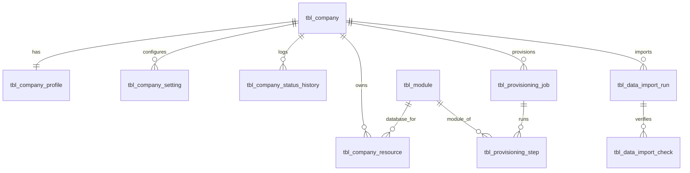

#### 6.3.2 Catalog, plans, orders, subscriptions, entitlements

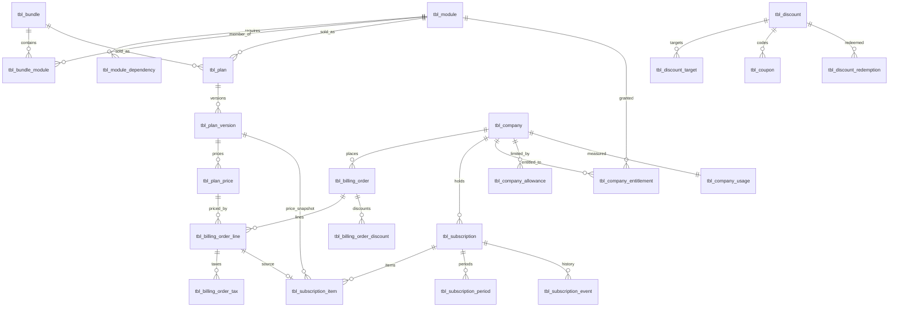

#### 6.3.3 Identity, administration and RBAC policy

Role **assignments** are not in this diagram: they live in the Keycloak realms (CD-11).

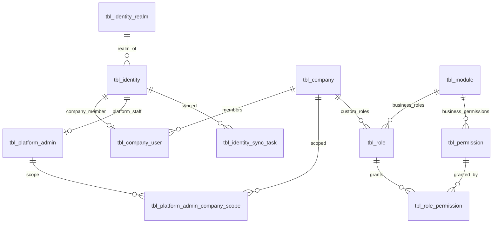

#### 6.3.4 How the main objects relate (summary)

- A **Company** has one profile, settings, one or more **Subscriptions**, materialized **Entitlements**, **Allowances**, **Usage**, registered **Resources** (a database and a bucket per purchased module, its Keycloak realm), **Company Users**, its own **custom Roles**, and **Provisioning jobs**.
- A **Subscription** consists of **Items** (modules, bundles, dependencies, extra users, extra storage), priced by a **Price book** and created only from accepted **Quotes**.
- **Modules** have **Dependencies** and belong to **Bundles**. Module databases are company **Resources**.
- A **Company User** is an identity in the **company realm** and holds **roles in that realm** (predefined or custom; business or company-admin domain). The CP keeps the membership (seat, status mirror, audit), not the roles. The effective access is always bounded by the company's **Entitlements** (master §10.5).
- A **Platform Admin** holds **platform roles in the platform realm**, plus a CP **company Scope**. Platform permissions never include business data access.

#### 6.3.5 Billing, invoices and payments (CURRENT core + FUTURE gateway)

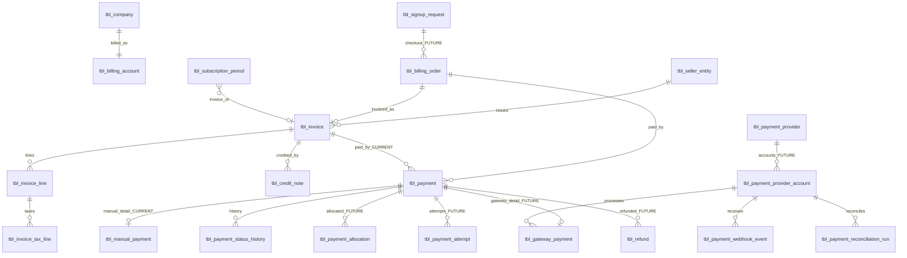

#### 6.3.6 Email connections, sender identities and policies (FUTURE)

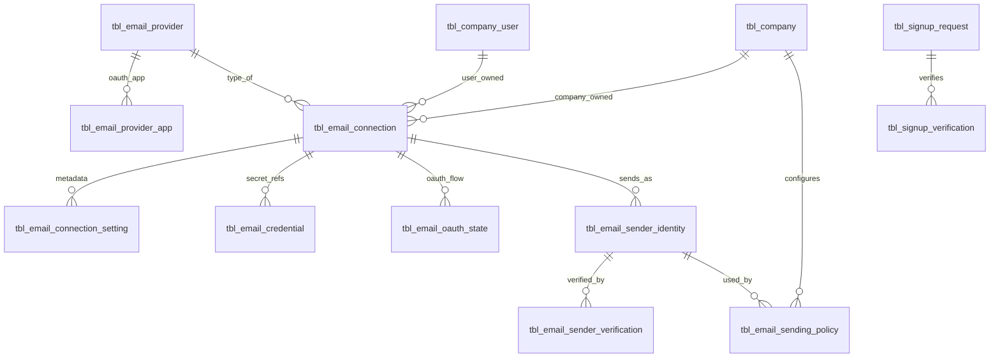

### 6.4 Schema migration strategy and compatibility

| Topic | Strategy |
|---|---|
| Control-plane data | `control_panel_db` holds **no production data** today. The existing development database is development data only. **During development (CD-27)** the new Company model is introduced through JPA entities with `ddl-auto: update` on a **fresh development database** (no in-place renames of the old model); the old development database is backed up and kept until the owner approves dropping it. **Nothing is dropped automatically.** The clean Liquibase baseline comes only in PHASE_11A, after the CP model is stable. |
| The legacy production `control_panel_db` (protected host) | Untouched. The new platform DB is created on the new platform MySQL server. The name collision is irrelevant because the servers differ (Q-20). |
| Changelog layout | **Deferred to PHASE_11A (CD-27).** No CP changelog is written in PHASE_02..PHASE_11. PHASE_11A designs the final layout (a reviewable split such as tables, constraints and indexes, seeds; one table per file per `LIQUIBASE_CONVENTIONS.md`) from the audited final schema. |
| The superseded generated changelogs (26 files of the old model) | Not run and not extended. Retired in PHASE_11A (moved to `_cleanup_review` with owner approval; no deletion). |
| Runtime compatibility | The internal metadata API is `GET /api/v1/internal/platform/companies/{companyCode}/metadata?serviceName=` (renamed from `/organizations/{id}` with the payload field `companyCode` in P02-T11 stage B; COMMON `ControlPlaneClient` changed with it). Domain services needed no own change to keep routing (the resolver tests stay valid). `/active` stays. The Redis key was renamed from the LEGACY `ORG_MODULES` to `COMPANY_MODULES` (CD-26; done in P02-T11 stage B): the gateway, the COMMON filter and the CP publisher changed one key constant. |
| Code compatibility | Old CP code (Customer/Organization services, plan code, the organization quota) is migrated to the Company model in PHASE_02/04/06 and removed only after its replacement passes the tests. |
| Tenant databases | Unchanged structurally. They gain Liquibase tracking tables when migrated with the tenant migrator (PHASE_02). |
| Forward evolution | Expand–contract changesets; no `drop*` in tenant changelogs without owner-approved exceptions. |

### 6.5 Platform Super Admin and Keycloak design (realm per company, CD-06)

#### 6.5.1 Realm model (CONFIRMED DECISION CD-06)

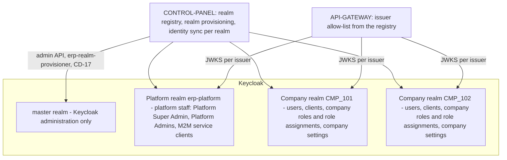

| Realm | Contains | Never contains |
|---|---|---|
| `master` | Keycloak administration (operator); the realm-provisioning service account `erp-realm-provisioner` (CD-17) | Any ERP user |
| **Platform realm `erp-platform`** (CD-17) | Platform Super Admins and Platform Admins (OTP mandatory); service-to-service (M2M) clients of the ERP services; the platform admin console client | Company users |
| **Company realm** (one per company) | That company's users only; its ERP web client(s) (public, PKCE); optionally its portal client (Q-14); a hard-coded `tenant_id` claim; realm-level security policies; **the company's roles (predefined from the template + custom) and every role assignment (CD-11)** | Users of another company; platform staff; platform roles |

Rules:
1. The company is identified by the **realm, that is the token issuer**, and confirmed by the `tenant_id` claim that the realm itself stamps (a hard-coded claim mapper in the realm template). The two must agree. One login = one company is guaranteed structurally (CD-02).
2. **Company roles and role assignments** are authoritative in the **company realm** (CD-11). The Control Plane holds only the CP Permission Policy (CD-12), the entitlements and the registry. The services enforce authorization (§6.7).
3. Platform roles exist **only** in the platform realm. A token from a company realm can never carry platform authority, even with a role of the same name, because authority is evaluated only for the platform issuer.

#### 6.5.2 Realm registry (schema)

`tbl_identity_realm` `[CURRENT]` `[NEW]`:

| Column | Type | Null | Key | Notes |
|---|---|---|---|---|
| id | BIGINT | NO | PK | |
| realm_type | VARCHAR(20) | NO | | PLATFORM, COMPANY |
| company_id | BIGINT | YES | FK → `tbl_company`; UQ | Required for COMPANY; NULL for PLATFORM |
| realm_name | VARCHAR(100) | NO | UQ | Naming rule `co-<n>` (e.g. `co-101`) for every company, Shivam included (CD-16); `erp-platform` for the platform realm |
| issuer_uri | VARCHAR(300) | NO | UQ | The exact `iss` value accepted |
| jwks_uri | VARCHAR(300) | NO | | |
| template_version | VARCHAR(20) | NO | | The realm-template version applied |
| status | VARCHAR(20) | NO | | PROVISIONING, ACTIVE, DISABLED, ARCHIVED |
| last_reconciled_at | DATETIME(6) | YES | | Drift check |
| [audit], [ver] | | | | |

`tbl_identity.identity_realm_id` (new FK). The uniqueness becomes UQ (`identity_realm_id`, `keycloak_user_id`), because Keycloak user ids are unique per realm, not globally.

#### 6.5.3 Implications and required automation

| Area | Implication of a realm per company | Required automation and design |
|---|---|---|
| **Realm provisioning** | Each new company needs a fully configured realm before its users can log in | Provisioning step `CREATE_REALM` (PHASE_08): create the realm from a **versioned realm template as code** (JSON plus scripts in the repository): security policies, token lifetimes, brute-force protection, password policy, required actions, client scopes and mappers (audience, hard-coded `tenant_id`), clients, the **predefined company roles** of the purchased modules as **realm roles** delivered by the built-in `roles` client scope (CD-14), the platform SMTP (CD-19), theme. Idempotent; recorded in `tbl_identity_realm` + `tbl_company_resource` (IDP_REALM). |
| **Company creation** | Company DRAFT → realm created during provisioning | The realm name derives only from `company_code`. The company status becomes ACTIVE only after the realm is VERIFIED. |
| **User creation** | Users are created **inside the company realm** | The identity-sync outbox becomes **realm-aware**: every task carries the realm. Invitations (execute-actions email) are sent from the company realm. The Company Super Admin is the first user. |
| **Roles and permissions** | Each realm holds its company's roles and assignments (CD-11); the predefined roles must be identical across realms | The **realm template** creates the predefined company roles for the purchased modules; `ADD_MODULE` adds the roles of a new module; the realm reconciler detects missing, changed or `PLATFORM_*` roles. Role assignment goes through the realm admin API, only via the ERP backend (CD-13). The CP Permission Policy (CD-12) stays in the CP (Q-54) so that it is not duplicated in every realm. |
| **Clients** | Each realm needs its own public ERP client (and the portal client if used) | Created by the template. Client `erp-web` (and `erp-portal` if used, plus `erp-identity-admin`); redirect URIs to the ERP login page (no subdomains in R1, CD-15). M2M service clients live **only in the platform realm**, so the services do not need credentials per company. |
| **Token validation** | The gateway and the services must accept **many issuers**, but only registered ones | The issuer allow-list is loaded from `tbl_identity_realm` (cached, refreshed on change). JWKS per issuer is cached with key rotation. Unknown issuer → 401. Issuer → company mapping, then `tenant_id` claim equality. The existing `RealmIssuers` multi-issuer resolver is extended from 2 static issuers to the registry-driven list. |
| **Realm discovery and routing** | The login page must send the user to the right realm | **Company Login Code** (CD-15, §6.5.11): public, rate-limited discovery endpoint with a generic error; no company enumeration. Subdomains and a broker realm are future. |
| **Realm configuration** | Settings must stay consistent across hundreds of realms | **Realm reconciler job**: compares each realm with its template version, reports drift, applies approved template upgrades in batches, and records `template_version` / `last_reconciled_at`. Manual console changes are detected and reported. |
| **Realm lifecycle** | Suspension, archive and reactivation must reach the IdP | SUSPENDED company → realm login blocked (realm `enabled=false`, or the gateway denies; decided at implementation). ARCHIVED → realm disabled and **retained**. Deletion only through the manual purge process (master §19.6). No automatic realm deletion. |
| **Backup and recovery** | All realms share Keycloak's database. Restoring **one** company's realm is not a simple DB restore. | Scheduled Keycloak DB backups plus a **per-realm export** (configuration and users, excluding secrets where possible) for single-company recovery; a documented restore procedure; regular restore drills. |
| **Monitoring** | Failures may affect one realm only | Per-realm metrics: login failures, lockouts, token errors, admin events. Alert on realm drift, a disabled realm with active subscriptions, or an expired certificate or key. Total realm count. |
| **Upgrades** | A Keycloak version upgrade affects all realms at once; template changes must be applied to every realm | A staged upgrade on staging with representative realms; template migrations as versioned scripts run by the reconciler; upgrade runbook. |
| **Large number of companies** | Keycloak memory, startup time, cache and admin operations grow with the realm count | Capacity tests at the planning target of **50 companies** (CD-18, §6.5.13), horizontal scaling, cache tuning, and limits on admin calls. Load-test thresholds are defined before production. |
| **Automation (summary)** | Manual operation does not scale beyond a few companies | Realm template as code; `CREATE_REALM`, `DISABLE_REALM`, `ENABLE_REALM` provisioning steps; realm-aware identity sync; realm reconciler; key and client-secret rotation jobs; per-realm export job; monitoring dashboards; runbooks. **No company realm is configured by hand.** |

#### 6.5.4 Token claims used by the backend

| Claim | Platform realm token | Company realm token | Validation |
|---|---|---|---|
| `iss` | Platform issuer | `…/realms/<company realm>` | Must be in `tbl_identity_realm` with status ACTIVE |
| signature, `exp`, `aud` (`nyaalkaran-erp`) | ✓ | ✓ | JWKS of that issuer; audience mapper in every realm |
| `sub` | ✓ | ✓ | Linked to `tbl_identity` (realm + user id) |
| `tenant_id` | — | Hard-coded per realm (= the company `company_code`) | Must equal the registry mapping of the issuer |
| `realm_access.roles` (realm roles, CD-14) | `PLATFORM_SUPER_ADMIN` / `PLATFORM_ADMIN` | The user's company roles (e.g. `COMPANY_ADMIN`, `CRM_MANAGER`) | Platform authority **only** from the platform issuer; company roles only from the issuer of the request's company; permissions resolved through the CP policy (§6.7) |
| `azp` | M2M clients | — | Allow-lists on internal APIs |

#### 6.5.5 Platform Super Admin creation (CONFIRMED DECISION CD-04, refined by CD-28 item 9)

1. **Secure bootstrap (CD-28 item 9).** No permanent seeded username/password (never `admin/admin`). The operator supplies the initial username, email and a one-time initial password **only through environment / secret configuration**. The one-time Control Plane bootstrap creates the user in the **platform realm** `erp-platform` (via `erp-platform-identity-admin`) with the realm role `PLATFORM_SUPER_ADMIN`, the initial password marked **temporary** (required action `UPDATE_PASSWORD`, forced change at first login), and the required actions `VERIFY_EMAIL` and `CONFIGURE_TOTP` (OTP mandatory for platform accounts, Q-27). The Platform Super Admin is platform-level and has **no company code**.
2. In the same one-time run (environment property, single run; refused when an ACTIVE `SUPER_ADMIN` exists unless the operator sets the one-time allow-additional flag), the bootstrap inserts `tbl_identity` (platform realm, `account_scope=PLATFORM`) + `tbl_platform_admin(SUPER_ADMIN, created_via=BOOTSTRAP)` (entity owned by PHASE_04, CD-28 item 4) and records `PLATFORM_SUPER_ADMIN_BOOTSTRAPPED` in the platform audit log. The initial password is never logged, stored in the CP DB or returned by any API; the operator removes it from the secret configuration after the first login.
3. Additional Super Admins: operator only, through the same procedure with an explicit one-time flag.
4. **Company administrators can never create, invite or elevate a Platform Super Admin.**
   - Company APIs operate only on company realms.
   - Platform roles do not exist in company realms.
   - The platform-role assignment exists only in platform APIs (Super Admin).
5. Platform Admins are created by a Platform Super Admin, through the platform realm, using the identity-sync task `ASSIGN_PLATFORM_ROLE`.

#### 6.5.6 Platform versus company separation (summary)

| Aspect | Platform | Company |
|---|---|---|
| Realm | Platform realm | The company's own realm |
| Authority | Platform-realm role + `tbl_platform_admin` row (status, scope) + platform permission policy | Company-realm roles (CD-11) + CP Permission Policy (CD-12) + company entitlements; `tbl_company_user` mirrors membership and seats |
| Routes | `/control-panel/api/v1/platform/**` | Business modules, `/control-panel/api/v1/company/**` |
| Business data | Never | Own company only |
| MFA | Mandatory | Per-realm policy (Q-27) |

#### 6.5.7 How platform administrators manage companies, and how company users get in

- **Platform staff** log in to the platform realm, then use the platform console. Company creation triggers provisioning, which creates the company realm and invites the Company Super Admin **into that realm**.
- **Company users:**
  1. They are invited by their Company Super Admin or a permitted Company Admin.
  2. Their account exists only in their company realm.
  3. They log in with the **Company Login Code** (CD-15), which leads to their company realm.
  4. Their token's issuer and `tenant_id` bind every request to that company only.

#### 6.5.8 Realm and client naming (CONFIRMED, CD-15/CD-17)

| Object | Name | Notes |
|---|---|---|
| Keycloak administration realm | `master` | Operator only; holds the realm-provisioning service account (§6.5.10) |
| Platform realm | **`erp-platform`** | Platform staff only (CD-04). Never used for company users. |
| Company realm | **`co-<n>`** (e.g. `co-101`) | One per company, derived from `company_code`; validation `^co-[0-9]{1,8}$`. Shivam gets a standard `co-<n>` realm like every company (CD-16). |
| Company ERP web client | `erp-web` | Public client, PKCE, in every company realm |
| Company identity-admin client | `erp-identity-admin` | Confidential, service account only, in every company realm (§6.5.10) |
| Company portal client | `erp-portal` | Optional (Q-14), in the company realm |
| Platform console client | `platform-console` | Public client, PKCE, OTP enforced, in `erp-platform` |
| Service-to-service clients | `svc-<service>` | Confidential, client credentials, **only** in `erp-platform` |
| Audience | `nyaalkaran-erp` | Audience mapper in every realm |

The gateway and the microservices are **resource servers**. They validate tokens and need no client per company realm.

#### 6.5.9 Role architecture in Keycloak (CONFIRMED DECISION CD-14, closes Q-56)

Verified against the official Keycloak documentation and the repository:
- Keycloak distinguishes **realm roles** (a role defined for the whole realm) from **client roles** ("a role namespace dedicated to the client").
- The built-in `roles` client scope is a realm **default** client scope. Its mappers put realm roles into `realm_access.roles` and client roles into `resource_access.<client>.roles`.
- With **Full Scope Allowed** on (the default), a client's token carries all the user's role mappings. Switching it off restricts the token to the client's role scope mappings.
- Sources: [Keycloak Server Administration Guide](https://www.keycloak.org/docs/latest/server_admin/index.html), [Keycloak discussion on default client scopes](https://github.com/keycloak/keycloak/discussions/37804).

**Target model:**

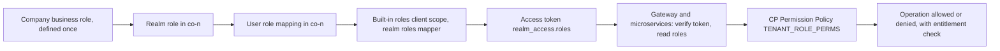

**Role consistency across clients:**
- A business role such as `CRM_MANAGER` exists **once**, as a realm role of `co-<n>`.
- Clients (`erp-web`, `erp-portal`) are applications, not role owners. **No client defines a copy** of a business role: there is no `erp-web → CRM_MANAGER`, no `api-gateway → CRM_MANAGER`, no `crm-service → CRM_MANAGER`.
- `erp-web` keeps **Full Scope Allowed = on**, so its tokens carry all the user's realm roles of that company realm. The realm contains only company roles, so nothing foreign can appear.
- If a client must receive only a subset (e.g. `erp-portal`), the realm template sets Full Scope Allowed = off for that client and grants the needed realm roles through its **role scope mappings**. This is configured centrally in the template, never by hand.
- Client roles are allowed only for a concrete application-specific technical need, documented in the template. **None is planned in R1.**

**Role naming convention:**

| Kind | Rule | Examples |
|---|---|---|
| General | `UPPER_SNAKE_CASE`, `^[A-Z][A-Z0-9]*(_[A-Z0-9]+)*$`, ≤ 60 characters, unique in the realm | — |
| Platform predefined (realm `erp-platform`) | `PLATFORM_<NAME>` | `PLATFORM_SUPER_ADMIN`, `PLATFORM_ADMIN` |
| Company-admin predefined (every `co-<n>`) | `COMPANY_<NAME>` | `COMPANY_SUPER_ADMIN`, `COMPANY_ADMIN` |
| Module predefined (every `co-<n>`, per purchased module) | `<MODULE_CODE>_<LEVEL>`, levels `USER`, `TEAM_LEAD`, `MANAGER`, `ADMIN`, `SUPER_ADMIN` | `CRM_USER`, `CRM_MANAGER`, `HRMS_MANAGER`, `ACCOUNT_BOOK_USER` |
| Company custom (one `co-<n>`) | `CUSTOM_<NAME>` | `CUSTOM_ROLE_SALES`, `CUSTOM_ROLE_X` |
| Reserved | Custom roles may not start with `PLATFORM_`, `COMPANY_` or a module code; Keycloak's own roles (`default-roles-co-<n>`, `offline_access`, `uma_authorization`) are ignored by the policy | — |

**Role template:** the versioned realm template (PHASE_03) contains the company-admin roles. `CREATE_STANDARD_ROLES` adds the module roles of every purchased module (provisioning and `ADD_MODULE`). Each predefined role has a CP `tbl_role` row (`role_type=SYSTEM`) with its default permission policy.

**Lifecycle rules:**

| Operation | Predefined roles | Custom roles |
|---|---|---|
| Create | Automation only (`CREATE_STANDARD_ROLES`) | Company Super Admin, or a Company Admin with `company.role.manage`, through the ERP UI (CD-13); the backend creates the realm role + the CP policy row |
| Update | **Not allowed** for companies (409 `SYSTEM_ROLE_IMMUTABLE`). Template upgrades by the platform only. | The description and the permission policy (within the assigner's own permissions); the **name is immutable** because it is the identifier in the policy |
| Delete | **Not allowed** for companies. Removing a module **does not delete** its roles; they become inert (no entitlement). | Only when no user holds it (checked in the realm); otherwise disable it first. The policy row is kept as history (status DISABLED). |
| Assign | Within entitled modules and the escalation rules (§6.7.5) | Same |

**Token mapping:**
- realm roles → `realm_access.roles` (built-in `roles` scope);
- the audience mapper → `aud` contains `nyaalkaran-erp`;
- the hard-coded claim mapper → `tenant_id`.

The services read roles **only** from `realm_access.roles` of the **verified** token, through one COMMON-LIBRARY extractor. Unknown roles are ignored by the policy.

**Legacy compatibility (`CODE-INSPECTED`):**

| Code | Today | Classification | Migration |
|---|---|---|---|
| CRM `CrmDataAccessAuthority`; COMMON `JwtAccessTokenUtil`; COMPLIANCE `JwtAccessTokenUtil`, `ComplaintLetterController`, `IndependentMasterOfTaskServiceImpl`; CP `JwtRoleExtractor`; ACCOUNT-BOOK `KeycloakAccountBookRolesConverter` (`account-book-ui` client roles); erp-ui `debug-auth.interceptor.ts` | Read client roles from `resource_access`, partly without signature verification | **CURRENT/LEGACY** | Replaced by the COMMON extractor (realm roles of the verified token) and `@RequiresPermission` (PHASE_10). Legacy client-role names are mapped to realm roles (Shivam migration). |
| HRMS / PAYROLL `TenantContext` | Reads `realm_access.roles` (`SUPER_ADMIN`, `TENANT_ADMIN`, `HR_ADMIN`, `PAYROLL_ADMIN`) and a `tenant_id` claim, with an `X-Tenant-Id` header fallback | **CURRENT/LEGACY** (realm-role style already; the header fallback is a security gap) | Replaced by the central verification and permission evaluator; the `X-Tenant-Id` fallback is removed |
| CP `PlatformJwtGrantedAuthoritiesConverter` | Platform authority from realm roles `PLATFORM_SUPERADMIN` / `PLATFORM_ADMIN`; ignores client roles | **MIGRATION COMPATIBILITY** (already realm-role based) | Restricted to the `erp-platform` issuer; role name `PLATFORM_SUPERADMIN` → `PLATFORM_SUPER_ADMIN` |

#### 6.5.10 Keycloak administrative service accounts (CONFIRMED DECISION CD-17, closes Q-48)

**Platform business authorization** (who may create a company, assign a user, record a payment) is the CP's platform permission model. It is separate from **Keycloak infrastructure administration**, which only backend service accounts perform:

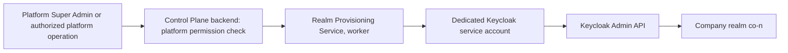

| Service account (client) | Realm | Rights (minimum) | Used for |
|---|---|---|---|
| `erp-realm-provisioner` | `master` | Master realm role `create-realm`. Keycloak grants the creator full access to the realms it creates, and nothing else. | `CREATE_REALM`, `ENABLE_REALM`, `DISABLE_REALM`, `APPLY_REALM_TEMPLATE`, `CREATE_STANDARD_ROLES`, `CONFIGURE_CLIENTS`, custom-role creation and deletion (realm configuration), `RECONCILE_REALM`. `REGISTER_REALM` is a CP database step. |
| `erp-identity-admin` | **each company realm** (created by `CONFIGURE_CLIENTS`) | Service-account roles of that realm's `realm-management` client: `manage-users`, `view-users`, `query-users`, `view-realm`. No `manage-realm`, no access to any other realm. Authentication by **signed JWT** (one CP key pair published as a JWKS URL), so no per-realm secret is stored. | Company user and role-assignment operations of the ERP company admin APIs (CD-13). It is scoped to exactly one realm by construction. |
| `erp-platform-identity-admin` | `erp-platform` | `manage-users`, `view-users`, `query-users` of `erp-platform` | Platform Admin users and `ASSIGN_PLATFORM_ROLE` (never `PLATFORM_SUPER_ADMIN`, CD-04) |

Rules:
- The secrets are in the environment or secret store (owner-managed), used only by the CP worker, and never in a frontend, a log or the DB.
- Platform Admins never receive master or `erp-platform` admin credentials.
- Company admins never reach these operations directly (CD-13).
- Every call is audited with the platform actor that triggered it.
- Source: [Keycloak admin permissions](https://docs.redhat.com/en/documentation/red_hat_build_of_keycloak/26.4/html/server_administration_guide/admin_permissions): users with `create-realm` can create new realms and are granted full access to the realms they create.

#### 6.5.11 Company Login Code (CONFIRMED DECISION CD-15, closes Q-46)

```mermaid
sequenceDiagram
    autonumber
    actor U as User
    participant UI as ERP login page
    participant D as Discovery API (public, rate-limited)
    participant CP as CP registry
    participant KC as Keycloak co-n
    U->>UI: enter Company Login Code e.g. ABCMFG01
    UI->>D: POST /public/auth/discover
    D->>CP: login_code lookup
    CP-->>D: company ACTIVE and realm ACTIVE, issuer, client erp-web
    D-->>UI: authorization endpoint + client id + issuer (no other data; issuer added by owner decision 2026-10-06, P03-T12)
    UI->>KC: redirect (PKCE)
    U->>KC: authenticate
    KC-->>UI: tokens
    UI->>UI: call the gateway, which validates issuer, signature, audience, expiry and company
```

**`tbl_company.login_code`:**
- unique, non-sensitive, 6–12 characters `^[A-Z0-9]{6,12}$`;
- chosen or generated by the platform (e.g. `ABCMFG01` for "ABC Manufacturing Pvt Ltd");
- **not** the company code, the company code, a database name or the realm name; it reveals no infrastructure;
- stable, changed only by an authorized, audited platform operation (`platform.company.update`);
- never used as a security identifier: it only selects the login realm.

**Failures:**
- an invalid code, a non-ACTIVE company (suspended, disabled, archived) or a disabled realm all return the **same generic response** ("Invalid Company Code"), so companies cannot be enumerated;
- the endpoint is rate-limited, and no authentication starts;
- the gateway and the services still deny tokens of non-ACTIVE companies and realms.

**Note:** the Keycloak authorization URL necessarily contains the realm name (`/realms/co-<n>/…`). The realm name is a non-sensitive technical identifier; no database name, host or credential is exposed.

**Future enhancements (not R1):** company subdomains, a broker realm, remembering the last code on the device.

#### 6.5.12 Keycloak identity email (CONFIRMED DECISION CD-19, closes Q-53 for R1)

- Keycloak identity emails (email verification, password reset, execute-actions invitations, account notices) are sent through **one central platform transactional SMTP** with a platform-owned sender and domain (e.g. `no-reply@<platform domain>`, owner-defined).
- The realm template sets each realm's SMTP settings automatically. The SMTP password is referenced through the **Keycloak vault** (`${vault.<key>}`), so the secret is not copied into each realm's configuration. The company display name and theme appear in the templates.
- Companies configure nothing. Company-specific SMTP for identity emails is future.
- This is unrelated to ERP business email (CD-08, PHASE_13).

#### 6.5.13 Capacity planning (CONFIRMED DECISION CD-18, closes Q-49 for R1)

Planning target: **50 companies.** It is not a hard limit; growth beyond it requires a new capacity validation.

| Area | Planning figure at 50 companies | Action |
|---|---|---|
| Keycloak | 51 realms (50 + `erp-platform`) + `master` | Well inside the range the Keycloak community reports for one installation (hundreds of realms with cache tuning, [discussion](https://github.com/keycloak/keycloak/discussions/11074)); realm cache sized to the realm count; load test of logins and token validation at 50 realms |
| Databases | ≤ 50 × (purchased modules + attachment + notification) schemas (worst case 50 × 18 = 900) | Per-service pools only for ACTIVE companies entitled to that module; small pools with idle eviction; MySQL `max_connections` sized from the load test |
| Buckets | ≤ 50 × (purchased modules + control-panel bucket) (worst case 850) | Bucket-count monitoring |
| Provisioning | Sequential jobs (one per company), realm creation included | Throughput measured in PHASE_12 |
| Jobs | `@RunPerTenant` iterates ≤ 50 companies per module | Per-company locks; duration monitored |
| Backup | 50 per-company backups + 51 realm exports | Schedule and retention (Q-23) sized for 50 |
| Monitoring, reconciler, registry | 50 realms, 50 registry entries per resource type | Reconciler batches; alerts per realm |

### 6.6 Company database routing and tenant context

#### 6.6.1 End-to-end request flow (realm per company, shared DB credentials)

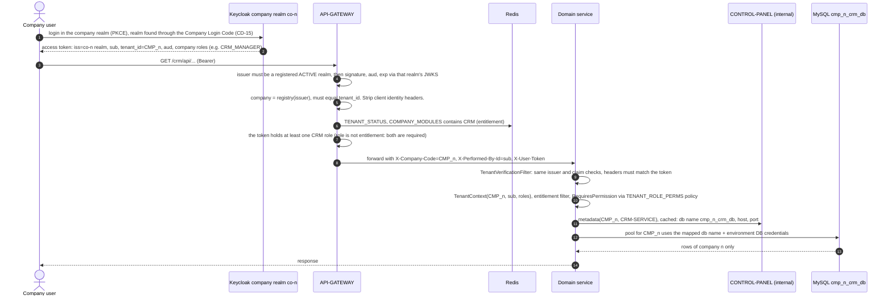

#### 6.6.2 Resolution and validation rules

| Step | Rule | Failure |
|---|---|---|
| 1 Issuer | `iss` ∈ registered realms with status ACTIVE (`tbl_identity_realm`) | 401 |
| 2 Token | Signature (the issuer's JWKS), audience `nyaalkaran-erp`, expiry | 401 |
| 3 Scope | Platform realm → platform routes only; company realm → company and business routes only | 403 `SCOPE_NOT_ALLOWED` |
| 4 Company | Company = the registry mapping of the issuer; the `tenant_id` claim must be equal | 403 `TENANT_MISMATCH` |
| 5 Company status | `TENANT_STATUS` = ACTIVE | 503 `COMPANY_NOT_READY` / 403 `COMPANY_SUSPENDED` / `COMPANY_DISABLED` |
| 6 Entitlement | Module token ∈ `COMPANY_MODULES` | 403 `MODULE_NOT_ENTITLED` |
| 7 User module access | The token (company realm) holds at least one role of the target module | 403 `MODULE_ACCESS_DENIED` |
| 8 Service verification | Steps 1–4 repeated in the service on `X-User-Token`; headers must match | 401/403 |
| 9 Permission | `@RequiresPermission`: token roles → `TENANT_ROLE_PERMS` (CP Permission Policy, CD-12) → the required permission (+ data scope) | 403 `PERMISSION_DENIED` |
| 10 Routing | DB name and bucket **only** from the VERIFIED `tbl_company_resource` rows for (tenant, module); credentials from the environment (CD-03) | 403/503 (fail-closed) |

Redis unavailable → 503 (fail-closed). A missing key → deny. **There is no `Active-Org` header and no company switching** (CD-02).

#### 6.6.3 Tenant context propagation

| Hop | Mechanism | Guarantee |
|---|---|---|
| Gateway → service | Trusted headers + the user token; the service re-verifies | A forged header without a matching verified token is rejected |
| Service → service (Feign) | Forwards `X-Company-Code`, `X-User-Token`, trace headers, plus an M2M token of the calling service; `X-Internal-Token` only for `/api/v1/internal/**` | The callee re-verifies the user token (business calls) or the M2M token + `azp` (internal calls) |
| `@Async` | `MdcTaskDecorator` copies and restores the context | No leakage across tasks |
| Scheduled jobs | `@RunPerTenant(module=…)` iterates ACTIVE companies entitled to the module and sets or clears the context per company under a per-company lock | No tenant-less business job (architecture test) |
| WebSocket | Single-use gateway ticket → `TenantStompSupport` namespaced destinations `/topic/tenant.<CMP_n>.*` | No cross-company broadcast |
| Cache | Spring cache key prefix `<tenant>:` (existing `RedisConfig`) | No shared cache entries |
| Invalidation | CP publishes `tenant-invalidation` → services clear metadata, realm registry, role-policy cache and pools | Suspension takes effect in seconds; role changes with the next token (≤ 5 min) or immediately with session revocation |

### 6.7 Roles, permissions, entitlements and runtime authorization (CONFIRMED DECISION CD-11, closes Q-50)

#### 6.7.1 Separation of concepts (mandatory)

These concepts are **never merged**. Each has exactly one owner:

| Concept | Question it answers | Owner (source of truth) | Example |
|---|---|---|---|
| **Identity** | Who is the user? | **Keycloak Company realm** (company users) / **Platform realm** (platform staff) | `john@company-a.com` in realm `co-101` |
| **Company** | Which company does the request belong to? | The **token issuer** (realm) → `tbl_identity_realm`, confirmed by the realm's hard-coded `tenant_id` claim (CD-02, CD-06) | realm `co-101` → `CMP_101` |
| **Keycloak Role Assignment** | Which roles does this user hold? | **Keycloak Company realm** (CD-11). The Control Plane is **not** the runtime source of truth for user-role assignment. | John → `CRM_MANAGER` in `co-101` |
| **CP Permission Policy** | What may a role do? | **Control Plane**: permission catalog, role → module → permission → operation mappings, policy version (CD-12; centralized editing UI is FUTURE) | `CRM_MANAGER` → `crm.customer.create`, `crm.customer.read`, `crm.report.view` |
| **Module entitlement** | Has the company purchased and activated the module? | **Control Plane** subscription and entitlement engine (PHASE_06), published as `COMPANY_MODULES` | `CMP_101` has CRM ACTIVE |
| **Runtime Authorization** | Is this operation allowed now? | **Application / microservice backend** (gateway + every service) | Allow `POST /crm/customers` |
| **Database routing** | Where does this company's module data live? | **Control Plane** registry (`tbl_company_resource` DATABASE) | `cmp_101_crm_db` |
| **Storage routing** | Where do this company's module files live? | **Control Plane** registry (`tbl_company_resource` BUCKET) | `cmp-101-crm-bucket` |

**Authorization rule:** an operation is allowed only when **all** of the following hold:

```
verified token (signature, issuer, expiry, audience)
  AND company = registry(issuer) = tenant_id
  AND company ACTIVE
  AND module entitled for the company (subscription)
  AND the user holds a role in the company realm
  AND that role grants the permission for the operation (CP Permission Policy, CD-12)
```

- A valid role **alone** never grants access to a module the company has not purchased. For example, a user with `CRM_MANAGER` in a company without an active CRM subscription gets 403 `MODULE_NOT_ENTITLED`.
- An entitled module **alone** never grants access to a user without a role that carries the permission. For example, CRM is purchased but the user has no CRM role, so the result is 403 `PERMISSION_DENIED`.
- **Frontend-provided company ids, roles or permissions are never trusted.** Roles are read only from the verified token of the company realm.

#### 6.7.2 Role model

| Role class | Defined where | Assigned where, by whom | Editable by a company? | Examples |
|---|---|---|---|---|
| **Platform predefined roles** | **Platform realm** (created by the operator runbook) | Platform realm `erp-platform`. `PLATFORM_SUPER_ADMIN`: operator only (CD-04). Other platform roles: a Platform Super Admin, through the CP platform APIs that write to the platform realm. | **Never.** Company admins cannot see, create or assign them. | `PLATFORM_SUPER_ADMIN`, `PLATFORM_ADMIN` (+ further platform roles if the owner defines them) |
| **Company predefined roles** | **Each company realm**, created from the **realm template** (PHASE_03) for the company's purchased modules; added by `ADD_MODULE` | Company realm. `COMPANY_SUPER_ADMIN`: provisioning (first user) or the platform. Others: the Company Super Admin or an authorized Company Admin, through the ERP Company Admin UI and backend (CD-13). | **No:** they cannot be edited or deleted by companies (`SYSTEM_ROLE_IMMUTABLE`); they can be assigned. | `COMPANY_SUPER_ADMIN`, `COMPANY_ADMIN`, `CRM_MANAGER`, `CRM_USER`, `HRMS_MANAGER`, `HRMS_USER` |
| **Company custom roles** | Company realm (created by the Company Super Admin or an authorized Company Admin) | Company realm, same as above | Yes, within the company only (§6.5.9 lifecycle) | `CUSTOM_ROLE_SALES` |
| **Permission templates** | Control Plane configuration (permission catalog + role-permission templates) | — | Not by companies. Platform editing is FUTURE (§6.7.4). | `CRM_MANAGER` template |

Every role is a Keycloak **realm role** (CD-14). Naming, token mapping, lifecycle and legacy compatibility are in §6.5.9. The legacy spellings `PLATFORM_SUPERADMIN` / `COMPANY_SUPERADMIN` (CP code) are migrated to `PLATFORM_SUPER_ADMIN` / `COMPANY_SUPER_ADMIN`.

#### 6.7.3 Rules (backend-enforced)

1. **Realm isolation:** a role exists only inside its own realm. A user of Company A can never hold a role of Company B, because the user and the role live in different realms, and the backend reads roles only from the token of the user's own company realm.
2. **Platform separation:** platform roles exist **only** in the platform realm. Platform authority is evaluated only for tokens of the platform issuer. A company-realm role with a `PLATFORM_*` name has no effect, and the realm template and the reconciler reject such roles.
3. **Company administrators** act only inside their own realm and company. The company comes from the verified token, never from a path or body. They can never create, invite, elevate or modify platform identities or platform roles (CD-04), and they can never access another company's realm, databases or buckets.
4. **Predefined roles** can be assigned (within entitlements) but not edited or deleted by companies (409 `SYSTEM_ROLE_IMMUTABLE`). **Custom roles** belong to exactly one company realm.
5. **No escalation:** an assigner may assign only roles whose permissions they themselves hold. The last ACTIVE Company Super Admin cannot be removed or demoted. These guards are enforced by the ERP backend (CD-13, §6.7.5).
6. **Entitlement ceiling:** module roles take effect only for entitled modules. A role never re-enables a non-entitled module.
7. **Enforcement points:**
   - the gateway: issuer, company, status, entitlement, and the user holds at least one role of the target module;
   - every service: verification filter, entitlement filter, `@RequiresPermission` using the token roles and the role-permission policy (+ data scope);
   - the CP: platform and company permission annotations.

   **Frontend restrictions are cosmetic only.**
8. **Change latency:** a role change takes effect with the next access token (lifetime ≤ 5 minutes). Removing a user or a role that must take effect immediately also revokes the user's sessions in the company realm.
9. Every role assignment made through the ERP APIs is audited (platform audit or company audit). The realm reconciler detects assignments made outside the ERP APIs and reports them (CD-13).

#### 6.7.4 CP Permission Policy: current and future (CONFIRMED DECISION CD-12, closes Q-54)

| Capability | Status |
|---|---|
| Permission catalog declared by the services (codes, module, default data scope) | **CURRENT (R1)** (CD-12) |
| Role → permission policy of the **predefined** roles (one versioned template per role) | **CURRENT (R1)** (CD-12) |
| Permission policy of **company custom roles** (stored per company in the CP) | **CURRENT (R1)** (CD-12); created through the ERP UI (CD-13) |
| Platform Super Admin UI to define available roles, role permissions, module and application access, operation permissions, permission groups, role templates, company-specific customization rules | **FUTURE CAPABILITY.** The schema stays extensible (`tbl_role` templates, `tbl_permission`, `tbl_role_permission`). |

The Control Plane holds **policy** (what a role may do). It never holds **who has the role**.

#### 6.7.5 Company Admin user and role management (CONFIRMED DECISION CD-13, closes Q-55)

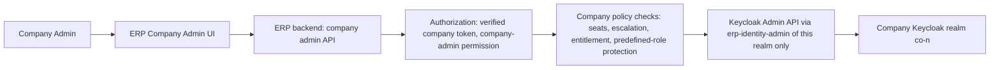

**Allowed operations** (each needs the named company permission):
- create or invite a user;
- disable or enable a user;
- send a password-reset or invitation email;
- view users and their roles;
- assign or remove allowed company roles;
- manage custom roles (`company.role.manage`).

**Never allowed** for company administrators:
- access to the `erp-platform` realm or to any other company's realm;
- managing platform roles or creating a Platform Super Admin or Platform Admin (CD-04);
- assigning another company's roles;
- bypassing subscription or module rules;
- access to the Keycloak Admin Console.

**Seat limit (backend-enforced, under a company row lock):**
- Seats in use = users with status INVITED or ACTIVE (enabled accounts).
- The limit is the subscription user allowance (`tbl_company_allowance` USERS).
- Example: plan of 20 users, 18 in use → creating a 19th and a 20th user is allowed; the 21st returns 409 `USER_LIMIT_REACHED`.
- Disabling a user frees a seat. Enabling a user consumes one again.
- Frontend checks are cosmetic only.

**Escalation guard:**

| Actor | May assign | May never assign |
|---|---|---|
| **Company Super Admin** (`COMPANY_SUPER_ADMIN`) | Any company role of its realm: `COMPANY_ADMIN`, module roles of entitled modules, custom roles; may create custom roles | `COMPANY_SUPER_ADMIN` (only the platform or provisioning assigns it; a second Super Admin follows Q-11, default **no**); any platform role |
| **Company Admin** (`COMPANY_ADMIN` or a custom admin role) | Only roles whose permissions it holds itself (CP policy comparison), within entitled modules | `COMPANY_SUPER_ADMIN`, `COMPANY_ADMIN` (non-grantable `company.admin.manage` is Super-Admin-only), any platform role, roles of non-entitled modules |

Additional rules:
- no self-elevation;
- the last ACTIVE Company Super Admin cannot be disabled or demoted;
- every change is audited.

**Keycloak console:** normal company admins receive no Keycloak console access and no Keycloak credentials. Only the backend service accounts of §6.5.10 call the Keycloak Admin API. Changes made in the console by operators are detected by `RECONCILE_REALM` and reported.

#### 6.7.6 Worked example: role ≠ permission ≠ module entitlement

Company A realm `co-101`:
- **Users:** `john` (`CRM_MANAGER`), `mary` (`CRM_USER`), `admin` (`COMPANY_ADMIN`).
- **Roles:** `COMPANY_SUPER_ADMIN`, `COMPANY_ADMIN`, `CRM_MANAGER`, `CRM_USER`, `HRMS_MANAGER`, `CUSTOM_ROLE_SALES`.

CP Permission Policy (CD-12):

```
CRM_MANAGER -> CRM -> CUSTOMER_VIEW, CUSTOMER_CREATE, CUSTOMER_UPDATE, CUSTOMER_DELETE
CRM_USER    -> CRM -> CUSTOMER_VIEW, CUSTOMER_CREATE
```

(Permission codes in the catalog are written `crm.customer.view`, `crm.customer.create`, …; `CUSTOMER_VIEW` is the operation shown in the policy UI.)

| Request | Role (Keycloak) | Entitlement (CP subscription) | Permission (CP policy) | Result |
|---|---|---|---|---|
| John updates a customer | `CRM_MANAGER` | CRM ACTIVE | `CUSTOMER_UPDATE` granted | **Allowed** |
| John updates a customer | `CRM_MANAGER` | CRM subscription **EXPIRED** | (not evaluated) | **Denied** 403 `MODULE_NOT_ENTITLED` |
| Mary deletes a customer | `CRM_USER` | CRM ACTIVE | `CUSTOMER_DELETE` **not** granted | **Denied** 403 `PERMISSION_DENIED` |

All three (role, permission, entitlement) are always evaluated.


### 6.8 Shivam: the first Company through the standard flow, then a data import

#### 6.8.0 Three separate activities (CONFIRMED DECISION CD-16, closes Q-47)

| Activity | What it is | Shivam-specific code? | Where |
|---|---|---|---|
| **A. Standard company provisioning** | Create company → subscription → full verified payment → `CREATE_REALM` (standard `co-<n>`) → `APPLY_REALM_TEMPLATE` → `CREATE_STANDARD_ROLES` → purchased module DBs → purchased module buckets → company users → role assignment → activation | **None.** There is no `if company == Shivam` anywhere. | PHASE_06–PHASE_10 |
| **B. Legacy identity migration** | Shivam users in the legacy `ERPSystem` realm → users of Shivam's new `co-<n>` realm | Operator-run migration tool and runbook, separate from provisioning | PHASE_11 (tool), PHASE_12 (execution) |
| **C. Legacy business-data export/import** | Owner-supplied exports → Shivam's module DBs and buckets | The generic import toolkit (`onboarding_type=IMPORT_EXISTING_DATA`) | PHASE_11 (toolkit), PHASE_12 (execution) |

**B. Identity migration design:**

1. **Export:** the owner runs a boot-time `kc.sh export --realm ERPSystem --users realm_file` on the legacy Keycloak. This is the only export that includes users with their credentials, as **password hashes**; Admin Console exports exclude users and mask secrets ([Keycloak import/export](https://www.keycloak.org/server/importExport)). The legacy Keycloak is on protected infrastructure, so **only the owner** performs this step.
2. **Transform** (offline tool, no connection to legacy hosts):
   - keep only Shivam's users;
   - map the legacy client roles and realm roles → the new company realm roles (owner-approved mapping table, CD-14);
   - drop legacy groups and attributes;
   - keep the user **id** when the target Keycloak is a separate installation, so that `sub` values referenced in business data stay valid. Otherwise produce an old `sub` → new `sub` mapping table that activity C applies.
3. **Import** into `co-<n>` (realm already created by activity A) through the Admin API or partial import, with the credential hashes.
4. **Verify in the staging rehearsal** that the migrated hashes authenticate (same hash algorithm available).
   - If that works, users keep their passwords.
   - **If not, or if the owner prefers it:** a controlled activation flow (execute-actions email `UPDATE_PASSWORD` through the platform SMTP, CD-19), sent in batches with support.
5. `ERPSystem` is **not** part of the target. It is not required by any future company. It stays untouched during the soak (rollback target), and its decommission is an owner decision. Nothing is deleted automatically.

#### 6.8.1 Principles

1. **No special architecture and no separate Shivam phase.** Shivam is created, configured and provisioned with exactly the same APIs, jobs and rules as any other company.
2. Importing existing data is a **generic, standard onboarding option** (`onboarding_type = IMPORT_EXISTING_DATA`, provisioning mode `EMPTY_FOR_IMPORT`). It is available to any future customer with legacy data. Its only differences: seeders are skipped, so imported master data does not collide with seed data, and the company waits in `AWAITING_DATA_IMPORT` until the import is verified.
3. The import happens **only after** the new architecture is implemented and verified (rollout gates in PHASE_12).
4. **The legacy Shivam system is never modified, deprecated or switched off by this project.** It stays the production system until the owner approves the cutover, and it stays available as the rollback target afterwards.
5. **Protected hosts:** the legacy data lives on `192.168.5.52` / `192.168.5.53`. No tool, script, test or agent of this project connects to them. **The project owner produces every backup and export.**

#### 6.8.2 Standard onboarding steps for Shivam

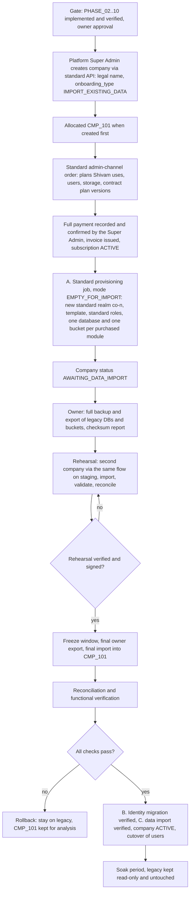

#### 6.8.3 Backup strategy (before any import)

| Item | Who | Content |
|---|---|---|
| Legacy databases | Owner, on the production side | A full logical backup (`mysqldump --single-transaction --routines --triggers`) per legacy DB, plus a checksum report generated with the provided read-only SQL script (row counts and per-table checksums) |
| Legacy buckets and local upload folders | Owner | A full mirror (e.g. `mc mirror`) plus an object count and byte totals per bucket |
| Keycloak realm | Owner | Boot-time `kc.sh export` of `ERPSystem` with users (password hashes) for the identity migration (activity B), plus a full Keycloak backup; `ERPSystem` itself is never modified |
| New platform | Platform | Backups of `control_panel_db` and `cmp_101_*` before the final import (empty schema state) |
| Storage of exports | Owner | An approved, access-restricted, non-protected location; retained until the soak ends plus the retention agreed |

#### 6.8.4 Import, validation and reconciliation

| Stage | Action | Checks recorded in `tbl_data_import_check` |
|---|---|---|
| Inventory | Read the export manifests | Expected tables, row counts, checksums, objects, bytes |
| Schema diff gate | Compare each legacy schema with the target Liquibase schema per module | Per table and column: MATCH, MAPPABLE or BLOCKER; a BLOCKER stops that module |
| Load | Data-only load (`--no-create-info --complete-insert`) into `cmp_101_<module>_db` using the environment DB credentials (CD-03); strict SQL mode; FK checks off **only** during the load; legacy Hibernate `*_seq` tables excluded | — |
| Integrity | FK orphan queries per FK; `AUTO_INCREMENT` set above `MAX(id)` | FK_INTEGRITY = 0 orphans |
| Reconcile data | Target row counts and checksums vs the source report | ROW_COUNT and CHECKSUM: 100 % PASS, or a WAIVED entry with the owner's reason |
| Attachments | Import `attachment_db` rows of the agreed modules into `cmp_101_attachment_db`; rewrite `bucket` to the module bucket `cmp-101-<module>-bucket`; keys unchanged; the 50 unknown-owner rows only by owner decision (Q-02) | OBJECT_COUNT, OBJECT_BYTES |
| Objects | Copy the owner mirror of each legacy module bucket into the matching `cmp-101-<module>-bucket` with keys unchanged; verify size and ETag | OBJECT_COUNT, OBJECT_BYTES |
| Usage | Recompute `tbl_company_usage.storage_bytes` and `billable_users` | Matches the allowance |
| Identities | **Activity B** (separate, §6.8.0): migrated users exist in Shivam's new `co-<n>` realm with their mapped realm roles; `tbl_identity` (realm + `sub`) + `tbl_company_user`; the old → new `sub` mapping (if ids changed) is applied to the business data | IDENTITY_LINK per user; login test per department |
| Functional | Smoke flows per module: CRM booking → logistics dispatch; store inward/outward → account-book; production job sheet → QC; payroll run; attendance report; compliance tasks; file download; notifications; chat | Signed checklist |

#### 6.8.5 Rollback strategy

- **Before cutover:** nothing changes for Shivam users. A failed import or verification leaves the legacy system in use. The `CMP_101` data is a copy. A retry requires an empty target, which the **owner-approved, audited "reset import target"** procedure provides. It is allowed **only** while the company is `AWAITING_DATA_IMPORT`, after a backup, and only for `CMP_101`'s module databases. No automatic reset ever happens.
- **After cutover, during soak:** the legacy system stays untouched (read-only by owner policy). Rollback means switching users back to the legacy UI and endpoints. The owner decides how to handle data entered in the new system during the soak (Q-28); this needs a documented reverse-delta procedure or manual re-entry.
- No step deletes legacy data. Decommissioning the legacy system is a separate owner decision after the soak.

#### 6.8.6 Cutover strategy

1. Agree the freeze window (owner). Announce it to users.
2. The legacy system goes read-only (owner action).
3. Final export and checksum report (owner).
4. Final import, reconciliation and functional checks (platform team).
5. Owner go/no-go.
6. Company `ACTIVE`. Identity links active. The UI points to the new gateway (DNS or configuration change by the owner).
7. Hypercare and soak (e.g. two weeks), with monitoring dashboards for errors, latency and isolation alerts.

#### 6.8.7 Compatibility changes and migration dependencies (Shivam must keep working)

| Area | Required change | Phase |
|---|---|---|
| Logins | Shivam's users move to Shivam's new standard realm `co-<n>` (CD-16) through the separate identity migration (§6.8.0 B): password hashes if they verify in the rehearsal, otherwise a controlled activation and password-reset flow. `ERPSystem` is not part of the target. | PHASE_11, PHASE_12 |
| Existing UI(s) | The production ERP UI (not in this repository) must use the ERP client of the company realm (`erp-web`: audience and `tenant_id` mappers, realm roles in `realm_access.roles`, CD-14) and call the gateway. `Active-Org` is removed (CD-02). The client is `erp-web` in Shivam's new company realm; users enter Shivam's Company Login Code (CD-15). Confirmation of the client and the UI changes is needed (Q-25). `account-book-ui` is configured the same way in the company realm. | PHASE_03 / PHASE_11 |
| Legacy client roles | Legacy `resource_access` client roles (and HRMS/PAYROLL realm roles) are mapped to the new company **realm roles** in activity B (owner-approved table, CD-14); the legacy role readers are replaced by the COMMON extractor | PHASE_10, PHASE_11 |
| Branding | Hard-coded Shivam names, logos, mail sender and letter templates → `tbl_company_profile` of CMP_101 (the values are preserved exactly) | PHASE_11 |
| Integrations | Today's `.env` flags → `tbl_company_setting` of CMP_101 (store, production and mining → account-book ON; CRM per the owner) | PHASE_11 |
| Email sending | **Interim (R1):** the existing global SMTP configuration keeps sending Shivam's emails unchanged; it is Shivam's own account. The committed QC password is rotated by the owner. **Future (PHASE_13):** Shivam's users connect their own mailboxes (CD-23) and the static sender is switched off. Further companies before PHASE_13 have business email disabled (§6.10.5, Q-41). Platform email works from R1. | PHASE_13 |
| Commercial record | Shivam's subscription is created through the admin channel (order → full manual payment confirmed → invoice → activation), so it uses the same records as every other company | PHASE_07 |
| Hard-coded mail addresses and URLs | `@shivaminduscorp.com` addresses, the QC module URLs, the face-recognition URL → company settings | PHASE_11 |
| Schema | The legacy schema vs the target Liquibase schema (diff gate); legacy-only columns preserved through reviewed changesets, never dropped | PHASE_02 / PHASE_12 |
| Attachments | Bucket names rewritten; keys unchanged; ACCOUNT-BOOK local files moved into `cmp-101-account-book-bucket` | PHASE_09 |
| Attendance | The legacy schema on `.53` is exported by the owner only | PHASE_12 (execution) |
| Code | **No existing business functionality is removed.** Legacy single-DB runners and inert switches are removed only after the owner confirms they are unused. | PHASE_11 |

---

### 6.9 Commercial, billing and payment architecture

#### 6.9.1 One model, two channels (admin now, website later)

Both channels write the same tables:

`tbl_company` → `tbl_billing_account` → `tbl_billing_order` → `tbl_payment` (+ `tbl_manual_payment` now, `tbl_gateway_payment` later) → `tbl_invoice` → `tbl_subscription` (+ items, period, events) → `tbl_company_entitlement` → provisioning.

| Aspect | Admin panel `[CURRENT]` (R1; Shivam) | Website `[FUTURE]` (PHASE_14) |
|---|---|---|
| Company record | Created first (DRAFT) | Created after the payment is verified |
| Payment | **Manual, full amount** (cash, cheque, DD, UPI, bank transfer, other approved methods), recorded and verified by authorized platform users (no mandatory two-person rule, CD-21); several verified instruments may make up 100 % (CD-20) | Online gateway; the webhook is the authority |
| Activation | **Only when 100 % is confirmed** (CD-07) | Same rule |
| Invoice | Tax invoice issued at full-payment confirmation; the order PDF is the proforma before that (Q-42) | Same |
| Renewal | **Manual**: the Super Admin processes the renewal order and confirms the full payment | Future automatic or online renewal |

#### 6.9.2 Current admin flow (CONFIRMED DECISION CD-07)

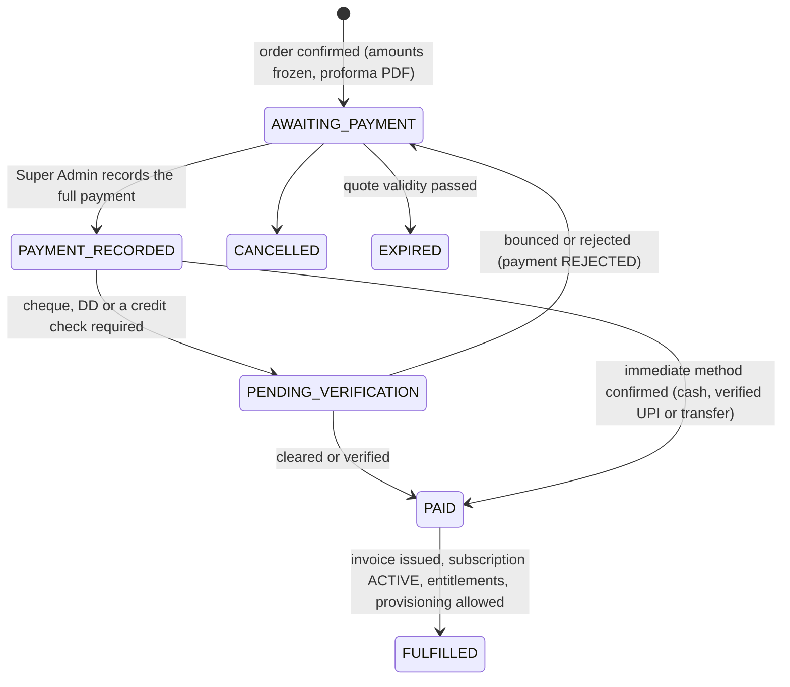

1. **Create company** (DRAFT) and its billing account.
2. **Select plans and modules.** The pricing engine builds the order: base → optional manual adjustment → tax → round-off → final. The amounts are **frozen** at QUOTED.
3. **Confirm the order:** AWAITING_PAYMENT. The subscription is **not** created as ACTIVE yet; it is created in PENDING, with its items and period 1.
4. **Record the payment(s):** method, instrument reference, evidence. One instrument for the full amount, or several instruments (e.g. cash ₹40,000 + UPI ₹60,000 for ₹100,000) whose **verified** total equals `grand_total` (CD-20). A payment may not exceed the outstanding amount. Unverified cheque, DD or transfer amounts do not count. This is **not** partial activation: nothing activates before 100 % is verified.
5. **Verification:**
   - immediate methods are confirmed directly;
   - cheques and DDs stay PENDING_VERIFICATION until cleared;
   - a bounce returns the order to AWAITING_PAYMENT and the payment becomes REJECTED, with history.
6. **PAID:**
   1. the tax invoice is ISSUED with `amount_paid` = `grand_total` and `balance_due` = 0;
   2. the subscription becomes **ACTIVE**;
   3. the entitlements are computed;
   4. the company is ready for **provisioning**. Provisioning starts by platform action or automatically (Q-40), in the approved PHASE_08.
7. **Expiry and renewal:**
   - warnings 7 days and 1 day before `end_date`; at `end_date` the subscription becomes **EXPIRED** immediately (grace = 0 days in R1, CD-22; access blocked, data kept);
   - the Super Admin creates a RENEWAL order from the admin panel and records the full payment;
   - on PAID, a new `tbl_subscription_period` starts and the subscription is reinstated;
   - the scheduler only **flags** subscriptions that are about to expire. It does not auto-renew.

**No half-payment activation exists anywhere** in the design: there are no activation rules, no PARTIALLY_PAID invoice state, and no credit terms.

#### 6.9.3 Duplicate prevention

Unchanged:
- the engine's duplicate, redundant-bundle and dependency rules;
- the charged-entitlement guard;
- order and payment idempotency keys;
- in the future, webhook deduplication.

#### 6.9.4 Standard calculation order and stored values

| Step | Stored in |
|---|---|
| 1. Base amount | Order line `gross_amount` → `subtotal` |
| 2. Discount (R1: manual adjustment; future: catalog or coupon) | `tbl_billing_order_discount.discount_amount` → `discount_total` |
| 3. Taxable amount | `taxable_total` |
| 4. Tax | `tbl_billing_order_tax` → `tax_total` |
| 5. Other charges (none in R1) | `other_charges_total` |
| 6. Round-off | `round_off` |
| 7. **Final payable** | `grand_total` (frozen) |
| 8. **Paid amount** | Confirmed `tbl_payment.amount` → `tbl_invoice.amount_paid` |
| 9. **Outstanding amount** | `tbl_invoice.balance_due` (0 at activation; changes only through credit notes) |

All values are stored, never recomputed. Plan price changes create new plan versions, so historical records never change.

#### 6.9.5 Future: provider-independent online payments (PHASE_14)

Unchanged from v4:
- the `PaymentGatewayAdapter` SPI;
- the FUTURE child tables;
- verified and deduplicated webhooks;
- reconciliation;
- no card, CVV, UPI-PIN or bank-password data, ever.

Online payments activate a subscription only when the **full** amount is captured.

#### 6.9.6 Initial gateway recommendation (future): Razorpay `[PENDING-VERIFICATION Q-30]`

Unchanged. India-specific code base; RazorpayX is the only vendor named in the code; Cashfree is the alternative.

#### 6.9.7 Permissions for billing and payments

| Permission | Scope |
|---|---|
| `platform.billing.read`, `platform.billing.manage` | Billing accounts, orders, invoices (CURRENT) |
| `platform.plan.manage` | Plans, versions, prices, tax rules (CURRENT; Super Admin by default) |
| `platform.order.discount` | Manual adjustment with a reason (CURRENT) |
| `platform.payment.record` | Record a full manual payment (CURRENT; Super Admin by default) |
| `platform.payment.confirm` | Confirm or verify (cheque clearance), reject (CURRENT; Super Admin or an authorized Platform Admin; the same user may record and verify, CD-21; audited) |
| `platform.subscription.renew` | Process manual renewals (CURRENT; Super Admin) |
| `platform.credit-note.manage` | Credit notes (CURRENT) |
| `platform.tax.manage` | Billing policy, seller entity, tax rules, document series: create, approve, retire (CURRENT; Super Admin only, non-grantable; CD-25) |
| `platform.discount.manage`, `platform.refund.manage`, `platform.payment-provider.manage` | FUTURE |
| `company.billing.read` | The company's own orders, invoices and payments (CURRENT) |

#### 6.9.8 Configurable tax and invoicing (CONFIRMED DECISION CD-25; Q-42, Q-29 and Q-04 tax values stay PENDING)

**Principle.** The **design** is decided now; only the **values** wait for the CA and the owner.
- Everything the CA must decide is **data, not code**: effective-dated, versioned configuration that the Platform Super Admin enters and approves.
- Development, testing and every non-tax feature continue now. When the CA answers, the values are entered and approved, and **no code change or release is needed**.

**Configuration objects:**

| Object | Holds (decided by CA / owner) | Covers |
|---|---|---|
| `tbl_billing_policy` (new, versioned) | `invoice_issue_trigger` = ON_FULL_PAYMENT or ON_ORDER_CONFIRMATION; `proforma_enabled`; `fy_start_month` (default 4 = April); amount rounding mode and scale; final round-off unit (e.g. ₹1.00 or none); tax rounding level (LINE or INVOICE) | **Q-42**, rounding part of **Q-04** |
| `tbl_seller_entity` (versioned) | Legal name, GSTIN, PAN, state code, address, default SAC code, e-invoicing applicable (yes/no), e-invoice provider (NONE now; a GSP adapter later), bank details for receipts | **Q-29** |
| `tbl_tax_rule` (versioned) | Tax type GST; applicability (SAC / plan type); supply type (INTRA_STATE, INTER_STATE, EXPORT, SEZ); components and rates (e.g. CGST x % + SGST x %, or IGST y %); cess if any | **Q-04** tax part |
| `tbl_document_series` | Format pattern per document type (e.g. `INV/{FY}/{SEQ:5}`), FY reset yes/no, starting number | Numbering part of **Q-29** |

**Common rules for all four** (effective dating, approval, immutability):
- Every row has `config_status` (DRAFT → APPROVED → RETIRED), `effective_from`, `effective_to`, `approved_by_identity_id`, `approved_at` and `approval_reference` (e.g. the CA's letter, uploaded as evidence to the platform bucket).
- **Only the Platform Super Admin** (`platform.tax.manage`, non-grantable) can create and approve them. Every change is audited.
- **No retroactive change:**
  - a new version applies only to orders created on or after its `effective_from`;
  - existing orders and invoices keep their stored **snapshots** (seller, rates, components, amounts) forever;
  - a correction of an issued invoice is always a credit note.
- The engine always reads the APPROVED version valid on the order date. Exactly one APPROVED version per object and date (constraint).

**How each pending question plugs in:**

| Question | Implementation now | When the CA answers |
|---|---|---|
| **Q-42** tax invoice timing | Both paths are implemented. **ON_FULL_PAYMENT:** proforma → 100 % verified payment → tax invoice `ISSUED_PAID`. **ON_ORDER_CONFIRMATION:** tax invoice `ISSUED_UNPAID` at confirmation → `ISSUED_PAID` when 100 % is verified; a cancelled or expired order gets a credit note. In **both** paths activation happens only at 100 % verified payment (CD-07). | Set `invoice_issue_trigger` and approve |
| **Q-29** seller data | The invoice template, snapshot and series read everything from `tbl_seller_entity` and `tbl_document_series`. The e-invoice step is an SPI (`EInvoiceProvider`) with the implementation NONE; `e_invoice_irn` stays empty. | Enter, approve. If e-invoicing applies, a GSP adapter is added behind the same SPI (the only case needing new code) |
| **Q-04** GST | The engine applies whatever rule is approved. Intra-state when the seller state = the buyer place of supply (`tbl_billing_account.state_code`) → CGST + SGST; otherwise IGST; EXPORT / SEZ per the rule. B2B (buyer GSTIN) and B2C (no GSTIN) are both supported by `gst_treatment`. | Enter the rates and components, approve |

**Scenarios handled by configuration only:**

| # | Scenario | Result |
|---|---|---|
| 1 | CA confirms proforma → payment → tax invoice | Policy ON_FULL_PAYMENT |
| 2 | CA requires the tax invoice at confirmation | Policy ON_ORDER_CONFIRMATION; unpaid invoices exist, activation still waits for 100 % |
| 3 | Buyer in the same state (e.g. both Gujarat) | CGST + SGST from the approved rule |
| 4 | Buyer in another state | IGST from the approved rule |
| 5 | GST rate changes from a date | New tax-rule version with `effective_from`; old orders unchanged |
| 6 | The platform company changes GSTIN, address or state | New seller-entity version; old invoices keep the old snapshot |
| 7 | Turnover crosses the e-invoicing threshold | Seller entity e-invoicing = yes + GSP adapter |
| 8 | Customer without GSTIN (B2C) | Invoice without buyer GSTIN; same tax rule |
| 9 | Different numbering format or no FY reset | Change the series pattern for the next FY |

**Behaviour while the values are PENDING (current stage):**
- **Local, dev and staging:** a clearly marked **SAMPLE** configuration (`config_status=DRAFT`, every PDF watermarked "SAMPLE – NOT A TAX INVOICE"). All billing features, tests and rehearsals run.
- **Production:** a **billing go-live gate**. No order can be **quoted** without an APPROVED billing policy, seller entity, tax rule and series valid on that date. The quote total needs the tax, so this cannot be bypassed.
  - The rest of the platform is not affected: company creation, catalog, plans, provisioning code, identity, storage and every phase's development.
  - The gate is checked at startup and shown on the platform dashboard ("Tax configuration not approved").
- The earlier "tax not configured" override of PHASE_05 is **withdrawn**; it is replaced by this gate.

### 6.10 Email architecture (future: PHASE_13)

#### 6.10.1 Existing email functionality (`CODE-INSPECTED`): reuse vs change

| Existing element | Where | Decision |
|---|---|---|
| CRM outbox `email_messages`, `email_logs`, `email_recipients`, `email_attachments`; atomic PENDING→PROCESSING claim; afterCommit dispatch; stale-row recovery; PARTIAL_SUCCESS terminal; user-safe vs technical errors; Micrometer metrics | CRM `email/**` | **Reuse as the pattern**, generalized into the central dispatcher. Add `next_attempt_at` backoff, idempotency, sender and connection references. |
| `event_email_dispatches` with `claimed_by` (multi-instance claim) | CRM `event/**` | **Reuse** the claim pattern |
| `SmtpFailureClassifier`, `SendResult` | CRM `email/provider` | **Reuse** the shape; add OAuth and API classifiers (`invalid_grant`, throttling) |
| `HtmlSanitizer` | CRM `email/util` | **Reuse** for every user-supplied HTML |
| Thymeleaf and HTML templates per service | CRM, QC, R&D, COMPLIANCE, HRMS | **Keep in the services.** Services render, the dispatcher sends. Templates switch to company branding. |
| Recipient groups `email_recipient_group`, `stakeholder_email` | CRM, QC, R&D, TICKETS (per company DB) | **Keep** |
| "Currently logged-in sender" profile used for the quotation signature | CRM `QuotationEmailDispatchService` | **Reuse.** The same acting-user context selects the user's own connection under policy ACTING_USER. |
| `@RunPerTenant` retry schedulers, `MdcTaskDecorator` | COMMON | **Reuse** |
| Global `JavaMailSender` with `spring.mail.*`, `MAIL_*`, `EMAIL_*`, `CRM_EMAIL_*`, `SMTP_*` | CRM, QC, R&D, COMPLIANCE, TICKETS, ACCOUNT-BOOK | **Modify:** replaced by the COMMON `EmailClient`. **No provider credentials remain inside individual microservices.** |
| TICKETS `MailConfig` empty sender (broken), no error or retry fields | TICKETS | **Remove / replace** |
| Hard-coded senders and recipients (`noreply@shivaminduscorp.com`, the COMPLIANCE report recipient, Gmail defaults, the committed QC password) | QC, R&D, COMPLIANCE, CRM | **Remove.** They become company settings and policies; the owner rotates the committed secret. |
| `mail.smtp.debug: true`; unescaped HTML in TICKETS and ACCOUNT-BOOK | CRM, TICKETS, ACCOUNT-BOOK | **Fix** |
| `GspAuthTokenCache` (process-wide token cache), `GspConfiguration` plaintext secrets | ACCOUNT-BOOK | **Do not reuse** (anti-patterns) |
| NOTIFICATION-SERVICE (per-company DB, internal-token API, unused `channel=EMAIL`) | NOTIFICATION | **Extend** into the central email dispatcher |

#### 6.10.2 Target architecture: user mailbox authorization (CONFIRMED DECISION CD-08)

**Today** (`CODE-INSPECTED`): static, application-level email configuration. One global Gmail SMTP account is shared by the services, with per-module sender addresses configured in yml or `.env` (the "sales@ / hr@" style).

**This is not the target.** The target is **user mailbox authorization**:

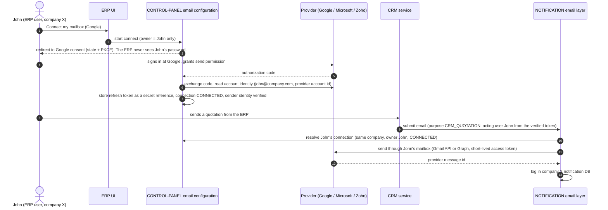

- **Services** call `EmailClient.submit(...)` with the purpose, module, rendered content, attachment ids and idempotency key. The company and acting user come from the verified context. Services hold **no** mail credentials.
- **NOTIFICATION** resolves the sender, persists the message in the **company's** notification DB, and sends through the COMMON `MailTransportAdapter` (Gmail API, Microsoft Graph, Zoho; **no** SMTP for business email, CD-23).
- **The Control Plane** owns connections, OAuth flows, token refresh and revocation, and the secret references.

#### 6.10.3 Sender selection and authorization (CONFIRMED DECISION CD-23, closes Q-51, Q-52, Q-44)

The owner's rule: **platform email and business email are two separate channels that never mix.**

| Channel | What is sent | Sender | How it is authorized | Release |
|---|---|---|---|---|
| **Platform email** | Platform-purpose mail **from the platform to its customers and users**: order and proforma, payment receipt, tax invoice, subscription activation, renewal reminders (7 days and 1 day), expiry notice, company welcome and onboarding, Company Super Admin invitation, provisioning-completed notice, storage warnings (80 % and 95 %), security notices. Keycloak identity emails (verification, password reset, invitations) use the same platform sender (CD-19). | **One single static platform mailbox** (e.g. `no-reply@<platform domain>`, owner-defined), connected once by SMTP with an **app password** | The app password is in the environment or secret store (owner-managed), never in the DB in plain text, never in code or logs | **R1** (simple sender in the Control Plane; PHASE_07) |
| **Business email** | Everything a company user or a company module sends to the company's customers, vendors or employees: quotations, sales orders, invoices of ACCOUNT-BOOK, HR letters, compliance reports, ticket mails, CRM events, … | **Only the user's own mailbox**, connected by OAuth (Google, Microsoft 365, Zoho) | OAuth with the provider; the ERP **never** asks for or stores the mailbox password | **FUTURE** (PHASE_13); R1 keeps the interim rule of §6.10.5 |

**Business email rules (hard rules, checked at selection and again at send):**
1. The sender is the **acting user**: the user who triggered the email, or for scheduled or system-generated business mail the **responsible user** (the user who created the record or the schedule).
2. That user's connection must be CONNECTED, and its provider-verified mailbox address must be **the user's own ERP account email** (the verified email of the user's account in the company realm). A mailbox that does not match is not accepted.
3. **If the user has no connected, verified mailbox, the email is NOT sent.**
   - There is **no company shared mailbox**, **no platform fallback** and **no other user's mailbox**.
   - The ERP blocks the send (`EMAIL_MAILBOX_NOT_CONNECTED`) and shows the user "Connect your mailbox".
   - For scheduled sends, the message is recorded as `BLOCKED_NO_MAILBOX`, and the responsible user receives an **in-app** notification (NOTIFICATION service, no email).
   - Once the mailbox is connected, the user can resend.
4. The platform mailbox **never** sends business email, and a user mailbox never sends platform email.
5. The connection's company equals the message's company. A user can never send through another user's connection.
6. **No generic SMTP or password-based connection** exists for business email. SMTP with an app password exists **only** for the single platform mailbox.
7. Violations are rejected and audited.

**Permissions:**
- every user manages only their own connection (`/me/email`: connect, status, disconnect);
- a Company Super Admin or Company Admin with `company.email.log.read` can read the company's send log, and with `company.user.manage` can disable a user's connection (for example when the user leaves);
- `platform.email.manage` (Super Admin) manages the platform mailbox configuration and the platform email log.

#### 6.10.4 Connection and token lifecycle

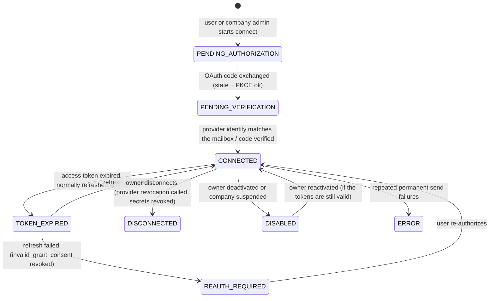

- **Refresh:**
  - proactive, before `expires_at`, under a per-connection Redis lock (no parallel refresh races);
  - the new token is stored as a new credential version and the old one becomes ROTATED;
  - users do not reconnect as long as the provider's refresh token stays valid.
- **Failure:**
  - `invalid_grant` or revoked consent sets REAUTH_REQUIRED;
  - business messages of that user are **not sent** (BLOCKED_REAUTH) until the user reconnects; there is no fallback sender (CD-23);
  - the owner and the Company Super Admin are notified.
- **Revocation and disconnection:**
  - the provider revocation endpoint is called where supported;
  - the credentials are marked REVOKED (the secret material is destroyed in the secret store);
  - the identities are disabled;
  - the logs are kept.
- **User deactivation or removal:** the user's connections become DISABLED immediately, with the tokens revoked on removal.
- **Company suspension:** sending is paused.

#### 6.10.5 Company-DB email tables (`cmp_<n>_notification_db`) `[FUTURE]`

| Table | Key columns | Keys |
|---|---|---|
| `email_message` | `idempotency_key`, `source_service`, `source_ref_type`, `source_ref_id`, `purpose`, `module_code`, `acting_user_id` (Keycloak `sub`), `sender_mode_applied` (ACTING_USER), `status` incl. BLOCKED_NO_MAILBOX / BLOCKED_REAUTH, `email_connection_id` and `sender_identity_id` (CP ids, no cross-DB FK), `from_address`, `from_name`, `reply_to`, `subject`, `body_html` or `body_object_key`, `status` (PENDING, PROCESSING, SENT, PARTIAL_SUCCESS, RETRYING, FAILED, CANCELLED, SUPPRESSED, HELD_REAUTH), `attempt_count`, `next_attempt_at`, `claimed_by`, `provider_message_id`, `sent_at`, `last_error_code`, `last_error_user_message`, audit | UQ `idempotency_key`; IDX (`status`, `next_attempt_at`); IDX (`source_service`, `source_ref_type`, `source_ref_id`); IDX (`acting_user_id`, `created_at`) |
| `email_message_recipient` | `email_message_id`, `recipient_type` (TO, CC, BCC), `address`, `status` | IDX `email_message_id` |
| `email_message_attachment` | `email_message_id`, `attachment_id` (company module bucket), `filename`, `size_bytes`, `display_order` | — |
| `email_delivery_attempt` | `email_message_id`, `attempt_no`, `provider_code`, `started_at`, `finished_at`, `result`, `error_code`, `error_detail` (scrubbed), `provider_response_code` | UQ (`email_message_id`, `attempt_no`) |
| `email_suppression` | `address`, `reason` (BOUNCE, COMPLAINT, MANUAL), `created_at` | UQ `address` |

**Interim rule (until PHASE_13):**
- The existing global SMTP sending continues unchanged for the **first company (Shivam)** only, because its global account is Shivam's own.
- **Any further company before PHASE_13 is onboarded with business email disabled** (in-app notifications only). Otherwise its mail would leave from Shivam's account, which CD-23 forbids (Q-41, decided).
- **Platform email** (CD-23) works for every company from R1, through the single platform mailbox.
- After PHASE_13, Shivam's static sender is switched off and Shivam follows CD-23 like every company.

### 6.11 Schema quality review and change classification

#### 6.11.1 Marks used in §6.2

| Mark | Meaning |
|---|---|
| `[CURRENT]` / `[FUTURE]` | Scope (§1.1): created in R1, or designed now and added later without changing CURRENT tables |
| `[REUSE existing]` | Existing table or concept, unchanged |
| `[MODIFY existing]` | Existing table or stub, changed (changes marked **New**) |
| `[NEW in v2, kept]` / `[MODIFY v2 design]` | Earlier design (2026-10-02), not implemented, kept or adjusted |
| `[NEW]` | New design |
| `[REMOVE]` | Existing table not in the new baseline |
| `[PENDING-VERIFICATION Qxx]` | Depends on an owner or business answer, or an external fact |

#### 6.11.2 Production-readiness review

| Concern | How the schema addresses it |
|---|---|
| Normalization | Separate entities for catalog, plan, version, price, order, invoice, payment, allocation, subscription and entitlement. Channel-specific details are 1:1 child tables (`tbl_manual_payment`, future `tbl_gateway_payment`). Provider-specific settings are key/value children. Snapshots (order and invoice line copies, `*_snapshot_json`) are deliberate, for immutability. |
| No duplicates | One order model (quotes are order states), one payment model (channel-neutral), one email-connection model (owner type), one signup → company path. No admin-only or website-only tables. No Shivam tables. |
| Keys and FKs | BIGINT PKs. Explicit FKs with `ON DELETE RESTRICT`. Missing FKs of the existing stubs are added. Cross-DB references are logical ids validated by the service. |
| Uniqueness | Business numbers from the atomic series. Idempotency keys. Provider refs unique per provider account. Charged-entitlement guard. One ACTIVE credential per type. One default sender per owner. |
| Indexes | On every FK, worker queues (`status`, `next_attempt_at`), company + status, source references |
| Lifecycle history | `tbl_company_status_history`, `tbl_subscription_event`, `tbl_subscription_period`, `tbl_payment_status_history`, allocation reversals, credit notes; future attempts, webhooks and ledger |
| Auditability | Audit columns everywhere. Platform audit log for every privileged action. Manual payment recording and verification with history and audit (no mandatory two-person rule, CD-21). Payment history. Future hash chain. |
| Soft delete | **None generic.** Status lifecycles for configuration. Financial and audit records append-only. Personal data is anonymized (Q-39). |
| Tenant isolation | `company_id` on every company-owned CP row. Company APIs filter by the verified tenant. Email logs and business data stay in company DBs. Email connection ownership checks at selection and at send. |
| Idempotency | Orders, payments, refunds, email messages: idempotency keys. Webhooks: event-id or payload-hash dedup. Allocations: locked recomputation. |
| Secrets | §6.11.3 |
| Financial immutability | No DELETE grant. Only derived balance fields change. Corrections through credit notes and reversals. `content_sha256` on issued documents. |
| Vendor neutrality | Payment and email providers are catalog rows plus adapters. CURRENT tables carry no provider-specific columns. |
| Extensibility | New billing periods (enum values), plan types, tax types, currencies, gateways, mail providers, signup channels: rows and adapters, not schema redesign |

#### 6.11.3 Secret and token storage strategy

1. **No plaintext secret columns exist anywhere** in the schema: provider passwords, OAuth access and refresh tokens, PKCE verifiers, gateway API and webhook secrets, DB credentials.
2. Every secret is a **secret reference row**:
   - `storage_type` DB_ENCRYPTED: AES-256-GCM ciphertext with AAD (owner id + type) and `key_version`; the master key comes from the environment or a KMS.
   - `storage_type` SECRET_STORE: `secret_ref` to an external secret manager.

   The schema supports both, and the implementation phase chooses (Q-13).
3. APIs are **write-only** for secrets (they return `…Set` booleans).
4. Decrypted values live only in process memory, keyed by connection or account id, with a short TTL. They are never in Redis, logs, exceptions, metrics, step errors or webhook storage. **No process-wide shared token caches** (the `GspAuthTokenCache` anti-pattern).
5. Rotation: new versions with `active_guard`; old versions ROTATED or REVOKED; revocation destroys the material.

#### 6.11.4 Review result of the v3 proposal

| v3 element | v4 decision | Reason |
|---|---|---|
| Catalog discount and coupon tables as part of the core | `[FUTURE]`. R1 uses a MANUAL adjustment on `tbl_billing_order_discount`. | No current website; avoids unused complexity |
| `tbl_payment` with provider columns | Neutral `tbl_payment` + `tbl_manual_payment` (CURRENT) + `tbl_gateway_payment` (FUTURE) | Manual payments are never gateway payments; no current gateway complexity |
| `tbl_payment_attempt`, `tbl_refund`, webhooks, reconciliation, provider tables | `[FUTURE]` | Gateway-only |
| `tbl_financial_audit_ledger` | `[FUTURE]` (before the website). R1 relies on immutability + payment history + platform audit. | Proportionate to R1 |
| Full-payment-only assumption | v4 changed it to partial payments; **v5 restores full payment only** (CD-07) | Owner clarification |
| Per-company DB users, single company bucket, single realm (v2–v4) | Shared environment credentials (CD-03), a bucket per company and module (CD-01), a realm per company (CD-06) | Owner clarification |
| `tbl_mail_*` (company-level only) | `tbl_email_*` with PLATFORM/COMPANY/USER ownership, connections vs sender identities, sending policies, secret references | User-level OAuth requirement |
| `tbl_mail_route` | `tbl_email_sending_policy` | Purpose-based sender modes incl. ACTING_USER and fallbacks |
| One live subscription (v2) | One or several subscriptions (v3, kept) | Mixed billing periods |

---

## 7. Exact services, files and database areas involved

Phase 01 changes **no files** except this documentation. It **defines** changes in:

| Area | Files / objects (implemented in later phases) |
|---|---|
| CP schema | JPA entities under `CONTROL-PANEL-SERVICE/src/main/java/nyaalkaran/erp/system/platform/**` with `ddl-auto: update` during development; the final clean Liquibase baseline under `db/changelog/**` and `ddl-auto: validate` in PHASE_11A (CD-27) |
| CP code | `CONTROL-PANEL-SERVICE/src/main/java/nyaalkaran/erp/system/platform/**` (company, catalog, pricing, subscription, entitlement, provisioning, admin, rbac, identity, security, import) |
| COMMON runtime | `COMMON-LIBRARY/src/main/java/nyaalkaran/erp/common/tenant/**`, `entitlement/**`, `client/FeignSecurityInterceptor.java`, new `security/**` |
| Gateway | `API-GATEWAY/src/main/java/nyaalkaran/erp/gateway/filter/**`, `configs/**` |
| Attachments | `COMMON-ATTACHMENT-SERVICE/src/main/java/nyaalkaran/erp/attachment/**` |
| Keycloak | `erp-platform` + one standard realm per company from a realm template (automation, §6.5.3), Shivam included (CD-16) |
| Databases | `control_panel_db` (new Company model; Hibernate-managed until the final Liquibase baseline, CD-27); `cmp_<n>_<module>_db` per purchased module + attachment and notification DBs (Liquibase tracking); environment DB credentials |
| Storage | `cmp-<n>-<module>-bucket` per purchased module |

## 8. Proposed schema changes

The complete proposed schema is in **§6.2**, the ER diagrams in **§6.3** and the migration strategy in **§6.4**. Implementation is in PHASE_02 (baseline and company/tenancy tables) and the phases that own each group:

| Group | Implementing phase |
|---|---|
| A, B (structure) | PHASE_02 |
| F (identity), H (audit, sync) | PHASE_02/03 |
| C, G (platform part) | PHASE_04 |
| D (plans, plan prices, discounts, coupons, tax rules) | PHASE_05 |
| D (subscriptions, periods, events), E | PHASE_06 |
| D (billing orders, manual adjustments, document series, seller entity), I.1 (billing accounts, invoices, credit notes, neutral payments, manual payments, allocations, payment history) | PHASE_07 |
| B (behaviour) | PHASE_08 |
| G (company and business part) | PHASE_10 |
| H (import) | PHASE_11 |
| J (`tbl_email_*`: providers, OAuth apps, company and user connections, secret references, sender identities, sending policies, platform email log) + company-DB email tables (§6.10.5) — FUTURE | PHASE_13 |
| D (catalog discounts and coupons), I.2 (gateway, attempts, refunds, webhooks, reconciliation, financial ledger), K (signup) — FUTURE | PHASE_14 |

## 9. API and integration requirements

Foundational contracts fixed by this phase:

| Contract | Rule |
|---|---|
| Internal tenant metadata | Path, payload and status semantics unchanged (compatibility) |
| Realm registry | `GET /api/v1/internal/platform/identity-realms` (issuer allow-list for the gateway and services; cached) |
| Route classes | `/control-panel/api/v1/platform/**` (platform scope), `/control-panel/api/v1/company/**` (company scope, tenant from the token), `/<module>/api/**` (company scope), `/**/internal/**` (denied at the gateway) |
| Error codes | As in §6.6.2 and master §14 |
| Keycloak | Changes only through the identity-sync outbox (no synchronous calls in user transactions) |

## 10. Dependencies on other phases

None. **Every later phase depends on the approval of this phase.**

New phase order (all follow PHASE_01):

| # | Phase | Main dependency |
|---|---|---|
| 02 | CP schema and tenancy implementation | 01 |
| 03 | Identity, Keycloak and company context | 02 |
| 04 | Platform administration and module catalog | 02, 03 |
| 05 | Plans, bundles, pricing and discounts | 04 |
| 06 | Subscriptions and entitlements | 05 |
| 07 | Billing: orders, invoices and manual payments (admin channel) | 05, 06 |
| 08 | Company provisioning | 02, 06, 07 |
| 09 | File storage isolation and usage | 06, 08 |
| 10 | Company admin, roles and permission enforcement | 03, 06, 08 |
| 11 | Microservice integration, compatibility and data-import tooling | 09, 10 |
| 12 | Testing, rollout and first company onboarding (Shivam, admin channel) — **end of the current release R1** | 02–11 |
| 13 | Company and user email integration — **FUTURE** (required before a second company with email modules) | 02, 10, 11, 12 |
| 14 | Online payments and public website onboarding — **FUTURE** | 07, 12, 13 |

## 11. Security and tenant-isolation requirements

The non-negotiable rules defined here and enforced by the later phases:

1. The tenant comes only from the verified token.
2. Resource names derive only from `company_code`.
3. Shared environment DB credentials (CD-03); company isolation enforced by the registry-only routing and the compensating controls of §6.1.4.
4. Exact bucket checks per (company, module); no runtime bucket creation.
5. Services verify tokens themselves; no host-published service ports.
6. Platform and company identities, roles and routes are separated.
7. Entitlements are a ceiling for every permission.
8. Every privileged mutation is audited.
9. No automatic deletion of company data.
10. **No operation of any kind targets `192.168.5.52` or `192.168.5.53`.**

## 12. Ordered implementation tasks (Phase 01)

| # | Task | Owner | Status |
|---|---|---|---|
| 1 | Analysis of code, CP schema and old documents | Agent | COMPLETED |
| 2 | Foundation design (this document) and master update | Agent | COMPLETED (draft for review) |
| 3 | Owner review of §6 (schema, naming, Keycloak, routing, roles, Shivam plan) | Owner | DONE (covered by the S0-1 approval, 2026-10-03) |
| 4 | Decisions **required before PHASE_02**: Q-20 (legacy `control_panel_db`). Closed by the decision register: Q-01, Q-03, Q-13, Q-16 (Super Admin), Q-24, Q-50, and in the final review Q-46, Q-47, Q-48, Q-49, Q-53, Q-54, Q-55, Q-56, Q-45, Q-31, Q-07 (CD-11..CD-22). Q-51, Q-52, Q-44 (CD-23), and under the owner's delegation the questions listed in §0.2 (CD-24). Still open: Q-42, Q-29, Q-04 tax part (accountant/CA) | Owner | PENDING |
| 5 | Owner action items (§0.2): Q-25 (UI owner), Q-02 (Shivam data), Q-22 (credential rotation), Q-30/Q-37 (future accounts); CA questions Q-42, Q-29, Q-04 (tax) | Owner | PENDING |
| 6 | Safeguard the unversioned control-plane code (SVN server operations are owner-only) | Owner | PENDING |
| 7 | Baseline test run report (local only) to compare against in PHASE_02 | Agent (after approval) | PENDING |
| 8 | Written approval of Phase 01 recorded in this document (§16) | Owner | DONE (S0-1, owner approval in chat on 2026-10-03; recorded in §16 and the tracker) |

## 13. Acceptance criteria

1. The owner has reviewed and approved: the CP schema (§6.2), the naming conventions (§6.1), the Keycloak and Platform Super Admin design (§6.5), routing and isolation (§6.6), the role model (§6.7), and the Shivam onboarding and import plan (§6.8).
2. Every decision marked "required before PHASE_02" has a recorded answer.
3. The unversioned control-plane code is safeguarded.
4. The baseline test report exists.
5. The master document and every phase document are consistent with this document (reviewed together).

## 14. Testing and validation checklist (design review)

- [ ] Every existing CP table has a decision (§5.1) and every new table has a full column definition (§6.2).
- [ ] Every FK, unique constraint and index needed by the queries of the later phases is defined.
- [ ] No resource name can be derived from user input (naming rules §6.1).
- [ ] The request flow (§6.6) covers the gateway, the services, Feign, async, jobs, WebSocket and caches.
- [ ] Platform and company separation holds for identities, roles, routes and data (§6.5.5, §6.7).
- [ ] The Shivam plan uses only standard flows and options (§6.8), and includes backup, validation, reconciliation, rollback and cutover.
- [ ] No step anywhere requires access to `192.168.5.52` / `192.168.5.53` by this project.

## 15. Risks and rollback considerations

| ID | Risk | Mitigation |
|---|---|---|
| R-01 | The unversioned CP code is lost before implementation | Owner safeguard (task 6) |
| R-02 | Schema design gaps found during implementation | Changes to §6.2 require a document update and owner re-approval before the code changes |
| R-03 | Keycloak capabilities needed by the realm automation (admin API realm creation, realm templates, conditional OTP, per-realm SMTP and themes) differ by version | Verify the Keycloak version (owner); fallback: operator-only platform-role assignment (Q-26) |
| R-04 | The legacy UI is not compatible with the realm-per-company login or the audience | Q-25; Company Login Code (CD-15); Shivam identity migration rehearsal (CD-16) |
| R-07 | Realm-per-company operational load (provisioning, upgrades, backups, monitoring at scale) | Mandatory automation (§6.5.3); capacity test at 50 companies (CD-18) |
| R-08 | Shared DB credentials: a compromised service could reach other companies' databases | Compensating controls (§6.1.4); least-privilege runtime account; network isolation; monitoring |
| R-05 | Shivam import blockers (schema drift, unknown attachment rows) | Schema diff gate, rehearsal, owner decisions |
| R-06 | Shivam is not the first company created (number ≠ 101) | Nothing depends on 101; the documents use "the company code allocated to Shivam" |

Rollback: Phase 01 changes no runtime behaviour. Design changes are handled by document revision and re-approval.

## 16. Current status

| Item | Status | Evidence |
|---|---|---|
| Code and schema analysis | COMPLETED | `CODE-INSPECTED` 2026-10-02 |
| CP schema design | COMPLETED (draft) | §6.2 |
| Naming, Keycloak, routing, roles, Shivam plan | COMPLETED (draft) | §6.1, §6.5–6.8 |
| Current vs future scope (R1 admin panel; future website, gateway, email OAuth) | COMPLETED (draft, v1.2) | §1.1 |
| Decision register (CD-01..CD-10, open questions) | COMPLETED (draft, v1.3) | §0 |
| Commercial, billing (full manual payment), future gateway and signup design | COMPLETED (draft, v1.3) | §6.2 D, I, K; §6.9 |
| Company and user email design (future) | COMPLETED (draft, v1.2) | §6.2 J; §6.10 |
| Schema quality review and change classification | COMPLETED (draft) | §6.11 |
| CP schema management strategy (Hibernate during development, final clean Liquibase baseline) | DECIDED by the owner, 2026-10-03 | CD-27; [PHASE_11A](PHASE_11A_FINAL_CP_LIQUIBASE_BASELINE.md) |
| Owner review and decisions | Architecture approved (S0-1 DONE). Still open: S0-2, S0-10, S0-12 (PROPOSAL only) open; S0-4, S0-5 pending; PHASE_02 LOCKED until S0-4 and S0-5 are DONE; CA values Q-42, Q-29, Q-04 (tax) | Tracker §3 |
| Safeguard + baseline tests | PENDING | — |
| **Owner approval** | **DONE** (S0-1, gate G0, owner approval 2026-10-03) | Tracker S0-1 |
| **Phase** | **APPROVED** (S0-1 DONE, 2026-10-03) | Tracker §4 |
