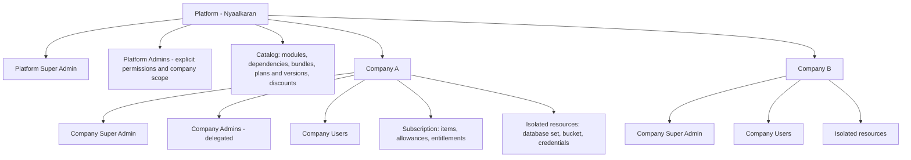
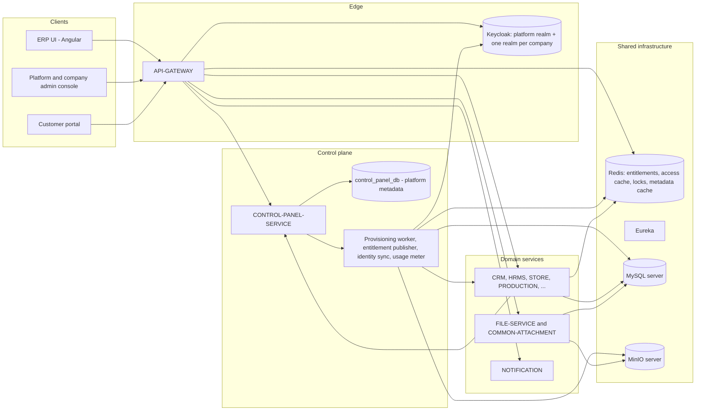
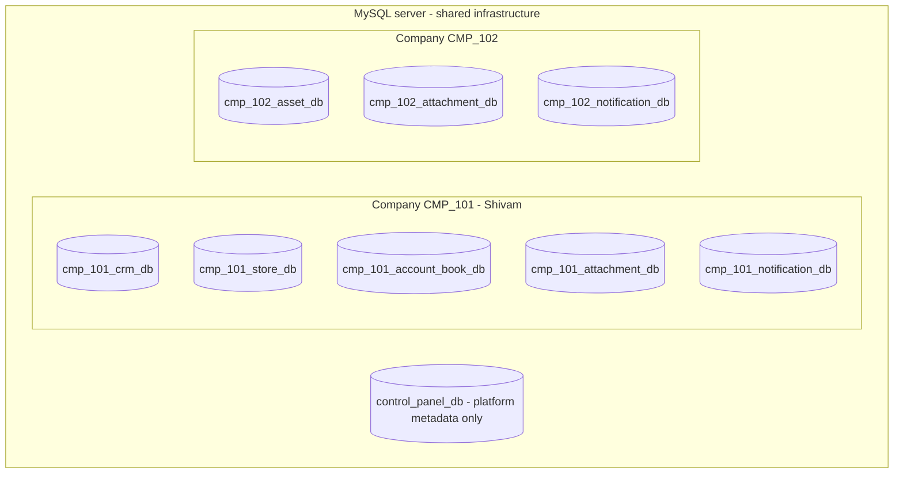
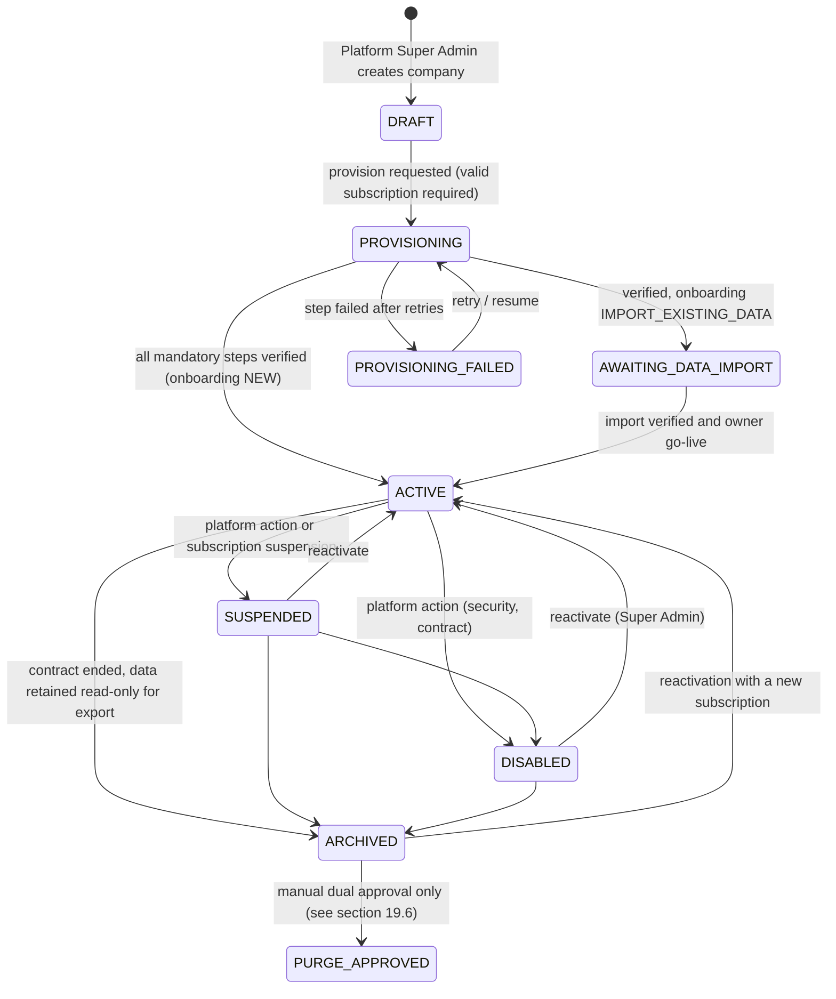
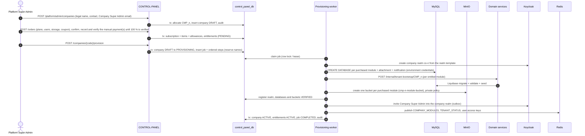
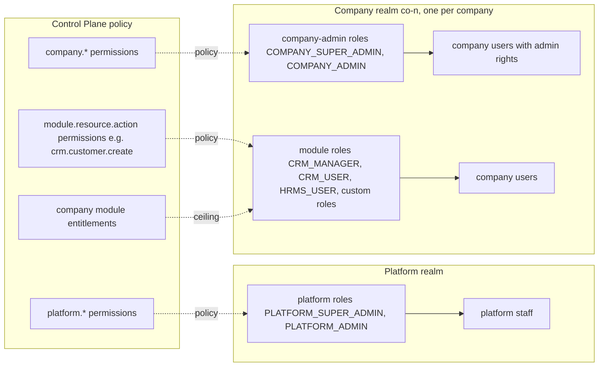
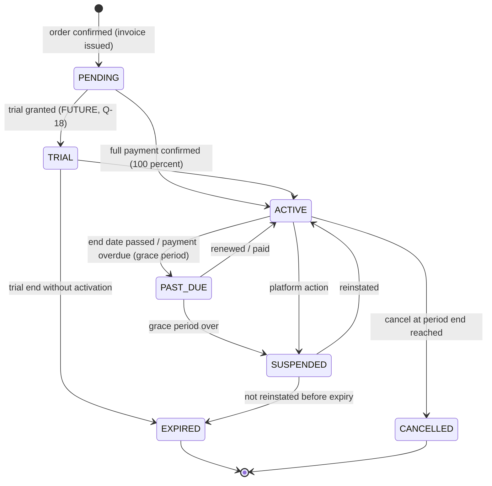
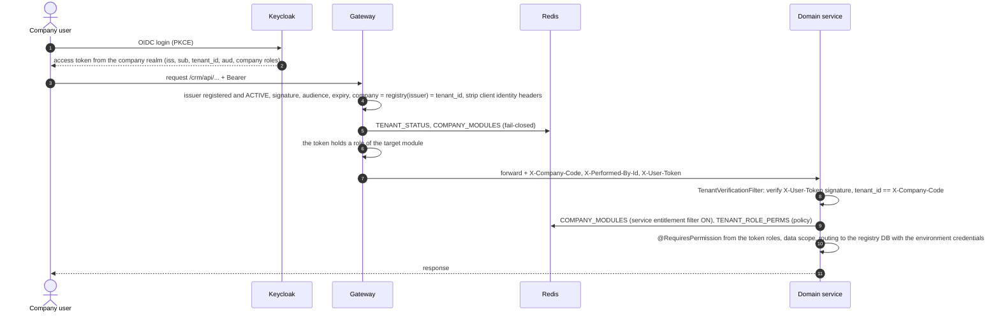
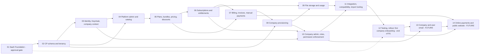

# Nyaalkaran ERP — SaaS Architecture Master (Company-Based Model)

| Item | Value |
|---|---|
| Document type | Target architecture, single source of truth |
| Version | 5.3 (2026-10-03: CD-23 email channels, CD-24 delegated decisions; only Q-42, Q-29, Q-04 tax remain open; 5.2: final decision review, CD-12..CD-22, all architecture questions closed except Q-42 and Q-51/Q-52; 5.1: final consistency review, CD-11 company roles in the company realm, Q-50 closed, Q-54..Q-56; 5.0: decision register; strict per-module DB and bucket isolation, shared environment DB credentials, Keycloak realm per company, full payment only, user mailbox authorization) |
| Date | 2026-10-02 |
| Status | **PHASE_01 APPROVED** (S0-1 DONE, 2026-10-03). Not implemented. **No implementation phase starts before the Stage 0 items S0-4 and S0-5 are DONE** (tracker); S0-2, S0-10, S0-12 (PROPOSAL only) open. Open decisions: [§25](#25-unresolved-business-questions). |
| Audience | Project owner, developers, and the AI coding agent that will implement the phases |
| Supersedes | Every SaaS architecture document in `_cleanup_review/` (reference only; see [§0.3](#03-relationship-to-the-old-documents)) |
| Foundation | [PHASE_01_SAAS_FOUNDATION.md](PHASE_01_SAAS_FOUNDATION.md): the approval gate. It holds the **complete column-level CP schema** (§6.2), ER diagrams, naming, Keycloak, routing, the role model and the Shivam onboarding and import plan. |
| Phase plans | `PHASE_01` … `PHASE_14` in this folder (index in [§22](#22-development-phases-and-dependencies)). Version 1.0 phase files were moved unchanged to `_cleanup_review/saas-plan-doc-v1/`. |

---

## 0. How to read this document

### 0.1 Purpose

This document defines the **final target state** of the Nyaalkaran ERP SaaS platform under the new company-based business model.

The phase documents define **how to get there** from the code that exists today. When a phase document and this document disagree, this document wins; the phase document must then be corrected.

### 0.2 Evidence levels used in this folder

Every statement about the existing system carries one of these evidence levels.

| Level | Meaning |
|---|---|
| `CODE-INSPECTED` | The source code was read during the 2026-10-02 analysis. The tests were **not** executed in this analysis. |
| `TEST-EXISTS` | Automated tests covering the behaviour exist in the repository. They were not re-run for this document. |
| `DOC-REPORTED` | Only an old document in `_cleanup_review/` claims it. No code evidence was confirmed. |
| `NOT-VERIFIED` | The old documents themselves say the behaviour was never run against real infrastructure (real Keycloak, real MinIO, full stack). |

Work status values (`COMPLETED`, `PARTIALLY_COMPLETED`, `PENDING`, `BLOCKED`) are defined in [§22.2](#222-status-definitions).

### 0.3 Relationship to the old documents

The documents under `_cleanup_review/` describe the previous architecture: Platform → Customer → Organization → Users, with plans, plan versions and key/value entitlements. They are kept unchanged as historical reference.

- **They are not requirements.** Where they conflict with this document, this document applies.
- They are still useful as evidence of intent and of decisions taken earlier. The most relevant ones are `docs/PHASE_5L_DECISION_DOCUMENT.md`, `docs/BUSINESS_RBAC_SCHEMA_DESIGN.md`, `docs/MODULE_ENTITLEMENT_DESIGN.md`, `docs/SAAS_ONBOARDING_WORK_PLAN.md`, `docs/MANUAL_EXISTING_CLIENT_MIGRATION_PROCEDURE.md` and `AI_PROJECT_MEMORY_AND_CONTINUATION.md`.
- Several old documents contradict each other and the code. **Do not rely on these old statements:**
  1. The organization id format: UUID in the old documents versus the frozen `ORG_<n>`.
  2. The separate customer realm: built in 5L P-1, then reversed in R-2.
  3. Keycloak groups and tier roles versus the "no groups, `org_id` claim" design of RBAC revision 4.
  4. Multi-organization membership versus "one account = one workspace".
  5. Legacy attachments: excluded in one document, imported in another.
  6. "`ddl-auto` eliminated" versus `ddl-auto: update` in the code.
  7. Backup scripts that are claimed to exist but are absent.
  8. Vault described as present, although it was removed on 2026-10-01.
  9. Stale status lines in the old status files and module `AGENTS.md` files.

### 0.4 Non-negotiable project rules

These rules come from the root `CLAUDE.md` and bind every phase.

1. **Protected hosts.** Never connect to, scan, deploy to, or run anything against `192.168.5.52` or `192.168.5.53`. This includes SVN server commands, because the SVN server is on `.52`. If a task may involve either host, stop and ask the project owner.
2. **No commits, destructive actions or production deployments** without explicit approval from the project owner.
3. **No automatic deletion of customer data.** Not in provisioning, subscription handling, cleanup or rollback.

### 0.5 Decision register (authoritative)

The clarified business requirements of 2026-10-03 are recorded as **CONFIRMED DECISIONS**, **OPEN QUESTIONS**, **FUTURE CAPABILITIES** and **IMPLEMENTATION IMPACT** in [PHASE_01 §0](PHASE_01_SAAS_FOUNDATION.md#0-decision-register-clarified-business-requirements-2026-10-03). Summary:

| ID | CONFIRMED DECISION |
|---|---|
| CD-01 | Strict isolation: a dedicated **database and bucket per company per purchased module**; never shared |
| CD-02 | **One login = one company**; no switching or linking; the company comes from the authenticated identity |
| CD-03 | **DB credentials are environment infrastructure configuration**, the same for all company DBs; **no per-company MySQL users**; the CP registry maps company → module → database and bucket; routing is dynamic |
| CD-04 | The **Platform Super Admin is created manually by the operator**; company admins can never create one |
| CD-05 | The **new production database architecture** (new CP DB + company module DBs); the existing production DB is not the target and is not touched; import is a future controlled activity |
| CD-06 | **A Keycloak realm per company** + a platform realm; requires heavy automation (PHASE_01 §6.5.3) |
| CD-07 | **Full payment only** before activation (manual cash, cheque, UPI, bank transfer, other); a verification state for non-immediate methods; **manual renewal** by the Super Admin |
| CD-08 | Target business email = **user mailbox authorization** (OAuth, no password requested); refined by CD-23 |
| CD-09 | Shivam is the first **normal** company and follows the standard company flow; its data import is a future controlled activity |
| CD-10 | R1 = the admin panel (Control Plane, catalog, plans, pricing, subscription, billing, full manual payment, provisioning, isolation, realms, platform and company administration); website, online payments, automatic renewal and user-mailbox OAuth are future |
| CD-11 | **Company user roles live in the company's Keycloak realm** (closes Q-50). The company realm is authoritative for identity **and** role assignment; the CP holds configuration, the registry, subscriptions, entitlements and the CP Permission Policy (CD-12), never who holds which role; the services enforce. **Role ≠ entitlement** (§10). |
| CD-12 | **CP Permission Policy** (closes Q-54): role → module → permission → operation in the CP; Keycloak Role Assignment in the company realm; Runtime Authorization in the gateway and services |
| CD-13 | Company admins manage users and roles **only through the ERP Company Admin UI and backend** (closes Q-55); seat limit and escalation guards in the backend; no Keycloak console |
| CD-14 | Company business roles are **realm roles**, defined once per realm (closes Q-56); no duplicate client roles; `realm_access.roles` through the built-in `roles` scope |
| CD-15 | **Company Login Code** for login discovery (closes Q-46); subdomain and broker realm are future |
| CD-16 | Shivam: a **new standard realm** through the standard flow; legacy identity migration and data import are separate activities (closes Q-47) |
| CD-17 | Platform realm **`erp-platform`**; dedicated minimum-privilege realm-provisioning service account (closes Q-48) |
| CD-18 | **50 companies** as the initial capacity planning target, not a hard limit (closes Q-49 for R1) |
| CD-19 | Keycloak identity emails through a **central platform transactional SMTP** (closes Q-53 for R1) |
| CD-20 | Several **verified** instruments may total 100 %; no partial activation (closes Q-45) |
| CD-21 | No mandatory two-person payment rule in R1; audit kept (closes Q-31) |
| CD-22 | Expiry grace **0 days** in R1; warnings at 7 days and 1 day (closes Q-07 for R1) |
| CD-23 | **Email channels:** platform email (subscription, billing, invoices, notices, invitations, Keycloak emails) from **one static platform mailbox** (SMTP app password, R1); business email **only from the user's own verified OAuth mailbox**; if not connected and verified, the business email is **not sent**; no shared mailbox, no fallback, no generic SMTP (closes Q-51, Q-52, Q-44) |
| CD-24 | Remaining product and operational questions decided by the agent under the owner's delegation (§25); the owner may override |
| CD-25 | **Configurable tax and invoicing:** invoice trigger, seller data, GST rules, rounding and numbering are versioned, effective-dated configuration approved by the Super Admin with the CA's reference; production quoting gated until APPROVED; no code change when the CA answers |
| CD-26 | **`CMP_<n>` is the single company identifier** everywhere in the target (values, claims, Redis keys `COMPANY_MODULES:<CMP_n>`, `cmp_<n>_<module>_db`, `cmp-<n>-<module>-bucket`); `ORG_` / `org_` / `org-` are LEGACY only; supersedes AD-02 |
| — | **PENDING (values only, CD-25):** Q-42, Q-29, Q-04 (tax), for the accountant/CA; billing go-live only. Owner action items: Q-25, Q-02, Q-22, Q-30, Q-37 |

Every statement in this document that contradicts the register has been corrected. If one remains, the register wins.


---

## 1. Executive summary

Nyaalkaran ERP is a set of Spring Boot 3.4 microservices for mining, mineral processing and allied industries. A large part of the multi-tenant foundation already exists and is reusable:

- per-tenant database routing that refuses to work without a tenant (fail-closed);
- trusted tenant context set by the gateway;
- tenant schema bootstrap;
- per-tenant scheduled jobs;
- a provisioning engine, a Redis entitlement cache, an identity-sync outbox and a business-RBAC data model.

The **new business model** changes the commercial and administrative layer, not the isolation foundation:

| Topic | Old model (code today) | New target |
|---|---|---|
| Customer concept | Customer (commercial) → Organization (tenant), many organizations per customer | **Company** = the customer **and** the tenant. One company is one isolated workspace. |
| Hierarchy | Platform → Customer → Organization → Users | **Platform → Company → Company Users** |
| Databases | One set of databases per organization (16 module databases plus 1 attachment database), always all modules | One set of databases per company, created **only for entitled modules**, with company-scoped credentials |
| File storage | Bucket per organization **per module**, created lazily, no registry | **One dedicated bucket per company per purchased module** (`cmp-<n>-<module>-bucket`, CD-26), created at provisioning, registered, exact-checked, usage measured (CD-01) |
| Selling | Plan → plan version → key/value entitlements (`module.crm=true`) | **Database-driven catalog**: modules, mandatory dependencies, bundles, plans with immutable versions (monthly and yearly prices), per-user and storage pricing, discounts and coupons, billing orders, subscription items |
| Limits | Only `max_organizations` | **Users** and **storage** limits per company, enforced on the backend |
| Platform admins | Global Keycloak realm roles with no scoping | Platform Super Admin plus **Platform Admins**: roles in the **platform realm**, permissions through the CP platform policy, company scope in the CP |
| Company admins | `COMPANY_*` and `ORG_*` tiers split across two tables | **Company Super Admin** and **delegated Company Admin**, both inside one company |
| ERP permissions | Schema only, never enforced; legacy services read Keycloak **client roles** (`resource_access`) | Company roles (predefined and custom) as **realm roles of the company realm** (CD-11, CD-14), the **CP Permission Policy** (CD-12), module access through module roles, permission checks enforced in services |
| Service trust | Services trust gateway headers without verifying them | Services **verify the forwarded token** and the tenant binding; entitlement checks are on in every service |
| Identity | One realm `ERPSystem` for everyone; companies as groups | **A Keycloak realm per company** + a platform realm; company from the token issuer + realm claim (CD-06) |
| DB credentials | One shared environment login | **Unchanged by decision:** shared environment credentials; the company DB is chosen by the registry (CD-03) |
| Billing and payments | Unused stubs; no gateway; no invoices, tax or numbering | **Current:** admin-panel orders, **full manual payment confirmed before activation** (cash, cheque, DD, UPI, bank transfer, other), verification state for non-immediate methods, tax invoice on confirmation, manual renewal (CD-07). **Future:** provider-independent online gateway (initially Razorpay, Q-30) in separate child tables, webhooks, refunds, reconciliation. |
| Discounts | None | **Current:** audited manual order adjustment. **Future:** catalog discounts and coupons. Standard calculation order base → discount → tax → charges → round-off → final payable → paid → outstanding, all stored. |
| Email | One global Gmail SMTP sender in six services (CURRENT/LEGACY, static application-level mailbox) | **Future target: user mailbox authorization** (CD-08): each user connects their own mailbox by OAuth (Google, Microsoft 365, Zoho); the ERP never asks for the mailbox password; token refresh, revocation, reconnect, secret references, audit, central email layer. **CD-23:** no company shared mailbox, no platform fallback, no generic SMTP for business email; if the user's own mailbox is not connected and verified, the business email is not sent. **Platform email** (subscription, billing, notices, invitations) comes from one static platform mailbox from R1. The existing global sender remains an interim for the first company only; it is not the target. |
| Onboarding channels | Platform admin only | **Current:** admin panel only (Shivam included). **Future:** public website with digital payment. Both write the same company, plan, subscription, order, invoice, payment and entitlement tables. |

**Release scope** (details in [PHASE_01 §1.1](PHASE_01_SAAS_FOUNDATION.md#11-current-scope-vs-future-capability-clarified-2026-10-03)):
- **R1 (current)** = PHASE_01–PHASE_12: admin-panel onboarding, including Shivam, with full manual payment before activation.
- **Future** = PHASE_13 (company and user email) and PHASE_14 (website, catalog discounts, gateway). Their tables are designed now and added later **without altering R1 tables**.

The plan is **evolutionary**:

- keep the routing, bootstrap, job and outbox foundations;
- merge Customer and Organization into Company in the control plane;
- use **one** company identifier, `CMP_<n>`, for business and runtime (CD-26); database names, bucket names, Redis keys and the gateway claim check use it; the legacy `ORG_<n>` format is retired in the target;
- add catalog, pricing, subscription-item, entitlement, limit and permission layers;
- harden service-side security;
- onboard the existing client **Shivam** as the **first company through the standard creation and provisioning flow**, then import its existing data into the newly provisioned resources (PHASE_01 §6.8). There is no special Shivam architecture.

The **first phase** is [PHASE_01 — SaaS Foundation](PHASE_01_SAAS_FOUNDATION.md), a design and approval gate:
- the complete CP schema;
- naming and isolation;
- Platform Super Admin and Keycloak;
- company routing;
- role isolation;
- the Shivam onboarding plan.

The **first implementation phase** is [PHASE_02](PHASE_02_CP_SCHEMA_AND_TENANCY_IMPLEMENTATION.md). It starts only after the owner has approved PHASE_01 and the uncommitted control-plane code has been safeguarded ([PHASE_01 §12](PHASE_01_SAAS_FOUNDATION.md#12-ordered-implementation-tasks-phase-01)).

---

## 2. Terminology and code mapping

### 2.1 Business terms (customer-facing)

| Term | Definition |
|---|---|
| **Platform** | Nyaalkaran, the SaaS operator. It owns the catalog, pricing, companies and platform staff. |
| **Company** | A paying customer and its isolated ERP workspace. It has exactly one tenant, one database set, one bucket, one subscription account, its own users, roles and data. |
| **Company User** | A person with a login that belongs to exactly one company. See Q-03 for multi-company accounts. |
| **Module** (application) | A sellable ERP application, for example CRM, HRMS or Asset. Each module is usually one microservice. |
| **Bundle** | A predefined, separately priced package of modules. |
| **Subscription** | A company's commercial contract: the purchased items, period and status. |
| **Entitlement** | The materialized right of a company to use a module, derived from its subscription. |
| **Allowance** | A numeric limit for a company: the maximum number of billable users and the storage bytes. |

### 2.2 Technical terms and how they map

**Company names in code (owner directive P02-T11, 2026-10-04; supersedes the earlier "keep the organization names" rule of CD-26).** The tenant runtime uses company names: `TenantContext.companyCode`, the `X-Company-Code` header, `TenantResourceNaming(companyCode, …)` (P02-T11 stages A–D, 2026-10-05). The value is always the company code `CMP_<n>` (CD-26). The `ORG_<n>` value format, the `ORG_MODULES` key, the `org_` / `org-` resource prefixes and the `X-Organization-Id` / `Active-Org` headers are retired; stage E architecture tests keep them out. Business uses of *organization* (for example the ACCOUNT-BOOK organization profile or HRMS previous employers) are not tenancy and stay.

| Concept | Name in the new control-plane model | Existing name in code (kept unless stated) |
|---|---|---|
| Company record | `tbl_company` (new; merges `tbl_customer` and `tbl_organization`) | `Customer`, `Organization` (control plane only; replaced) |
| Company public id | `company_code` (`CMP_<n>`), shown in the UI and APIs | `Customer.external_id` `CUST_<n>` (replaced) |
| Company code | `company_code` (`CMP_<n>`), immutable, the single identifier for routing and naming (CD-26) | Runtime names: `TenantContext.companyCode`, `X-Company-Code` (P02-T11). Retired: `Organization.external_id` (`ORG_<n>`), `TenantContext.organizationId`, `X-Organization-Id` |
| Company database registry | `tbl_company_resource` (resource type `DATABASE`) | `tbl_organization_database` (replaced) |
| Company entitlement cache | Redis `COMPANY_MODULES:<company_code>` | Retired key `ORG_MODULES:<id>` (renamed, CD-26; done in P02-T11 stage B) |
| Module catalog | `tbl_module` | `tbl_application` plus the hard-coded `ModuleCatalog` (replaced by a database-driven catalog) |

**Rule for implementers:** new control-plane code uses *company*. Shared tenant runtime code (COMMON-LIBRARY) keeps *organization/tenant* names. A later, optional rename is tracked as open item Q-21; it is not required by any phase.

---

## 3. Business model and hierarchy



### 3.1 Isolation guarantees (target)

1. Company A can never read or change Company B's databases, bucket, files, users, roles, subscription or audit data. This holds through the UI, the API, service-to-service calls, background jobs and WebSockets.
2. No shared business database and no shared business bucket exist. **Shared** are only the platform infrastructure (gateway, discovery, Redis, MySQL server, MinIO server, Keycloak realm) and the platform metadata database (`control_panel_db`).
3. Every isolation and subscription rule is enforced on the **backend**. Frontend hiding is cosmetic only.

---

## 4. Current state in one page

> **CURRENT/LEGACY:** this section describes the code as inspected on 2026-10-03, before P02-T11. `ORG_<n>`, `ORG_MODULES`, `org_` and `org-` appear here only as LEGACY values; the target uses `CMP_<n>`, `COMPANY_MODULES`, `cmp_` and `cmp-` (CD-26). P02-T11 stages A–F (2026-10-04/05) replaced them in the code (company-only runtime, `X-Company-Code`, CP organization / customer tier deleted, gateway `CompanyContextFilter` / `CompanySelection`).

The full evidence-based analysis, including the column-level review of the current CP schema, is in [PHASE_01 §2–§5](PHASE_01_SAAS_FOUNDATION.md#2-existing-implementation-relevant-to-this-phase). The essentials (`CODE-INSPECTED`):

| Area | What exists | Main gap against the target |
|---|---|---|
| Tenant context | COMMON-LIBRARY `TenantContextFilter` takes `X-Organization-Id` from the gateway. The ThreadLocal is cleared after each request. `@Async` propagation is handled by `MdcTaskDecorator`; WebSocket tenancy by `TenantStompSupport`. | Services **do not verify** the forwarded identity. Six services publish host ports (8097, 8100, account-book, portal, notification, chat). |
| DB routing | `DynamicRoutingDataSource` refuses to work without a tenant. Hikari pools are kept in a Caffeine cache. Metadata comes from the Control Plane (L1 Caffeine, L2 Redis). | One shared MySQL login for every tenant, with DDL rights. Suspending a company does not close its live pools. |
| Schema | Each service exposes a tenant bootstrap. Hibernate `hbm2ddl=update` runs only while the DB is empty, then validate. Seeders run after. | **No migration path for populated tenant databases**: a changed entity fails validation. Liquibase changelogs exist but are never run on tenant databases. |
| Provisioning | Control-plane state machine. Creates `org_<n>_<module>_db` for **all 16 modules** plus the attachment DB, runs bootstraps, then sets ACTIVE. Job and step rows record progress. | In-process executor, not durable. No automatic retry. Ignores entitlements. Creates no bucket and no credentials. Id generation is max+1. |
| Storage | COMMON-ATTACHMENT writes to the per-company attachment DB and MinIO bucket `org-<n>-<module>-bucket`, created lazily. `size` is stored per row. | The per-company per-module naming already matches the target (CD-01), but buckets are created lazily at first upload, are not registered, and are not created per purchase; no usage total, no quota. The bucket check is a prefix match. ACCOUNT-BOOK stores files on a local volume. |
| Commercial | Customer → Subscription → PlanVersion → PlanEntitlement key/value pairs. Lifecycle API, quota on `max_organizations`, Redis `ORG_MODULES` publisher. | No catalog management, bundles, dependencies, prices, user or storage limits, or plan API. Billing tables are unused stubs. |
| Identity | `tbl_identity` plus membership tables (`tbl_customer_user`, `tbl_organization_user`) with `PlatformRole` tiers. Keycloak `ORG_<n>` groups are synced by an outbox worker (off by default; never run against real Keycloak). | Platform admins have no permissions model and no company scope. Company invitation has no endpoint. |
| Business RBAC | Tables for system and custom roles, permissions, role-permission and user-role assignments. **CURRENT/LEGACY:** the target keeps only role definitions and policy in the CP; assignments move to the realms (CD-11). 5 system roles per module are seeded. | No API, no permission catalog, no enforcement anywhere. **Zero** `@PreAuthorize` checks. Legacy role checks decode tokens without verifying them. |
| Gateway | **CURRENT/LEGACY:** JWT validation (issuer, audience), header stripping, org selection from `ORG_` groups and `Active-Org` (replaced by issuer-based resolution, CD-02/CD-06), Redis `ORG_MODULES` check (fail-closed), internal-path deny, WebSocket tickets. | Org from groups (not a tenant claim). No user-level module check. CORS omits `Active-Org`. The rate limiter fails open. |
| Shivam | No company record, no import tooling. Branding is hard-coded in many services. The legacy DBs live on the production hosts. | Needs a representation as a company and an operator-run data-only migration. |

**Repository risk:** most of the control-plane SaaS code (provisioning, entitlements, quota, identity sync, RBAC, security resolvers, Liquibase files, tests) is **unversioned (`?`) in SVN**. It exists only in this working copy. See [PHASE_01 risk R-01](PHASE_01_SAAS_FOUNDATION.md#15-risks-and-rollback-considerations).

---

## 5. Target architecture overview



### 5.1 Responsibilities

| Component | Responsibility in the target |
|---|---|
| API-GATEWAY | Single public entry point. Validates the JWT, strips client identity headers, resolves the company from the **issuer realm** (registry) and the `tenant_id` claim, and enforces company status, company entitlement (Redis, fail-closed) and "the token holds a role of the module". Denies internal paths. Rate limiting fails closed for unauthenticated paths. |
| CONTROL-PANEL-SERVICE | The control plane. Owns companies, catalog, plans and pricing, discounts, billing orders, invoices, payments (manual and online), subscriptions, entitlements, allowances, usage, platform and company administration (writing users and role assignments **to the realms**, CD-11), the role → permission policy, provisioning, realm automation, identity sync and the platform audit. Publishes the Redis entitlement and policy caches. It is **not** the source of truth for who holds which role. |
| Domain services | Business logic per module, each on the company's own database. Verify the forwarded user token, enforce entitlement and permissions locally (token roles + CP policy), and reach the company's module database with the environment credentials and the registry DB name (CD-03). |
| COMMON-LIBRARY | The shared tenant runtime: context, verification filter, routing datasource, environment credential provider (CD-03), realm-registry client, permission evaluator, per-tenant jobs, tenant-aware Feign and STOMP, schema migration runner, audit. |
| COMMON-ATTACHMENT plus FILE-SERVICE | File storage in the company's module buckets, metadata in the company attachment DB, usage metering events, storage-limit enforcement. |
| NOTIFICATION | A platform utility module. Always provisioned; no plan check. |
| Keycloak | Authentication and profile store only. **A platform realm + one realm per company** (CD-06), provisioned and reconciled automatically; each company realm stamps a hard-coded `tenant_id` claim. **Authoritative for identity and role assignment** (CD-11): platform roles (`PLATFORM_SUPER_ADMIN`, `PLATFORM_ADMIN`) in the platform realm; company roles in each company realm. |

---

## 6. Tenancy and isolation model

### 6.1 Company code and identifiers

| Identifier | Format | Generated by | Mutable | Used for |
|---|---|---|---|---|
| `company.id` | BIGINT IDENTITY | Database | No | Internal foreign keys |
| `company_code` | `CMP_<n>` (n ≥ 101) | Control plane, race-safe sequence (§6.2) | **No, never** | The **single** company identifier (CD-26): API and UI reference, invoices, routing (`X-Company-Code` value), DB and bucket naming, Redis keys, Keycloak `tenant_id` claim |
| `slug` | `^[a-z0-9](?:[a-z0-9-]{1,38}[a-z0-9])$`, unique, reserved words rejected | Suggested by the platform from the name, editable before activation | Only before ACTIVE | Friendly URL / login hint (optional) |
| Display / legal name | Free text, 1–150 characters | Platform admin | Yes | Display only. **Never** used in any resource identifier. |

Decision **CD-26** (supersedes AD-02): `CMP_<n>` is the only company identifier. The former separate tenant key `ORG_<n>` is retired. Code impact: `TenantResourceNaming` prefixes (`cmp_` / `cmp-`), the `ORG_MODULES` key constant, the CP allocator (`"ORG_" + n`), the gateway claim check and the identity-sync id pattern. The bootstrap id validation (`^[A-Za-z0-9_]{1,40}$`) already accepts `CMP_<n>`.

### 6.2 Race-safe generation

Today ids are generated as "max + 1 over all ids loaded in memory". This is race-prone outside the customer-locked path (`CODE-INSPECTED`: `PlatformOnboardingService`).

Target: table `tbl_id_sequence(sequence_name PK, next_value BIGINT, version)`.
- Allocate with `SELECT … FOR UPDATE` and an increment in its own short transaction, or with a MySQL `AUTO_INCREMENT` helper table.
- One sequence, `COMPANY`, yields `CMP_<n>`.
- A unique constraint on each identifier is the backstop.

### 6.3 Resource naming (frozen)

All names are derived **only** from `company_code` and the module's catalog tokens. Never from user input. The utility `COMMON-LIBRARY/.../tenant/naming/TenantResourceNaming.java` stays the single implementation. It is extended with the new bucket rule and an exact-match validator.

| Resource | Rule | Example (`CMP_101`) | Validation |
|---|---|---|---|
| Module database | `<company token>_<module db_token>_db` | `cmp_101_crm_db`, `cmp_101_account_book_db`, `cmp_101_rnd_db` | `^[a-z0-9_]{1,64}$` |
| Attachment database | `<company token>_attachment_db` | `cmp_101_attachment_db` | same |
| Module bucket (per company, per purchased module) | `<company dns token>-<module dns token>-bucket` (the existing `TenantResourceNaming.bucketName` pattern with the `cmp-` prefix, CD-26) | `cmp-101-crm-bucket` | 3–63 characters, `^[a-z0-9][a-z0-9-]*[a-z0-9]$` |
| Platform-core bucket (per company) | the same rule with the `CONTROL_PANEL` module | `cmp-101-control-panel-bucket` | same |
| Company realm | `co-<n>` for every company, Shivam included (CD-16) | `co-101` | `^co-[0-9]{1,8}$` |
| Platform realm | `erp-platform` (CD-17) | — | fixed |
| Company Login Code | Chosen or generated by the platform; not the company code, realm or DB name (CD-15) | `ABCMFG01` | `^[A-Z0-9]{6,12}$`, unique |
| Keycloak tenant claim | `tenant_id` = `company_code` | `CMP_101` | `^CMP_[0-9]{1,8}$`, and equal to the registry mapping of the issuer |

Every name is **reserved** in `tbl_company_resource` (status `RESERVED`) **before** it is created, under a unique constraint `(resource_type, resource_name)`. This prevents collisions even across a failed or abandoned provisioning.

### 6.4 Database-per-company model



Decision **AD-03**: "its own isolated database" is implemented as **its own isolated set of databases**: one MySQL schema per (company, entitled module), plus one attachment schema and one notification schema per company.

Reasons:
- Each microservice owns its schema and entity model, and many table names would collide if merged into one schema.
- The routing, bootstrap and naming code already implement this layout (`CODE-INSPECTED`).
- Physical separation per company is preserved: there is no shared business schema, and no row-level tenant column is needed.

The set is owned exclusively by the company, through the credentials in §6.6. Business confirmation is tracked as Q-01.

Rules:

1. **Only entitled modules get a database**, plus the platform-core per-company databases (attachment, notification). Buying a module later provisions its database on demand (an `ADD_MODULE` provisioning job, §7.4).
2. **Databases are never dropped automatically.** This holds when a module is removed, a subscription expires, a company is suspended or archived, or provisioning fails. The only path to deleting data is the manual, dual-approved purge in §19.6.
3. One MySQL server is used today. `tbl_company_resource` stores `db_host` and `db_port` per database, so a company can later be placed on a different server without a code change. This replaces `tbl_organization_database`.
4. The **platform metadata** (company registry, catalog, prices, subscriptions, entitlements, platform and company admin data, permission catalog and role-permission policy; **not** user-role assignments, CD-11) lives only in `control_panel_db`. **No business data** lives there.

### 6.5 Bucket per company per module (CD-01)

Each company has **one bucket per purchased module**: `cmp-<n>-<module>-bucket`. It follows the pattern that already exists in `TenantResourceNaming.bucketName` and `PropertyBasedBucketResolver`, with the prefix changed from the LEGACY `org-` to `cmp-` (CD-26).

Corrected behaviour:
- Buckets are **created at provisioning** (only for purchased modules) and **registered** in `tbl_company_resource` (BUCKET, company, module). Today they are created lazily on first upload and not registered.
- Every object operation does an **exact** bucket check against the registry row for (company, module). Today the check is a prefix match.
- Storage usage per company is the sum over its module buckets (PHASE_09).
- The v2–v4 single bucket `org-<n>-files` is withdrawn.

### 6.6 Database credentials and dynamic routing (CD-03)

| Concept | Where | Notes |
|---|---|---|
| Infrastructure DB credentials | Environment (`DB_HOST`, `DB_PORT`, `DB_USER`, `DB_PASSWORD`) | The same for every company database. **No MySQL user per company.** Never stored in the CP DB. Existing `EnvironmentTenantCredentialProvider`. |
| Company database identity | The DB name from `company_code` + module `db_token` | `cmp_101_crm_db` |
| Company-to-database mapping | `tbl_company_resource` (DATABASE and BUCKET rows per company and module, with host and port) | The existing `tbl_organization_database` concept, extended |
| Runtime routing | `TenantMetadataResolver` → `DynamicRoutingDataSource` (pool per company, mapped DB name + environment credentials) | Existing, reused |

Because the credentials are shared, **isolation is enforced by the application**: verified tenant, registry-only names, fail-closed routing, service-side token verification, no published ports, allow-listed internal APIs, and audit (PHASE_01 §6.1.4).

- **Residual risk accepted with CD-03:** a fully compromised service process could reach other companies' databases.
- **Mitigations:** least-privilege runtime account (only the `cmp\_%` schemas and the CP DB, no MySQL admin rights), network isolation, monitoring.
- **Optional, open (non-blocking):** whether provisioning uses the same environment account or a separate environment-level DDL account.
- The v2–v4 per-company DB users and encrypted credentials are withdrawn (AD-05).

---

## 7. Company lifecycle and provisioning

### 7.1 Company lifecycle states



- While an `ADD_MODULE` job runs, the company stays ACTIVE. The job's own status is tracked in the job table, not in the company status.
- Mapping from today's `OrganizationStatus`:
  - `PENDING` becomes `DRAFT`.
  - `RECOVERING` becomes a job state (`RETRYING`), not a company state.
  - `DEACTIVATED` becomes `ARCHIVED`.
  - `PROVISIONING_FAILED` is new. Today a failed run stays `PROVISIONING` with a reason text.

Access per state:

| State | Business API | Company admin console | Login |
|---|---|---|---|
| DRAFT, PROVISIONING, PROVISIONING_FAILED, AWAITING_DATA_IMPORT | 503 `COMPANY_NOT_READY` | Platform only (and the import tooling for AWAITING_DATA_IMPORT) | Company users cannot log in yet |
| ACTIVE | Allowed (subject to entitlements) | Allowed | Allowed |
| SUSPENDED | 403 `COMPANY_SUSPENDED` | Read-only: subscription and billing view | Allowed (lands on the suspension page) |
| DISABLED | 403 `COMPANY_DISABLED` | Denied | Denied at the gateway |
| ARCHIVED | 403 `COMPANY_ARCHIVED` | Data export only, by the platform on request | Denied |
| PURGE_APPROVED | 403 `COMPANY_ARCHIVED` (CD-36, P06-T6 decision T6-1) | Data export only until the purge | Denied |

### 7.2 Company creation flow (target)



### 7.3 Provisioning engine requirements

| Requirement | Target design | Today (`CODE-INSPECTED`) |
|---|---|---|
| Durability | Jobs and steps persist in `tbl_provisioning_job` / `tbl_provisioning_step`. A polling worker claims jobs with a lease (`locked_by`, `locked_until`) under a Redis ShedLock, the same pattern as the identity-sync outbox. A restart resumes. | In-process `ThreadPoolTaskExecutor`. Work in flight is lost on restart. |
| Ordering | Explicit ordered steps per job, persisted when the job is created. | Implicit code order. |
| Idempotency | Every step checks the real state first (schema exists, user exists, bucket exists, resource row VERIFIED), then acts. "Create if missing", never "create or fail". | Partly: existing DBs and routing are skipped. |
| Retries | Automatic: exponential backoff 30 s → 1 h, at most 8 attempts per step. Then `FAILED` with the error stored (truncated, no secrets). The job becomes `FAILED` and the company `PROVISIONING_FAILED`. | Manual only (`recover-provisioning`). |
| Resume | A retry re-runs only the steps that are not `COMPLETED`. | Re-runs everything (idempotently). |
| Concurrency | One active job per company (unique partial index emulated with an `active_job_guard` column). A MySQL named lock per resource name. | A conditional status transition on the organization. |
| Entitlement-driven | The job plan is computed from active entitlements plus platform-core modules. | All configured modules, regardless of the plan. |
| No destructive compensation | A failure **never** drops a database, user or bucket. Resources stay `CREATED` / `ORPHANED` for operator review. | Same (nothing is dropped). |
| Observability | Job and step API, platform audit entries, metrics: duration, failures and stuck jobs (lease expired with no progress for 30 minutes). | Status API exists. |

### 7.4 Provisioning job types

| Job type | Trigger | Steps (summary) |
|---|---|---|
| `CREATE_COMPANY` | Provision request (after full payment, CD-07) | reserve names → company realm → databases (per purchased module + attachment + notification) → schema bootstrap per module → buckets (per purchased module) → register resources → Company Super Admin invite (company realm) → publish caches → ACTIVE |
| `ADD_MODULE` | New entitlement on an ACTIVE company | database → bootstrap that module → bucket → register → publish caches |
| `REPAIR` | Platform Super Admin, after an incident | Verify every resource; recreate missing **empty** resources only. Never overwrites data. |
| `REALM_TEMPLATE_UPGRADE` | A new realm-template version | Apply the approved template changes to the company realms (realm reconciler) |
| `SCHEMA_UPGRADE` | A release with new changesets | Run the Liquibase migration for one module across all companies (§16.5) |

---

## 8. Platform administration

### 8.1 Roles

| Role | Identity | Authority |
|---|---|---|
| **Platform Super Admin** | Keycloak realm role `PLATFORM_SUPER_ADMIN`, **plus** an ACTIVE `tbl_platform_admin` row of type `SUPER_ADMIN` | Everything on the platform. Manages companies and their lifecycle, catalog, dependencies, bundles, price books, pricing rules, quotes, subscriptions, renewals and entitlements, platform admins and their permissions, and Company Super Admin assignment. Views platform-wide usage and billing. |
| **Platform Admin** | Platform-realm role `PLATFORM_ADMIN` (and any further platform roles, assigned in the platform realm) **plus** an ACTIVE `tbl_platform_admin` row of type `ADMIN` | **Only** the platform permissions of its platform-realm roles (CP platform policy), and **only** for the companies in its scope (`ALL` or a list). Never the implicit rights of the Super Admin. |

Both conditions (the realm role and the database row) must be true, otherwise access is denied (fail-closed). The platform-realm role proves the tier and carries the role assignment (CD-11). The database row carries the status and the company scope, and gives the audit trail that is missing today. The permissions of each platform role come from the CP platform policy.

**Bootstrap (CD-04):** the first Platform Super Admin is created **manually by the operator** in the **platform realm**. Company administrators can never create one. The operator assigns the realm role and seeds the row through a one-off, audited CLI or SQL step. Platform Super Admins can create Platform Admins: the identity-sync outbox assigns the `PLATFORM_ADMIN` realm role. Only the operator can create another Platform Super Admin (Q-16).

### 8.2 Platform permission catalog (examples)

These are `permission_domain = PLATFORM` rows in `tbl_permission`.

| Code | Meaning |
|---|---|
| `platform.company.read` / `.create` / `.update` | View, create and edit companies in scope |
| `platform.company.lifecycle` | Suspend, reactivate, disable, archive |
| `platform.company.provision` | Request, retry and repair provisioning |
| `platform.catalog.read` / `.manage` | Modules, dependencies, bundles |
| `platform.plan.manage`, `platform.discount.manage` | Plans, plan versions and prices, discounts and coupons |
| `platform.billing.read` / `.manage`, `platform.payment.record`, `platform.payment.confirm`, `platform.order.discount`, `platform.subscription.renew`, `platform.credit-note.manage`, `platform.refund.manage`, `platform.payment-provider.manage`, `platform.email.manage` | Billing, manual payment record and verification (one or several verified instruments totalling 100 %, CD-20; no mandatory two-person rule, CD-21), manual renewal, credit notes; future refunds, gateway accounts and platform email (PHASE_01 §6.9.7, §6.10.3) |
| `platform.subscription.read` / `.manage` | Subscription lifecycle, renewals, upgrades |
| `platform.usage.read`, `platform.billing.read` | Usage and billing reports |
| `platform.company-admin.assign` | Assign or replace a Company Super Admin |
| `platform.admin.manage` | Manage platform admins (**super admin only, not grantable**) |
| `platform.audit.read` | Platform audit log |

Rules:
- `platform.admin.manage` and `platform.pricing.manage` are flagged `grantable = false`, so they stay Super Admin only. Q-16 tracks whether pricing may ever be delegated.
- A Platform Admin can **never** read company business data. The gateway denies tenant business routes to platform identities, which have no tenant claim. Support access to company data is an explicit, time-boxed, audited "support session" feature. It is **not** planned in these phases (Q-17).

### 8.3 Enforcement

- The control-plane `PlatformSecurityInterceptor` is extended. Annotation `@RequiresPlatformPermission("platform.company.lifecycle")` is evaluated against the admin's effective permissions, together with `@CompanyScoped` resolution of the target company against the admin's scope.
- `@PlatformAdminOnly` / `@PlatformSuperAdminOnly` remain for coarse gating.
- Every platform mutation writes `tbl_platform_audit_log`: actor, admin id, permission used, company, target, outcome, a JSON detail, IP and correlation id.

---

## 9. Company administration

### 9.1 Company roles

| Role | Assigned by | Can do | Cannot do |
|---|---|---|---|
| **Company Super Admin** (`COMPANY_SUPER_ADMIN` role in the **company realm**) | Platform (Super Admin, or a Platform Admin with `platform.company-admin.assign`), or provisioning for the first one | Everything inside their own company: users (create, update, activate, deactivate), custom roles, role assignment **in the company realm** within entitlements, company settings and branding, delegated Company Admins. Views modules, subscription, limits and usage. **Uses all entitled ERP modules** (AD-11). | Act on another company. Exceed limits. Enable non-entitled modules. Change purchases or platform settings (self-service purchase: Q-12). |
| **Company Admin** (company-admin roles in the company realm) | Company Super Admin | Only the company-admin permissions granted to them (through company-admin roles). For example: manage users of selected departments, or assign roles except admin roles. | Grant permissions they do not hold. Manage Company Super Admins or other admins of equal or higher authority. Modify the subscription. Access another company. |
| **Company User** (an account in the company realm) | Company Super Admin or a Company Admin with `company.user.manage` | Use the entitled modules for which they hold a module role, with the permissions of those roles | Anything administrative unless granted |

Whether a Company Super Admin may appoint a second Company Super Admin is open (Q-11). The default is **no**; only the platform appoints.

### 9.2 Company-admin permission catalog (examples)

These are `permission_domain = COMPANY_ADMIN` rows.

`company.profile.read|update`, `company.user.read|create|update|activate|deactivate`, `company.user.invite`, `company.role.read|manage`, `company.role.assign`, `company.subscription.read`, `company.usage.read`, `company.audit.read`, `company.admin.manage` (Super Admin only, not grantable).

### 9.3 Safeguards (backend-enforced)

1. **No escalation.** An admin can assign only roles whose permissions they themselves hold (enforced by the ERP backend that writes to the realm, CD-13). Company-admin roles can be assigned only by holders of `company.admin.manage` or `company.role.assign` whose own permission set is a superset of the role.
2. **No self-lockout.** Nobody can deactivate themselves or remove their own last admin permission. The last ACTIVE Company Super Admin cannot be deactivated or demoted.
3. **Seat check.** Creating, inviting or activating a billable user checks the user allowance (§13.6) under a company row lock.
4. **Entitlement ceiling.** Module roles can only be assigned for entitled modules. Roles whose module is not entitled are inert (role ≠ entitlement), and are hidden from assignment lists.
5. **Platform separation.** Company administrators can never see, create, assign or modify platform roles or platform identities (CD-04), and can never access another company's realm, databases or buckets.

---

## 10. Roles and permissions model (CD-11)

> **CONFIRMED DECISION CD-11 (closes Q-50):**
> - **Keycloak company realm** = the authoritative company user identity **and** the actual company role assignment.
> - **Control Plane** = platform configuration, the company registry, subscriptions, entitlements, and the **CP Permission Policy** (role → module → permission → operation, CD-12; a centralized editing UI is FUTURE).
> - **Application / microservice** = runtime authorization enforcement.
> - **Subscription** = whether the company has access to a module.
> - **Role** = what the user may do within the company's authorization model.
> - **Module DB** = where that company's module business data lives.
> - **Module bucket** = where that company's module files live.
>
> These concepts are never merged. Details are in [PHASE_01 §6.7](PHASE_01_SAAS_FOUNDATION.md#67-roles-permissions-entitlements-and-runtime-authorization-confirmed-decision-cd-11-closes-q-50).

### 10.1 Three separated permission domains



- A role belongs to exactly one domain and contains only permissions of its own domain.
- Role **definitions and assignments** are in the realms. The CP holds the **permission policy** of each role and the **entitlements**.

### 10.2 Role types

| Type | Defined in | Editable by company | Deletable by company | Assignable by company |
|---|---|---|---|---|
| **Platform predefined** (`PLATFORM_SUPER_ADMIN`, `PLATFORM_ADMIN`) | Platform realm | **No** (invisible to companies) | **No** | **No.** `PLATFORM_SUPER_ADMIN`: operator only (CD-04); other platform roles: Platform Super Admin |
| **Company predefined, company admin** (`COMPANY_SUPER_ADMIN`, `COMPANY_ADMIN`, …) | Every company realm, from the realm template | **No** | **No** | `COMPANY_SUPER_ADMIN`: platform or provisioning only (Q-11 for a second one); others: Company Super Admin |
| **Company predefined, module** (e.g. `CRM_MANAGER`, `CRM_USER`, `HRMS_MANAGER`, `HRMS_USER`; 5 levels per module today) | Every company realm, from the realm template, for purchased modules | **No** | **No** | Yes, within entitled modules |
| **Company custom** (business or company-admin) | One company realm | Yes (holders of `company.role.manage`) | Yes, if not assigned; otherwise disable first | Yes |
| **Permission templates** | CP Permission Policy (CD-12) | No | No | — |

Implementation notes:
- The existing `tbl_business_role` evolves into `tbl_role`, a catalog of **role definitions and templates**, not assignments. `tbl_organization_user_business_role` is removed (CD-11).
- The Hibernate `@Check` must also exist as a database CHECK in the final CP Liquibase baseline (PHASE_11A, CD-27).
- Predefined roles are protected in two places: the ERP company-admin APIs reject edits and deletes, and the realm reconciler detects changes (CD-13).

### 10.3 Permission catalog and CP Permission Policy (CD-12, Q-54 closed)

- Permission codes are `<module>.<resource>.<action>` for business permissions, plus `company.*` and `platform.*`.
- Each domain service **declares** its permissions in code and registers them with the control plane at start-up through `POST /api/v1/internal/platform/permissions/register` (idempotent). Unknown codes are inserted as `ACTIVE`; codes no longer declared become `DEPRECATED`, never deleted.
- Predefined roles get their permission sets (with data scope) from a versioned role-permission template in the control plane.
- Custom roles are in R1: created through the ERP UI (CD-13) as realm roles named `CUSTOM_<NAME>` (CD-14), with their policy stored per company in the CP (CD-12).
- **FUTURE CAPABILITY:** a Platform Super Admin UI to define roles, role permissions, module and application access, operation permissions, permission groups, role templates and company-specific customization rules.

### 10.4 Module access

- **Module access comes from module roles in the company realm.** A user can use a module only if they hold at least one role of that module (e.g. `CRM_USER`).
- `COMPANY_SUPER_ADMIN` has implicit access to every **entitled** module (AD-11).
- The former CP table `tbl_company_user_module_access` is removed (CD-11).
- Module access never exceeds the company's entitlements.

### 10.5 Effective access decision

For a request by user *u* of company *c* (from the verified issuer) to module *m*, requiring permission *p*:

```
allow =  tokenValid(u)                                -- signature, issuer registered + ACTIVE, exp, aud
      && c == registry(issuer) == tenant_id(u)
      && c.status == ACTIVE
      && m ∈ activeEntitlements(c)                    -- the subscription ceiling, always first, independent of roles
      && ( u has COMPANY_SUPER_ADMIN || ∃ r ∈ roles(u) : r.module == m )   -- roles(u) from the company-realm token
      && ( p == null
           || u has COMPANY_SUPER_ADMIN                -- AD-11: implicit business permissions inside entitled modules
           || p ∈ ⋃ policy(c, r) for r in roles(u) where r.module ∈ activeEntitlements(c) )
dataScope = widest data_scope (OWN < TEAM < COMPANY) among the roles that grant p
```

- **Role ≠ entitlement.** A user with `CRM_MANAGER` in a company without an active CRM subscription → 403 `MODULE_NOT_ENTITLED`.
- A company with CRM, but a user without a CRM role that grants *p* → 403 `PERMISSION_DENIED`.
- Disabled users cannot obtain tokens. Their sessions are revoked on deactivation, and existing tokens expire within ≤ 5 minutes.

### 10.6 Runtime distribution

**Redis keys** (written by the control plane after commit; TTL 300 s; refreshed by events and by a resync scheduler that is **on** by default in the target):

| Key | Content |
|---|---|
| `COMPANY_MODULES:<company_code>` (renamed from the LEGACY `ORG_MODULES`, CD-26) | Set of entitled module tokens |
| `TENANT_STATUS:<company_code>` (new) | Company status |
| `TENANT_ROLE_PERMS:<company_code>:<role>` (new, CD-11) | The role → permission policy for that company: a set of permission codes with a data-scope suffix, e.g. `crm.customer.read:TEAM`, plus the `policy_version` (CD-12) |

The former per-user keys `TENANT_USER_ACCESS` and `TENANT_USER_PERMS` are **removed**. Per-user data (identity, roles, status) comes from the verified company-realm token, not from a CP cache.

**Enforcement points:**
- **Gateway:** issuer and company, company status, company entitlement, then "the token holds a role of the module". A missing key is treated as deny. A Redis error returns 503.
- **Service, COMMON-LIBRARY `PermissionEvaluator`:**
  - annotations `@RequiresPermission("crm.customer.create")` on controller methods;
  - the evaluator resolves the token roles through `TENANT_ROLE_PERMS` (local cache ≤ 30 s);
  - it exposes the data scope to the ownership filter (`OwnershipContext`).
- **CRM ownership:** `CrmDataAccessAuthority` (today it scans `resource_access` client roles itself) is replaced by the data scope from the permission evaluator.


---

## 11. Module catalog, dependencies and bundles

### 11.1 Catalog table (database-driven)

`tbl_module` replaces the hard-coded `ModuleCatalog`, the YAML provisioning list and `tbl_application`. Today these lists disagree with each other (`CODE-INSPECTED`).

| Column | Purpose |
|---|---|
| `code` | Canonical id, e.g. `crm`, `research-and-development`, `account-book` |
| `gateway_token` | Upper-case route / Redis token, e.g. `CRM`, `RESEARCH-AND-DEVELOPMENT` |
| `db_token` | Database token, e.g. `crm`, `rnd`, `account_book`. Frozen: Shivam's databases depend on it. |
| `service_name` | Eureka name, e.g. `CRM-SERVICE` |
| `module_type` | `BUSINESS`, `PLATFORM_CORE` (always provisioned, never sold), `ADDON` |
| `requires_database`, `requires_bootstrap` | Provisioning flags |
| `standalone_allowed` | Whether it can be bought without any other business module |
| `status` | `DRAFT`, `ACTIVE`, `RETIRED` (retired modules stay usable by existing subscribers) |
| `name`, `description`, `category`, `sort_order` | Catalog display |

**Initial catalog** (from code; tokens `CODE-INSPECTED`):

| Code | Gateway token | DB token | Type | Standalone (evidence) |
|---|---|---|---|---|
| crm | CRM | crm | BUSINESS | Yes, with PRODUCTION recommended (SKU master) |
| hrms | HRMS | hrms | BUSINESS | Yes |
| attendance | ATTENDANCE | attendance | BUSINESS | No: needs HRMS |
| payroll | PAYROLL | payroll | BUSINESS | No: needs HRMS |
| store | STORE | store | BUSINESS | No: needs ACCOUNT-BOOK |
| account-book | ACCOUNT-BOOK | account_book | BUSINESS | Yes |
| production | PRODUCTION | production | BUSINESS | Yes; soft links to MINING, QC, R&D and STORE |
| mining | MINING | mining | BUSINESS | Yes; soft links |
| qc | QC | qc | BUSINESS | No: customer-order QC needs R&D; sample codes need MINING |
| research-and-development | RESEARCH-AND-DEVELOPMENT | rnd | BUSINESS | Partly: master names come from MINING |
| logistics | LOGISTICS | logistics | BUSINESS | No: needs CRM |
| compliance | COMPLIANCE | compliance | BUSINESS | Yes |
| asset | ASSET | asset | BUSINESS | Yes |
| ~~tickets~~ | ~~TICKETS~~ | ~~tickets~~ | ~~BUSINESS~~ | **Retired 2026-10-10 (CD-34):** legacy TICKETS-SERVICE archived, catalog seed row removed |
| chat | CHAT | chat | BUSINESS or ADDON | Yes |
| portal | PORTAL | (none) | ADDON | No: needs CRM and LOGISTICS |
| file | FILE | (attachment DB) | PLATFORM_CORE | n/a. Today it is entitlement-checked; the target makes it core. |
| notification | NOTIFICATION | notification | PLATFORM_CORE | n/a |

### 11.2 Dependencies

`tbl_module_dependency(module_id, depends_on_module_id, dependency_type, charge_mode, reason, status)`:
- `dependency_type`: `MANDATORY` (the module cannot be entitled without it) or `RECOMMENDED` (a warning on the order).
- `charge_mode`: `CHARGED` (the dependency is priced like a normal module line) or `INCLUDED` (added at zero price).
- Cycles are rejected at write time (DFS check).

**Initial dependency set** (evidence: Feign clients and failure handling, `CODE-INSPECTED`; business confirmation Q-09):

| Module | Depends on | Type | Evidence |
|---|---|---|---|
| store | account-book | MANDATORY | `StoreInwardServiceImpl` / `OutwardStoreServiceImpl` call ACCOUNT-BOOK unconditionally and roll back on failure |
| logistics | crm | MANDATORY | `SalesDispatchServiceImpl.fetchOrderBalanceFromCrm` is not wrapped; dispatches are built on CRM booking orders |
| portal | crm, logistics | MANDATORY | CUSTOMER-PORTAL calls CRM (scope, data, chat) and LOGISTICS (tracking) without fallback |
| payroll | hrms | MANDATORY | Salary assignment validates employees in HRMS; 11 HRMS clients |
| attendance | hrms | MANDATORY | The employee master, shifts and calendar live in HRMS |
| payroll | attendance | RECOMMENDED | Without ATTENDANCE there is no attendance intake |
| qc | research-and-development | MANDATORY | `QcCustomerOrderProxyController` forwards to R&D (hard) |
| qc | mining, production | MANDATORY (to confirm) | Sample-code resolution and the email DTO paths are hard |
| crm | production | MANDATORY (to confirm) | `CargoDetails.skuId` points to the PRODUCTION SKU master; the code degrades softly but the names are missing |
| research-and-development | mining | RECOMMENDED | Master display names come from MINING |
| production, mining | account-book | CONDITIONAL → see §15.4 | Only when the per-company accounting integration switch is on |

Rules:
1. A module cannot be entitled unless all its MANDATORY dependencies are entitled, whether bought, bundled or auto-added.
2. A module cannot be removed (downgrade) while an entitled module depends on it.
3. The service-side entitlement filter must never block a Feign call that a *mandatory* dependency requires. Rule 1 already guarantees the target is entitled. RECOMMENDED and CONDITIONAL calls must degrade softly when the target is not entitled (§15.4).

### 11.3 Bundles

- `tbl_bundle(code, name, description, status, sort_order)`
- `tbl_bundle_module(bundle_id, module_id, quantity_note)`: unique `(bundle_id, module_id)`.
- A bundle must be **closed under mandatory dependencies**. Validation rejects a bundle whose module needs a module outside the bundle, unless the dependency is marked `INCLUDED`.
- Bundles are versioned through their plan prices (plan versions, §12), not by editing their content after they are sold. To change the content, retire the bundle and create a new one; existing subscriptions keep their snapshot.

**Illustrative bundle candidates** (from the dependency evidence; the final list is a business decision, Q-09):

| Bundle | Modules |
|---|---|
| HR Suite | hrms, attendance, payroll |
| Finance & Inventory | account-book, store |
| Sales & Dispatch | crm, production, logistics (+ portal as add-on) |
| Plant Operations | production, mining, qc, research-and-development |
| Standalone apps | asset, compliance, chat (sold individually; tickets retired 2026-10-10, CD-34) |

---

## 12. Pricing engine

All prices in this document are **illustrative**, shown in illustrative units (IU). No real commercial prices are defined here.

### 12.1 Pricing configuration model (v3)

The authoritative definitions are in [PHASE_01 §6.2 D](PHASE_01_SAAS_FOUNDATION.md#d-plans-pricing-discounts-orders-and-subscriptions) and §6.9.

| Table | Purpose |
|---|---|
| `tbl_plan` (existing, modified) | A sellable offer: MODULE, BUNDLE, USER_SEAT or STORAGE |
| `tbl_plan_version` (existing, modified) | Immutable price version (DRAFT, ACTIVE, RETIRED); `is_custom` + `custom_company_id` for contract pricing |
| `tbl_plan_price` | Monthly and yearly price per currency; included users and storage; the unit and block size for seat and storage plans |
| `tbl_billing_order_discount` (CURRENT) | Applied discounts with stored amounts. R1: MANUAL adjustments (reason + approval). Future: CATALOG rows referencing the tables below. |
| `tbl_discount`, `tbl_discount_target`, `tbl_coupon`, `tbl_discount_redemption` (FUTURE) | Catalog discounts and coupons: validity, limits, eligibility, stacking (website, PHASE_14) |
| `tbl_tax_rule`, `tbl_seller_entity` | GST rules and the platform's invoicing entity (**BLOCKED** Q-04/Q-29) |
| `tbl_billing_order` (+ lines, discounts, taxes, warnings) | The persisted, frozen calculation result. A quote is an order in DRAFT/QUOTED status. |

Publishing a plan version makes it immutable. Price changes publish new versions. Existing orders, invoices and subscription items keep their own amounts and version references, so **historical documents never change** (this replaces the v2 "price book" model).

### 12.2 Order calculation algorithm

A **billing order** (`tbl_billing_order` + lines) is the transparent result of a calculation. It is frozen once QUOTED or AWAITING_PAYMENT. A subscription is created or changed only by a **fulfilled (paid or approved-waived) order** (PHASE_07). The step-by-step money rules (base → line discounts → order discounts → taxable → tax → other charges → round-off → final payable) are in [PHASE_01 §6.9.4](PHASE_01_SAAS_FOUNDATION.md#694-standard-calculation-order-and-stored-values).

```
input:  company, plan versions (current or contract), billing period, selected bundles B, selected modules M,
        requested users U, requested storage S_gb, discount codes D,
        existing active subscription items E (for upgrades)

1. Expand:     covered = ⋃ modules(b) for b in B ∪ bundles(E)
2. Duplicates: for m in M: if m ∈ covered or m ∈ modules(E):
                   drop line, add warning DUPLICATE_ENTITLEMENT (never charge twice)
3. Bundle overlap: for b1, b2 in B ∪ bundles(E) with modules(b1) ∩ modules(b2) ≠ ∅:
                   if modules(b1) ⊆ modules(b2): reject b1 (REDUNDANT_BUNDLE)
                   else: warning BUNDLE_OVERLAP (full bundle prices apply unless
                         a discount rule covers the overlap; see Q-10)
4. Dependencies: closure = transitive MANDATORY deps of (covered ∪ M ∪ modules(E))
                 for d in closure not yet covered: add line DEPENDENCY
                     price = charge_mode == INCLUDED ? 0 : module price of d
                 RECOMMENDED deps that are missing: warning only
5. Lines:      bundle lines + module lines + dependency lines (unit price × 1, per period)
6. Users:      included = base_included_users + Σ included_users of item lines
               additional = max(0, U − included); enforce U ≤ max_users
               line ADDITIONAL_USERS = additional × price_per_additional_user
7. Storage:    included = base_included_storage_gb + Σ included_storage_gb of item lines
               blocks = ceil(max(0, S_gb − included) / block_size_gb); enforce ≤ max_storage_gb
               line ADDITIONAL_STORAGE = blocks × price_per_block
8. Subtotal → discounts (validated, ordered: line-level first, then order-level) → taxable amount
9. Tax (if a tax rule is configured) → total
10. Proration (upgrades mid-period): new or increased lines × remaining_days / period_days
11. Persist the order + lines + discounts + taxes + warnings with the plan-version references; status DRAFT → QUOTED → AWAITING_PAYMENT → PAID → FULFILLED (or CANCELLED / EXPIRED)
```

Monetary arithmetic uses `BigDecimal` with the scale of the currency, rounding `HALF_UP` at line level. Totals are sums of rounded lines.

### 12.3 Illustrative scenarios (IU = illustrative units, monthly)

Assume these illustrative plan-version prices:
- Modules: asset 100, crm 300, production 250, logistics 200, hrms 200, attendance 80, payroll 150, account-book 250, store 150.
- Bundles: HR Suite (hrms, attendance, payroll) 380; Sales & Dispatch (crm, production, logistics) 650.
- Users: 5 included, then 20 per additional user.
- Storage: 10 GiB included, then 15 per 10 GiB block (storage quantities, incl. the plan-price `*_gb` fields and `S_gb` above, are GiB: 1 GiB = 2^30 = 1,073,741,824 bytes — owner decision P06-T5 T5-4, 2026-10-10).

| # | Request | Calculation | Total (IU) |
|---|---|---|---|
| S1 | Asset only, 3 users, 5 GiB | asset 100; users within 5; storage within 10 GiB | 100 |
| S2 | Store only, 8 users, 10 GiB | store 150 + **dependency** account-book 250 (CHARGED) + 3 extra users × 20 | 460 |
| S3 | HR Suite + Payroll standalone | HR Suite 380; payroll dropped (DUPLICATE_ENTITLEMENT) | 380 |
| S4 | HR Suite + Sales & Dispatch + Asset, 25 users, 35 GiB | 380 + 650 + 100 + (25−5)=20 users × 20 = 400 + ceil(25/10)=3 blocks × 15 = 45 | 1575 |
| S5 | Logistics alone | logistics 200 + dependency crm 300 + (if confirmed) crm→production 250 | 750 |
| S6 | Upgrade S1 mid-month (day 16 of 30) by adding CRM | crm 300 (+ production dependency if confirmed), prorated × 15/30 | 150 (275 with production) |
| S7 | Downgrade S4: remove Sales & Dispatch at renewal | Allowed only if nothing entitled depends on crm/production/logistics. Takes effect at period end; data is retained (§13.7). | from the next period |

### 12.4 Renewals, upgrades and downgrades

| Change | When effective | Price |
|---|---|---|
| Renewal | **Manual (CD-07):** the Super Admin processes a renewal order and confirms the full payment; the scheduler only flags upcoming expiries | The current ACTIVE plan versions at renewal, unless the company is on a contract (`is_custom`) version (Q-04) |
| Upgrade (add module, bundle, users, storage) | Immediately after the UPGRADE order is paid | Prorated for the remaining period |
| Downgrade (remove item, reduce users or storage) | At period end, by default (Q-08) | No refund mid-period, by default |
| Reduce users below the active billable count | Rejected until users are deactivated | — |
| Reduce storage below current usage | Rejected until usage is reduced | — |

---

## 13. Subscriptions and entitlements

### 13.1 Subscription model (v3)

- `tbl_subscription`: `subscription_number`, `company_id`, `billing_period`, `currency`, `status`, start/end/renewal and trial dates, `auto_renew` (reserved for future automatic renewal; R1 renewal is manual), `cancel_at_period_end`, `grace_until`, `external_subscription_id`, `version`.
- `tbl_subscription_item`: references the **plan version and plan price** it was sold with, plus `unit_price_snapshot` and `source_order_line_id`.
- `tbl_subscription_period`: **renewal history**, one row per billed period (order, invoice, status).
- `tbl_subscription_event`: append-only transition history.

**A company may hold several subscriptions** (decision AD-08, revised 2026-10-03). Each has one billing period (MONTHLY or YEARLY) and its own renewal cycle. Duplicate entitlements and duplicate charges are prevented by:
1. the pricing engine's duplicate and redundant-bundle rules;
2. the DB **charged-entitlement guard** UQ (`company_id`, `module_id`, `charged_guard`) on `tbl_company_entitlement`;
3. order idempotency keys and webhook deduplication (PHASE_01 §6.9.3).

**Activation (R1, CD-07):** an admin order's confirmation creates the subscription in PENDING. It becomes ACTIVE **only when 100 % of the order amount is confirmed paid** (manual methods; cheques and other non-immediate methods only after verification). There is no partial-payment or credit activation. Renewal after expiry is a manual Super Admin action. TRIAL is reserved for future use.

### 13.2 Lifecycle



- Existing states that are reused: `PENDING`, `ACTIVE`, `PAST_DUE`, `CANCELLED`, `EXPIRED` (`CODE-INSPECTED`). New states: `TRIAL`, `SUSPENDED`.
- A **subscription scheduler** (per platform, ShedLock) performs date-based transitions daily. Today validity is computed only at read time, and the resync scheduler is off by default.
- Grace period: **0 days in R1** (CD-22): ACTIVE → EXPIRED at `end_date`; warnings 7 days and 1 day before; `PAST_DUE` is not used in R1. Renewal stays manual.

### 13.3 Entitlement materialization

`tbl_company_entitlement(company_id, module_id, source_type, source_item_id, source_key, is_charged, charged_guard, status, valid_from, valid_to)` holds one row per (company, module, source) (columns aligned 2026-10-08 with PHASE_01 §6.2 E: `source_key` owner decision E6-1, `charged_guard` rule E6-2):
- `source_type`: `PLAN_MODULE`, `PLAN_BUNDLE`, `DEPENDENCY`, `PLATFORM_CORE`, `MANUAL_GRANT` (Super Admin only, with reason and expiry) — the PHASE_01 §6.2 E names (aligned 2026-10-08; earlier `MODULE`, `BUNDLE`).
- `status`: `PENDING` (not yet provisioned), `ACTIVE`, `DEGRADED`, `SUSPENDED`, `ENDED` (the PHASE_01 §6.2 E values, aligned 2026-10-08).

The **effective entitled set** = distinct modules with at least one row that is ACTIVE and inside `valid_from..valid_to`, **and** the subscription in ACTIVE, TRIAL or PAST_DUE, **and** the company ACTIVE.

The `EntitlementEngine` recomputes all rows for a company in one transaction after any subscription or catalog change:
- It diff-applies: only changed rows are touched.
- It validates the dependency closure.
- It schedules an `ADD_MODULE` provisioning job for new modules whose database is missing.
- It publishes Redis after commit.

### 13.4 Distinguishing the concepts (as requested)

| Concept | Where it lives | Example |
|---|---|---|
| Purchased modules | `tbl_subscription_item` with `item_type=PLAN` and `module_id` (PHASE_01 values, E6-4) | asset |
| Modules included through bundles | `tbl_subscription_item` `PLAN` with `bundle_id` → `tbl_bundle_module` (E6-4) | hrms via HR Suite |
| Mandatory dependencies | `tbl_subscription_item` `DEPENDENCY` and `tbl_module_dependency` | account-book for store |
| Active entitlements | `tbl_company_entitlement` (materialized) → Redis `COMPANY_MODULES` | {asset, store, account-book} |
| User roles | Company realm roles (CD-11) | `STORE_MANAGER` |
| User permissions | CP Permission Policy (CD-12), bounded by the active entitlements | `store.inward.create` |
| User limit | `tbl_company_allowance` (`USERS`) | 8 |
| Storage limit | `tbl_company_allowance` (`STORAGE_BYTES`) | 10 GiB (10 × 2^30 bytes) |

### 13.5 Allowances

`tbl_company_allowance(company_id, allowance_type, included_quantity, purchased_quantity, effective_limit, override_limit, override_reason, override_expires_at, updated_at)` (owner decision E6-3, 2026-10-08: `source_subscription_id` removed — one row per type, summed over all active subscriptions; the override fields are nullable). It is recomputed by the `EntitlementEngine`.
- The effective limit = **min(includedContributions, applicableIncludedCap) + purchasedAdditionalQuantity** (owner decision P06-T5, 2026-10-10; was "included + purchased, capped by the USER_SEAT or STORAGE plan version's maximum"): the maximum (`max_quantity`) caps only the included part (the base + item contributions); purchased additional users / storage are never capped a second time by the company-wide aggregation — order-level purchase caps stay with the pricing engine.
- A Super Admin override needs a reason, an expiry and an audit entry.
- **P06-T5 owner decisions (2026-10-10; details in the PHASE_06 implementation plan, T5 rows):** the base is counted once per company — the highest base and the highest `max_quantity` across the applicable ACTIVE prices of the qualifying subscriptions (no applicable price → base 0, no cap) (T5-1, B5-1); only ACTIVE subscriptions' PAID items contribute (T5-2); previously purchased qualifying additional users / storage are not reduced solely because a newly published price has a lower cap (TA5-3 with D-1 (b)), made exact by the final formula above (BL-1 / BL-2; examples: included 5, cap 12, purchased 10 + 5 → 20; purchased 7 + 7 → 19); an ACTIVE subscription in a PAID period makes the base / cap eligible even without a qualifying item, purchased quantities need qualifying PAID items (TA5-2); the override is an absolute limit and may exceed the cap, and the computed limit applies again after its expiry (T5-3, T5-5); no allowance row → limit 0 (T5-6); storage in GiB (T5-4).

### 13.6 Billable users

| Rule | Default (Q-06 to confirm) |
|---|---|
| Counted | Company users with membership status `ACTIVE` or `INVITED` (a pending invitation reserves a seat) |
| Not counted | `INACTIVE` (deactivated), `REMOVED`, platform staff, technical/service accounts |
| Company Super Admin | Counted |
| Activation / invitation when at the limit | Rejected with 409 `USER_LIMIT_REACHED`; buy more users first |
| Deactivation | Frees a seat immediately; the history is kept; the user cannot log in (Keycloak account disabled through the outbox) |
| Concurrency | The count and the insert happen in one transaction under `PESSIMISTIC_WRITE` on the company row (the pattern of today's `OrganizationQuotaService`) |
| Counter | `tbl_company_usage.billable_users` is maintained transactionally and reconciled daily by COUNT |

### 13.7 Expiry, suspension and data retention

1. Expiry, suspension, cancellation or the removal of a module **never deletes** databases, tables, rows, buckets or files.
2. Access when a module stops being entitled:
   - API calls to it return 403 `MODULE_NOT_ENTITLED`;
   - its scheduled jobs stop for that company (the per-tenant job runner checks entitlement);
   - its inbound integrations from other modules degrade softly.
3. Company-level SUSPENDED or EXPIRED: §7.1 applies. *(CD-40 D-1, 2026-10-12: there is no company-level expiry state — a subscription expiry ends the module entitlements (point 2); the company stays ACTIVE, its realm is not disabled, and login, Control Panel and Notification stay available for the renewal.)*
4. **Retention:** the data of an ended subscription is retained for `retention_days`. Retention is configurable per company; the default (e.g. 365) is decided under Q-19.
   - During retention, the Super Admin can reactivate: a new order and subscription re-enable access to the existing data, with no re-provisioning except missing databases.
   - After retention, a deletion requires the manual purge process in §19.6.
5. **Data export** for leaving customers is a platform-run operation, planned as a later work item (Q-19).
6. **Migration behaviour (catalog and price changes):**
   - Retiring a module, bundle, plan or plan version never changes an existing subscription.
   - Existing subscribers keep their entitlements and price snapshot until the period ends.
   - At renewal the Platform Super Admin reviews a renewal order that moves the company to the replacement bundle or plan version.
   - A retired module stays usable for its current subscribers until they leave it, and its database is retained.

---

## 14. Authentication and authorization

### 14.1 Keycloak model (target, CD-06)

The full design, including the operational implications and the required automation, is in [PHASE_01 §6.5](PHASE_01_SAAS_FOUNDATION.md#65-platform-super-admin-and-keycloak-design-realm-per-company-cd-06).

| Realm | Purpose |
|---|---|
| `master` | Keycloak administration only (operator); the realm-provisioning service account `erp-realm-provisioner` (CD-17) |
| Platform realm **`erp-platform`** (CD-17) | Platform Super Admins (created manually by the operator, CD-04) and Platform Admins; M2M service clients `svc-<service>`; `platform-console` |
| **One realm per company** (`co-<n>`) | That company's users only; clients `erp-web` (and `erp-portal`, `erp-identity-admin`); a hard-coded `tenant_id` claim; the company's **realm roles** and **all role assignments** (CD-11, CD-14) |

Token rules:
- the issuer must be a registered, ACTIVE realm (`tbl_identity_realm`);
- company = registry(issuer), and it must equal the `tenant_id` claim;
- platform authority is taken only from the platform issuer;
- access tokens live ≤ 5 minutes.

Required automation:
- a realm template as code;
- the `CREATE_REALM` provisioning step;
- realm-aware identity sync;
- a realm reconciler (drift and template upgrades);
- key and secret rotation;
- per-realm exports;
- per-realm monitoring;
- a capacity test at the planning target of **50 companies** (CD-18).

Final identity decisions (details in PHASE_01 §6.5.8–§6.5.13 and §6.7.5):
- **Login:** Company Login Code → discovery API → the company realm (CD-15).
- **Roles:** company business roles = realm roles, defined once per realm and delivered through the built-in `roles` client scope (`realm_access.roles`); no duplicate client roles (CD-14).
- **Administration:** company admins manage users and roles only through the ERP UI and backend (CD-13).
- **Keycloak administration:** dedicated service accounts `erp-realm-provisioner` (master, `create-realm`), `erp-identity-admin` (per company realm, user management only), `erp-platform-identity-admin` (CD-17).
- **Identity email:** central platform transactional SMTP for every realm (CD-19).

Legacy: Shivam gets a new standard `co-<n>` realm through the standard flow. Its users are moved from `ERPSystem` by a **separate** identity migration (CD-16). `ERPSystem` is not part of the target.

### 14.2 Login and request flow



### 14.3 Rules

1. The tenant is **always** derived from the verified token (issuer realm + `tenant_id`), never from client input. There is no `Active-Org` and no company switching (CD-02).
2. **Platform identities** (tokens of the platform realm) can call only `/control-panel/api/v1/platform/**`. The gateway denies them on tenant business routes.
3. **Customer-portal** users are portal accounts **inside their company's realm** (CD-06), marked `portal=true`. They can only reach `/portal/**` (Q-14).
4. The control-plane resource server must validate **issuer and audience**, as the gateway does. Today it validates only via `jwk-set-uri` (`CODE-INSPECTED`).
5. The legacy control-plane admin APIs (`/api/keycloak/**`, `/api/users/**`, `/api/user-roles/**`) are replaced by tenant-scoped internal APIs. They are then removed: user lookups are filtered to the caller's company. Today they return realm-wide users (`CODE-INSPECTED`), which is a cross-company data exposure.

---

## 15. Microservice architecture and tenant context

### 15.1 Tenant context propagation (target)

| Channel | Mechanism | Status |
|---|---|---|
| HTTP from the gateway | `TenantContextFilter`, plus the **new** `TenantVerificationFilter` that verifies `X-User-Token` (JWKS cached), the tenant claim equal to the header, and expiry | Filter exists; verification is new |
| Feign (service → service) | `FeignSecurityInterceptor` forwards `X-Company-Code`, `X-User-Token`, trace headers and the M2M token; adds `X-Internal-Token` **only** for internal paths | Exists; the internal-token scope must be fixed (it is sent on every call today) |
| `@Async` | `MdcTaskDecorator` | Exists |
| Scheduled jobs | `@RunPerTenant` over ACTIVE companies, **filtered by module entitlement** | Exists; the entitlement filter is new |
| Quartz (PRODUCTION) | `TenantQuartzSupport` with the tenant in the job data | Exists |
| WebSocket / STOMP | Gateway tickets plus `TenantStompSupport` destination namespacing | Exists |
| Messaging | None in use (no Kafka or Rabbit) | n/a |

### 15.2 Internal service-to-service authentication (target)

1. M2M tokens: one Keycloak confidential client **per service in the platform realm** (not per company realm), using client credentials. The audience is the target service group. The current `FeignSecurityInterceptor` defaults (`http://192.168.5.15:8081`, `admin-cli`, a placeholder secret) are removed; the configuration is required and fail-fast.
2. `X-Internal-Token`: kept as a second factor for internal APIs. It gets a dual-secret rotation window (current and next) and is sent only to `/api/v1/internal/**` paths.
3. Tenant bootstrap and credential APIs additionally require the caller's service identity (`azp` claim) to be on an allow-list: the control plane only.

### 15.3 Domain-service obligations (checklist for every service)

- [ ] Uses routed datasources only (no static datasource). `MultiTenantSafetyEnforcer` stays.
- [ ] `TenantVerificationFilter` active.
- [ ] `ModuleEntitlementEnforcementFilter` **enabled** with the correct `module-token`.
- [ ] `@RequiresPermission` on every non-internal controller method (a phased rollout per module).
- [ ] No host-published ports in compose (only the gateway, and infrastructure UIs bound to localhost).
- [ ] Jobs use `@RunPerTenant` (or an explicit runner) with an entitlement check. **No tenant-less business jobs.** Today `EwayBillExpiryScheduler` in ACCOUNT-BOOK is tenant-less and silently fails.
- [ ] Integration calls to non-mandatory modules degrade softly when the target is not entitled.
- [ ] No hard-coded customer branding: logos, sender names and mail domains come from the company profile.
- [ ] Declares its permission catalog.

### 15.4 Per-company integration switches

Today the ACCOUNT-BOOK integrations of STORE, PRODUCTION and MINING are switched by **global** environment flags (`*_ACCOUNT_SYNC_ENABLED`). The CRM flag is bound to nothing (`CODE-INSPECTED`).

Target:
- An integration is active for a company when **both** modules are entitled **and** the company setting `integration.<source>-to-<target>.enabled` is true.
- Settings live in `tbl_company_setting` and are published to Redis `TENANT_SETTINGS:<company_code>`.
- STORE → ACCOUNT-BOOK stays mandatory (§11.2).

---

## 16. Data architecture

### 16.1 Database ownership

| Store | Owner | Contents |
|---|---|---|
| `control_panel_db` (shared, platform) | CONTROL-PANEL | Company registry and resources, catalog, plans and pricing, discounts, billing orders, invoices, payments, payment-provider and mail configuration (encrypted), subscriptions, entitlements, allowances, usage, identities and memberships (mirror), permission catalog and role-permission policy (no user-role assignments, CD-11), platform admins (status and scope), provisioning jobs, identity-sync outbox, platform audit, settings |
| `cmp_<n>_<module>_db` (per company and module) | The module's service | Business data of that module for that company, plus its `tbl_audit_log` and Liquibase `DATABASECHANGELOG` |
| `cmp_<n>_attachment_db` (per company) | COMMON-ATTACHMENT (written by every participant) | `attachment_metadata` |
| `cmp_<n>_notification_db` (per company) | NOTIFICATION | `tbl_notification` |
| Redis (shared) | Control plane (writer), gateway and services (readers) | Caches only. Every key is rebuildable from `control_panel_db`. Never a system of record. |
| MinIO buckets `cmp-<n>-<module>-bucket` (per company, per purchased module) | COMMON-ATTACHMENT | Files |

Subscription and billing metadata belongs **only** in `control_panel_db`. Company databases never hold commercial data. They learn their entitlements only through Redis and the internal APIs, keyed by `company_code`.

### 16.2 Platform schema: entity overview

> **Authoritative schema:** the complete, column-level definition (types, nullability, keys, constraints, indexes, status values) is in [PHASE_01 §6.2](PHASE_01_SAAS_FOUNDATION.md#62-complete-proposed-cp-database-schema). The ER diagrams are in PHASE_01 §6.3 and the migration strategy in §6.4. This section is a summary; where they differ, PHASE_01 §6.2 applies. The schema also contains `tbl_data_import_run` / `tbl_data_import_check` (generic company data import) and `tbl_company.onboarding_type`.

```mermaid
erDiagram
    tbl_company ||--o{ tbl_company_resource : owns
    tbl_company ||--o| tbl_identity_realm : authenticates_in
    tbl_company ||--o| tbl_company_profile : has
    tbl_company ||--o{ tbl_company_setting : has
    tbl_company ||--o{ tbl_provisioning_job : has
    tbl_provisioning_job ||--o{ tbl_provisioning_step : has
    tbl_module ||--o{ tbl_module_dependency : requires
    tbl_bundle ||--o{ tbl_bundle_module : contains
    tbl_module ||--o{ tbl_bundle_module : in
    tbl_plan ||--o{ tbl_plan_version : versions
    tbl_plan_version ||--o{ tbl_plan_price : prices
    tbl_company ||--o{ tbl_billing_order : places
    tbl_billing_order ||--o{ tbl_billing_order_line : lines
    tbl_billing_order ||--o| tbl_invoice : invoiced_as
    tbl_billing_order ||--o{ tbl_payment : paid_by
    tbl_company ||--|| tbl_billing_account : billed_as
    tbl_company ||--o{ tbl_email_connection : sends_with
    tbl_company ||--o{ tbl_subscription : holds
    tbl_subscription ||--o{ tbl_subscription_item : has
    tbl_subscription ||--o{ tbl_subscription_event : logs
    tbl_company ||--o{ tbl_company_entitlement : entitled
    tbl_module ||--o{ tbl_company_entitlement : grants
    tbl_company ||--o{ tbl_company_allowance : limited
    tbl_company ||--o| tbl_company_usage : measures
    tbl_identity ||--o| tbl_company_user : member
    tbl_company ||--o{ tbl_company_user : employs
    tbl_identity ||--o| tbl_platform_admin : staff
    tbl_platform_admin ||--o{ tbl_platform_admin_company_scope : scoped
    tbl_role ||--o{ tbl_role_permission : grants
    tbl_permission ||--o{ tbl_role_permission : in
```



### 16.3 Platform tables (proposed)

All tables:
- use the `tbl_` prefix and a `BIGINT IDENTITY` `id`;
- carry the audit columns `created_at`, `created_by`, `updated_at`, `updated_by`;
- have `version` for optimistic locking where concurrent edits are possible;
- use `ON DELETE RESTRICT` foreign keys;
- store enums as `VARCHAR` (the project dialect convention).

#### Company and tenancy

| Table | Key columns | Constraints and indexes | Notes |
|---|---|---|---|
| `tbl_company` | `company_code` (`CMP_<n>`, the single identifier, CD-26), `login_code`, `legal_name`, `display_name`, `slug`, `status`, `status_reason`, `timezone`, `retention_days`, `keycloak_group_id` (transition), `archived_at`, `version` | UQ `company_code`, UQ `company_code`, UQ `slug`; IDX `status` | Merges `tbl_customer` and `tbl_organization` |
| `tbl_company_profile` | `company_id`, `billing_email`, `tax_id`, address fields, `logo_object_key`, `mail_sender_name`, `mail_reply_to`, `primary_contact_*` | UQ `company_id`; FK company | Per-company branding (replaces the hard-coded Shivam branding) |
| `tbl_company_setting` | `company_id`, `setting_key`, `setting_value` | UQ (`company_id`, `setting_key`) | Integration switches and preferences |
| `tbl_company_resource` | `company_id`, `resource_type` (DATABASE, BUCKET, DB_USER, IDP_GROUP), `module_id` (nullable), `resource_name`, `db_host`, `db_port`, `status` (RESERVED, CREATED, VERIFIED, ORPHANED, RETIRED), `verified_at` | UQ (`resource_type`, `resource_name`); UQ (`company_id`, `resource_type`, `module_id`); FKs | Replaces `tbl_organization_database`. Rows with `resource_type=DATABASE` are the routing source. |
| `tbl_identity_realm` | `realm_type` (PLATFORM, COMPANY), `company_id`, `realm_name`, `issuer_uri`, `jwks_uri`, `template_version`, `status` | UQ `realm_name`, UQ `issuer_uri`, UQ `company_id` (CD-06; replaces the withdrawn per-company DB credential table) |
| `tbl_id_sequence` | `sequence_name`, `next_value`, `version` | PK `sequence_name` | Race-safe codes |
| `tbl_provisioning_job` | `company_id`, `job_type`, `status` (QUEUED, RUNNING, RETRYING, FAILED, COMPLETED, CANCELLED), `requested_by`, `attempt`, `next_attempt_at`, `locked_by`, `locked_until`, `active_guard`, `last_error` | FK company; IDX (`status`, `next_attempt_at`); UQ (`company_id`, `active_guard`) | Evolved from the existing table (adds type, lease, guard) |
| `tbl_provisioning_step` | `job_id`, `sequence_no`, `step_code`, `resource_type`, `module_id`, `resource_name`, `status`, `attempts`, `last_error`, `started_at`, `completed_at` | FK job; UQ (`job_id`, `sequence_no`) | Evolved |
| `tbl_company_status_history` | `company_id`, `from_status`, `to_status`, `reason`, `actor`, `changed_at` | FK company | Append-only |

#### Catalog

| Table | Key columns | Constraints |
|---|---|---|
| `tbl_module` | see §11.1 | UQ `code`, UQ `gateway_token`, UQ `db_token` (when not null) |
| `tbl_module_dependency` | `module_id`, `depends_on_module_id`, `dependency_type`, `charge_mode`, `reason`, `status` | UQ (`module_id`, `depends_on_module_id`); CHECK `module_id <> depends_on_module_id`; acyclic (service-validated) |
| `tbl_bundle` | `code`, `name`, `description`, `status`, `sort_order` | UQ `code` |
| `tbl_bundle_module` | `bundle_id`, `module_id` | UQ (`bundle_id`, `module_id`) |

#### Plans, pricing, orders, billing and payments (v3)

Summary only. The column-level definitions are in PHASE_01 §6.2 D (plans, plan prices, discounts, coupons, tax rules, seller entity, document series, billing orders, subscriptions, periods, events) and §6.2 I (billing accounts, invoices, credit notes, payments, attempts, allocations, manual payments, refunds, payment providers and accounts, gateway customers, webhook events, reconciliation, financial audit ledger).

#### Company email and signup (v3)

PHASE_01 §6.2 J (FUTURE: `tbl_email_provider`, `tbl_email_provider_app`, `tbl_email_connection` owned by PLATFORM / COMPANY / USER, settings, `tbl_email_credential` secret references, OAuth state, sender identities and verification, `tbl_email_sending_policy`, platform email log) and §6.2 K (signup requests and verification). The per-company send logs live in `cmp_<n>_notification_db` (PHASE_01 §6.10.4).

#### Entitlement and usage

| Table | Key columns | Constraints |
|---|---|---|
| `tbl_company_entitlement` | see §13.3 | UQ (`company_id`, `module_id`, `source_type`, `source_key`) (E6-1; was `source_item_id`); UQ (`company_id`, `module_id`, `charged_guard`); IDX (`company_id`, `status`) |
| `tbl_company_allowance` | see §13.5 | UQ (`company_id`, `allowance_type`) |
| `tbl_company_usage` | `company_id`, `billable_users`, `storage_bytes`, `storage_measured_at`, `version` | PK `company_id` |
| `tbl_company_usage_snapshot` | `company_id`, `metric`, `value`, `measured_at` | IDX (`company_id`, `metric`, `measured_at`) |

#### Identity, administration and RBAC

| Table | Key columns | Constraints | Origin |
|---|---|---|---|
| `tbl_identity` | `keycloak_user_id`, `account_scope` (PLATFORM, COMPANY), `status` | UQ (`identity_realm_id`, `keycloak_user_id`) (CD-06) | Existing, reused; `identity_realm_id` added |
| `tbl_company_user` | `company_id`, `identity_id`, `status` (INVITED, ACTIVE, INACTIVE, REMOVED), `is_company_super_admin`, `invited_at`, `activated_at`, `deactivated_at` | UQ `identity_id` (one company per account, CD-02); IDX (`company_id`, `status`) | Merges `tbl_customer_user` and `tbl_organization_user` |
| `tbl_platform_admin` | `identity_id`, `admin_type` (SUPER_ADMIN, ADMIN), `status`, `scope_mode` (ALL, LISTED) | UQ `identity_id` | New (replaces the deleted `PlatformUser`) |
| `tbl_platform_admin_company_scope` | `platform_admin_id`, `company_id` | UQ pair | New |
| `tbl_permission` | `code`, `permission_domain` (PLATFORM, COMPANY_ADMIN, BUSINESS), `module_id` (BUSINESS only), `name`, `grantable`, `status` (ACTIVE, DEPRECATED) | UQ `code`; CHECK the domain/module combination | Existing, evolved |
| `tbl_role` (role **definitions and templates**, not assignments, CD-11) | `role_domain`, `role_type` (SYSTEM, CUSTOM), `company_id` (CUSTOM only), `module_id` (BUSINESS only), `role_level` (SYSTEM business only), `code`, `name`, `status`, `scope_key`, `version` | UQ (`scope_key`, `code`); CHECK type/company/level consistency (in Liquibase, not only Hibernate) | Evolved from `tbl_business_role` |
| `tbl_role_permission` | `role_id`, `permission_id`, `data_scope` (OWN, TEAM, COMPANY) | UQ pair; trigger-free CHECK by service: same domain | Evolved |
| ~~`tbl_company_user_role`~~, ~~`tbl_platform_admin_role`~~, ~~`tbl_company_user_module_access`~~ | — | — | **Removed (CD-11):** role assignments live in the Keycloak realms; module access comes from module roles |
| `tbl_identity_sync_task` | Existing outbox; realm-aware (target realm column); new task types `CREATE_REALM_ADMIN_USER`, `INVITE_COMPANY_USER`, `ASSIGN_PLATFORM_ROLE` (platform realm only), `ASSIGN_COMPANY_ROLE` / `REVOKE_COMPANY_ROLE` / `CREATE_COMPANY_ROLE` (company realm only, CD-11), `DISABLE_ACCOUNT`, `DISABLE_REALM`, `ENABLE_REALM` | Existing indexes | Reused |

#### Audit and settings

| Table | Change |
|---|---|
| `tbl_platform_audit_log` | Add `company_id`, `outcome`, `permission_code`, `detail_json`, `correlation_id`. Take the IP from the trusted gateway header only. |
| `tbl_platform_setting` | Reused (platform-wide settings, e.g. the default retention) |

### 16.4 Existing control-plane tables: classification

| Existing table | Classification | Target |
|---|---|---|
| `tbl_customer` | Requires migration / redesign | Merged into `tbl_company` (+ `tbl_company_profile`) |
| `tbl_organization` | Requires migration / redesign | Merged into `tbl_company` (company code, status; the legacy group id only as a nullable migration column, CD-06) |
| `tbl_organization_database` | Reusable with modifications | Becomes `tbl_company_resource` (DATABASE rows) |
| `tbl_customer_user`, `tbl_organization_user` | Requires migration / redesign | Merged into `tbl_company_user` |
| `tbl_identity` | Reusable without changes (scope enum reduced to PLATFORM/COMPANY) | `tbl_identity` |
| `tbl_identity_sync_task` | Reusable with modifications (new task types) | same |
| `tbl_application` | Reusable with modifications | `tbl_module` |
| `tbl_permission` | Reusable with modifications (domain, grantable) | same |
| `tbl_business_role`, `tbl_business_role_permission` | Reusable with modifications | `tbl_role` (role definitions and templates), `tbl_role_permission` (policy) |
| `tbl_organization_user_business_role` | No longer required (CD-11) | Role assignments live in the company realm |
| `tbl_plan`, `tbl_plan_version` | Reusable with modifications (v3) | Sellable offers and immutable price versions (+ new `tbl_plan_price`) |
| `tbl_plan_entitlement` | No longer required | Entitlements derived from the plan's module or bundle |
| `tbl_subscription` | Reusable with modifications | Same name; `customer_id` becomes `company_id`; new columns and states |
| `tbl_subscription_addon` | No longer required | `tbl_subscription_item` (multiple subscriptions per company, v3) |
| `tbl_organization_application` | No longer required | `tbl_company_entitlement` |
| `tbl_customer_usage` | No longer required | `tbl_company_usage` |
| `tbl_provisioning_job`, `tbl_provisioning_step` | Reusable with modifications | Same names; new columns |
| `tbl_platform_audit_log` | Reusable with modifications | Same name; new columns |
| `tbl_platform_setting` | Reusable without changes | same |
| `tbl_billing_account`, `tbl_invoice`, `tbl_payment_transaction` | Reusable with modifications (v3) | GST billing identity; immutable invoices with lines and tax; `tbl_payment` (+ attempts, allocation, manual detail, refunds), provider-independent (PHASE_07, PHASE_14) |
| `tbl_audit_log` (COMMON, also in every company DB) | Reusable with modifications (MDC key fix, trusted IP) | same |

**Migration safety:** the control-plane tables hold **no production data** today. The legacy production `control_panel_db` on the protected host is a different, legacy schema (Q-20). The control-plane schema therefore gets a new model rather than in-place renames. **CD-27 (owner decision, 2026-10-03):** during development (PHASE_02..PHASE_11) the CP schema is generated by Hibernate `ddl-auto: update` from the new JPA entities on a fresh development database, with no CP changelogs; once the CP model is stable, PHASE_11A writes **one clean Liquibase baseline** of the final schema and the CP switches to `ddl-auto: validate`. The existing development data can be discarded or re-seeded; it is not customer data. Company databases are not affected by CD-27 (§16.5).

### 16.5 Schema management for company databases (Liquibase per tenant)

**Finding (`CODE-INSPECTED`):** tenant schemas are created by Hibernate `hbm2ddl=update` while a database is empty. Once data exists, the bootstrap only *validates*. There is therefore **no supported way to evolve the schema of a company that already has data**. The per-service Liquibase changelogs are aligned to the entities (schema-parity work, 2026-10-02) but are not run on tenant databases.

**Target (AD-09):**
1. Liquibase becomes the only schema mechanism for company databases.
2. The tenant bootstrap runs the service's master changelog against the company database (environment DB credentials, CD-03), and then validates with Hibernate `validate`.
3. A `SCHEMA_UPGRADE` job in the control plane runs a module's changelog across all companies in batches.
   - Per-company results are recorded.
   - A failure stops that company only, which keeps running the old version of the schema; the module is marked DEGRADED for it.
   - The control plane exposes the per-company schema version.
4. The existing `MARK_RAN` preconditions, `logicalFilePath` and guard conventions (`LIQUIBASE_CONVENTIONS.md`) stay mandatory. Changesets must be backward compatible for one release (expand–contract), so services can roll forward company by company.
5. Seeders run after migration and must be insert-if-missing. In mode `EMPTY_FOR_IMPORT` (companies onboarded with existing data, e.g. Shivam, §20) they are skipped.

---

## 17. File storage architecture

| Topic | Target |
|---|---|
| Bucket | **One per company per purchased module** (`cmp-<n>-<module>-bucket`), created by provisioning (step `CREATE_BUCKET`) and registered in `tbl_company_resource` (CD-01). Runtime creation of buckets is **disabled**: the `bucketExists`/`makeBucket` path in `MinioStorageService` is removed. |
| Object key | Unchanged: `<module>/<entity>/<formSegment>/<entityId>/documents/<attachmentId>/v<n>/<file>` |
| Tenant check | **Exact** match with the registry bucket of (company, module) plus a module-prefix check on the key. Today a prefix match lets `ORG_1` pass `org-1-…` buckets of `ORG_1_X` (`CODE-INSPECTED`, CURRENT/LEGACY). |
| Credentials | Environment-level MinIO access keys, the same principle as CD-03 (today and R1). A per-company MinIO service account is a FUTURE hardening option. |
| Metadata | `cmp_<n>_attachment_db.attachment_metadata` (unchanged structure; `size` per row). `uploaded_by` and `deleted_by` must be filled (today they are never set). |
| Authorization | FILE-SERVICE checks that the company is entitled to the attachment's `module`, that the caller holds a role of that module (company realm), and the read permission of the CP policy. Today any company member can read any attachment of the company. |
| Usage | `storage_bytes` = Σ `size` of rows whose status is not `PURGED`, updated transactionally per upload, replace and purge through `tbl_company_usage` (the attachment service emits a usage delta to the control plane). Reconciled daily against MinIO bucket usage. |
| Limit | An upload is rejected with 409 `STORAGE_LIMIT_REACHED` when `usage + size > limit`. Reads, downloads and deletes are still allowed. Warnings at 80 % and 95 % go to the Company Super Admin (paid storage overage is future; R1 is a hard stop). |
| Other files | ACCOUNT-BOOK local `./account-book-files` and any service-local upload folders are moved into the company's ACCOUNT-BOOK module bucket, so all company files are isolated and measured. |
| Legacy buckets | The existing per-module buckets (LEGACY `org-<id>-<module>-bucket` from development, and Shivam's legacy `crm-bucket` etc.) are copied with keys unchanged into the matching company module bucket `cmp-<n>-<module>-bucket`. The `bucket` column is rewritten. The sources are kept until verified (PHASE_09 tool; Shivam import in PHASE_12). |

---

## 18. Security and isolation controls

| Threat | Control | Phase |
|---|---|---|
| A client chooses another tenant | Tenant only from the verified token claim; the gateway strips identity headers (exists) | Exists; claim in 03 |
| Direct calls to a service with forged headers | `TenantVerificationFilter` verifies `X-User-Token`; compose publishes no service ports; network policy | 03 |
| Compromised service reads other companies | Shared environment credentials (CD-03): least-privilege runtime account, service-side token verification, registry-only routing, network isolation, monitoring; residual risk accepted | 02/07 |
| Unauthorized DB or bucket selection | Names derived only from `company_code`; routing rows only from `tbl_company_resource` (VERIFIED); exact bucket check; bootstrap derives and verifies the name against the registry | 02/07/08 |
| Platform admin overreach | Explicit platform permissions plus company scope; no access to tenant business routes | 03/04 |
| Company admin escalation | Grant ⊆ own permissions; last-super-admin guard; SYSTEM roles immutable | 09 |
| Subscription bypass | Entitlement checked at the gateway **and** in every service (filter ON); role permissions are filtered by entitlements | 06/09 |
| Stale access after suspension | Event-driven Redis refresh, resync scheduler ON, `TENANT_STATUS` check, Hikari pool eviction on status change (`evictPool` wired to a `tenant-invalidation` publisher) | 03/06 |
| Background jobs crossing tenants | `@RunPerTenant` only; tenant-less business jobs are forbidden (static check in the build) | 03 |
| Internal API abuse | M2M per service, `azp` allow-list, internal token sent only to internal paths, dual-secret rotation | 03 |
| Secret leakage | Secrets only in `.env`/secret store, never in Git or SVN-tracked files. Plaintext credentials found in tracked files and in the `_cleanup_review` branch copy must be rotated by the owner (Q-22). Encrypted DB credentials in the platform DB. | 02/03/11 |
| Unverified token decoding in services | Remove `JwtAccessTokenUtil` role decoding, `CrmDataAccessAuthority` decoding and `JwtRoleExtractor` usage; the permission evaluator is the only source | 09 |
| Cross-company user listing | Legacy `/api/keycloak/users` replaced by company-scoped lookups | 09/10 |
| Audit tampering / gaps | Platform audit on every mutation; per-company `tbl_audit_log` readable only with `company.audit.read`; trusted source IP | 04/09 |

---

## 19. Failure handling and operations

### 19.1 Provisioning failures

See §7.3. Rules:
- automatic retries with backoff;
- `PROVISIONING_FAILED` after exhaustion;
- resume from the failed step;
- a `REPAIR` job for drift;
- **no automatic deletion**.

Orphaned resources (created but not registered, or left from an abandoned company) are listed by a daily **resource reconciliation** report that compares MySQL schemas, MySQL users, MinIO buckets and Keycloak attributes with `tbl_company_resource`. They are cleaned only by an operator, after review.

### 19.2 Transaction boundaries

| Operation | Boundary |
|---|---|
| Create company | One platform DB transaction (sequence, company, audit). External resources happen later in the job. |
| Fulfil a paid order | One transaction: order PAID, invoice ISSUED, payment allocation, discount APPLIED, subscription + items + period, allowances, entitlement diff, provisioning job (if needed), outbox events. Redis is published after commit. |
| Provisioning step | External action first, then a short transaction marking the step and resource. Idempotency makes a crash between the two safe. |
| Invite or activate user | One transaction with a company row lock: seat check, membership, outbox task |
| Role or permission change | One transaction, then Redis rebuild of the affected users after commit |

### 19.3 Caches and consistency

Redis is rebuildable. On a cache miss, the gateway denies and the control plane re-publishes:
- on events;
- in the resync scheduler (≤ 120 s, below the 300 s TTL);
- on demand through the internal refresh API.

### 19.4 Backups and recovery

- Per-company logical backups (mysqldump per `cmp_<n>_%` schema plus the bucket mirror), plus the platform DB. The schedule and retention are operational decisions (Q-23).
- Restore is per company, without touching the others.
- The old documents claim backup scripts that do not exist (`DOC-REPORTED` contradiction). Backup tooling is planned in [PHASE_12](PHASE_12_TESTING_ROLLOUT_AND_FIRST_COMPANY_ONBOARDING.md).

### 19.5 Capacity

- Each service keeps up to `max-pools` Hikari pools. The default is 100 × 10 connections; there are about 17 routed services, plus attachment pools.
- MySQL `max_connections` and the pool sizes must be sized per environment. The target defaults are `max-pool-size` 5, `minimum-idle` 0 and an idle eviction of 10 minutes.
- Monitor the pool count per service.
- With more than about 100 active companies, a placement or sharding decision is needed (`db_host` per resource already allows it).

### 19.6 Data deletion (manual only)

Deleting a company's data is never automatic.
1. The company must be `ARCHIVED` and past its retention period.
2. A written request is required, plus approval by two different Platform Super Admins, recorded as `PURGE_APPROVED`.
3. A final backup is taken and verified.
4. An operator runs the purge runbook.
5. Every step is audited.

The purge tool itself is out of scope for these phases (Q-19).

---

## 20. Shivam: the first company on the new architecture

Shivam is **not** a special case. It is created and provisioned through the **standard company flow**, like any other company. Its existing data is then imported into the newly provisioned resources. There is **no separate Shivam phase and no legacy architecture**.

The detailed plan (backup, validation, reconciliation, rollback, cutover, compatibility register) is in [PHASE_01 §6.8](PHASE_01_SAAS_FOUNDATION.md#68-shivam-the-first-company-through-the-standard-flow-then-a-data-import). It is executed in [PHASE_12 §6.6](PHASE_12_TESTING_ROLLOUT_AND_FIRST_COMPANY_ONBOARDING.md), with the generic import toolkit from [PHASE_11](PHASE_11_MICROSERVICE_INTEGRATION_AND_COMPATIBILITY.md).

### 20.1 Representation in the new model

| Aspect | Target for Shivam |
|---|---|
| Creation | The Platform Super Admin creates the company through the standard API with `onboarding_type=IMPORT_EXISTING_DATA` (a standard option available to any company with existing data) |
| Identifiers | The first company created receives `CMP_101` / `CMP_101`. Nothing depends on the number (Q-02). |
| Subscription | A standard admin-channel order: the plans Shivam uses, the agreed users and storage, contract plan versions or a discount (Q-02), paid in full by a manual payment confirmed by the Super Admin before activation (CD-07) |
| Resources | Standard provisioning, mode `EMPTY_FOR_IMPORT` (seeders skipped): `cmp_101_<module>_db` and `cmp-101-<module>-bucket` per purchased module, `cmp_101_attachment_db`, `cmp_101_notification_db`, a new standard company realm `co-<n>` (CD-16); environment DB credentials. The company then waits in `AWAITING_DATA_IMPORT`. |
| Users | **Separate identity migration** (CD-16, PHASE_01 §6.8.0 B): an owner-run `kc.sh export` of `ERPSystem` (with password hashes) → offline transform (Shivam users only; legacy roles → new realm roles per an owner-approved table; user ids kept or an old → new `sub` map) → import into Shivam's new realm. If the hashes do not verify in the rehearsal: a controlled activation and password-reset flow. Each user gets a `tbl_identity` + `tbl_company_user` row. |
| Branding and settings | The hard-coded values are moved unchanged into `tbl_company_profile` / `tbl_company_setting` of Shivam's company. Integration switches are set to today's behaviour. |

### 20.2 Import principles

1. The import starts only **after** the new architecture is implemented and verified (gates G0–G6 in PHASE_12).
2. **Data-only import** into the provisioned databases. Then integrity checks, reconciliation against the owner's source checksums, attachment and object import with unchanged keys, identity linking, and functional verification.
3. **Protected hosts:** the legacy data lives on `192.168.5.52` / `192.168.5.53`. **The owner produces every backup and export.** No tool, script or agent of this project connects to those hosts.
4. **Existing Shivam functionality is preserved.** No business code is deprecated or removed because of the architecture change; the compatibility items are listed in PHASE_01 §6.8.7 and PHASE_11 §6.5.
5. **Rollback:** the legacy system is never modified and stays the fallback until the owner decides on decommissioning after the soak.

---

## 21. Component reuse classification (summary)

Full per-file detail is in the phase documents.

| Component | Classification | Notes |
|---|---|---|
| COMMON `TenantContext`, `TenantContextHolder`, `TenantContextFilter` | Reusable without changes | Add the verification filter next to it |
| COMMON `DynamicRoutingDataSource`, `AttachmentRoutingDataSource` | Reusable with modifications | Environment credentials kept (CD-03); database name from the registry; pool eviction on invalidation |
| COMMON `EnvironmentTenantCredentialProvider` | Reusable with modifications | Development-only fallback |
| COMMON `TenantMetadataResolver`, `ControlPlaneClient` | Reusable with modifications | Return credentials (internal); the invalidation publisher |
| COMMON `TenantResourceNaming` | Reusable with modifications | New bucket rule, exact validators |
| COMMON `TenantBootstrapService`, `HibernateTenantSchemaInitializer` | Requires redesign | Liquibase-based migration (AD-09); bootstrap modes SEEDED / EMPTY_FOR_IMPORT / UPGRADE |
| COMMON `TenantMySqlDialect` | Reusable without changes | — |
| COMMON `@RunPerTenant`, `PerTenantJobAspect`, `TenantJobLock`, ShedLock | Reusable with modifications | Entitlement filter |
| COMMON `ModuleEntitlementEnforcementFilter` | Reusable with modifications | Enable everywhere; Feign-aware dependency handling |
| COMMON `FeignSecurityInterceptor` | Requires redesign | Per-service M2M, no hard-coded defaults, internal token only on internal paths |
| COMMON `TenantStompSupport`, `MdcTaskDecorator`, `TenantQuartzSupport` | Reusable without changes | — |
| COMMON `AuditAspect`, `AuditLogController` | Reusable with modifications | MDC key, trusted IP, permission check |
| COMMON ownership filter / `DataAccessAuthority` | Reusable with modifications | Fed by the permission data scope |
| COMMON `JwtAccessTokenUtil` role decoding | No longer required | Replaced by the permission evaluator |
| COMMON-ATTACHMENT services, key generator, metadata | Reusable with modifications | Module bucket per company from the registry, exact check, usage, authorization |
| COMMON-ATTACHMENT `PropertyBasedBucketResolver`, lazy `makeBucket` | Requires redesign | Registry-based bucket |
| API-GATEWAY `SecurityConfig`, `RealmIssuers`, `LegacyAdminPathMatcher`, WebSocket tickets | Reusable without changes / with minor modifications | — |
| API-GATEWAY `CompanyContextFilter`, `CompanySelection` (renamed from `OrganizationContextFilter` / `OrganizationSelection` in P02-T11 stage D) | Reusable with modifications | Tenant claim done (stage D, P03-T5); status and user-access checks remain |
| API-GATEWAY rate limiter | Reusable with modifications | Fail-closed policy for unauthenticated paths; no `X-Forwarded-For` trust |
| CP provisioning (`TenantProvisioningService`, `DomainDatabaseProvisioningService`, `AttachmentDatabaseProvisioningService`, `HttpDomainTenantBootstrapClient`, `LiquibaseAttachmentDbSchemaManager`) | Reusable with modifications | Durable worker, entitlement-driven, credentials, bucket |
| CP `PlatformProvisioningService` in-process executor | Requires redesign | Durable job worker |
| CP onboarding, organization, customer services | Requires migration / redesign | Company model |
| CP `PlatformSubscriptionService`, `SubscriptionResolver` | Reusable with modifications | Items, new states, scheduler |
| CP `ModuleEntitlementService`, `ModuleEntitlementCachePublisher`, sync listener/scheduler | Reusable with modifications | Materialized entitlements, new keys |
| CP `ModuleCatalog` (hard-coded) | No longer required | `tbl_module` |
| CP `OrganizationQuotaService` | Reusable with modifications | The pattern is reused for the user limit; `max_organizations` is no longer required |
| CP `PlatformSecurityInterceptor`, `PlatformAccessResolver`, `PlatformActorResolver`, `InternalServiceTokenAuthenticator` | Reusable with modifications | Platform permissions and scope |
| CP `PlatformJwtGrantedAuthoritiesConverter` | Reusable without changes | Fix its stale test |
| CP `PlatformMembershipService` | Reusable with modifications | Company-user model, seats, escalation rules |
| CP identity sync (outbox, worker, processor, reconciler) | Reusable with modifications | Realm-aware tasks (realm admin user, company-realm invitations, platform role, disable account and realm); verify against a test Keycloak |
| CP `BusinessRoleCatalogSeeder` | Reusable with modifications | Seeds from `tbl_module` |
| CP legacy `KeycloakController`, `KeycloakUserController`, `RoleController`, `JwtRoleExtractor` | No longer required (after replacement) | — |
| Service `UserLookupService` / `ControlPanelClient` user lookups | Requires redesign | Company-scoped lookups |
| ACCOUNT-BOOK own bootstrap and security chain | Requires further investigation | Align with the common bootstrap and verification |
| Hard-coded Shivam branding (CRM, QC, R&D, HRMS, ATTENDANCE, COMPLIANCE) | Requires redesign | Company profile |
| Liquibase changelogs per service (aligned 2026-10-02) | Reusable with modifications | Become the tenant schema source (AD-09) |
| CP billing stubs `BillingAccount`, `Invoice`, `PaymentTransaction`, `SubscriptionAddon`, enums | Reusable with modifications / no longer required (addon) | Unused today; redesigned as provider-independent billing (PHASE_07, PHASE_14) |
| CP `Plan`, `PlanVersion` (no prices) | Reusable with modifications | Plan versions get prices; `PlanEntitlement` removed (PHASE_05) |
| ACCOUNT-BOOK accounting patterns (`InvoiceService` GST split, `LedgerCodeSequenceService`, `CreditNote`, `PaymentAllocation`, `AuditLedger`, `GstTreatment`, `IndianState`) | Reusable as patterns only (re-implemented in the control plane; no shared DB) | Billing core (PHASE_07) |
| HMAC utilities (`ShareTokenSigner`, `QuotationPublicLinkSigner`, `MessageDigest.isEqual`) and the gateway `WebSocketTicketCodec` (AES-GCM) | Reusable as patterns | Webhook signatures, secret encryption |
| CRM email outbox (`email_messages`, `email_logs`, claim, PARTIAL_SUCCESS), `SmtpFailureClassifier` | Reusable with modifications | Generalized into the central dispatcher (PHASE_13) |
| Direct `JavaMailSender` senders in CRM, QC, R&D, COMPLIANCE, TICKETS, ACCOUNT-BOOK | Requires redesign | Central `CompanyEmailClient` (PHASE_13) |
| ACCOUNT-BOOK `GspAuthTokenCache` (global token cache), `GspConfiguration` plaintext secrets | Not to be reused (anti-patterns) | Tenant-keyed caches; encrypted credentials |

---

## 22. Development phases and dependencies

### 22.1 Phase list

| Phase | Document | Goal | Status (2026-10-03) |
|---|---|---|---|
| 01 | [PHASE_01_SAAS_FOUNDATION](PHASE_01_SAAS_FOUNDATION.md) | **Design and approval gate**: complete CP schema, naming and isolation, Platform Super Admin and Keycloak, company routing, role isolation, the Shivam onboarding and import plan, the reuse classification | **APPROVED** (S0-1 DONE, 2026-10-03) |
| 02 | [PHASE_02_CP_SCHEMA_AND_TENANCY_IMPLEMENTATION](PHASE_02_CP_SCHEMA_AND_TENANCY_IMPLEMENTATION.md) | Company model, id sequence, resource registry, realm registry table (environment DB credentials kept, CD-03), tenant Liquibase migrator and bootstrap modes; the CP schema stays Hibernate-managed during development (CD-27) | PARTIALLY_COMPLETED |
| 03 | [PHASE_03_IDENTITY_KEYCLOAK_AND_COMPANY_CONTEXT](PHASE_03_IDENTITY_KEYCLOAK_AND_COMPANY_CONTEXT.md) | Platform realm + company realm template, realm registry and issuer-based company resolution (CD-06), Platform Super Admin bootstrap (CD-04), service-side verification, M2M hardening, network surface, tenant-safe jobs, invalidation | PARTIALLY_COMPLETED |
| 04 | [PHASE_04_PLATFORM_ADMIN_AND_MODULE_CATALOG](PHASE_04_PLATFORM_ADMIN_AND_MODULE_CATALOG.md) | Platform Admin permissions and scope, company lifecycle APIs, database-driven catalog and dependencies | PARTIALLY_COMPLETED |
| 05 | [PHASE_05_PLANS_BUNDLES_PRICING_AND_DISCOUNTS](PHASE_05_PLANS_BUNDLES_PRICING_AND_DISCOUNTS.md) | Bundles, plans with immutable versions (monthly and yearly prices), user and storage plans, discounts and coupons, tax rules, pricing engine (standard calculation order) | PARTIALLY_COMPLETED (plan/version structure reusable) |
| 06 | [PHASE_06_SUBSCRIPTIONS_AND_ENTITLEMENTS](PHASE_06_SUBSCRIPTIONS_AND_ENTITLEMENTS.md) | Several subscriptions per company, items with price snapshots, periods (renewal history), events, lifecycle scheduler (expiry flags; manual renewal, CD-07), entitlement engine with the charged guard, allowances, Redis publication | PARTIALLY_COMPLETED |
| 07 | [PHASE_07_BILLING_ORDERS_INVOICES_AND_MANUAL_PAYMENTS](PHASE_07_BILLING_ORDERS_INVOICES_AND_MANUAL_PAYMENTS.md) | **New.** Billing accounts, orders, atomic numbering, immutable invoices and credit notes, **full** manual payment confirmed before activation (CD-07), verification for non-immediate methods, manual renewal (admin channel, CURRENT) | PENDING |
| 08 | [PHASE_08_COMPANY_PROVISIONING](PHASE_08_COMPANY_PROVISIONING.md) | Durable, entitlement-driven provisioning: company realm, a database and a bucket per purchased module (no per-company DB users, CD-03), Company Super Admin in the company realm; the `EMPTY_FOR_IMPORT` option | PARTIALLY_COMPLETED |
| 09 | [PHASE_09_FILE_STORAGE_ISOLATION_AND_USAGE](PHASE_09_FILE_STORAGE_ISOLATION_AND_USAGE.md) | Bucket per company per purchased module (CD-01), exact checks, usage metering, storage limits, bucket registration and future import tools | PARTIALLY_COMPLETED |
| 10 | [PHASE_10_COMPANY_ADMIN_ROLES_AND_PERMISSION_ENFORCEMENT](PHASE_10_COMPANY_ADMIN_ROLES_AND_PERMISSION_ENFORCEMENT.md) | Company Super Admin and Company Admin, users and seats, system and custom roles, module access, permission catalog, **backend permission enforcement** | PARTIALLY_COMPLETED |
| 11 | [PHASE_11_MICROSERVICE_INTEGRATION_AND_COMPATIBILITY](PHASE_11_MICROSERVICE_INTEGRATION_AND_COMPATIBILITY.md) | Per-company integrations, company directory, branding and settings, portal users, compatibility register, **generic company data-import toolkit** | PENDING |
| 11A | [PHASE_11A_FINAL_CP_LIQUIBASE_BASELINE](PHASE_11A_FINAL_CP_LIQUIBASE_BASELINE.md) | Final CP schema audit and one clean Control Plane Liquibase baseline of the stabilized Company-based model; switch to `ddl-auto: validate`; retire the old generated changelogs (CD-27) | PENDING (starts after the CP model is stable) |
| 12 | [PHASE_12_TESTING_ROLLOUT_AND_FIRST_COMPANY_ONBOARDING](PHASE_12_TESTING_ROLLOUT_AND_FIRST_COMPANY_ONBOARDING.md) | Test suites (isolation gate), environments, operations, gates G0–G8, **Shivam onboarding through the standard admin flow + data import**. **End of R1.** | PENDING (onboarding BLOCKED until the gates) |
| 13 | [PHASE_13_COMPANY_EMAIL_INTEGRATION](PHASE_13_COMPANY_EMAIL_INTEGRATION.md) | **FUTURE.** User mailbox authorization (CD-08; OAuth: Google, Microsoft 365, Zoho); business email only from the user's own verified mailbox, no shared mailbox, no fallback, no generic SMTP (CD-23); secret references, token refresh and revocation, sending policies, central email layer, migration of the 6 sending services. Until then, further companies have business email disabled (Q-41). | PENDING |
| 14 | [PHASE_14_ONLINE_PAYMENTS_AND_PUBLIC_WEBSITE_ONBOARDING](PHASE_14_ONLINE_PAYMENTS_AND_PUBLIC_WEBSITE_ONBOARDING.md) | **FUTURE.** Catalog discounts and coupons, gateway SPI + Razorpay adapter, webhooks, refunds, reconciliation, financial ledger, public signup and website purchase (gate G9) | PENDING |

Changes from version 1.0 of this plan:
- PHASE_01 is now the foundation and approval gate.
- Identity, Keycloak and company context moved forward to PHASE_03, because routing isolation must exist before the commercial features.
- The former security phase is split: verification and hardening go to PHASE_03, permission enforcement to PHASE_10, and integration, branding and directory to PHASE_11.
- The separate Shivam migration phase was **removed**. Shivam follows the standard flow, and its import is executed in PHASE_12 with the generic toolkit from PHASE_11.
- **v3 (2026-10-03):** new PHASE_07 (billing and manual payments, needed for Shivam via the admin channel), new PHASE_13 (company email, needed so Shivam emails keep working at go-live), new PHASE_14 (online payments and the public website, a later release). The former 07–11 became 08–11 and 13.

### 22.2 Status definitions

| Status | Meaning |
|---|---|
| `COMPLETED` | Implemented, compatible with this architecture, and verified. In this folder, "verified" means code-inspected plus existing tests, **not** re-executed during this analysis unless stated. Every phase re-runs these tests at its start. |
| `PARTIALLY_COMPLETED` | Useful existing implementation; changes or more work are required (the gap is documented). |
| `PENDING` | Not implemented, or must be newly developed. |
| `BLOCKED` | Waits on an unresolved decision or prerequisite (named). |

### 22.3 Dependency graph



- **Nothing starts before PHASE_01 is approved.**
- PHASE_12 test infrastructure may start in parallel with PHASE_02.
- **No real company is onboarded, and Shivam's data is not imported, before gates G0–G6 (PHASE_12) are passed.**
- The first release (Shivam) uses the admin channel (PHASE_07). Online payments and the website (PHASE_14) follow behind gate G9.

### 22.4 Requirement coverage

| Requirement (user specification) | Covered in |
|---|---|
| CP database schema redesign | PHASE_01 §5–§6.4, §6.11; implemented in PHASE_02 and the owning phases |
| Company naming and tenant isolation | PHASE_01 §6.1; §2, §6; PHASE_02, 08, 09 |
| Platform Super Admin and Keycloak | PHASE_01 §6.5; §8, §14; PHASE_03, 04 |
| Company database routing and tenant context | PHASE_01 §6.6; §15; PHASE_02, 03 |
| Role and permission isolation (platform → company → users) | PHASE_01 §6.7, §6.9.7; §9–10; PHASE_04, 10 |
| Database and bucket per company, provisioning | §6, §7, §17; PHASE_08, 09 |
| Modules, bundles, dependencies | §11; PHASE_04, 05 |
| Plans, plan versions, monthly and yearly prices, discounts and coupons, calculation order | PHASE_01 §6.2 D, §6.9.4; §12; PHASE_05 |
| Subscriptions (several per company), lifecycle, renewal history, entitlements, no duplicate charging | PHASE_01 §6.2 D/E, §6.9.3; §13; PHASE_06 |
| **CURRENT:** admin-panel company creation, plan selection, subscription, payment mode, full manual payment confirmation (cash, cheque, UPI, bank transfer, other), activation only at 100 %, manual renewal, immutability | PHASE_01 §1.1, §6.2 D/I.1, §6.9.1–6.9.4; PHASE_07 |
| **FUTURE:** website registration, catalog discounts and coupons, provider-independent gateway, attempts, webhooks, refunds, reconciliation | PHASE_01 §6.2 D/I.2/K, §6.9.5–6.9.6; PHASE_14 |
| **R1:** the single platform mailbox (SMTP app password) for platform email. **FUTURE:** user-level email connections (OAuth: Google, Microsoft 365, Zoho; no SMTP), secret references, token lifecycle, sending policies, central layer, logs | PHASE_01 §6.2 J, §6.10, §6.11.3; PHASE_13 |
| Security and isolation, scalability review | §14–15, §18; PHASE_01 §6.11; PHASE_03, 10, 13 |
| Shivam as the first company + data import | PHASE_01 §6.8; §20; PHASE_07 (admin channel), PHASE_11 (toolkit), PHASE_12 (execution); email on the interim sender until PHASE_13 |
| Testing and rollout | PHASE_12 (G0–G8), PHASE_14 (G9) |

---

## 23. Key architecture decisions

| ID | Decision | Rationale | Status |
|---|---|---|---|
| AD-01 | Company replaces Customer + Organization as the single business and tenant concept; one company = one tenant | New business model; removes the two-level ambiguity | Decided by the requirements |
| AD-02 | (superseded 2026-10-03 by CD-26) `CMP_<n>` is the single company identifier; the `ORG_<n>` tenant key is retired; legacy class and header names may stay as names (that part superseded by the owner directive P02-T11, 2026-10-04: names renamed to company names) | Owner decision: one consistent identifier | **Confirmed (CD-26)** |
| AD-03 | "Own database" = own set of databases, one per (company, entitled module), plus attachment and notification | Microservice schema ownership; existing routing | Recommended (Q-01) |
| AD-04 | (corrected 2026-10-03, CD-01) One bucket **per company per purchased module**, created at provisioning, registry-backed, exact-checked | Owner requirement; the existing naming pattern with the `cmp-` prefix (CD-26) | **Confirmed** |
| AD-05 | (corrected 2026-10-03, CD-03) Shared environment DB credentials; no per-company MySQL users; registry-driven routing; application-level isolation with compensating controls | Owner requirement; matches the existing code | **Confirmed** |
| AD-06 | (corrected 2026-10-03, CD-02/CD-06) Company = registry(issuer realm), equal to the realm's hard-coded `tenant_id` claim; one login = one company; no groups, no `Active-Org` | Realm per company | **Confirmed** |
| AD-07 | Catalog, dependencies, bundles, plans and prices are database-driven; fulfilled billing orders are the only way to change a subscription | Flexibility without code changes; auditability | Decided by the requirements |
| AD-08 | (revised 2026-10-03) A company may hold several subscriptions, each with one billing period and its own renewal cycle; duplicates are prevented by engine rules and a DB charged-entitlement guard | Mixed monthly and yearly purchases; still unambiguous per subscription | Recommended |
| AD-09 | Liquibase per company database replaces Hibernate `update` for tenant schemas; expand–contract changesets | Populated tenants need migrations | Recommended (high priority) |
| AD-10 | Three permission domains (platform, company admin, business) in one **permission policy** schema, separated by a domain column and checks; role **assignments** in the Keycloak realms (CD-11) | Clear separation with one policy engine | Confirmed (CD-11) |
| AD-11 | The Company Super Admin implicitly has access and business permissions in all entitled modules | Owner of the company workspace | Recommended (Q-11) |
| AD-12 | Durable database-backed provisioning worker; no destructive compensation | Restart safety; no data loss | Recommended |
| AD-13 | Services verify the forwarded user token; host ports are closed | Removes the header-trust weakness | Required |
| AD-14 | Platform metadata only in `control_panel_db`; Redis holds only rebuildable caches | Single source of truth | Recommended |
| AD-15 | Integrations between modules are per-company switches gated by both entitlements | Global flags break tenants without the target module | Recommended |
| AD-16 | (corrected 2026-10-03, CD-06) **A Keycloak realm per company** + a platform realm, with full realm automation | Owner requirement | **Confirmed** |
| AD-17 | Shivam is onboarded through the standard company flow. Existing data is imported through the generic `IMPORT_EXISTING_DATA` onboarding option (seeders skipped, `AWAITING_DATA_IMPORT` until verified). There is no special architecture and no separate phase. | Requirement; reusable for any customer with legacy data | Decided by the requirements |
| AD-18 | PHASE_01 is a design and approval gate. The complete column-level CP schema lives in PHASE_01 §6.2 and is the authoritative schema definition. | Requirement | Decided by the requirements |
| AD-19 | Plans with immutable plan versions (reusing the existing `tbl_plan`/`tbl_plan_version` concept) replace the v2 price books; billing orders replace separate quotes | Historical price retention; contract pricing; no duplicated quote/order models | Recommended |
| AD-20 | Provider-independent payment core: a neutral `tbl_payment` with channel-specific 1:1 children (`tbl_manual_payment` now, `tbl_gateway_payment` later) and the `PaymentGatewayAdapter` SPI; manual full payments (verification for non-immediate methods; two-person rule open, Q-31) for the admin channel; the webhook is the only authority for online capture | Add gateways without schema change; fraud-resistant | Recommended |
| AD-21 | Initial gateway: Razorpay (India, INR, UPI, HMAC webhooks, payment links); renewals are platform-driven orders, not gateway subscriptions | The code is India-specific; RazorpayX is the only vendor named in the code | Recommended (Q-30) |
| AD-22 | (corrected 2026-10-03, CD-08) Email through a central layer (NOTIFICATION + COMMON adapters); the target is **user mailbox authorization** (OAuth, no passwords); no company shared mailbox, no platform fallback, no generic SMTP for business email; platform email from one static platform mailbox (CD-23); no credentials in microservices | Owner requirement | **Confirmed** |
| AD-23 | Financial records (orders once frozen, invoices, credit notes, payments, refunds, webhook events) are immutable and append-only, with a hash-chained ledger; no generic soft-delete anywhere | Audit and legal correctness | Recommended |
| AD-24 | Scope separation: R1 implements only the admin-panel flow; website, gateway, catalog discounts and email OAuth are FUTURE, designed so their tables are additive and no R1 table must be restructured | Avoid current complexity; no future redesign | Decided by the requirements |
| AD-25 | (corrected 2026-10-03, CD-07) **Full payment only** before activation; manual methods with verification for non-immediate methods; manual renewal | Owner requirement | **Confirmed** |

---

## 24. Assumptions

1. The project is in active development. No production tenant exists on the new platform; only Shivam's legacy single-tenant deployment is in production.
2. The control-plane development data may be discarded when the new schema baseline is introduced.
3. One MySQL server and one MinIO server serve all companies in the first release.
4. Keycloak stays external and supports automated realm provisioning through its admin API (a realm per company, CD-06).
5. The ERP UI (Angular, in ACCOUNT-BOOK-SERVICE `erp-ui`) or a new admin console will consume the new APIs. Frontend work is not detailed in these phases (Q-15).
6. The first release (R1, Shivam included) uses only the admin channel: a full manual payment confirmed before activation (CD-07). Online gateway payments, the public website and email OAuth are future (PHASE_13/14).
7. Indian GST may apply to subscription invoices. The tax design is blocked until confirmed (Q-04).

---

## 25. Unresolved business questions

**"Before PHASE_02"** means the answer is needed for the PHASE_01 approval.

| ID | Question | Recommended default | Needed before |
|---|---|---|---|
| Q-01 | **CLOSED** by CD-01 (database and bucket per company per purchased module) | — | — |
| Q-02 | Shivam commercial setup | **OWNER ACTION (data).** Defaults (CD-24): the modules Shivam uses today; user count = current active users; storage = current usage + 50 %; normal plan prices unless the owner gives a contract price; the 50 legacy attachment rows of unknown ownership are **not** imported into business modules but kept in a read-only archive for owner review (nothing deleted); proposed login code `SHIVAM01` | PHASE_12 (O-1) |
| Q-03 | **CLOSED** by CD-02 (one login = one company) | — | — |
| Q-04 | Currency, billing periods, tax rules, rounding, numbering | **Non-tax part CLOSED (CD-24):** INR; monthly and yearly; 2 decimals; one round-off line to the nearest ₹1; series per FY. **Tax part PENDING (values) — design CLOSED (CD-25):** versioned `tbl_tax_rule` (supply type, components, rates) and `tbl_billing_policy` (rounding) | PHASE_05 (tax go-live) |
| Q-05 | (Superseded 2026-10-03 by Q-30/Q-31: the billing tables are redesigned; manual payments come first, then online.) | — | — |
| Q-06 | Billable user definition | **CLOSED (CD-24):** INVITED + ACTIVE users count (incl. the Company Super Admin); DISABLED/REMOVED do not | — |
| Q-07 | Behaviour at the storage limit and the subscription grace period | **CLOSED for R1** (CD-22): grace 0 days; hard stop at the storage limit; paid overage and a configurable grace are future | — |
| Q-08 | Downgrade timing and refunds | **CLOSED (CD-24):** downgrade at period end; no refunds (Q-33) | — |
| Q-09 | Dependency list and bundles | **CLOSED (CD-24):** §11.2 accepted as the initial catalog; editable later in the DB catalog | — |
| Q-10 | Overlapping bundle pricing | **CLOSED (CD-24):** full prices + warning; optional manual discount | — |
| Q-11 | Second Company Super Admin; implicit ERP access | **CLOSED (CD-24):** only the platform (or provisioning) assigns `COMPANY_SUPER_ADMIN`; implicit access to entitled modules (AD-11) | — |
| Q-12 | Company self-service purchases | **CLOSED (CD-24):** not in R1 | — |
| Q-13 | **CLOSED** by CD-03 (shared environment credentials). Secret references remain for future OAuth tokens and gateway keys (master-key handling decided with PHASE_13/14). | — | — |
| Q-14 | Customer portal realm | **CLOSED (CD-24):** the company's own realm with a separate `erp-portal` client, limited to `/portal/**` | — |
| Q-15 | Frontend for admin screens | **CLOSED (CD-24):** a new small `platform-console` app; Company Admin screens inside the ERP UI (`erp-web`) | — |
| Q-16 | Who may create Platform Super Admins? Can pricing or catalog management ever be delegated? | **Super Admin part CLOSED by CD-04** (operator only, manual, platform realm; company admins never). Delegation of pricing or catalog: default no | PHASE_04 |
| Q-17 | Platform support access to company data | **CLOSED (CD-24):** not in R1 | — |
| Q-18 | Trials | **CLOSED (CD-24):** no trials in R1 | — |
| Q-19 | Retention, export, purge | **CLOSED (CD-24):** 365 days; export on request; manual dual-approved purge only | — |
| Q-20 | Legacy production `control_panel_db` | **CLOSED (CD-24, CD-05):** kept untouched | — |
| Q-21 | Rename technical "organization" identifiers | **CLOSED (CD-24):** not renamed | — |
| Q-22 | Rotation of credentials in tracked files | **OWNER ACTION:** rotate before gate G6 | PHASE_12 (G6) |
| Q-23 | Backups and RPO/RTO | **CLOSED (CD-24):** daily, 30-day retention, RPO ≤ 24 h, RTO ≤ 8 h, restore drill before go-live | — |
| Q-24 | **CLOSED** by CD-06 (a realm per company) | — | — |
| Q-25 | Production ERP UI changes (Company Login Code, `erp-web`, gateway) | **OWNER ACTION:** name the UI owner and repository; the backend contract is fixed by PHASE_03 | PHASE_03 / PHASE_12 |
| Q-26 | Keycloak version and admin-API capabilities | **CLOSED (CD-30, owner 2026-10-05; supersedes the CD-24 entry):** Keycloak **25.0.6** for both the local and the live/production environment (fixed project standard, no 26.x upgrade); capabilities validated in PHASE_03 on the local Keycloak 25.0.6 | — |
| Q-27 | MFA policy | **CLOSED (CD-24):** mandatory for platform users, Company Super Admins and Company Admins; optional for other company users | — |
| Q-28 | Rollback after cutover, soak length | **CLOSED (CD-24):** 2-week soak; documented manual re-entry procedure | — |
| Q-29 | The platform's invoicing entity (legal name, GSTIN, state, SAC, IRN, series format) | **PENDING (values) — design CLOSED (CD-25):** versioned `tbl_seller_entity`, series `format_pattern`, `EInvoiceProvider` SPI (NONE; GSP adapter if IRN applies) | Production quoting gate only |
| Q-30 | Gateway (Razorpay) and merchant account | **FUTURE / OWNER ACTION:** Razorpay as the initial adapter (CD-24); the owner opens the account | PHASE_14 |
| Q-31 | Manual payment policy | **CLOSED** (CD-21): no mandatory two-person rule; authorized platform users record and verify according to their permissions; cheque/DD/transfer count only after verification; evidence and audit kept | — |
| Q-32 | Auto-debit for renewals | **CLOSED (CD-24), future:** pay each renewal separately first | — |
| Q-33 | Refund policy | **CLOSED (CD-24):** no refunds except owner-approved exceptions with a credit note | — |
| Q-34 | Discount stacking | **CLOSED (CD-24), future:** one coupon; automatic discounts not stackable (best wins); first period only | — |
| Q-35 | Website signup | **CLOSED (CD-24), future:** company created only after payment; no free trial initially | — |
| Q-36 | **Superseded** by Q-51 | — | — |
| Q-37 | OAuth app registrations | **FUTURE / OWNER ACTION:** the owner registers Google, Microsoft and Zoho OAuth apps with send-only scopes (no SMTP for users, CD-23) | PHASE_13 |
| Q-38 | Email log retention | **CLOSED (CD-24):** bodies 180 days; metadata 2 years | — |
| Q-39 | Personal-data deletion (DPDP) | **CLOSED (CD-24):** anonymize non-financial personal data; never delete financial records | — |
| Q-40 | Provisioning start | **CLOSED (CD-24):** an explicit platform action in R1 after the full verified payment; automatic later | — |
| Q-41 | Interim email rule before PHASE_13 | **CLOSED (CD-24, CD-23):** Shivam keeps the static sender until PHASE_13; any further company has business email disabled (in-app only); platform email works for all | — |
| Q-42 | Tax invoice timing | **PENDING (value) — design CLOSED (CD-25):** `tbl_billing_policy.invoice_issue_trigger` = ON_FULL_PAYMENT or ON_ORDER_CONFIRMATION; both paths built; the CA's choice is entered and approved without a code change | Production quoting gate only |
| Q-43 | **CLOSED** by CD-07 (full payment only; no activation rules) | — | — |
| Q-44 | User-level email purposes and mailbox domain | **CLOSED (CD-23):** every business purpose uses the acting/responsible user's own mailbox; the connected mailbox must equal the user's own ERP account email | — |
| Q-45 | Several instruments for 100 % | **CLOSED** (CD-20): allowed when the verified total equals the order total; no partial activation | — |
| Q-46 | Realm discovery at login | **CLOSED** (CD-15): Company Login Code; subdomain and broker realm are future | — |
| Q-47 | Shivam's realm | **CLOSED** (CD-16): a new standard realm through the standard flow; separate identity migration and data import | — |
| Q-48 | Platform realm and realm creation | **CLOSED** (CD-17): platform realm `erp-platform`; dedicated minimum-privilege service accounts; M2M clients in `erp-platform` | — |
| Q-49 | Expected number of companies | **CLOSED for R1** (CD-18): 50 companies as the initial planning target, not a hard limit | — |
| Q-50 | RBAC location | **CLOSED by CD-11:** company roles and role assignments in the company realm; CP = policy only | — |
| Q-54 | Role → permission policy | **CLOSED** (CD-12): CP Permission Policy (catalog, predefined and custom role policies, policy version) | — |
| Q-55 | Company user and role administration | **CLOSED** (CD-13): ERP Company Admin UI and backend only; no Keycloak console for company admins | — |
| Q-56 | Role representation | **CLOSED** (CD-14): company business roles are realm roles; client roles only for a concrete technical need; naming in PHASE_01 §6.5.9 | — |
| Q-51 | Company shared mailboxes, platform fallback, no-mailbox behaviour | **CLOSED (CD-23):** no shared mailbox, no fallback; without a verified own mailbox the business email is not sent | — |
| Q-52 | Generic SMTP for business email | **CLOSED (CD-23):** not allowed; SMTP with an app password only for the single platform mailbox | — |
| Q-53 | Sender of Keycloak's own emails | **CLOSED for R1** (CD-19): central platform transactional SMTP for every realm | — |

---

## 26. Protected infrastructure

- `192.168.5.52` (production MySQL, Docker, SVN server and others, according to the old documents) and `192.168.5.53` (Shivam attendance database) are **off-limits** for every phase, tool and agent.
- Known references, documented only and **not** to be used:
  - a commented-out default in `docker-compose.yml` (attendance, `.53`);
  - a Postman collection in COMPLIANCE-SERVICE (`.52`);
  - old documents in `_cleanup_review`;
  - the SVN repository URL.
- No phase may add any configuration value, test or script that targets these addresses. Integration tests must keep refusing them, as today's `*MySqlIT` classes already do.
- Any work that needs data from these hosts (Shivam exports) is performed by the project owner.

---

## Appendix A — Evidence index (main files inspected)

| Area | Files |
|---|---|
| Tenant runtime | `COMMON-LIBRARY/src/main/java/nyaalkaran/erp/common/tenant/` (`TenantContextFilter`, `TenantContextHolder`, `db/DynamicRoutingDataSource`, `db/EnvironmentTenantCredentialProvider`, `metadata/TenantMetadataResolver`, `metadata/ControlPlaneClient`, `naming/TenantResourceNaming`, `schema/TenantBootstrapService`, `schema/HibernateTenantSchemaInitializer`, `job/PerTenantJobAspect`, `websocket/TenantStompSupport`) |
| Entitlement and Feign | `COMMON-LIBRARY/.../entitlement/ModuleEntitlementEnforcementFilter.java`, `COMMON-LIBRARY/.../client/FeignSecurityInterceptor.java` |
| Attachments | `COMMON-ATTACHMENT-SERVICE/.../services/AttachmentService.java`, `bucket/PropertyBasedBucketResolver.java`, `storage/MinioStorageService.java`, `src/main/resources/db/changelog/attachment/changelog-attachment_metadata.xml` |
| Control plane | `CONTROL-PANEL-SERVICE/src/main/java/nyaalkaran/erp/system/platform/**` (provisioning, entitlement, identity, quota, rbac, security, service, model), `src/main/resources/application.yml`, `src/main/resources/db/changelog/platform/*.xml` |
| Gateway | `API-GATEWAY/.../filter/CompanyContextFilter.java`, `filter/CompanySelection.java`, `configs/SecurityConfig.java`, `configs/RealmIssuers.java`, `websocket/*`, `src/main/resources/application.yml` |
| Module dependencies | `*/src/main/java/**/client/*Client.java` in CRM, STORE, PRODUCTION, MINING, QC, R&D, LOGISTICS, ATTENDANCE, PAYROLL, HRMS, CHAT, COMPLIANCE, CUSTOMER-PORTAL |
| Topology | `docker-compose.yml`, root `.env` (key names only), `LIQUIBASE_CONVENTIONS.md`, root `README.md` |
| Old architecture (reference only) | `_cleanup_review/docs/*.md`, `_cleanup_review/docs/archive/*.md`, `_cleanup_review/AI_PROJECT_MEMORY_AND_CONTINUATION.md`, `_cleanup_review/PROJECT_STATUS_AND_PRODUCTION_READINESS.md` |
