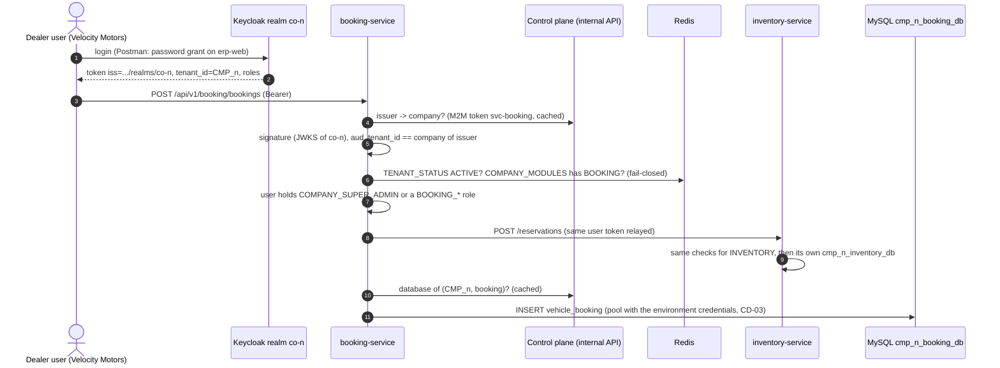

# Car-dealer microservices (multi-tenant, SOLID)

Three Spring Boot microservices for a **car dealer company**, run as **one deployment for every company**.
The control plane in `poc/` onboards companies (order → payment → provisioning). The services never take the
company from the client. Every request carries a company-realm token (`co-<n>`, `tenant_id = CMP_<n>`), and the
service routes it to that company's own database `cmp_<n>_<module>_db`.

| Service | Port | Module (gateway token) | What it does | Calls |
|---|---|---|---|---|
| `vehicle-service` | 8091 | `vehicle` (`VEHICLE`) | Car models: code, body, fuel, base price | — |
| `inventory-service` | 8092 | `inventory` (`INVENTORY`) | Physical cars by VIN; atomic reservations for bookings | vehicle-service (model exists?) |
| `booking-service` | 8093 | `booking` (`BOOKING`) | Customer bookings: price → reserve a car → book; cancel, deliver | vehicle-service (price), inventory-service (reserve / release / sell) |
| `tenant-starter` | — | library | Everything that makes a service multi-tenant (below) | control plane internal API |

Catalog (control plane seed `db/changelog/cp/003-seed-automotive.sql`, illustrative prices):
`inventory` requires `vehicle`; `booking` requires `inventory` and `vehicle` (mandatory dependencies are added to
the quote automatically). Bundle `AUTO_DEALER` = all three.

## How a request is handled



Errors keep one contract everywhere (problem details with `code`): 401 for a missing / foreign token,
`COMPANY_NOT_READY` 503, `COMPANY_SUSPENDED` 403, `MODULE_NOT_ENTITLED` 403, `MODULE_ACCESS_DENIED` 403,
`UNKNOWN_MODEL` 422, `OUT_OF_STOCK` 409, `INVALID_BOOKING_STATE` 409. A callee's error reaches the client unchanged.

## SOLID, concretely

| Principle | Where |
|---|---|
| **S**ingle responsibility | Each service owns one bounded context. Inside it, `api/` only validates and maps HTTP, `application/` holds the use cases, `domain/` holds records and ports, `infrastructure/` holds SQL and HTTP adapters. Tenant concerns live only in `tenant-starter`. |
| **O**pen/closed | The tenant gate runs every `TenantAccessRule` bean in order (`CompanyStatusRule` → `ModuleEntitlementRule` → `ModuleAccessRule`). A new check, e.g. `@RequiresPermission` (PHASE_01 §6.6.2 step 9), is a new bean; the interceptor is not changed. |
| **L**iskov substitution | Every port has interchangeable implementations: `JdbcBookingRepository` and the in-memory fakes in the unit tests obey the same contract (e.g. `transition` is compare-and-set), so `BookingService` behaves the same with either. |
| **I**nterface segregation | Narrow ports per consumer: inventory sees only `VehicleCatalog.modelExists`; booking sees `VehiclePricing.priceOf` and `VehicleReservations` — not the whole remote API. The starter splits `CompanyIssuerRegistry`, `TenantDatabaseLocator`, `RuntimeStateReader`, `ServiceTokenProvider`. |
| **D**ependency inversion | Use cases depend on interfaces (`BookingRepository`, `VehicleReservations`, `BookingNumberGenerator`, `Clock`), never on JDBC, RestClient or Redis. The starter's beans are `@ConditionalOnMissingBean`, so any of them can be replaced. |

Tests prove the point: `BookingServiceTest`, `InventoryServiceTest`, `VehicleCatalogServiceTest` and
`TenantAccessRulesTest` run with fakes only (no Spring, DB, HTTP or Redis).

## tenant-starter (one dependency = a tenant-aware service)

| Concern | Classes |
|---|---|
| Company-realm JWTs: issuer allow-list from the CP registry, JWKS per realm, `aud`, `tenant_id` = issuer's company; platform tokens refused | `security/CompanyRealmAuthenticationManagerResolver`, `ControlPlaneCompanyIssuerRegistry` |
| Fail-closed gate: status, entitlement, module role; context bound and cleared per request | `access/*`, `context/TenantContext` |
| Routing: DB name only from the registry (VERIFIED rows), one pool per company DB, shared environment credentials, name must belong to the token's company | `routing/*` |
| M2M token of the service (`svc-<module>` in `erp-platform`) for the CP internal API | `controlplane/*` |
| Business calls to other services relay the user's token; callee errors are passed through | `outbound/TenantRestClients`, `web/ProblemResponseErrorHandler` |
| `GET /api/v1/<module>/_routing` on every service: which company and which DB served the call | `web/TenantRoutingInfoController` |

## Run it and test it live in Postman

1. Infrastructure. If Keycloak was already started **before** these services were added, reset it once. The realm
   import (which now contains the `svc-*` clients) only runs when the realm does not exist yet:

   ```bash
   docker compose down -v
   ```

   ```bash
   docker compose up -d
   ```

2. Control plane on 8080 (from `poc/`; stop any older instance on 8080 first):

   ```bash
   mvn spring-boot:run
   ```

3. Build the services (from `poc/`). On Windows, stop running services first: a running `java -jar` locks its
   jar, and the build then leaves a broken (non-executable) jar behind.

   ```bash
   mvn -f services/pom.xml package
   ```

4. Start each service in its own terminal:

   ```bash
   java -jar services/vehicle-service/target/vehicle-service-0.1.0-SNAPSHOT.jar
   ```

   ```bash
   java -jar services/inventory-service/target/inventory-service-0.1.0-SNAPSHOT.jar
   ```

   ```bash
   java -jar services/booking-service/target/booking-service-0.1.0-SNAPSHOT.jar
   ```

5. Postman: **Import** [`../postman/car-dealer-saas.postman_collection.json`](../postman/car-dealer-saas.postman_collection.json),
   then **Run collection** (or click through the requests in order). No environment is needed; the URLs are
   collection variables. Tokens refresh automatically.

The collection does the following:
1. **Onboards Velocity Motors** with the `AUTO_DEALER` bundle: create → quote → confirm → pay → provision → wait
   for ACTIVE → accept the Company Super Admin invitation (no SMTP in the POC) → company login.
2. **Onboards Apex Autos** with vehicle + inventory only.
3. **Velocity** adds models, receives cars, books one (price from vehicle-service, VIN reserved in
   inventory-service) and delivers it. `_routing` shows `cmp_<n>_vehicle_db`.
4. **Apex** calls the **same APIs** and sees only its own catalog and stock. It may reuse the code `VX-SUV` at its
   own price. Booking first gets `MODULE_NOT_ENTITLED`; after the upgrade order (`ADD_MODULE` job), booking works,
   and a second booking of the only car gets `OUT_OF_STOCK`.
5. **Guard rails:** no token or a platform token → 401; a spoofed `X-Company-Code` header changes nothing.
   Suspending Velocity blocks it in every service (`COMPANY_SUSPENDED`) while Apex keeps working. Reactivating
   restores access with the data intact.

From the CLI (Postman CLI installed), the same run:

```bash
postman collection run postman/car-dealer-saas.postman_collection.json
```

Ports, URLs and secrets can be changed with environment variables: `PORT`, `KEYCLOAK_URL`, `CONTROL_PLANE_URL`,
`REDIS_HOST`/`REDIS_PORT`, `DB_USER`/`DB_PASSWORD`, `SVC_CLIENT_SECRET`, `VEHICLE_SERVICE_URL`,
`INVENTORY_SERVICE_URL`. The Postman URLs can be overridden with `--env-var "cp=…"` or a Postman environment.

## Demo data and curl

Load three car companies with different catalogs, stock, bookings and users (`owner@`, `sales@` and `viewer@`
per company, password `Demo-Pass-1`). The script prints what each company sees through the same APIs, the role
limits inside a company, and the row counts per physical database:

```bash
bash scripts/seed-demo-data.sh
```

Recorded output of a run (the codes increase on every run):

```
  Company          Code      Models   Cars     Bookings
  Velocity Motors  CMP_110   3        6        3
  Apex Autos       CMP_111   3        5        2
  Zenith Cars      CMP_112   2        4        403 MODULE_NOT_ENTITLED

  viewer@velocity.test  models: 3, cars: 403 MODULE_ACCESS_DENIED, bookings: 403 MODULE_ACCESS_DENIED

  cmp_110_vehicle_db.vehicle_model 3        cmp_111_vehicle_db.vehicle_model 3        cmp_112_vehicle_db.vehicle_model 2
  cmp_110_inventory_db.stock_unit 6         cmp_111_inventory_db.stock_unit 5         cmp_112_inventory_db.stock_unit 4
```

Every API called with curl, with the real response bodies: [`../CURL_FLOW.md`](../CURL_FLOW.md). The script that
produced it is `bash scripts/curl-flow.sh`.

## Tests

```bash
mvn -f services/pom.xml test
```

13 unit tests: the access rules, and each service's use cases with fakes. The full system (CP + Keycloak + the
three services) is exercised by the Postman collection: 61 requests and 60 assertions passed on a clean stack.

## Simplifications (POC)

| Target (docs) | Here |
|---|---|
| API gateway in front, services not host-published (master §15.3) | Postman calls each service on its own port; each service runs the gateway checks itself (which the target also requires as re-verification) |
| Service-to-service: `X-User-Token` + the caller's M2M token (PHASE_01 §6.6.3) | The user's Bearer token is relayed; the callee re-verifies it fully. So a booking user also needs a role of inventory and vehicle (the Company Super Admin has all) |
| Each service owns and runs its tenant changelog (master §16.5) | The changelogs live in the CP (`db/tenant/vehicle.sql`, `inventory.sql`, `booking.sql`) and are run by `MIGRATE_SCHEMA`, like `crm.sql` |
| `tenant-invalidation` events close pools on suspension (§6.6.3) | Status is checked in Redis on every request (instant); registry answers are cached 30 s; idle pools close after 30 min |
| `@RequiresPermission` with `TENANT_ROLE_PERMS` (CD-12) | Not implemented: module role only (the rule chain is the extension point) |
